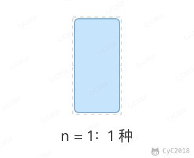
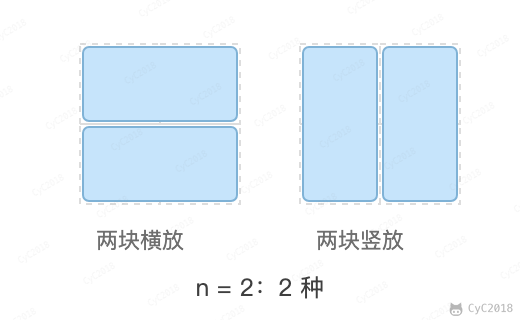
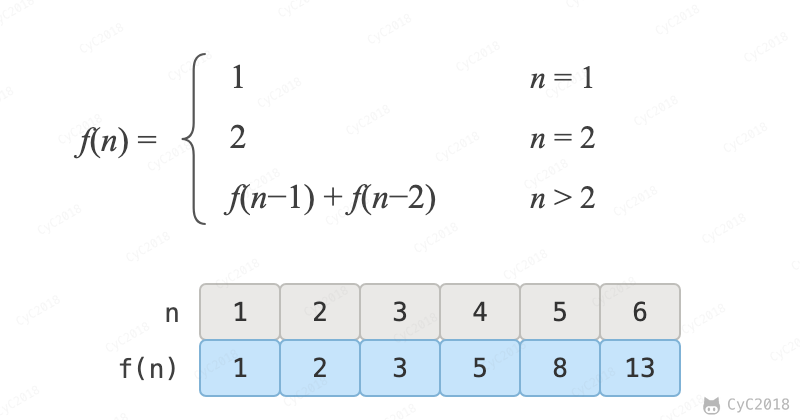

# 10.2 矩形覆盖

## 题目描述

可以用 2\*1 的小矩形横着或者竖着去覆盖更大的矩形。请问用 n 个 2\*1 的小矩形无重叠地覆盖一个 2\*n 的大矩形，总共有多少种方法？

<div align="center">  </div><br>

## 解题思路

当 n 为 1 时，只有一种覆盖方法：

<div align="center">  </div><br>

当 n 为 2 时，有两种覆盖方法：

<div align="center">  </div><br>

要覆盖 2\*n 的大矩形，看最左边一列怎么放：竖着放一块，占满第一列，剩下 2\*(n-1) 的矩形；横着放一块，它下面只能再横着放一块，两块占满前两列，剩下 2\*(n-2) 的矩形。两种放法互不重复，而覆盖 2\*(n-1) 和 2\*(n-2) 的矩形可以看成子问题。该问题的递推公式如下：

<div align="center">  </div><br>

```java
public int rectCover(int n) {
    if (n <= 2)
        return n;
    int pre2 = 1, pre1 = 2;
    int result = 0;
    for (int i = 3; i <= n; i++) {
        result = pre2 + pre1;
        pre2 = pre1;
        pre1 = result;
    }
    return result;
}
```
