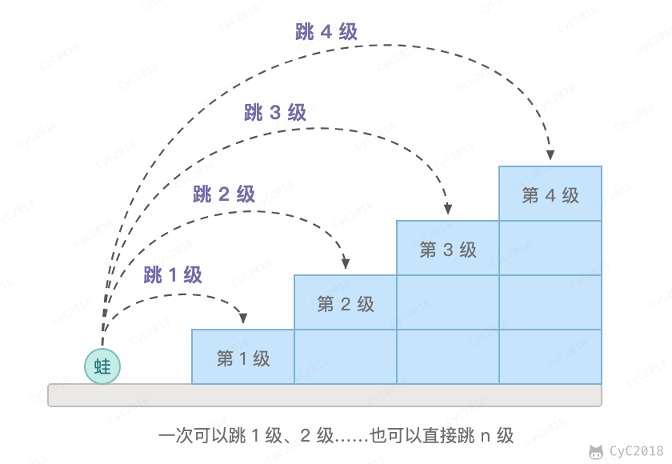

# 10.4 变态跳台阶

## 题目描述

一只青蛙一次可以跳上 1 级台阶，也可以跳上 2 级... 它也可以跳上 n 级。求该青蛙跳上一个 n 级的台阶总共有多少种跳法。

<div align="center">  </div><br>

## 解题思路

### 动态规划

dp[i] 表示跳上第 i + 1 级台阶的跳法数。最后一跳可以从地面直接跳上来（1 种），也可以从下面任意一级 j 跳上来（dp[j] 种），因此 dp[i] = 1 + dp[0] + dp[1] + …… + dp[i-1]，代码中先把每个 dp[i] 初始化为 1，再累加。时间复杂度 O(N<sup>2</sup>)。

```java
public int jumpFloorII(int target) {
    int[] dp = new int[target];
    Arrays.fill(dp, 1);
    for (int i = 1; i < target; i++)
        for (int j = 0; j < i; j++)
            dp[i] += dp[j];
    return dp[target - 1];
}
```

### 数学推导

跳上 n-1 级台阶，可以从 n-2 级跳 1 级上去，也可以从 n-3 级跳 2 级上去...，那么

```text
f(n-1) = f(n-2) + f(n-3) + ... + f(0)
```

同样，跳上 n 级台阶，可以从 n-1 级跳 1 级上去，也可以从 n-2 级跳 2 级上去... ，那么

```text
f(n) = f(n-1) + f(n-2) + ... + f(0)
```

综上可得

```text
f(n) - f(n-1) = f(n-1)
```

即

```text
f(n) = 2*f(n-1)
```

第一步的展开要求 n - 1 ≥ 1，所以上式在 n ≥ 2 时成立；又 f(1) = 1，因此 f(n) = 2<sup>n-1</sup>，例如 f(4) = 8。

```java
public int JumpFloorII(int target) {
    return (int) Math.pow(2, target - 1);
}
```
