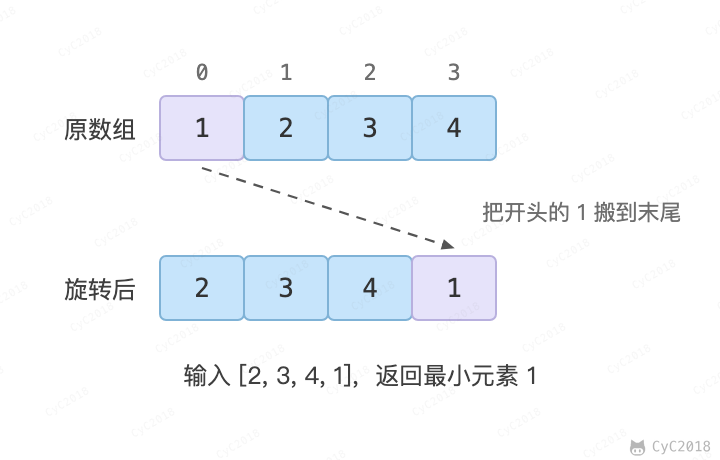
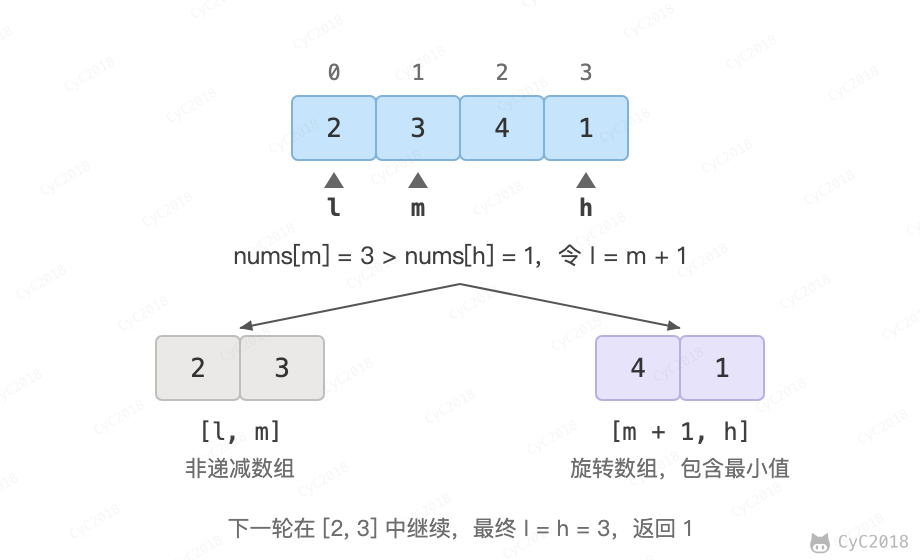

# 11. 旋转数组的最小数字

## 题目链接

[Leetcode](https://leetcode.cn/problems/xuan-zhuan-shu-zu-de-zui-xiao-shu-zi-lcof/)

## 题目描述

把一个数组最开始的若干个元素搬到数组的末尾，称之为数组的旋转。输入一个非递减排序的数组的一个旋转，输出旋转数组的最小元素。

<div align="center">  </div><br>

## 解题思路

将旋转数组对半分可以得到一个包含最小元素的新旋转数组，以及一个非递减排序的数组。新的旋转数组的长度是原数组的一半，从而将问题规模减少了一半，元素互不相同时，这种折半性质的算法的时间复杂度为 O(log<sub>2</sub>N)。

<div align="center">  </div><br>

此时问题的关键在于确定对半分得到的两个数组哪一个是旋转数组，哪一个是非递减数组。容易知道非递减数组的第一个元素一定小于等于最后一个元素。

通过修改二分查找算法进行求解（l 代表 low，m 代表 mid，h 代表 high）：

- 当 nums[m] \<= nums[h] 时，表示 [m, h] 区间内的数组是非递减数组，[l, m] 区间内的数组是旋转数组，此时令 h = m；
- 否则 [m + 1, h] 区间内的数组是旋转数组，令 l = m + 1。

需要注意的是 nums[m] 要和 nums[h] 比较，而不是和 nums[l] 比较。数组没有旋转时（例如 {1, 2, 3, 4, 5}）nums[m] \>= nums[l]，最小值在左边；旋转后（例如 {3, 4, 5, 1, 2}）同样 nums[m] \>= nums[l]，最小值却在右边，只看 nums[l] 无法区分。和 nums[h] 比较时，没有旋转的数组始终满足 nums[m] \<= nums[h]，h 一直左移，最后停在下标 0。

```java
public int inventoryManagement(int[] stock) {
    if (stock.length == 0)
        return 0;
    int l = 0, h = stock.length - 1;
    while (l < h) {
        int m = l + (h - l) / 2;
        if (stock[m] <= stock[h])
            h = m;
        else
            l = m + 1;
    }
    return stock[l];
}
```

上面的代码只适用于元素互不相同的数组。题目中的“非递减”允许元素重复，LeetCode 的测试用例中也有重复元素，这时会出现一个特殊的情况：nums[l] == nums[m] == nums[h]，此时无法确定解在哪个区间，需要切换到顺序查找。例如对于数组 {1,1,1,0,1}，l、m 和 h 指向的数都为 1，此时无法知道最小数字 0 在哪个区间。因此允许重复元素时，最坏时间复杂度为 O(N)，例如所有元素都相等。

```java
public int inventoryManagement(int[] stock) {
    if (stock.length == 0)
        return 0;
    int l = 0, h = stock.length - 1;
    while (l < h) {
        int m = l + (h - l) / 2;
        if (stock[l] == stock[m] && stock[m] == stock[h])
            return minNumber(stock, l, h);
        else if (stock[m] <= stock[h])
            h = m;
        else
            l = m + 1;
    }
    return stock[l];
}

private int minNumber(int[] nums, int l, int h) {
    for (int i = l; i < h; i++)
        if (nums[i] > nums[i + 1])
            return nums[i + 1];
    return nums[l];
}
```
