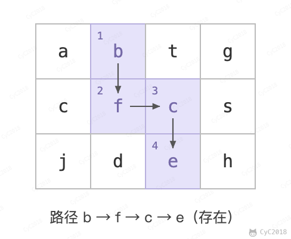
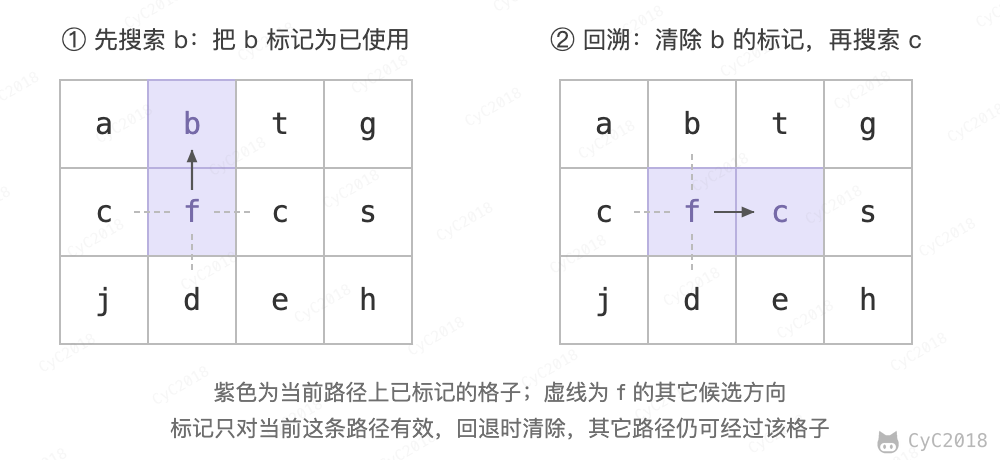

# 12. 矩阵中的路径

[Leetcode](https://leetcode.cn/problems/ju-zhen-zhong-de-lu-jing-lcof/)

## 题目描述

判断在一个矩阵中是否存在一条包含某字符串所有字符的路径。路径可以从矩阵中的任意一个格子开始，每一步可以在矩阵中向上下左右移动一个格子。如果一条路径经过了矩阵中的某一个格子，则该路径不能再进入该格子。

例如下面的矩阵包含了一条 bfce 路径。

<div align="center">  </div><br>

## 解题思路

使用回溯法（backtracking）进行求解，它是一种暴力搜索方法，通过搜索所有可能的结果来求解问题。回溯法在一次搜索结束时需要进行回溯（回退），将这一次搜索过程中设置的状态进行清除，从而开始一次新的搜索过程。例如下图示例中，从 f 开始，下一步有 4 种搜索可能，如果先搜索 b，需要将 b 标记为已经使用，防止重复使用。在这一次搜索结束之后，需要将 b 的已经使用状态清除，并搜索 c。

<div align="center">  </div><br>

```java
private final static int[][] next = {{0, -1}, {0, 1}, {-1, 0}, {1, 0}};
private int rows;
private int cols;

public boolean wordPuzzle(char[][] grid, String target) {
    if (grid == null || grid.length == 0 || grid[0].length == 0) return false;
    rows = grid.length;
    cols = grid[0].length;
    boolean[][] marked = new boolean[rows][cols];
    char[] words = target.toCharArray();
    for (int i = 0; i < rows; i++) {
        for (int j = 0; j < cols; j++) {
            if (backtracking(grid, words, marked, 0, i, j))
                return true;
        }
    }
    return false;
}

private boolean backtracking(char[][] grid, char[] words,
                             boolean[][] marked, int pathLen, int r, int c) {
    if (pathLen == words.length) return true;
    if (r < 0 || r >= rows || c < 0 || c >= cols
            || grid[r][c] != words[pathLen] || marked[r][c]) {
        return false;
    }
    if (pathLen == words.length - 1) return true;
    marked[r][c] = true;
    for (int[] n : next)
        if (backtracking(grid, words, marked, pathLen + 1, r + n[0], c + n[1]))
            return true;
    marked[r][c] = false;
    return false;
}
```
