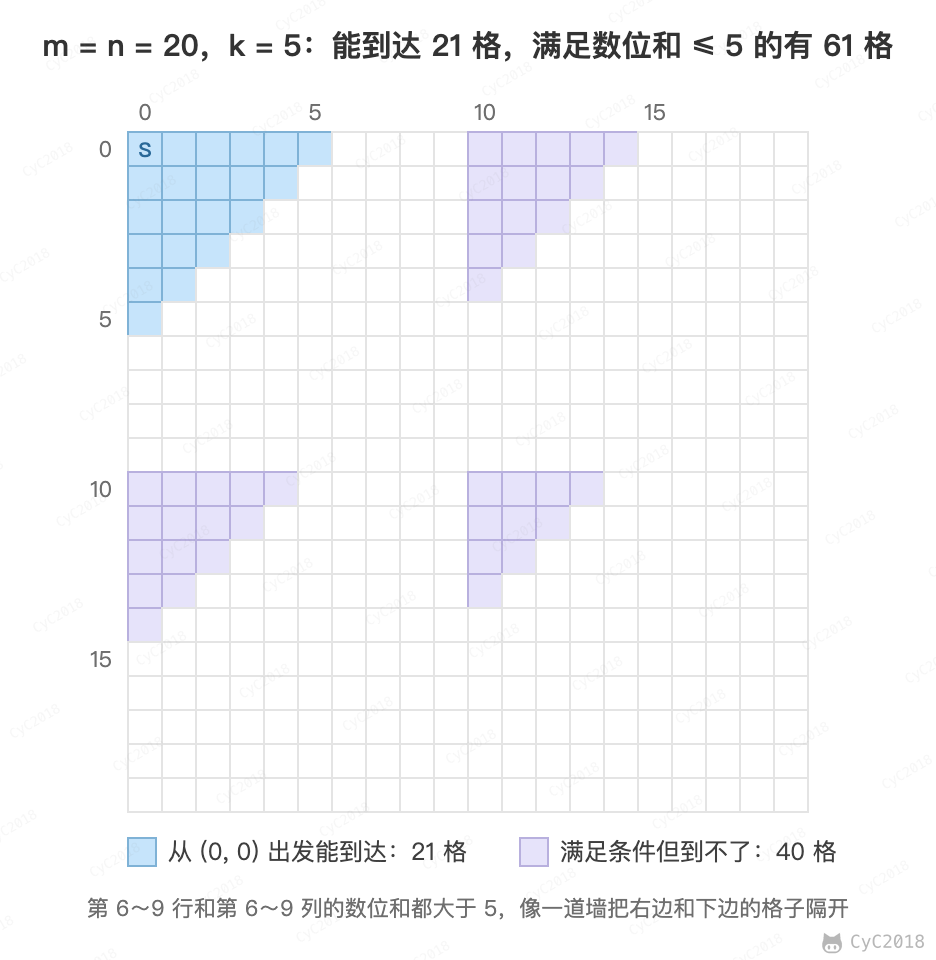

# 13. 机器人的运动范围

[Leetcode](https://leetcode.cn/problems/ji-qi-ren-de-yun-dong-fan-wei-lcof/)

## 题目描述

地上有一个 m 行和 n 列的方格。一个机器人从坐标 (0, 0) 的格子开始移动，每一次只能向左右上下四个方向移动一格，但是不能进入行坐标和列坐标的数位之和大于 k 的格子。

例如，当 k 为 18 时，机器人能够进入方格 (35,37)，因为 3+5+3+7=18。但是，它不能进入方格 (35,38)，因为 3+5+3+8=19。请问该机器人能够达到多少个格子？

## 解题思路

需要注意的是，答案不是“数位和不大于 k 的格子数”。机器人只能一格一格地走，满足条件的格子如果被不满足条件的格子隔开，就到不了。例如 m = n = 20、k = 5 时，满足条件的格子有 61 个，能到达的只有 21 个：

<div align="center">  </div><br>

因此要从 (0, 0) 出发搜索，只统计能走到的格子。使用深度优先搜索（Depth First Search，DFS）：进入一个格子时先标记，避免重复计数；数位和超过 k 的格子不计数，也不再从它往外走。每个格子最多访问一次，时间复杂度 O(MN)。

回溯是深度优先搜索的一种特例，它在一次搜索过程中需要设置一些本次搜索过程的局部状态，并在本次搜索结束之后清除状态。本题的标记是全局的，走到过的格子不需要再走，所以搜索结束后不清除标记，这一点和[矩阵中的路径](12.%20矩阵中的路径.md)不同。

力扣上对应的 LCR 130 只允许向右和向下移动。按本题的数位和规则，在它的数据范围（m、n ≤ 100，k ≤ 20）内，两种走法能到达的格子相同，下面的代码同样适用。

```java
private static final int[][] next = {{0, -1}, {0, 1}, {-1, 0}, {1, 0}};
private int res = 0;
private int rows;
private int cols;
private int threshold;
private int[][] digitSum;

public int wardrobeFinishing(int m, int n, int cnt) {
    this.rows = m;
    this.cols = n;
    this.threshold = cnt;
    this.res = 0;
    initDigitSum();
    boolean[][] marked = new boolean[rows][cols];
    dfs(marked, 0, 0);
    return res;
}

private void dfs(boolean[][] marked, int r, int c) {
    if (r < 0 || r >= rows || c < 0 || c >= cols || marked[r][c])
        return;
    marked[r][c] = true;
    if (this.digitSum[r][c] > this.threshold)
        return;
    res++;
    for (int[] n : next)
        dfs(marked, r + n[0], c + n[1]);
}

private void initDigitSum() {
    int[] digitSumOne = new int[Math.max(rows, cols)];
    for (int i = 0; i < digitSumOne.length; i++) {
        int n = i;
        while (n > 0) {
            digitSumOne[i] += n % 10;
            n /= 10;
        }
    }
    this.digitSum = new int[rows][cols];
    for (int i = 0; i < this.rows; i++)
        for (int j = 0; j < this.cols; j++)
            this.digitSum[i][j] = digitSumOne[i] + digitSumOne[j];
}
```
