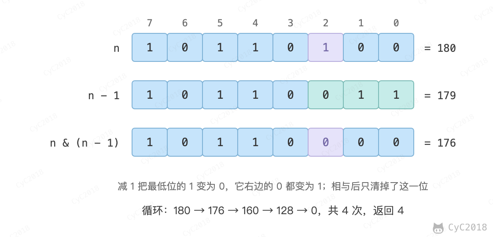

# 15. 二进制中 1 的个数

## 题目链接

[Leetcode](https://leetcode.cn/problems/er-jin-zhi-zhong-1de-ge-shu-lcof/)

## 题目描述

输入一个整数，输出该数二进制表示中 1 的个数。

## 解题思路

n&(n-1) 位运算可以将 n 的位级表示中最低的那一位 1 设置为 0。这是因为 n - 1 会把 n 最低位的 1 变成 0、它右边的 0 全部变成 1，更高的位不变，两者相与后最低位的 1 及其右边都变成 0。不断将 1 设置为 0，直到 n 为 0。时间复杂度：O(M)，其中 M 表示 1 的个数。

<div align="center">  </div><br>


```java
public int hammingWeight(int n) {
    int cnt = 0;
    while (n != 0) {
        cnt++;
        n &= (n - 1);
    }
    return cnt;
}
```
