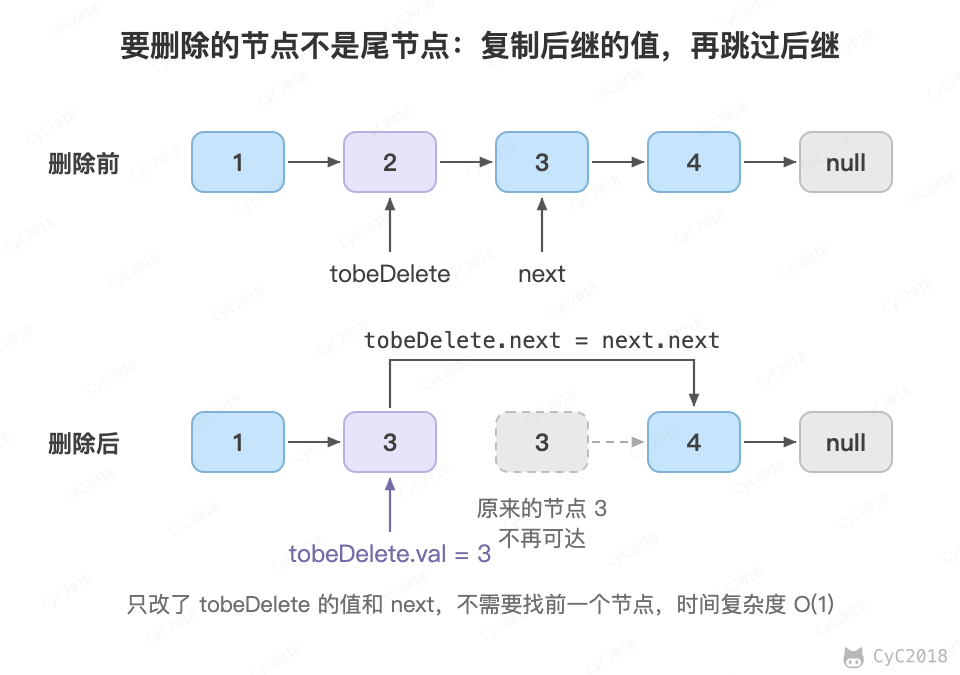
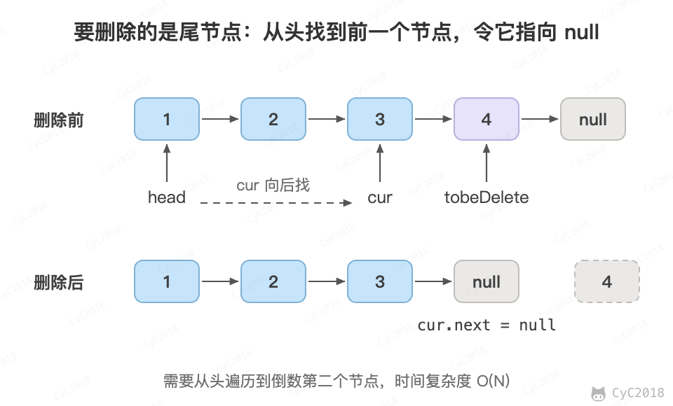

# 18.1 在 O(1) 时间内删除链表节点

## 题目描述

给定单向链表的头节点和其中一个要删除的节点，在 O(1) 时间内删除该节点。

## 解题思路

单向链表删除节点通常要先找到它的前一个节点，需要 O(N)。本题换一个思路：不删除这个节点本身，而是把下一个节点的内容复制过来，再删掉下一个节点。

① 如果该节点不是尾节点，那么可以直接将下一个节点的值赋给该节点，然后令该节点指向下下个节点，再删除下一个节点，时间复杂度为 O(1)。

<div align="center">  </div><br>

② 否则，就需要先遍历链表，找到节点的前一个节点，然后让前一个节点指向 null，时间复杂度为 O(N)。

<div align="center">  </div><br>

设链表有 N 个节点，要删除的节点是其中任意一个的机会相同。N - 1 个非尾节点各需 O(1)，只有尾节点需要 O(N)，平均时间为 [(N - 1) × O(1) + O(N)] / N，仍是 O(1)。需要注意的是，这是对一次随机删除的平均，删除尾节点的最坏情况仍是 O(N)，例如每次都删除当前的尾节点，总时间是 O(N<sup>2</sup>)。

```java
public ListNode deleteNode(ListNode head, ListNode tobeDelete) {
    if (head == null || tobeDelete == null)
        return head;
    if (tobeDelete.next != null) {
        // 要删除的节点不是尾节点
        ListNode next = tobeDelete.next;
        tobeDelete.val = next.val;
        tobeDelete.next = next.next;
    } else {
        if (head == tobeDelete)
             // 只有一个节点
            head = null;
        else {
            ListNode cur = head;
            while (cur.next != tobeDelete)
                cur = cur.next;
            cur.next = null;
        }
    }
    return head;
}
```
