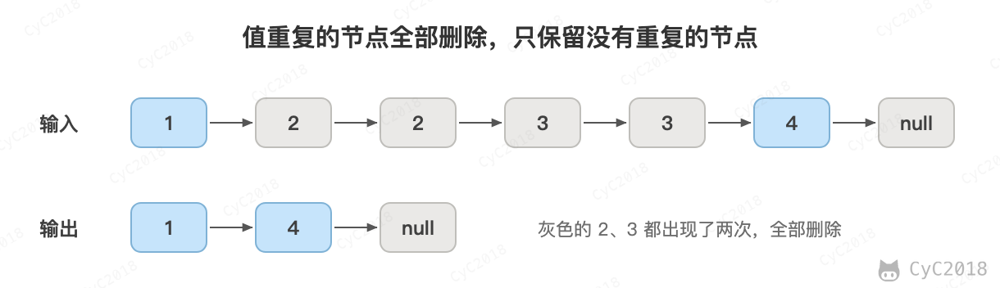

# 18.2 删除链表中重复的结点

[Leetcode](https://leetcode.cn/problems/remove-duplicates-from-sorted-list-ii/)

## 题目描述

<div align="center">  </div><br>

## 解题描述

```java
public ListNode deleteDuplicates(ListNode head) {
    if (head == null || head.next == null)
        return head;
    ListNode next = head.next;
    if (head.val == next.val) {
        while (next != null && head.val == next.val)
            next = next.next;
        return deleteDuplicates(next);
    } else {
        head.next = deleteDuplicates(head.next);
        return head;
    }
}
```
