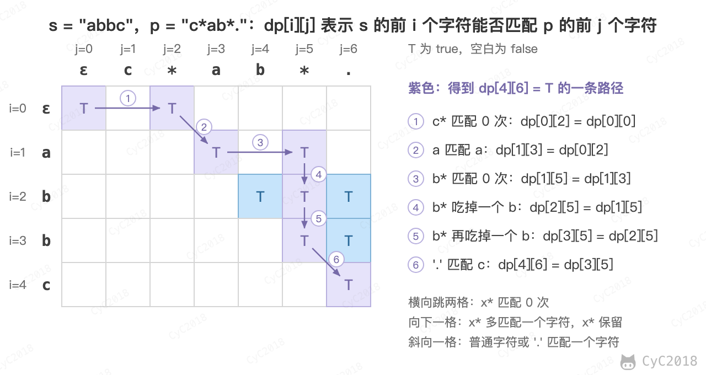

# 19. 正则表达式匹配

[Leetcode](https://leetcode.cn/problems/zheng-ze-biao-da-shi-pi-pei-lcof/)

## 题目描述

请实现一个函数用来匹配包括 '.' 和 '\*' 的正则表达式。模式中的字符 '.' 表示任意一个字符，而 '\*' 表示它前面的字符可以出现任意次（包含 0 次）。

在本题中，匹配是指字符串的所有字符匹配整个模式。例如，字符串 "aaa" 与模式 "a.a" 和 "ab\*ac\*a" 匹配，但是与 "aa.a" 和 "ab\*a" 均不匹配。

## 解题思路

'\*' 不能单独看，它和前面的字符构成一个整体 "x\*"，表示 x 出现 0 次或多次；'.' 只匹配一个任意字符，不会重复。

用动态规划求解。dp[i][j] 表示 s 的前 i 个字符能否匹配 p 的前 j 个字符，按 p 的第 j 个字符分情况：

- p[j-1] 是普通字符或 '.'：它必须和 s[i-1] 匹配，并且前面的部分也要匹配，dp[i][j] = dp[i-1][j-1]；
- p[j-1] 是 '\*'，记前一个字符为 x：让 "x\*" 匹配 0 次，相当于删掉这两个字符，dp[i][j] = dp[i][j-2]；如果 x 能匹配 s[i-1]（相等或 x 为 '.'），还可以让 "x\*" 吃掉 s[i-1]，而 "x\*" 本身保留下来继续匹配前面的字符，dp[i][j] = dp[i-1][j]。两种情况有一种成立即可。

初始时 dp[0][0] = true；空串只能被 "a\*b\*" 这类每个字符都带 '\*' 的模式匹配，因此 p[j-1] 为 '\*' 时 dp[0][j] = dp[0][j-2]。

以 s = "abbc"、p = "c\*ab\*." 为例，dp 表和得到结果的一条路径如下：

<div align="center">  </div><br>

```java
public boolean articleMatch(String s, String p) {
    int m = s.length(), n = p.length();
    boolean[][] dp = new boolean[m + 1][n + 1];
    dp[0][0] = true;
    for (int j = 2; j <= n; j++)
        if (p.charAt(j - 1) == '*')
            dp[0][j] = dp[0][j - 2];
    for (int i = 1; i <= m; i++) {
        for (int j = 1; j <= n; j++) {
            char sc = s.charAt(i - 1), pc = p.charAt(j - 1);
            if (pc == sc || pc == '.') {
                dp[i][j] = dp[i - 1][j - 1];
            } else if (pc == '*') {
                char x = p.charAt(j - 2);
                dp[i][j] = dp[i][j - 2]                           // x* 匹配 0 次
                        || ((x == sc || x == '.') && dp[i - 1][j]); // x* 再匹配一个 sc
            }
        }
    }
    return dp[m][n];
}
```

时间和空间复杂度都是 O(MN)。
