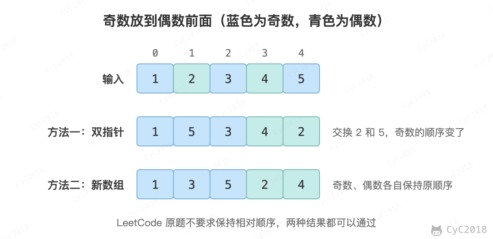

# 21. 调整数组顺序使奇数位于偶数前面

## 题目链接

[Leetcode](https://leetcode.cn/problems/diao-zheng-shu-zu-shun-xu-shi-qi-shu-wei-yu-ou-shu-qian-mian-lcof/)

## 题目描述

将所有奇数调整到偶数之前。LeetCode 原题不要求保证奇数和偶数各自的相对位置不变。

<div align="center">  </div><br>

## 解题思路

### 方法一：双指针（不要求相对顺序）

使用首尾双指针，左指针寻找偶数，右指针寻找奇数，找到后交换位置。时间复杂度 O(N)，空间复杂度 O(1)。

需要注意的是，题目保证元素非负，所以可以用 x % 2 == 1 判断奇数。数组中有负数时，Java 中 -3 % 2 等于 -1，负奇数在两个判断中都不成立，例如 [-3, 2, -1] 会让两个指针停在原地反复交换而死循环，这时要改用 x % 2 != 0。

```java
public int[] trainingPlan(int[] actions) {
    int i = 0, j = actions.length - 1;
    while (i < j) {
        while (i < j && actions[i] % 2 == 1) i++;
        while (i < j && actions[j] % 2 == 0) j--;
        int t = actions[i];
        actions[i] = actions[j];
        actions[j] = t;
    }
    return actions;
}
```

### 方法二：新建数组（保持相对顺序）

如果需要保证奇数之间、偶数之间的相对位置不变，可以先统计奇数个数，再借助新数组按顺序存放。时间复杂度 O(N)，空间复杂度 O(N)。

```java
public int[] trainingPlan(int[] actions) {
    int oddCnt = 0;
    for (int x : actions)
        if (x % 2 == 1)
            oddCnt++;
    int[] copy = actions.clone();
    int i = 0, j = oddCnt;
    for (int num : copy) {
        if (num % 2 == 1)
            actions[i++] = num;
        else
            actions[j++] = num;
    }
    return actions;
}
```
