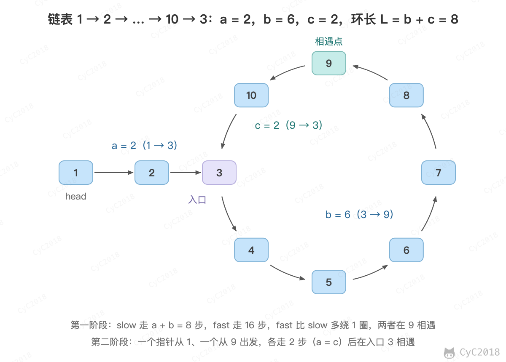

# 23. 链表中环的入口结点

[Leetcode](https://leetcode.cn/problems/linked-list-cycle-ii/)

## 题目描述

一个链表中包含环，请找出该链表的环的入口结点。要求不能使用额外的空间。

## 解题思路

使用快慢指针分两个阶段：

- 第一阶段：fast 每次走两步，slow 每次走一步。两者进入环后，fast 每步都比 slow 多走一步，相当于从后面一格一格追上 slow，因此必定在环中的某个节点相遇；
- 第二阶段：一个指针回到头节点，另一个留在相遇点，两者每次都走一步，再次相遇的节点就是环的入口。

第二阶段成立的原因如下。设头节点到入口的距离为 a，入口到相遇点的距离为 b，相遇点继续走到入口的距离为 c，环长 L = b + c。

- slow 走了 a + b。slow 刚进入环时，fast 已经在环中，落后 slow 不到一圈，每步追近一格，所以 slow 走完一圈之前就会被追上；
- fast 走了 a + b + kL（k ≥ 1，fast 比 slow 多绕的圈数）；
- fast 走的路程是 slow 的两倍：2(a + b) = a + b + kL，整理得 a = kL - b = (k - 1)L + c。

a = (k - 1)L + c 说明：从头节点走 a 步到达入口时，从相遇点出发的指针恰好走了 c 步再绕 k - 1 圈，也停在入口，两者在入口相遇。

<div align="center">  </div><br>

```java
public ListNode detectCycle(ListNode head) {
    if (head == null || head.next == null)
        return null;
    ListNode slow = head, fast = head;
    while (fast != null && fast.next != null) {
        slow = slow.next;
        fast = fast.next.next;
        if (slow == fast) {
            fast = head;
            while (slow != fast) {
                slow = slow.next;
                fast = fast.next;
            }
            return slow;
        }
    }
    return null;
}
```
