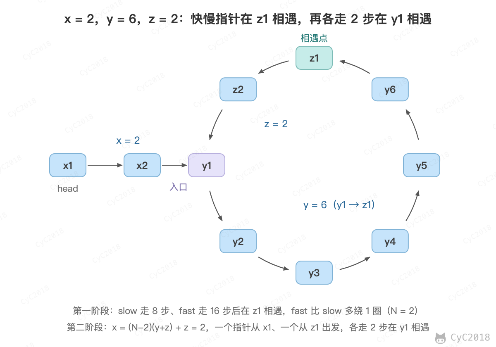

# 23. 链表中环的入口结点

[Leetcode](https://leetcode.cn/problems/linked-list-cycle-ii/)

## 题目描述

一个链表中包含环，请找出该链表的环的入口结点。要求不能使用额外的空间。

## 解题思路

使用双指针，一个快指针 fast 每次移动两个节点，一个慢指针 slow 每次移动一个节点。因为存在环，所以两个指针必定相遇在环中的某个节点上。

假设环入口节点为 y1，相遇所在节点为 z1。

假设快指针 fast 在圈内绕了 N 圈，则总路径长度为 x+Ny+(N-1)z。z 为 (N-1) 倍是因为快慢指针最后已经在 z1 节点相遇了，后面就不需要再走了。

而慢指针 slow 总路径长度为 x+y。

因为快指针是慢指针的两倍，因此 x+Ny+(N-1)z = 2(x+y)。

要找的是环入口节点 y1，也可以看成寻找长度 x 的值，因此先将上面的等式整理为和 x 有关：x=(N-2)y+(N-1)z。

上面的等式没有很强的规律，但是 y+z 就是圆环的总长度，因此将上面的等式再分解：x=(N-2)(y+z)+z。这个等式左边是从起点 x1 到环入口节点 y1 的长度，而右边是在圆环中走过 (N-2) 圈，再从相遇点 z1 再走过长度为 z 的长度。因此如果让两个指针同时从起点 x1 和相遇点 z1 开始，每次只走过一个距离，那么最后它们会在环入口节点相遇。

<div align="center">  </div><br>

```java
public ListNode detectCycle(ListNode head) {
    if (head == null || head.next == null)
        return null;
    ListNode slow = head, fast = head;
    while (fast != null && fast.next != null) {
        slow = slow.next;
        fast = fast.next.next;
        if (slow == fast) {
            fast = head;
            while (slow != fast) {
                slow = slow.next;
                fast = fast.next;
            }
            return slow;
        }
    }
    return null;
}
```
