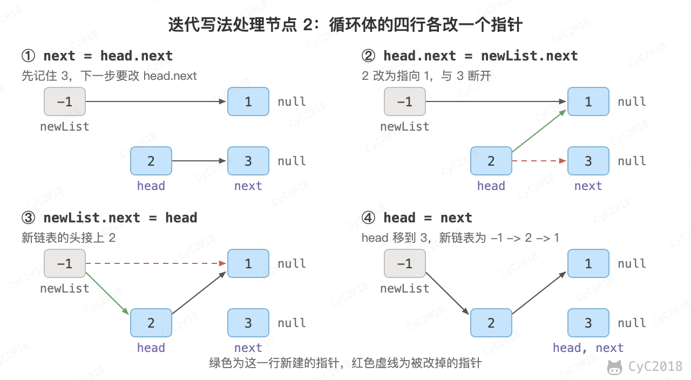

# 24. 反转链表

[Leetcode](https://leetcode.cn/problems/fan-zhuan-lian-biao-lcof/)

## 题目描述

反转一个单链表，例如 1 -\> 2 -\> 3 反转后为 3 -\> 2 -\> 1。

## 解题思路

### 递归

先断开头节点，把后面的链表递归反转，再把头节点接到反转结果的末尾。原来的第二个节点 next 反转后正好位于末尾，所以只要执行 next.next = head。以 1 -\> 2 -\> 3 为例：

```text
断开头节点      1 -> null        2 -> 3 -> null      next = 2
递归反转后半段  1 -> null        3 -> 2 -> null      newHead = 3，next 仍指向 2
next.next = 1   3 -> 2 -> 1 -> null
```

```java
public ListNode trainningPlan(ListNode head) {
    if (head == null || head.next == null)
        return head;
    ListNode next = head.next;
    head.next = null;
    ListNode newHead = trainningPlan(next);
    next.next = head;
    return newHead;
}
```

### 迭代

使用头插法：依次取下原链表的节点，插到新链表的头部，先取下的节点最后排在末尾。头插法的过程见[从尾到头打印链表](6.%20从尾到头打印链表.md#2-使用头插法)。以 1 -\> 2 -\> 3 为例：

```text
取下 1    newList -> 1 -> null             剩下 2 -> 3
取下 2    newList -> 2 -> 1 -> null        剩下 3
取下 3    newList -> 3 -> 2 -> 1 -> null   剩下 null
```

以取下 2 为例：

<div align="center">  </div><br>

每一步要先用 next 记住 head.next，再修改 head.next，否则后面的链表就丢了。newList.next 相当于常见写法中的 pre 指针，时间复杂度 O(N)，空间复杂度 O(1)；递归写法需要 O(N) 的栈空间。

```java
public ListNode trainningPlan(ListNode head) {
    ListNode newList = new ListNode(-1);
    while (head != null) {
        ListNode next = head.next;
        head.next = newList.next;
        newList.next = head;
        head = next;
    }
    return newList.next;
}
```
