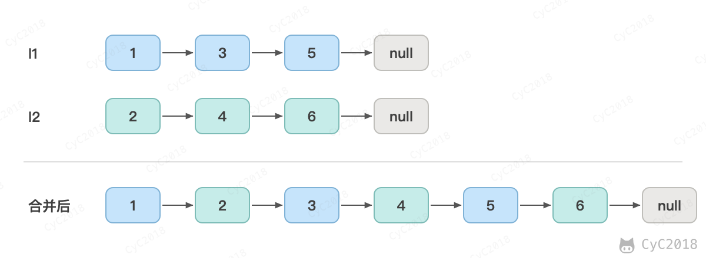

# 25. 合并两个排序的链表

[Leetcode](https://leetcode.cn/problems/he-bing-liang-ge-pai-xu-de-lian-biao-lcof/)

## 题目描述

<div align="center">  </div><br>

## 解题思路

### 递归

比较两个链表的头节点，较小的那个作为合并结果的头节点，它的 next 指向剩余部分合并的结果，剩余部分的合并是同一个问题。

```java
public ListNode trainningPlan(ListNode l1, ListNode l2) {
    if (l1 == null)
        return l2;
    if (l2 == null)
        return l1;
    if (l1.val <= l2.val) {
        l1.next = trainningPlan(l1.next, l2);
        return l1;
    } else {
        l2.next = trainningPlan(l1, l2.next);
        return l2;
    }
}
```

### 迭代

用一个不存值的头结点 head 简化边界处理，cur 指向合并结果的末尾。每次把两个链表中较小的头节点接到 cur 后面，一个链表用完后，把另一个链表剩下的部分整个接上。

```java
public ListNode trainningPlan(ListNode l1, ListNode l2) {
    ListNode head = new ListNode(-1);
    ListNode cur = head;
    while (l1 != null && l2 != null) {
        if (l1.val <= l2.val) {
            cur.next = l1;
            l1 = l1.next;
        } else {
            cur.next = l2;
            l2 = l2.next;
        }
        cur = cur.next;
    }
    if (l1 != null)
        cur.next = l1;
    if (l2 != null)
        cur.next = l2;
    return head.next;
}
```
