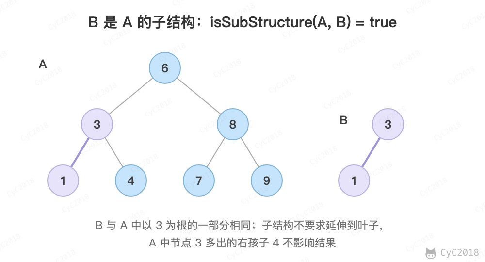

# 26. 树的子结构

## 题目链接

[Leetcode](https://leetcode.cn/problems/shu-de-zi-jie-gou-lcof/)

## 题目描述

<div align="center">  </div><br>

## 解题思路

```java
public boolean isSubStructure(TreeNode A, TreeNode B) {
    if (A == null || B == null)
        return false;
    return isSubtreeWithRoot(A, B) || isSubStructure(A.left, B) || isSubStructure(A.right, B);
}

private boolean isSubtreeWithRoot(TreeNode root1, TreeNode root2) {
    if (root2 == null)
        return true;
    if (root1 == null)
        return false;
    if (root1.val != root2.val)
        return false;
    return isSubtreeWithRoot(root1.left, root2.left) && isSubtreeWithRoot(root1.right, root2.right);
}
```
