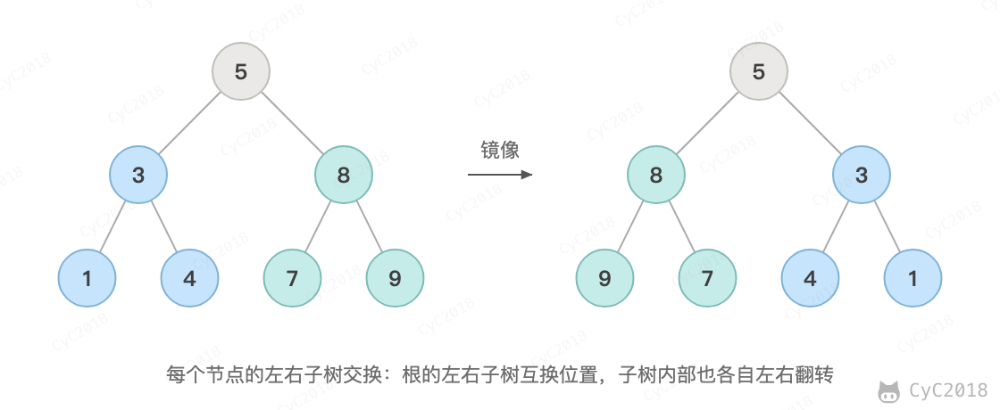

# 27. 二叉树的镜像

[Leetcode](https://leetcode.cn/problems/er-cha-shu-de-jing-xiang-lcof/)

## 题目描述

<div align="center">  </div><br>

## 解题思路

镜像就是每个节点的左右子树都交换。交换根节点的左右孩子，再递归地对左右子树做同样的操作即可，先交换还是先递归都可以。

```java
public TreeNode flipTree(TreeNode root) {
    if (root == null)
        return root;
    swap(root);
    flipTree(root.left);
    flipTree(root.right);
    return root;
}

private void swap(TreeNode root) {
    TreeNode t = root.left;
    root.left = root.right;
    root.right = t;
}
```
