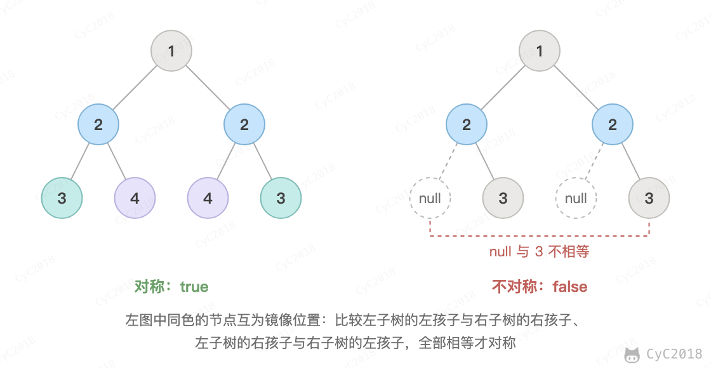

# 28. 对称的二叉树

[Leetcode](https://leetcode.cn/problems/dui-cheng-de-er-cha-shu-lcof/)

## 题目描述

判断一棵二叉树是不是对称的，也就是它和它的镜像是否相同。

<div align="center">  </div><br>

## 解题思路

```java
public boolean checkSymmetricTree(TreeNode root) {
    if (root == null)
        return true;
    return checkSymmetricTree(root.left, root.right);
}

private boolean checkSymmetricTree(TreeNode t1, TreeNode t2) {
    if (t1 == null && t2 == null)
        return true;
    if (t1 == null || t2 == null)
        return false;
    if (t1.val != t2.val)
        return false;
    return checkSymmetricTree(t1.left, t2.right) && checkSymmetricTree(t1.right, t2.left);
}
```
