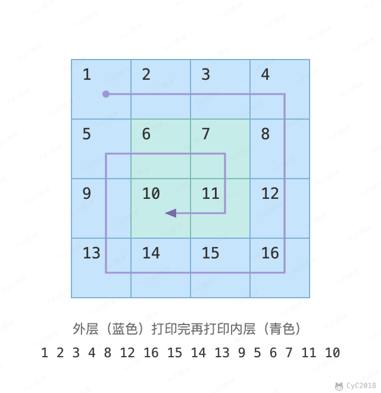
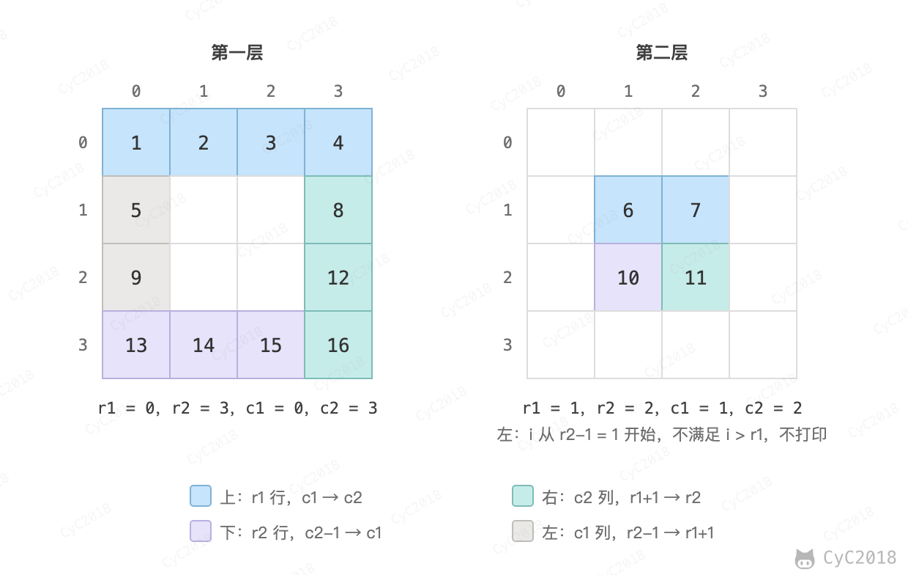

# 29. 顺时针打印矩阵

## 题目链接

[Leetcode](https://leetcode.cn/problems/shun-shi-zhen-da-yin-ju-zhen-lcof/)

## 题目描述

按顺时针的方向，从外到里打印矩阵的值。下图的矩阵打印结果为：1, 2, 3, 4, 8, 12, 16, 15, 14, 13, 9, 5, 6, 7, 11, 10

<div align="center">  </div><br>


## 解题思路

一层一层从外到里打印，每一层的处理步骤相同，只是上下左右的边界不同。因此使用四个变量 r1, r2, c1, c2 分别存储上下左右边界值，从而定义当前最外层。打印当前最外层的顺序：从左到右打印最上一行-\>从上到下打印最右一行-\>从右到左打印最下一行-\>从下到上打印最左一行，打印完把四个边界各向内收缩一格。

需要注意的是，只有在 r1 != r2 时才打印最下一行：当前最外层只有一行时，最下一行就是刚打印过的最上一行，再打印会重复。同理，只有在 c1 != c2 时才打印最左一列。

<div align="center">  </div><br>

```java
public int[] spiralArray(int[][] array) {
    if (array == null || array.length == 0 || array[0].length == 0) {
        return new int[0];
    }
    int m = array.length, n = array[0].length;
    int[] ret = new int[m * n];
    int idx = 0;
    int r1 = 0, r2 = m - 1, c1 = 0, c2 = n - 1;
    while (r1 <= r2 && c1 <= c2) {
        // 上
        for (int i = c1; i <= c2; i++) {
            ret[idx++] = array[r1][i];
        }
        // 右
        for (int i = r1 + 1; i <= r2; i++) {
            ret[idx++] = array[i][c2];
        }
        if (r1 != r2) {
            // 下
            for (int i = c2 - 1; i >= c1; i--) {
                ret[idx++] = array[r2][i];
            }
        }
        if (c1 != c2) {
            // 左
            for (int i = r2 - 1; i > r1; i--) {
                ret[idx++] = array[i][c1];
            }
        }
        r1++;
        r2--;
        c1++;
        c2--;
    }
    return ret;
}
```
