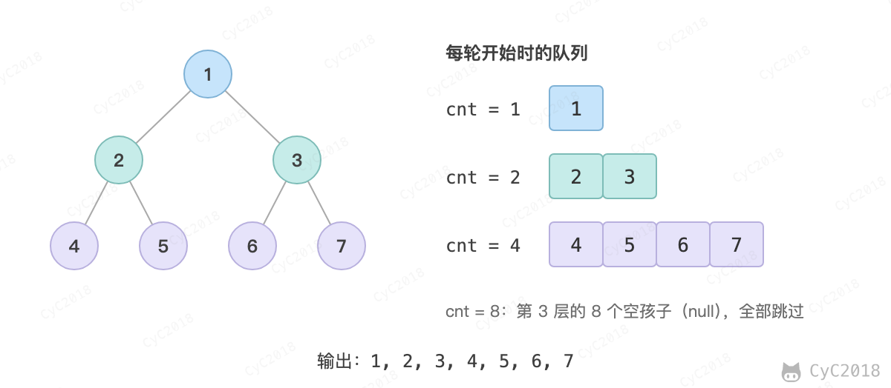

# 32.1 从上往下打印二叉树

[Leetcode](https://leetcode.cn/problems/cong-shang-dao-xia-da-yin-er-cha-shu-lcof/)

## 题目描述

从上往下打印出二叉树的每个节点，同层节点从左至右打印。

例如，以下二叉树层次遍历的结果为：1,2,3,4,5,6,7

<div align="center">  </div><br>

## 解题思路

使用队列来进行层次遍历。

不需要使用两个队列分别存储当前层的节点和下一层的节点，因为在开始遍历一层的节点时，当前队列中的节点数就是当前层的节点数，只要控制遍历这么多节点数，就能保证这次遍历的都是当前层的节点。

```java
public int[] decorateRecord(TreeNode root) {
    if (root == null) {
        return new int[0];
    }
    Queue<TreeNode> queue = new LinkedList<>();
    ArrayList<Integer> ret = new ArrayList<>();
    queue.add(root);
    while (!queue.isEmpty()) {
        int cnt = queue.size();
        while (cnt-- > 0) {
            TreeNode t = queue.poll();
            if (t == null)
                continue;
            ret.add(t.val);
            queue.add(t.left);
            queue.add(t.right);
        }
    }
    int[] res = new int[ret.size()];
    for (int i = 0; i < ret.size(); i++) {
        res[i] = ret.get(i);
    }
    return res;
}
```
