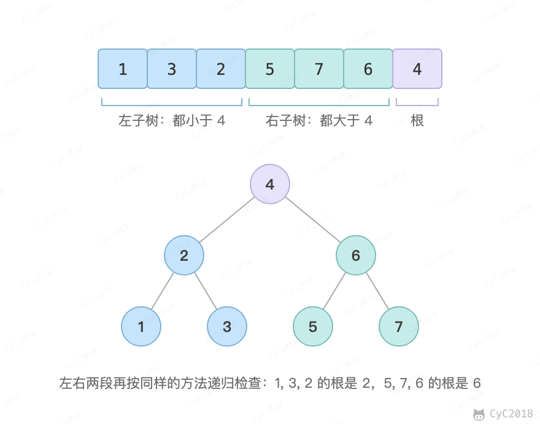

# 33. 二叉搜索树的后序遍历序列

[Leetcode](https://leetcode.cn/problems/er-cha-sou-suo-shu-de-hou-xu-bian-li-xu-lie-lcof/)

## 题目描述

输入一个整数数组，判断该数组是不是某二叉搜索树的后序遍历的结果。假设输入的数组的任意两个数字都互不相同。

例如，下图是后序遍历序列 1,3,2,5,7,6,4 所对应的二叉搜索树：最后一个元素 4 是根，前面小于 4 的 1,3,2 是左子树，大于 4 的 5,7,6 是右子树。

<div align="center">  </div><br>

## 解题思路

后序遍历的最后一个元素是根。从左往右找到第一个大于根的位置 cutIndex，它前面是左子树，从它开始到根之前是右子树。左子树的元素都小于根是这样划分出来就满足的，只需检查右子树中有没有小于根的元素，有就不是二叉搜索树；否则对左右两段递归检查。

例如 1,6,3,2,5 的根为 5，cutIndex 指向 6，右子树 6,3,2 中的 3 和 2 小于 5，返回 false。树退化成链时每层只少一个元素，最坏时间复杂度为 O(N<sup>2</sup>)。

```java
public boolean verifyTreeOrder(int[] postorder) {
    if (postorder == null || postorder.length == 0)
        return true;
    return verify(postorder, 0, postorder.length - 1);
}

private boolean verify(int[] sequence, int first, int last) {
    if (last - first <= 1)
        return true;
    int rootVal = sequence[last];
    int cutIndex = first;
    while (cutIndex < last && sequence[cutIndex] <= rootVal)
        cutIndex++;
    for (int i = cutIndex; i < last; i++)
        if (sequence[i] < rootVal)
            return false;
    return verify(sequence, first, cutIndex - 1) && verify(sequence, cutIndex, last - 1);
}
```
