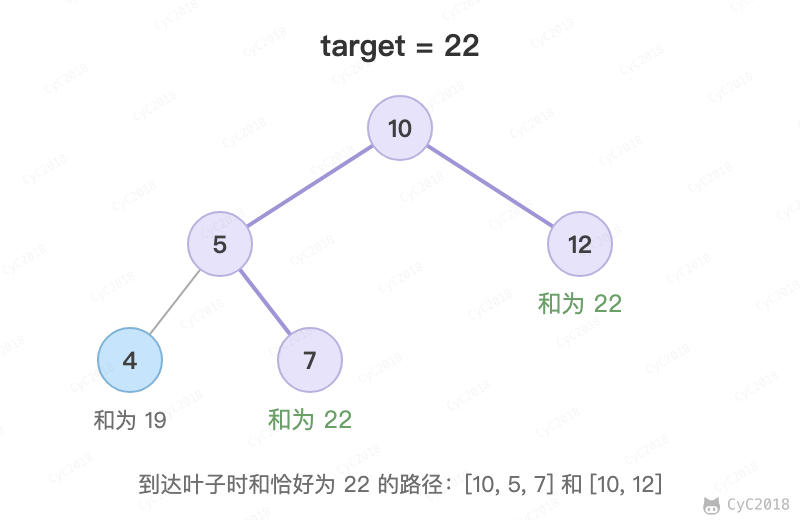

# 34. 二叉树中和为某一值的路径

[Leetcode](https://leetcode.cn/problems/er-cha-shu-zhong-he-wei-mou-yi-zhi-de-lu-jing-lcof/)

## 题目描述

输入一棵二叉树和一个整数，打印出二叉树中结点值的和为输入整数的所有路径。路径定义为从树的根结点开始往下一直到叶结点所经过的结点形成一条路径。

下图的二叉树有两条和为 22 的路径：10, 5, 7 和 10, 12

<div align="center">  </div><br>

## 解题思路

从根开始深度优先遍历，path 记录根到当前节点的路径，target 每经过一个节点就减去它的值。到达叶节点且 target 恰好为 0 时，把 path 的副本加入结果。递归返回前删除 path 的最后一个节点（回溯），使 path 回到父节点时的状态。

需要注意的是只有到叶节点才判断：节点值可能为负数，路径和中途等于 target 时后面还可能变化，也不能提前停止。

```java
private List<List<Integer>> ret = new ArrayList<>();

public List<List<Integer>> pathTarget(TreeNode root, int target) {
    ret = new ArrayList<>();
    backtracking(root, target, new ArrayList<>());
    return ret;
}

private void backtracking(TreeNode node, int target, List<Integer> path) {
    if (node == null)
        return;
    path.add(node.val);
    target -= node.val;
    if (target == 0 && node.left == null && node.right == null) {
        ret.add(new ArrayList<>(path));
    } else {
        backtracking(node.left, target, path);
        backtracking(node.right, target, path);
    }
    path.remove(path.size() - 1);
}
```
