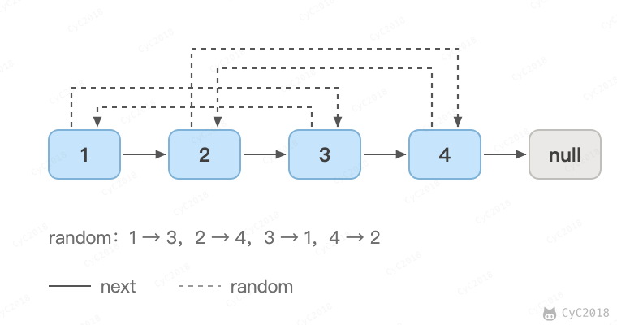
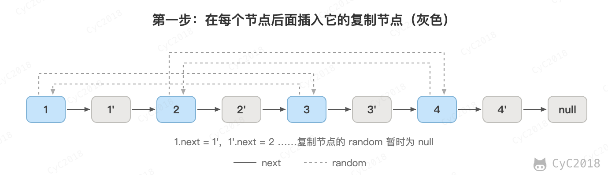
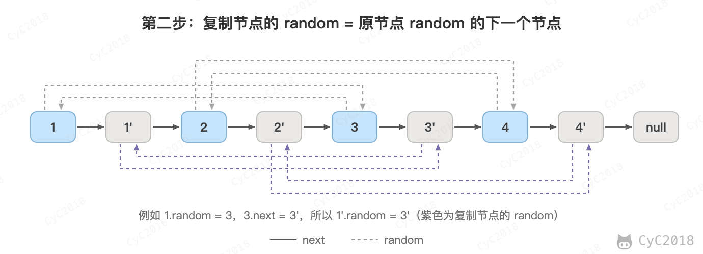
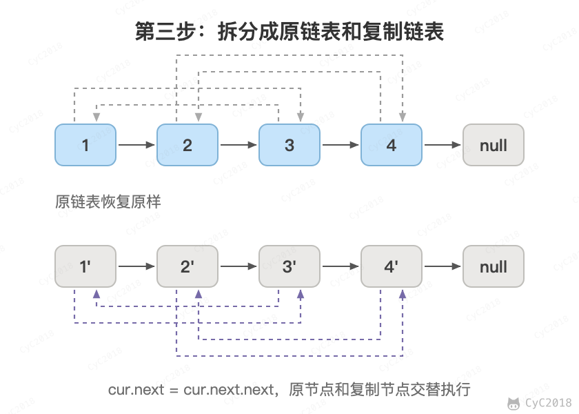

# 35. 复杂链表的复制

[Leetcode](https://leetcode.cn/problems/fu-za-lian-biao-de-fu-zhi-lcof/)

## 题目描述

输入一个复杂链表（每个节点中有节点值，以及两个指针，一个指向下一个节点，另一个特殊指针指向任意一个节点），返回结果为复制后复杂链表的 head。

```java
class Node {
    int val;
    Node next;
    Node random;

    public Node(int val) {
        this.val = val;
        this.next = null;
        this.random = null;
    }
}
```

<div align="center">  </div><br>

## 解题思路

第一步，在每个节点的后面插入复制的节点。

<div align="center">  </div><br>

第二步，对复制节点的 random 链接进行赋值。原节点 X 的复制节点就在 X 的后面，所以复制节点的 random 指向 cur.random.next。这一步是穿插复制节点的目的：用哈希表记录原节点到复制节点的映射也能做，但需要 O(N) 的额外空间。

<div align="center">  </div><br>

第三步，拆分：奇数位置的节点还原成原链表，偶数位置的节点连成复制的链表。

<div align="center">  </div><br>

```java
public Node copyRandomList(Node head) {
    if (head == null)
        return null;
    // 插入新节点
    Node cur = head;
    while (cur != null) {
        Node clone = new Node(cur.val);
        clone.next = cur.next;
        cur.next = clone;
        cur = clone.next;
    }
    // 建立 random 链接
    cur = head;
    while (cur != null) {
        Node clone = cur.next;
        if (cur.random != null)
            clone.random = cur.random.next;
        cur = clone.next;
    }
    // 拆分
    cur = head;
    Node cloneHead = head.next;
    while (cur.next != null) {
        Node next = cur.next;
        cur.next = next.next;
        cur = next;
    }
    return cloneHead;
}
```
