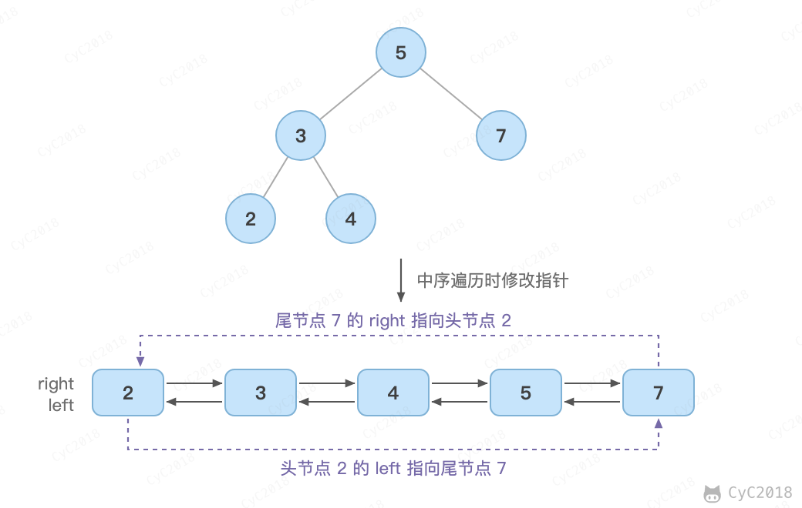

# 36. 二叉搜索树与双向链表

[Leetcode](https://leetcode.cn/problems/er-cha-sou-suo-shu-yu-shuang-xiang-lian-biao-lcof/)

## 题目描述

输入一棵二叉搜索树，将该二叉搜索树转换成一个排序的双向链表。要求不能创建任何新的结点，只能调整树中结点指针的指向。LeetCode 题目要求转换成循环双向链表，头节点的 left 指向尾节点，尾节点的 right 指向头节点。

<div align="center">  </div><br>

## 解题思路

```java
private Node pre = null;
private Node head = null;

public Node treeToDoublyList(Node root) {
    if (root == null)
        return null;
    head = null;
    pre = null;
    inOrder(root);
    head.left = pre;
    pre.right = head;
    return head;
}

private void inOrder(Node node) {
    if (node == null)
        return;
    inOrder(node.left);
    node.left = pre;
    if (pre != null)
        pre.right = node;
    pre = node;
    if (head == null)
        head = node;
    inOrder(node.right);
}
```
