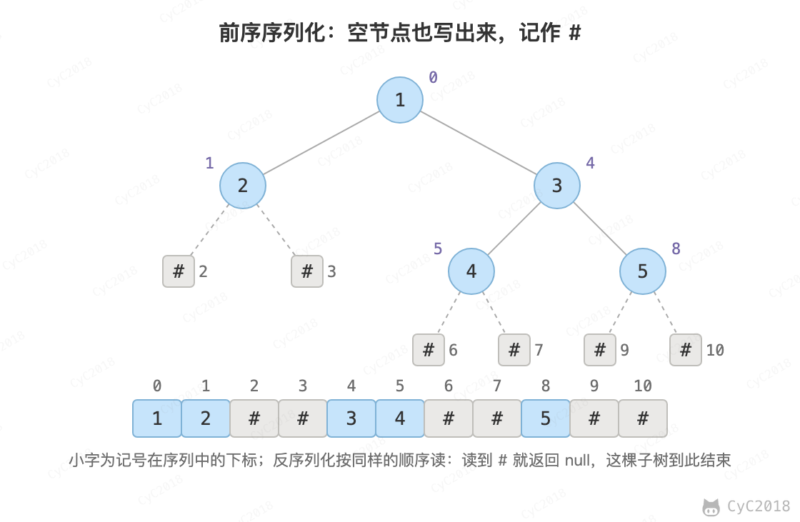

# 37. 序列化二叉树

[Leetcode](https://leetcode.cn/problems/xu-lie-hua-er-cha-shu-lcof/)

## 题目描述

请实现两个函数，分别用来序列化和反序列化二叉树。

## 解题思路

用前序遍历序列化，空节点写成 #，值之间用空格分隔。例如根为 1、左孩子为 2、右孩子 3 下面有 4 和 5 的树，序列化为：

```text
1 2 # # 3 4 # # 5 # #
```

<div align="center">  </div><br>

反序列化按同样的前序顺序读取：读到 # 返回 null，否则创建节点，再依次递归构建左子树和右子树。# 标出了每棵子树在哪里结束，因此只用前序序列就能还原出唯一的树；不记录空节点时，需要前序和中序两个序列（见 [7. 重建二叉树](7.%20重建二叉树.md)）。

序列化时所有节点追加到同一个 StringBuilder 中，时间复杂度为 O(N)。如果每层递归都返回字符串再拼接，子树的结果会被反复复制，树退化成链时为 O(N<sup>2</sup>)。

```java
class Codec {

    private String[] tokens;
    private int index;

    // Encodes a tree to a single string.
    public String serialize(TreeNode root) {
        StringBuilder sb = new StringBuilder();
        serialize(root, sb);
        return sb.toString();
    }

    private void serialize(TreeNode root, StringBuilder sb) {
        if (sb.length() > 0) {
            sb.append(' ');
        }
        if (root == null) {
            sb.append('#');
            return;
        }
        sb.append(root.val);
        serialize(root.left, sb);
        serialize(root.right, sb);
    }

    // Decodes your encoded data to tree.
    public TreeNode deserialize(String data) {
        tokens = data.split(" ");
        index = 0;
        return deserialize();
    }

    private TreeNode deserialize() {
        String node = tokens[index++];
        if (node.equals("#")) {
            return null;
        }
        TreeNode t = new TreeNode(Integer.parseInt(node));
        t.left = deserialize();
        t.right = deserialize();
        return t;
    }
}
```
