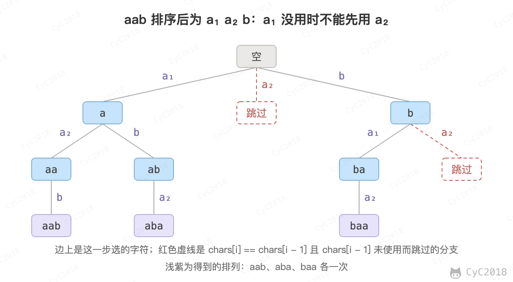

# 38. 字符串的排列

[Leetcode](https://leetcode.cn/problems/zi-fu-chuan-de-pai-lie-lcof/)

## 题目描述

输入一个字符串，按字典序打印出该字符串中字符的所有排列。例如输入字符串 abc，则打印出由字符 a, b, c 所能排列出来的所有字符串 abc, acb, bac, bca, cab 和 cba。

## 解题思路

用回溯生成排列：每一层从还没用过的字符中选一个接到 s 后面，s 的长度等于字符串长度时得到一个排列，返回后撤销这次选择，再试下一个字符。

字符串可能有重复字符，例如 aab 中两个 a 交换位置得到的是同一个排列，直接回溯会输出重复的结果。先排序让相同的字符相邻，再规定相同的字符只能按从左到右的顺序使用：chars[i] 等于 chars[i - 1] 而 chars[i - 1] 还没被使用时，跳过 chars[i]。这样 aab 只生成 aab、aba、baa 各一次。排序后按顺序选字符，输出也就是字典序。

<div align="center">  </div><br>

```java
private List<String> ret = new ArrayList<>();

public String[] goodsOrder(String goods) {
    if (goods == null || goods.length() == 0)
        return new String[0];
    ret.clear();
    char[] chars = goods.toCharArray();
    Arrays.sort(chars);
    backtracking(chars, new boolean[chars.length], new StringBuilder());
    return ret.toArray(new String[ret.size()]);
}

private void backtracking(char[] chars, boolean[] hasUsed, StringBuilder s) {
    if (s.length() == chars.length) {
        ret.add(s.toString());
        return;
    }
    for (int i = 0; i < chars.length; i++) {
        if (hasUsed[i])
            continue;
        if (i != 0 && chars[i] == chars[i - 1] && !hasUsed[i - 1]) /* 保证不重复 */
            continue;
        hasUsed[i] = true;
        s.append(chars[i]);
        backtracking(chars, hasUsed, s);
        s.deleteCharAt(s.length() - 1);
        hasUsed[i] = false;
    }
}
```
