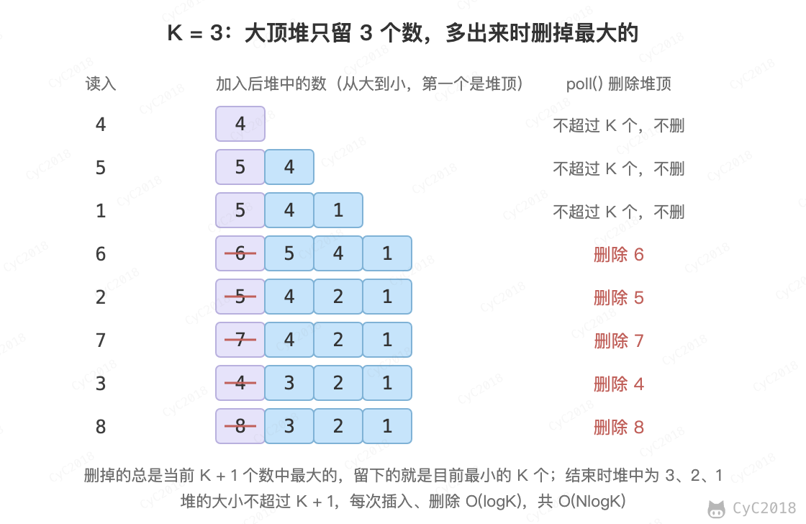

# 40. 最小的 K 个数

## 题目链接

[Leetcode](https://leetcode.cn/problems/zui-xiao-de-kge-shu-lcof/)

## 解题思路

### 大小为 K 的大顶堆

- 复杂度：O(NlogK) + O(K)
- 特别适合处理海量数据（内存中只保存 K 个数，数据可以边读边处理）

使用大小为 K 的大顶堆保存当前最小的 K 个数：在添加一个元素之后，如果大顶堆的大小大于 K，那么将大顶堆的堆顶元素去除，也就是将当前堆中值最大的元素去除，从而使得留在堆中的元素都比被去除的元素来得小。例如 [4, 5, 1, 6, 2, 7, 3, 8]、K = 3：

<div align="center">  </div><br>

应该使用大顶堆来保存最小的 K 个数，而不能直接创建一个小顶堆并设置一个大小，企图让小顶堆中的元素都是最小元素。这是因为超出 K 个时要删掉的是 K + 1 个数中最大的那个，大顶堆的堆顶正好是它；小顶堆只能删掉最小的，最后留下的是最大的 K 个数。

Java 的 PriorityQueue 实现了堆的能力，PriorityQueue 默认是小顶堆，可以在初始化时使用 Lambda 表达式 (o1, o2) -\> o2 - o1 来实现大顶堆。本题的数在 0～10000 之间，相减不会溢出；数值可能接近 int 的上下限时，相减会溢出、比较结果出错，应改用 Comparator.reverseOrder()。其它语言也有类似的堆数据结构。

```java
public int[] inventoryManagement(int[] stock, int cnt) {
    if (cnt > stock.length || cnt <= 0)
        return new int[0];
    PriorityQueue<Integer> maxHeap = new PriorityQueue<>((o1, o2) -> o2 - o1);
    for (int num : stock) {
        maxHeap.add(num);
        if (maxHeap.size() > cnt)
            maxHeap.poll();
    }
    int[] ret = new int[cnt];
    int i = 0;
    while (!maxHeap.isEmpty()) {
        ret[i++] = maxHeap.poll();
    }
    return ret;
}
```

### 快速选择

- 复杂度：随机选择切分元素时期望 O(N) + O(1)，最坏 O(N<sup>2</sup>)（每次切分都选到最值）
- 只有当允许修改数组元素时才可以使用

快速排序的 partition() 方法，会返回一个整数 j 使得 a[l..j-1] 小于等于 a[j]，且 a[j+1..h] 大于等于 a[j]，此时 a[j] 就是数组中第 j 小的元素（j 从 0 开始计数）。可以利用这个特性找出数组的第 K 个元素，这种找第 K 个元素的算法称为快速选择算法。切分元素固定取 a[l] 时，有序数组每次只能切掉一个元素，因此先随机选一个元素换到 a[l]。

```java
public int[] inventoryManagement(int[] stock, int cnt) {
    if (cnt > stock.length || cnt <= 0)
        return new int[0];
    findKthSmallest(stock, cnt - 1);
    /* findKthSmallest 会改变数组，使得前 cnt 个数都是最小的 cnt 个数 */
    int[] ret = new int[cnt];
    for (int i = 0; i < cnt; i++)
        ret[i] = stock[i];
    return ret;
}

private void findKthSmallest(int[] nums, int k) {
    int l = 0, h = nums.length - 1;
    while (l < h) {
        int j = partition(nums, l, h);
        if (j == k)
            break;
        if (j > k)
            h = j - 1;
        else
            l = j + 1;
    }
}

private final Random random = new Random();

private int partition(int[] nums, int l, int h) {
    swap(nums, l, l + random.nextInt(h - l + 1));  /* 随机选切分元素 */
    int p = nums[l];     /* 切分元素 */
    int i = l, j = h + 1;
    while (true) {
        while (i != h && nums[++i] < p) ;
        while (j != l && nums[--j] > p) ;
        if (i >= j)
            break;
        swap(nums, i, j);
    }
    swap(nums, l, j);
    return j;
}

private void swap(int[] nums, int i, int j) {
    int t = nums[i];
    nums[i] = nums[j];
    nums[j] = t;
}
```
