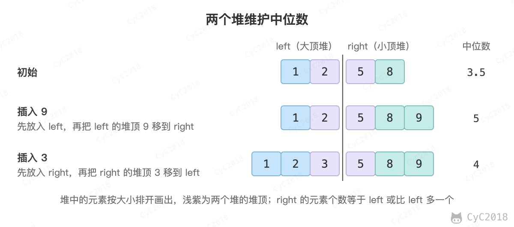

# 41.1 数据流中的中位数

## 题目链接

[Leetcode](https://leetcode.cn/problems/shu-ju-liu-zhong-de-zhong-wei-shu-lcof/)

## 题目描述

如何得到一个数据流中的中位数？如果从数据流中读出奇数个数值，那么中位数就是所有数值排序之后位于中间的数值。如果从数据流中读出偶数个数值，那么中位数就是所有数值排序之后中间两个数的平均值。

## 解题思路

用两个堆把数据分成较小的一半和较大的一半：left 是大顶堆，存较小的一半，堆顶是这一半的最大值；right 是小顶堆，存较大的一半，堆顶是这一半的最小值。让 right 的元素个数等于 left 或比 left 多一个，中位数就只和两个堆顶有关：总数为奇数时是 right 的堆顶，为偶数时是两个堆顶的平均值。插入的时间复杂度为 O(logN)，查找中位数为 O(1)。

新元素不能直接放进要变多的那个堆，因为它可能比另一个堆的堆顶更大或更小。做法是先放进另一个堆，再把那个堆的堆顶移过来。例如 left = {1, 2}、right = {5, 8} 时：

<div align="center">  </div><br>

```java
class MedianFinder {

    /* 大顶堆，存储左半边元素 */
    private PriorityQueue<Integer> left = new PriorityQueue<>((o1, o2) -> o2 - o1);
    /* 小顶堆，存储右半边元素，并且右半边元素都大于左半边 */
    private PriorityQueue<Integer> right = new PriorityQueue<>();
    /* 当前数据流读入的元素个数 */
    private int N = 0;

    public MedianFinder() {

    }

    public void addNum(int num) {
        /* 插入要保证两个堆处于平衡状态 */
        if (N % 2 == 0) {
            /* N 为偶数的情况下插入到右半边。
             * 因为右半边元素都要大于左半边，但是新插入的元素不一定比左半边元素来得大，
             * 因此需要先将元素插入左半边，然后利用左半边为大顶堆的特点，取出堆顶元素即为最大元素，此时插入右半边 */
            left.add(num);
            right.add(left.poll());
        } else {
            right.add(num);
            left.add(right.poll());
        }
        N++;
    }

    public double findMedian() {
        if (N % 2 == 0) {
            return (left.peek() + right.peek()) / 2.0;
        } else {
            return (double) right.peek();
        }
    }
}
```
