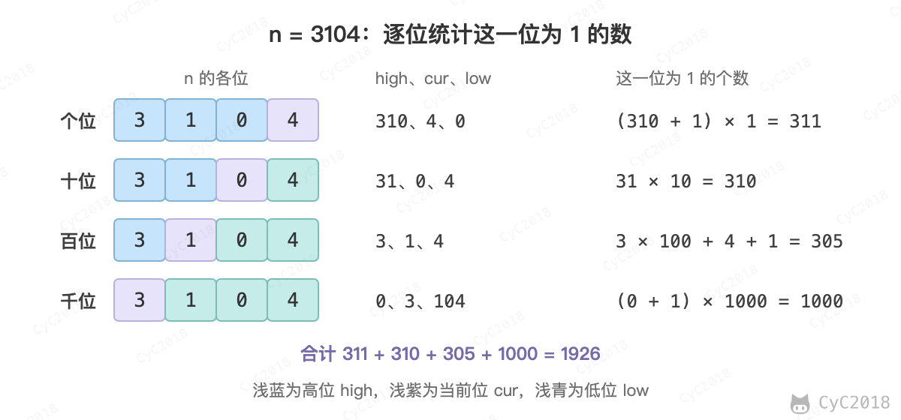

# 43. 从 1 到 n 整数中 1 出现的次数

[Leetcode](https://leetcode.cn/problems/1nzheng-shu-zhong-1chu-xian-de-ci-shu-lcof/)

## 解题思路

逐位统计：分别算出个位、十位、百位……上出现 1 的数有多少个，再相加。设当前位的权重为 m（个位 m = 1，十位 m = 10），把 n 分成三段：高位 high = n / (10m)，当前位 cur = n / m % 10，低位 low = n % m。在 0～n 中，这一位为 1 的数的个数为：

- cur = 0 时为 high × m：高位取 0～high - 1，低位任取 m 种；
- cur = 1 时为 high × m + low + 1：比上一种多出高位等于 high、低位取 0～low 的 low + 1 个；
- cur ≥ 2 时为 (high + 1) × m：高位取 0～high 都可以，低位任取。

以 n = 3104 为例：

<div align="center">  </div><br>

代码中 a = n / m 是高位和当前位，b = n % m 是低位。(a + 8) / 10 在 cur ≥ 2 时等于 high + 1，否则等于 high，正好合并了第一种和第三种情况；cur = 1 时再加上 b + 1。

```java
public int digitOneInNumber(int num) {
    int cnt = 0;
    for (long m = 1; m <= num; m *= 10) {
        long a = num / m, b = num % m;
        cnt += (a + 8) / 10 * m + (a % 10 == 1 ? b + 1 : 0);
    }
    return cnt;
}
```

## 参考资料

- [Leetcode : 233. Number of Digit One](https://leetcode.com/problems/number-of-digit-one/discuss/64381/4+-lines-O(log-n)-C++JavaPython)
