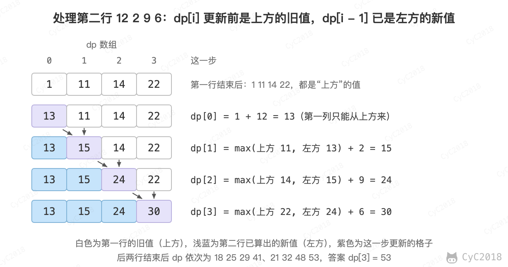

# 47. 礼物的最大价值

[Leetcode](https://leetcode.cn/problems/li-wu-de-zui-da-jie-zhi-lcof/)

## 题目描述

在一个 m\*n 的棋盘的每一个格都放有一个礼物，每个礼物都有一定价值（大于 0）。从左上角开始拿礼物，每次向右或向下移动一格，直到右下角结束。给定一个棋盘，求拿到礼物的最大价值。例如，对于如下棋盘

```text
1    10   3    8
12   2    9    6
5    7    4    11
3    7    16   5
```

礼物的最大价值为 1+12+5+7+7+16+5=53。

## 解题思路

深度优先搜索要枚举所有路径，路径数随棋盘大小指数增长；用动态规划每个格子只需计算一次。

设 dp[i][j] 为走到格子 (i, j) 时拿到的最大价值。只能从上方或左方到达，因此 dp[i][j] = max(dp[i - 1][j], dp[i][j - 1]) + 礼物价值。按行计算时只用到上一行，代码用一维数组滚动：更新 dp[i] 之前，dp[i] 是上方格子的结果，dp[i - 1] 是左方格子刚更新的结果。以上面棋盘的第二行为例：

<div align="center">  </div><br>

```java
public int jewelleryValue(int[][] frame) {
    if (frame == null || frame.length == 0 || frame[0].length == 0)
        return 0;
    int n = frame[0].length;
    int[] dp = new int[n];
    for (int[] row : frame) {
        dp[0] += row[0];
        for (int i = 1; i < n; i++)
            dp[i] = Math.max(dp[i], dp[i - 1]) + row[i];
    }
    return dp[n - 1];
}
```
