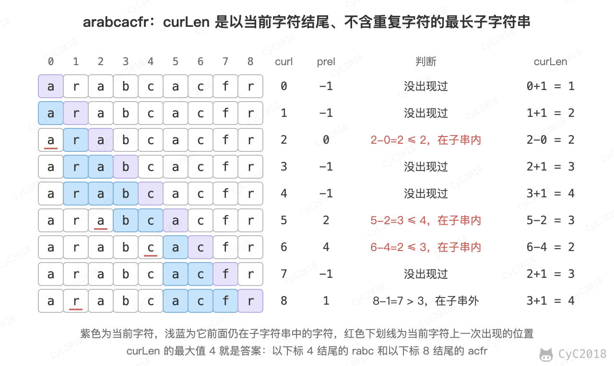

# 48. 最长不含重复字符的子字符串

[Leetcode](https://leetcode.cn/problems/zui-chang-bu-han-zhong-fu-zi-fu-de-zi-zi-fu-chuan-lcof/)

## 题目描述

输入一个字符串，求其最长不含重复字符的子字符串的长度。例如对于 arabcacfr，最长不含重复字符的子字符串为 acfr，长度为 4。原书中的字符串只包含 a\~z，力扣的版本还包含数字、符号和空格，因此代码用长度为 128 的数组按 ASCII 码记录。

## 解题思路

preIndexs 记录每个字符上一次出现的位置，curLen 是以当前字符结尾、不含重复字符的最长子字符串的长度。遍历到 curI 时，设当前字符上一次出现在 preI：

- 没有出现过，或者 curI - preI > curLen，说明上一次出现在当前子字符串之外，直接接上当前字符，curLen 加 1；
- 否则上一次出现在当前子字符串之内，新的子字符串只能从 preI + 1 开始，curLen 变为 curI - preI。

以 arabcacfr 为例，遍历到下标 5 的 a 时，上一个 a 在下标 2，仍在当前的 rabc 中，子字符串变为 bca；遍历到最后的 r 时，上一个 r 在下标 1，已经不在当前的 acf 中，curLen 加 1 得到 acfr：

<div align="center">  </div><br>

每个字符只访问一次，时间复杂度 O(N)。

```java
public int dismantlingAction(String str) {
    int curLen = 0;
    int maxLen = 0;
    int[] preIndexs = new int[128];
    Arrays.fill(preIndexs, -1);
    for (int curI = 0; curI < str.length(); curI++) {
        int c = str.charAt(curI);
        int preI = preIndexs[c];
        if (preI == -1 || curI - preI > curLen) {
            curLen++;
        } else {
            maxLen = Math.max(maxLen, curLen);
            curLen = curI - preI;
        }
        preIndexs[c] = curI;
    }
    maxLen = Math.max(maxLen, curLen);
    return maxLen;
}
```
