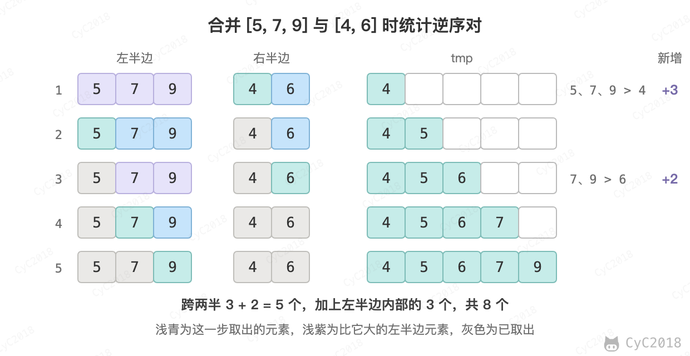

# 51. 数组中的逆序对

[Leetcode](https://leetcode.cn/problems/shu-zu-zhong-de-ni-xu-dui-lcof/)

## 题目描述

在数组中的两个数字，如果前面一个数字大于后面的数字，则这两个数字组成一个逆序对。输入一个数组，求出这个数组中的逆序对的总数。

## 解题思路

暴力枚举所有数对需要 O(N<sup>2</sup>)。归并排序在合并两个有序的子数组时，可以一次统计出一批逆序对：左半边 nums[l..m] 和右半边 nums[m+1..h] 都已有序，当 nums[i] > nums[j] 时，左半边从 i 到 m 的元素都不小于 nums[i]，也就都大于 nums[j]，一次就能加上 m - i + 1 个逆序对。两半内部的逆序对在递归时已经统计过，合并时只统计跨两半的，总的时间复杂度为 O(NlogN)。

以 [9, 7, 5, 4, 6] 为例，左半边 [9, 7, 5] 内部有 3 个逆序对，排序后为 [5, 7, 9]；右半边 [4, 6] 内部没有。最后一次合并统计跨两半的 5 个，共 8 个：

<div align="center">  </div><br>

需要注意的是两边相等时先取左边的元素，相等的两个数不是逆序对。

```java
private int cnt = 0;
private int[] tmp;

public int reversePairs(int[] record) {
    if (record == null || record.length < 2) {
        return 0;
    }
    this.cnt = 0;
    this.tmp = new int[record.length];
    mergeSort(record, 0, record.length - 1);
    return cnt;
}

private void mergeSort(int[] nums, int l, int h) {
    if (h - l < 1)
        return;
    int m = l + (h - l) / 2;
    mergeSort(nums, l, m);
    mergeSort(nums, m + 1, h);
    merge(nums, l, m, h);
}

private void merge(int[] nums, int l, int m, int h) {
    int i = l, j = m + 1, k = l;
    while (i <= m || j <= h) {
        if (i > m)
            tmp[k] = nums[j++];
        else if (j > h)
            tmp[k] = nums[i++];
        else if (nums[i] <= nums[j])
            tmp[k] = nums[i++];
        else {
            tmp[k] = nums[j++];
            this.cnt += m - i + 1;  // nums[i] > nums[j]，说明 nums[i...mid] 都大于 nums[j]
        }
        k++;
    }
    for (k = l; k <= h; k++)
        nums[k] = tmp[k];
}
```
