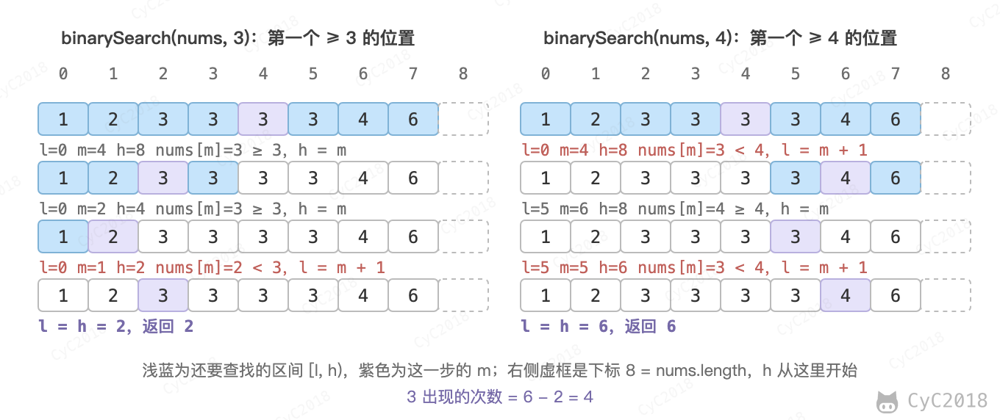

# 53. 数字在排序数组中出现的次数

## 题目链接

[Leetcode](https://leetcode.cn/problems/zai-pai-xu-shu-zu-zhong-cha-zhao-shu-zi-lcof/)

## 题目描述

```text
Input:
nums = 1, 2, 3, 3, 3, 3, 4, 6
K = 3

Output:
4
```

## 解题思路

只要能找出给定的数字 k 在有序数组第一个位置和最后一个位置，就能知道该数字出现的次数。

先考虑如何实现寻找数字在有序数组的第一个位置。正常的二分查找如下，在查找到给定元素 k 之后，立即返回当前索引下标。

```java
public int binarySearch(int[] nums, int K) {
    int l = 0, h = nums.length - 1;
    while (l <= h) {
        int m = l + (h - l) / 2;
        if (nums[m] == K) {
            return m;
        } else if (nums[m] > K) {
            h = m - 1;
        } else {
            l = m + 1;
        }
    }
    return -1;
}
```

但是在查找第一个位置时，找到元素之后应该继续往前找。也就是当 nums[m]\>=k 时，在左区间继续查找，左区间应该包含 m 位置。这样 binarySearch 返回的是第一个大于等于 k 的位置。

查找最后一个位置可以转换成寻找 k+1 的第一个位置，并再往前移动一个位置，因此出现次数为 binarySearch(k + 1) - binarySearch(k)。以题目中的数组为例，查找区间为左闭右开的 [l, h)：

<div align="center">  </div><br>

```java
public int countTarget(int[] scores, int target) {
    int first = binarySearch(scores, target);
    int last = binarySearch(scores, target + 1);
    return (first == scores.length || scores[first] != target) ? 0 : last - first;
}

private int binarySearch(int[] nums, int target) {
    int l = 0, h = nums.length;
    while (l < h) {
        int m = l + (h - l) / 2;
        if (nums[m] >= target)
            h = m;
        else
            l = m + 1;
    }
    return l;
}
```

需要注意 binarySearch 中 h 的初始值为 nums.length，而不是 nums.length - 1。k 比所有元素都大时，第一个大于等于 k 的位置在数组之外，应该返回 nums.length。例如 nums = [2, 2]、k = 2 时，binarySearch(nums, 3) 应返回 2，次数为 2 - 0 = 2；如果 h 从 nums.length - 1 开始，返回值最大只能是 1，得到的次数就变成了 1。
