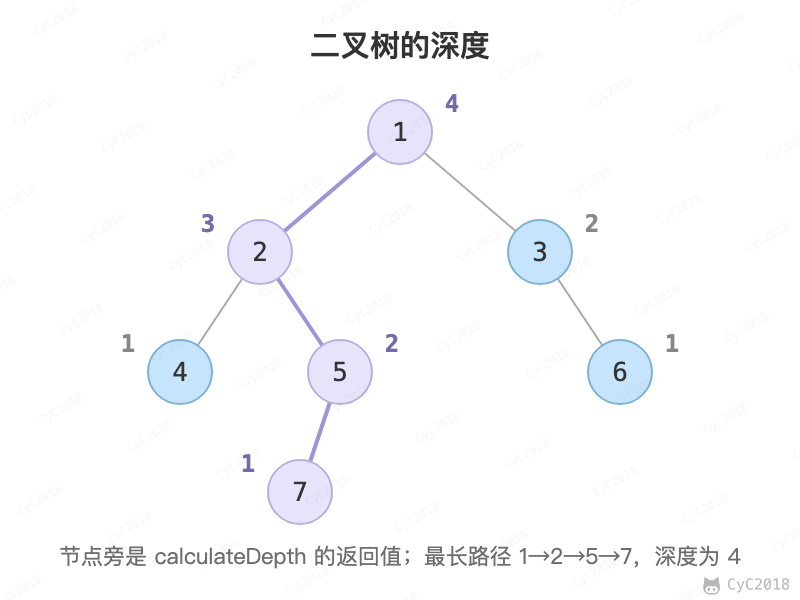

# 55.1 二叉树的深度

[Leetcode](https://leetcode.cn/problems/er-cha-shu-de-shen-du-lcof/)

## 题目描述

从根结点到叶结点依次经过的结点（含根、叶结点）形成树的一条路径，最长路径的长度为树的深度。

<div align="center">  </div><br>

## 解题思路

树的深度等于左右子树深度的较大值加 1，空树的深度为 0。

```java
public int calculateDepth(TreeNode root) {
    return root == null ? 0 : 1 + Math.max(calculateDepth(root.left), calculateDepth(root.right));
}
```
