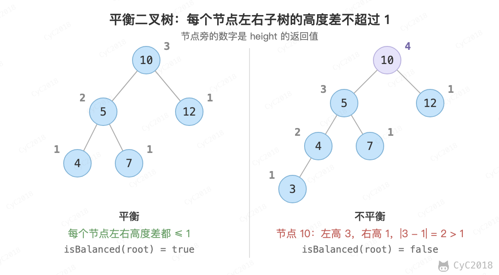

# 55.2 平衡二叉树

[Leetcode](https://leetcode.cn/problems/ping-heng-er-cha-shu-lcof/)

## 题目描述

平衡二叉树左右子树高度差不超过 1。

<div align="center">  </div><br>

## 解题思路

```java
private boolean isBalanced = true;

public boolean isBalanced(TreeNode root) {
    isBalanced = true;
    height(root);
    return isBalanced;
}

private int height(TreeNode root) {
    if (root == null || !isBalanced)
        return 0;
    int left = height(root.left);
    int right = height(root.right);
    if (Math.abs(left - right) > 1)
        isBalanced = false;
    return 1 + Math.max(left, right);
}
```
