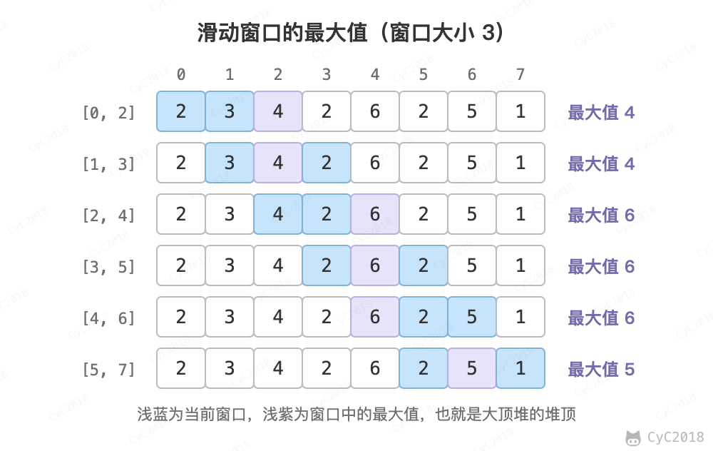
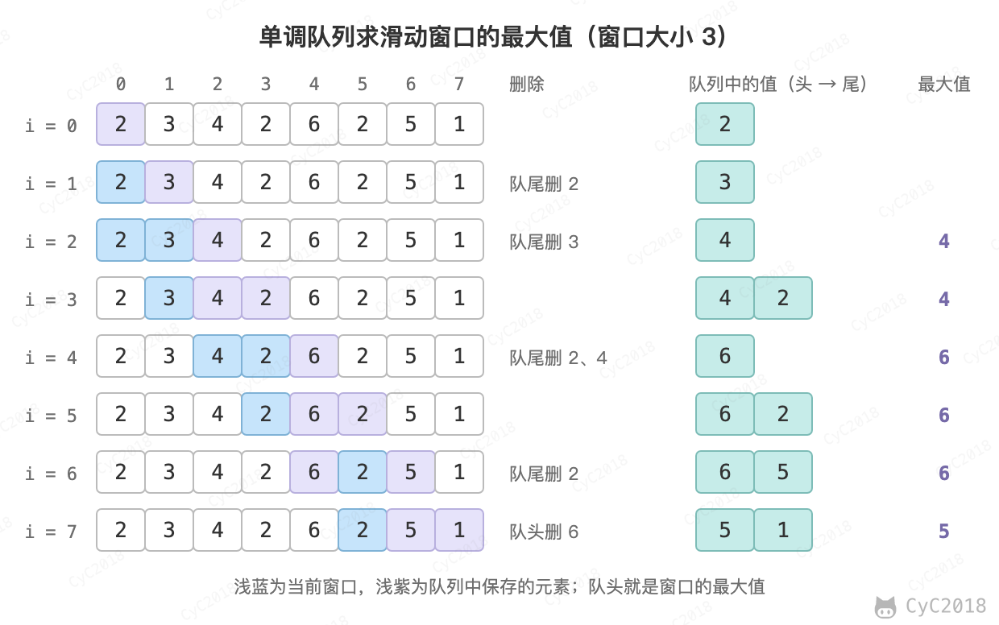

# 59. 滑动窗口的最大值

## 题目链接

[Leetcode](https://leetcode.cn/problems/hua-dong-chuang-kou-de-zui-da-zhi-lcof/)

## 题目描述

给定一个数组和滑动窗口的大小，找出所有滑动窗口里数值的最大值。

例如，如果输入数组 {2, 3, 4, 2, 6, 2, 5, 1} 及滑动窗口的大小 3，那么一共存在 6 个滑动窗口，它们的最大值分别为 {4, 4, 6, 6, 6, 5}。

<div align="center">  </div><br>

## 解题思路

### 大顶堆

维护一个大小为窗口大小的大顶堆，堆顶元素即为当前窗口的最大值。

假设窗口的大小为 M，数组的长度为 N。在窗口向右移动时，需要先在堆中删除离开窗口的元素，并将新到达的元素添加到堆中。添加的时间复杂度为 O(logM)，但 PriorityQueue.remove(Object) 要先线性查找这个元素，时间复杂度为 O(M)，因此算法的时间复杂度为 O(NM)，空间复杂度为 O(M)，N 和 M 都很大时会超时。

```java
public int[] maxAltitude(int[] heights, int limit) {
    if (heights == null || heights.length == 0 || limit <= 0) {
        return new int[0];
    }
    int[] ret = new int[heights.length - limit + 1];
    PriorityQueue<Integer> heap = new PriorityQueue<>((o1, o2) -> o2 - o1);  /* 大顶堆 */
    for (int i = 0; i < limit; i++) {
        heap.add(heights[i]);
    }
    int idx = 0;
    ret[idx++] = heap.peek();
    for (int i = 0, j = i + limit; j < heights.length; i++, j++) {            /* 维护一个大小为 limit 的大顶堆 */
        heap.remove(heights[i]);
        heap.add(heights[j]);
        ret[idx++] = heap.peek();
    }
    return ret;
}
```

### 单调队列

用双端队列保存窗口中有可能成为最大值的元素的下标，并让它们对应的值从队头到队尾递减，队头就是当前窗口的最大值：

- 新元素入队前，从队尾删除所有不大于它的元素：它们比新元素先离开窗口，值又不比它大，以后不可能成为最大值；
- 队头的下标离开窗口时，从队头删除。

每个下标最多入队、出队各一次，时间复杂度为 O(N)，空间复杂度为 O(M)。以 {2, 3, 4, 2, 6, 2, 5, 1}、窗口大小 3 为例：

<div align="center">  </div><br>

```java
public int[] maxAltitude(int[] heights, int limit) {
    if (heights == null || heights.length == 0 || limit <= 0) {
        return new int[0];
    }
    int[] ret = new int[heights.length - limit + 1];
    Deque<Integer> deque = new ArrayDeque<>();  /* 保存下标，对应的值从队头到队尾递减 */
    for (int i = 0; i < heights.length; i++) {
        while (!deque.isEmpty() && heights[deque.peekLast()] <= heights[i])
            deque.pollLast();
        deque.addLast(i);
        if (deque.peekFirst() <= i - limit)     /* 队头已经离开窗口 [i - limit + 1, i] */
            deque.pollFirst();
        if (i >= limit - 1)
            ret[i - limit + 1] = heights[deque.peekFirst()];
    }
    return ret;
}
```
