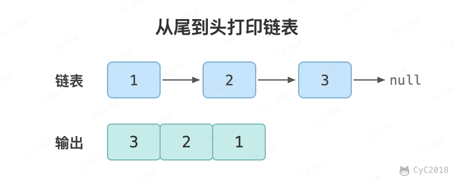

# 6. 从尾到头打印链表

## 题目链接

[Leetcode](https://leetcode.cn/problems/cong-wei-dao-tou-da-yin-lian-biao-lcof/)

## 题目描述

从尾到头反过来打印出每个结点的值。

<div align="center">  </div><br>

## 解题思路

### 1. 使用递归

要逆序打印链表 1-\>2-\>3（3，2，1），可以先逆序打印链表 2-\>3（3，2），最后再打印第一个节点 1。而链表 2-\>3 可以看成一个新的链表，要逆序打印该链表可以继续使用求解函数，也就是在求解函数中调用自己，这就是递归函数。

```java
private ArrayList<Integer> tmp = new ArrayList<>();

public int[] reverseBookList(ListNode head) {
    tmp.clear();
    recurse(head);
    int[] ret = new int[tmp.size()];
    for (int i = 0; i < ret.length; i++)
        ret[i] = tmp.get(i);
    return ret;
}

private void recurse(ListNode head) {
    if (head == null)
        return;
    recurse(head.next);
    tmp.add(head.val);
}
```

### 2. 使用头插法

头插法顾名思义是将节点插入到头部：在遍历原始链表时，将当前节点插入新链表的头部，使其成为第一个节点。

链表的操作需要维护后继关系，例如在某个节点 node1 之后插入一个节点 node2，可以通过修改后继关系来实现：

```text
node3 = node1.next;
node2.next = node3;
node1.next = node2;
```

<div align="center">  </div><br>


为了能将一个节点插入头部，引入一个叫头结点的辅助节点，该节点不存储值，只是为了方便进行插入操作。不要将头结点与第一个节点混起来，第一个节点是链表中第一个真正存储值的节点。

<div align="center">  </div><br>

需要注意的是，头插法直接修改了原链表的 next 指针，调用之后原链表的顺序被反转；不允许修改输入时用递归或栈。

```java
public int[] reverseBookList(ListNode head) {
    // 头插法构建逆序链表
    ListNode dummy = new ListNode(-1);
    int count = 0;
    while (head != null) {
        ListNode memo = head.next;
        head.next = dummy.next;
        dummy.next = head;
        head = memo;
        count++;
    }
    int[] ret = new int[count];
    ListNode cur = dummy.next;
    int idx = 0;
    while (cur != null) {
        ret[idx++] = cur.val;
        cur = cur.next;
    }
    return ret;
}
```

### 3. 使用栈

栈具有后进先出的特点，在遍历链表时将值按顺序放入栈中，最后出栈的顺序即为逆序。

<div align="center">  </div><br>

```java
public int[] reverseBookList(ListNode head) {
    Stack<Integer> stack = new Stack<>();
    while (head != null) {
        stack.push(head.val);
        head = head.next;
    }
    int[] ret = new int[stack.size()];
    int idx = 0;
    while (!stack.isEmpty())
        ret[idx++] = stack.pop();
    return ret;
}
```
