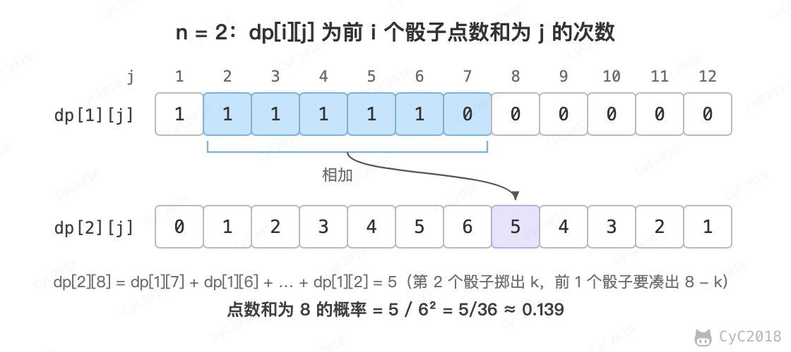

# 60. n 个骰子的点数

## 题目链接

[Leetcode](https://leetcode.cn/problems/nge-tou-zi-de-dian-shu-lcof/)

## 题目描述

把 n 个骰子扔在地上，求点数和为 s 的概率。

## 解题思路

### 动态规划

使用一个二维数组 dp 存储点数出现的次数，其中 dp\[i]\[j] 表示前 i 个骰子产生点数 j 的次数。第 i 个骰子掷出 k（1～6）时，前 i - 1 个骰子的点数和要为 j - k，因此 dp\[i]\[j] 等于 dp\[i - 1]\[j - k] 对 k = 1～6 求和，最后除以 6<sup>n</sup> 得到概率。

<div align="center">  </div><br>

空间复杂度：O(N<sup>2</sup>)

```java
public double[] statisticsProbability(int num) {
    final int face = 6;
    final int pointNum = face * num;
    long[][] dp = new long[num + 1][pointNum + 1];

    for (int i = 1; i <= face; i++)
        dp[1][i] = 1;

    for (int i = 2; i <= num; i++)
        for (int j = i; j <= pointNum; j++)     /* 使用 i 个骰子最小点数为 i */
            for (int k = 1; k <= face && k <= j; k++)
                dp[i][j] += dp[i - 1][j - k];

    final double totalNum = Math.pow(6, num);
    double[] ret = new double[pointNum - num + 1];
    for (int i = num; i <= pointNum; i++)
        ret[i - num] = dp[num][i] / totalNum;

    return ret;
}
```

### 动态规划 + 滚动数组

第 i 行只依赖第 i - 1 行，用两行交替使用即可。空间复杂度：O(N)

```java
public double[] statisticsProbability(int num) {
    final int face = 6;
    final int pointNum = face * num;
    long[][] dp = new long[2][pointNum + 1];

    for (int i = 1; i <= face; i++)
        dp[0][i] = 1;

    int flag = 1;                                     /* 当前行 */
    for (int i = 2; i <= num; i++, flag = 1 - flag) {
        for (int j = 0; j <= pointNum; j++)
            dp[flag][j] = 0;                          /* 当前行清零 */

        for (int j = i; j <= pointNum; j++)
            for (int k = 1; k <= face && k <= j; k++)
                dp[flag][j] += dp[1 - flag][j - k];
    }

    final double totalNum = Math.pow(6, num);
    double[] ret = new double[pointNum - num + 1];
    for (int i = num; i <= pointNum; i++)
        ret[i - num] = dp[1 - flag][i] / totalNum;

    return ret;
}
```
