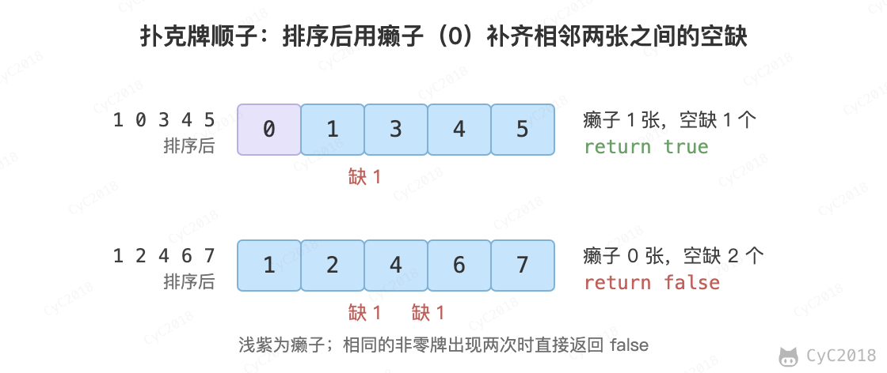

# 61. 扑克牌顺子

## 题目链接

[Leetcode](https://leetcode.cn/problems/bu-ke-pai-zhong-de-shun-zi-lcof/)

## 题目描述

五张牌，其中大小鬼为癞子，牌面为 0。判断这五张牌是否能组成顺子。

<div align="center">  </div><br>

## 解题思路

先排序，统计大小鬼（0）的个数 cnt。之后相邻的两张牌如果相同，就不可能组成顺子；不相同时，中间缺了 places[i + 1] - places[i] - 1 张牌，要用癞子补上。遍历完癞子还够用（cnt ≥ 0），就能组成顺子。

```java
public boolean checkDynasty(int[] places) {
    if (places == null || places.length < 5)
        return false;

    Arrays.sort(places);

    // 统计癞子数量
    int cnt = 0;
    for (int place : places)
        if (place == 0)
            cnt++;

    // 使用癞子去补全不连续的顺子
    for (int i = cnt; i < places.length - 1; i++) {
        if (places[i + 1] == places[i])
            return false;
        cnt -= places[i + 1] - places[i] - 1;
    }

    return cnt >= 0;
}
```
