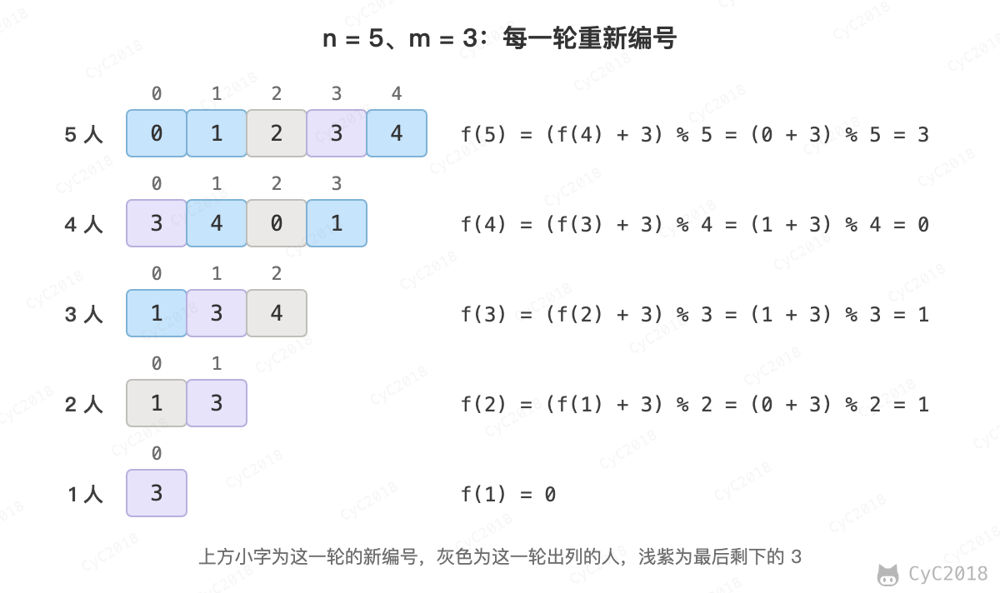

# 62. 圆圈中最后剩下的数

## 题目链接

[Leetcode](https://leetcode.cn/problems/yuan-quan-zhong-zui-hou-sheng-xia-de-shu-zi-lcof/)

## 题目描述

让小朋友们围成一个大圈。然后，随机指定一个数 m，让编号为 0 的小朋友开始报数。每次喊到 m-1 的那个小朋友要出列唱首歌，然后可以在礼品箱中任意的挑选礼物，并且不再回到圈中，从他的下一个小朋友开始，继续 0...m-1 报数 .... 这样下去 .... 直到剩下最后一个小朋友，可以不用表演。

## 解题思路

约瑟夫环问题。设 f(n) 为 n 个人（编号 0～n-1）报到 m 出列时最后剩下的编号。第一轮出列的是编号 (m - 1) % n，之后从编号 m % n 开始报数，剩下 n - 1 个人。把他们从 m % n 开始重新编号为 0、1、2……，就变成了 n - 1 个人的同一个问题，答案 f(n - 1) 是新编号；新编号 x 对应的原编号为 (x + m) % n，因此：

```text
f(1) = 0
f(n) = (f(n - 1) + m) % n
```

例如 n = 5、m = 3，每一行是这一轮还剩下的人，从开始报数的人排起，上方是这一轮的新编号。最后剩下的 3 在每一行的新编号就是 f(5)～f(1)，下一行到上一行编号加 3 再取余：

<div align="center">  </div><br>

num 最大为 10<sup>5</sup>，递归的调用深度与 num 相同，因此从 f(1) 开始递推：

```java
public int iceBreakingGame(int num, int target) {
    int x = 0;                       /* f(1) = 0 */
    for (int i = 2; i <= num; i++)
        x = (x + target) % i;        /* f(i) = (f(i - 1) + target) % i */
    return x;
}
```
