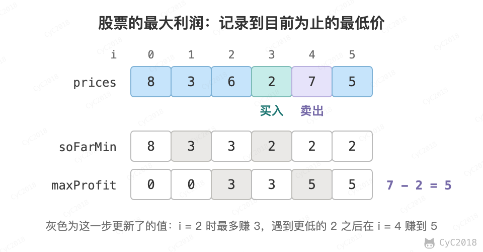

# 63. 股票的最大利润

## 题目链接

[Leetcode](https://leetcode.cn/problems/gu-piao-de-zui-da-li-run-lcof/)

## 题目描述

可以有一次买入和一次卖出，买入必须在前。求最大收益。

<div align="center">  </div><br>

## 解题思路

使用贪心策略，假设第 i 轮进行卖出操作，买入操作价格应该在 i 之前并且价格最低。因此在遍历数组时记录当前最低的买入价格，并且尝试将每个位置都作为卖出价格，取收益最大的即可。

可以多次买卖的版本见[买卖股票的最大收益 II](Leetcode%20题解%20-%20贪心思想.md#6-买卖股票的最大收益-ii)，有冷却期、手续费或交易次数限制的版本见[股票交易](Leetcode%20题解%20-%20动态规划.md#股票交易)。

```java
public int bestTiming(int[] prices) {
    if (prices == null || prices.length == 0)
        return 0;
    int soFarMin = prices[0];
    int maxProfit = 0;
    for (int i = 1; i < prices.length; i++) {
        soFarMin = Math.min(soFarMin, prices[i]);
        maxProfit = Math.max(maxProfit, prices[i] - soFarMin);
    }
    return maxProfit;
}
```
