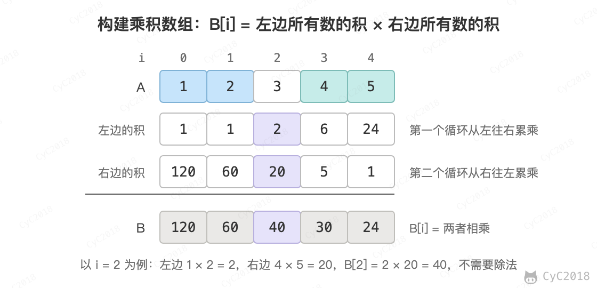

# 66. 构建乘积数组

## 题目链接

[Leetcode](https://leetcode.cn/problems/gou-jian-cheng-ji-shu-zu-lcof/)

## 题目描述

给定一个数组 A[0, 1,..., n-1]，请构建一个数组 B[0, 1,..., n-1]，其中 B 中的元素 B[i]=A[0]\*A[1]\*...\*A[i-1]\*A[i+1]\*...\*A[n-1]。要求不能使用除法。

<div align="center">  </div><br>

## 解题思路

B[i] 等于 A[i] 左边所有元素的乘积乘以右边所有元素的乘积。第一遍从左往右，让 B[i] 等于左边的乘积；第二遍从右往左，用 product 累乘右边的元素，再乘到 B[i] 上。两遍都是 O(N)，不需要除法。

```java
public int[] statisticalResult(int[] arrayA) {
    int n = arrayA.length;
    int[] B = new int[n];
    for (int i = 0, product = 1; i < n; product *= arrayA[i], i++)       /* 从左往右累乘 */
        B[i] = product;
    for (int i = n - 1, product = 1; i >= 0; product *= arrayA[i], i--)  /* 从右往左累乘 */
        B[i] *= product;
    return B;
}
```
