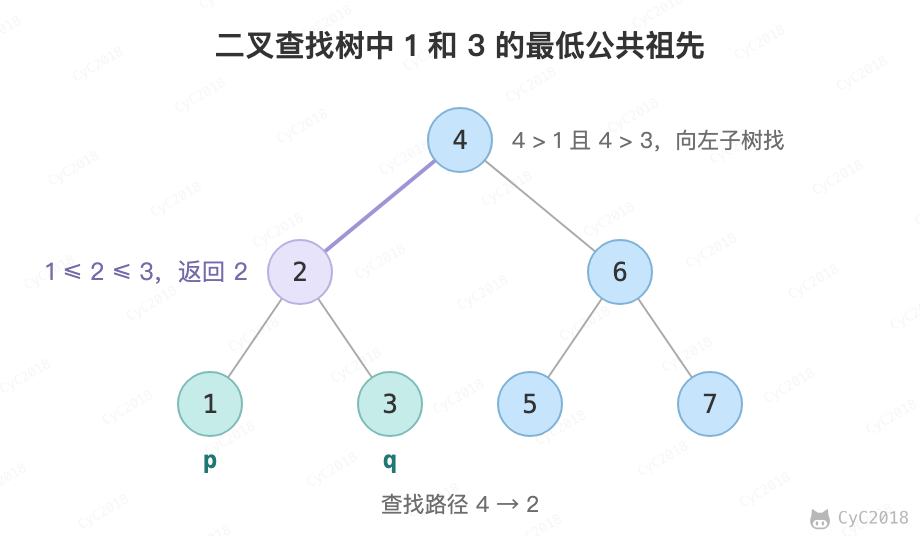
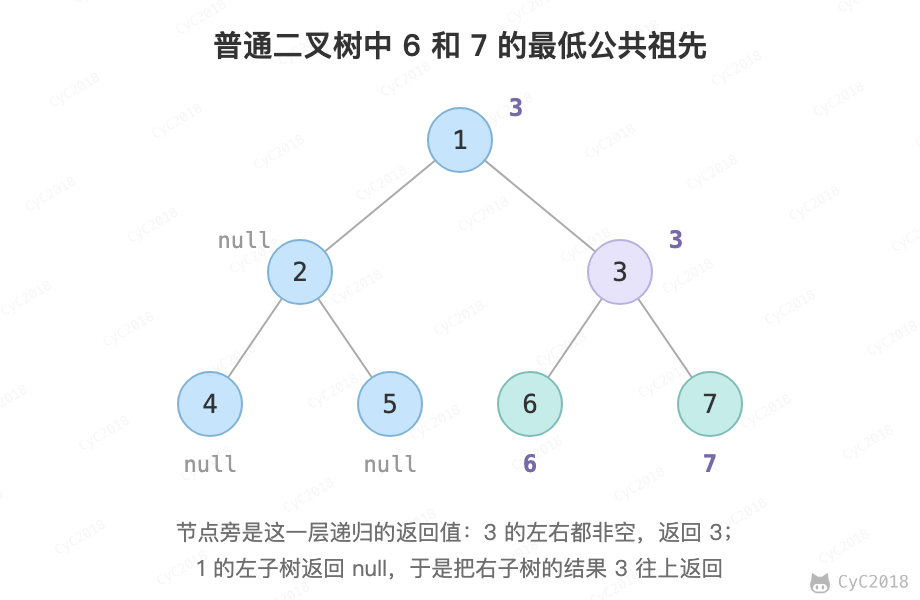

# 68. 树中两个节点的最低公共祖先


## 68.1 二叉查找树

### 题目链接

[Leetcode : 235. Lowest Common Ancestor of a Binary Search Tree](https://leetcode.com/problems/lowest-common-ancestor-of-a-binary-search-tree/description/)

### 解题思路

在二叉查找树中，设 p.val \<= q.val，从根节点往下查找，第一个满足 root.val \>= p.val && root.val \<= q.val 的节点 root 就是 p、q 的最低公共祖先。

<div align="center">  </div><br>

```java
public TreeNode lowestCommonAncestor(TreeNode root, TreeNode p, TreeNode q) {
    if (root == null)
        return root;
    if (root.val > p.val && root.val > q.val)
        return lowestCommonAncestor(root.left, p, q);
    if (root.val < p.val && root.val < q.val)
        return lowestCommonAncestor(root.right, p, q);
    return root;
}
```

## 68.2 普通二叉树

### 题目链接

[Leetcode : 236. Lowest Common Ancestor of a Binary Tree](https://leetcode.com/problems/lowest-common-ancestor-of-a-binary-tree/description/)

### 解题思路

在左右子树中查找是否存在 p 或者 q，如果 p 和 q 分别在两个子树中，那么就说明根节点就是最低公共祖先。

函数的返回值表示在这棵子树中找到的 p、q 或它们的公共祖先，没找到时为 null：左右子树的递归结果 left、right 都不为 null 时，p、q 分在两边，返回 root；只有一个不为 null 时，返回这个结果。遇到 p 或 q 就直接返回，是因为如果另一个节点在它下面，它本身就是最低公共祖先；如果不在它下面，另一个节点会在其它子树中被找到，由上层节点返回 root。这依赖题目保证 p、q 都在树中。

<div align="center">  </div><br>

```java
public TreeNode lowestCommonAncestor(TreeNode root, TreeNode p, TreeNode q) {
    if (root == null || root == p || root == q)
        return root;
    TreeNode left = lowestCommonAncestor(root.left, p, q);
    TreeNode right = lowestCommonAncestor(root.right, p, q);
    return left == null ? right : right == null ? left : root;
}
```
