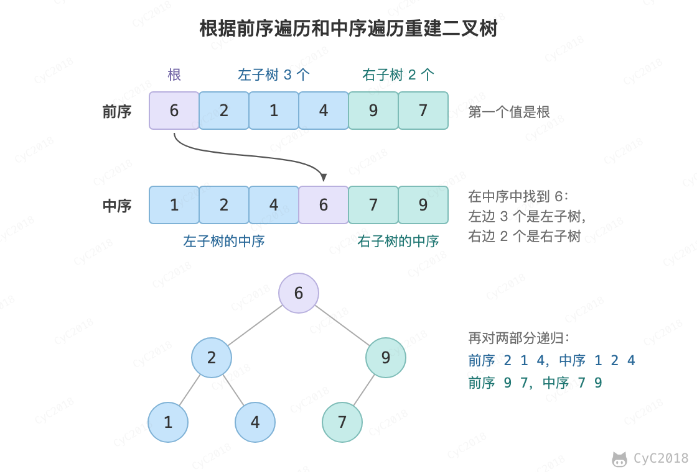

# 7. 重建二叉树

## 题目链接

[Leetcode](https://leetcode.cn/problems/zhong-jian-er-cha-shu-lcof/)

## 题目描述

根据二叉树的前序遍历和中序遍历的结果，重建出该二叉树。假设输入的前序遍历和中序遍历的结果中都不含重复的数字。


<div align="center">  </div><br>

## 解题思路

前序遍历的第一个值为根节点的值，使用这个值将中序遍历结果分成两部分，左部分为树的左子树中序遍历结果，右部分为树的右子树中序遍历的结果。然后分别对左右子树递归地求解。

<div align="center">  </div><br>

```java
// 缓存中序遍历数组每个值对应的索引
private Map<Integer, Integer> indexForInOrders = new HashMap<>();

public TreeNode deduceTree(int[] preorder, int[] inorder) {
    for (int i = 0; i < inorder.length; i++)
        indexForInOrders.put(inorder[i], i);
    return deduceTree(preorder, 0, preorder.length - 1, 0);
}

private TreeNode deduceTree(int[] pre, int preL, int preR, int inL) {
    if (preL > preR)
        return null;
    TreeNode root = new TreeNode(pre[preL]);
    int inIndex = indexForInOrders.get(root.val);
    int leftTreeSize = inIndex - inL;
    root.left = deduceTree(pre, preL + 1, preL + leftTreeSize, inL);
    root.right = deduceTree(pre, preL + leftTreeSize + 1, preR, inL + leftTreeSize + 1);
    return root;
}
```
