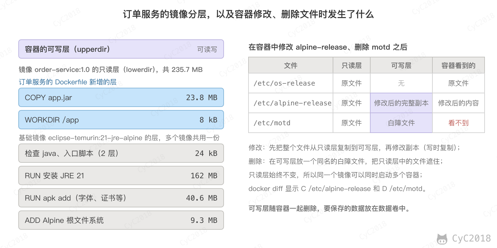
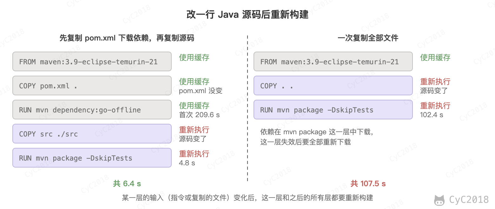
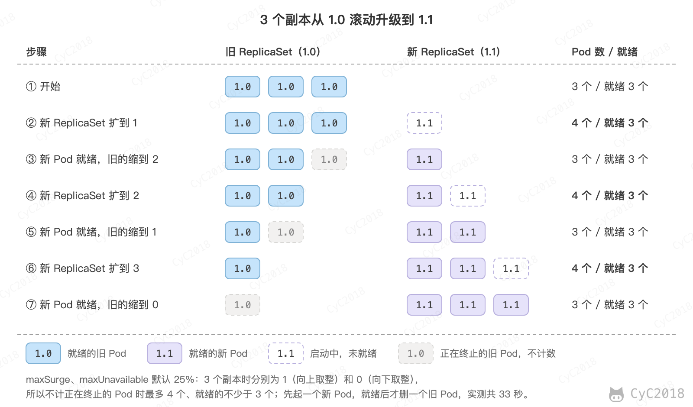
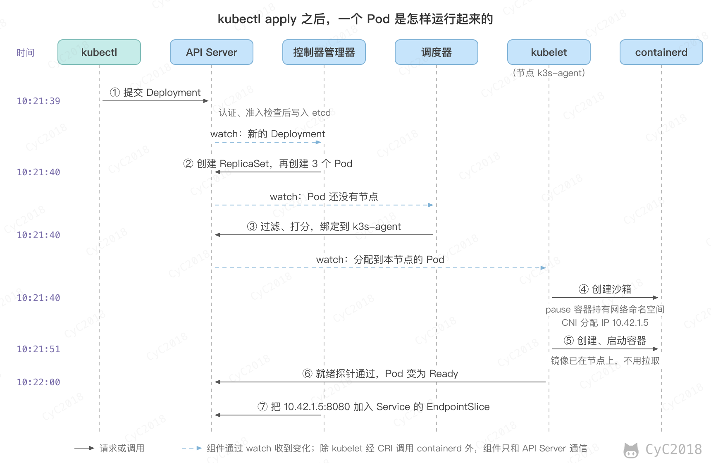
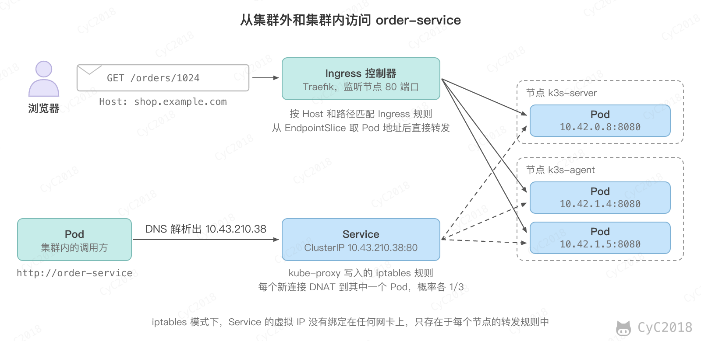

# Docker
<!-- GFM-TOC -->
* [Docker](#docker)
    * [一、解决的问题](#一解决的问题)
    * [二、与虚拟机的比较](#二与虚拟机的比较)
    * [三、优势](#三优势)
    * [四、使用场景](#四使用场景)
    * [五、实现原理](#五实现原理)
    * [六、镜像与容器](#六镜像与容器)
    * [七、Kubernetes](#七kubernetes) 🔥
    * [附录：实测](#附录实测)
    * [参考资料](#参考资料)
<!-- GFM-TOC -->


## 一、解决的问题

不同的机器有不同的操作系统，以及不同的库和组件，将一个应用部署到多台机器上时，需要进行大量的环境配置操作。

Docker 主要解决环境配置问题，它是一种虚拟化技术，对进程进行隔离，被隔离的进程与宿主机上的其它进程互相隔离，但共享宿主机的内核。使用 Docker 可以不修改应用程序代码，不需要开发人员学习特定环境下的技术，就能够将现有的应用程序部署在其它机器上。

<div align="center">  </div><br>

## 二、与虚拟机的比较

虚拟机也是一种虚拟化技术，它与 Docker 最大的区别在于它是通过模拟硬件，并在硬件上安装操作系统来实现。

<div align="center">  </div><br>

### 启动速度

启动虚拟机需要先启动虚拟机中的操作系统，再启动应用，通常要几十秒；启动容器相当于在宿主机上启动一个进程，通常在 1 秒以内。

### 占用资源

虚拟机是一个完整的操作系统，需要占用大量的磁盘、内存和 CPU 资源，一台机器只能开启几十个虚拟机。

容器只是宿主机上隔离运行的进程，只需要将应用以及相关的组件打包，在运行时占用很少的资源，一台机器可以运行成千上万个容器。

## 三、优势

除了启动速度快以及占用资源少之外，Docker 具有以下优势：

### 更容易迁移

提供一致性的运行环境。已经打包好的应用可以在不同的机器上进行迁移，而不用担心环境变化导致无法运行。

### 更容易维护

使用分层技术和镜像，使得应用可以更容易复用重复的部分。复用程度越高，维护工作也越容易。

### 更容易扩展

可以使用基础镜像进一步扩展得到新的镜像，并且官方和开源社区提供了大量的镜像，通过扩展这些镜像可以非常容易得到想要的镜像。

## 四、使用场景

### 持续集成

持续集成指的是频繁地将代码集成到主干上，这样能够更快地发现错误。

容器轻量、相互隔离，每次集成都可以在一个新的容器中构建和测试，不会影响其它构建，也不会残留上一次的环境。

### 提供可伸缩的云服务

根据应用的负载情况，可以很容易地增加或者减少容器。

### 搭建微服务架构

Docker 轻量级的特点使得它很适合用于部署、维护、组合微服务。

## 五、实现原理

容器就是宿主机上的普通进程，Docker 用 Linux 内核的两个机制把它和其它进程隔开：

- 命名空间（Namespace）负责隔离“能看到什么”：PID 命名空间让容器中的第一个进程以为自己是 1 号进程；网络命名空间让容器有自己的网卡、IP 和端口；挂载命名空间让容器有自己的根文件系统；UTS 命名空间让容器有自己的主机名；
- 控制组（cgroup）负责限制“能用多少”：限制 CPU、内存、磁盘 I/O 等资源。

例如用 docker run --memory 64m --cpus 0.5 启动一个容器，在容器中查看：

```sh
$ cat /sys/fs/cgroup/memory.max /sys/fs/cgroup/cpu.max
67108864
50000 100000
$ echo $$
1
```

内存上限是 64 MB，CPU 每 100 ms 最多使用 50 ms，即半个 CPU；容器里的 shell 的进程号是 1。在容器中不断申请内存，超过 64 MB 时进程被内核杀掉，退出码为 137（128 + SIGKILL 的 9）。

因为所有容器共享宿主机的内核，所以容器比虚拟机轻量，但隔离性也更弱：内核漏洞可能让容器中的进程影响宿主机。

## 六、镜像与容器

镜像是一种静态的结构，可以看成面向对象里面的类，而容器是镜像的一个实例。

镜像包含容器运行所需的全部文件（应用、依赖库和基础系统），由多个只读层叠成，每一层只记录相对下面一层的变化。例如下文订单服务的镜像共 7 层：下面 5 层来自基础镜像 eclipse-temurin:21-jre-alpine，上面 2 层是订单服务的 Dockerfile 新增的。基于同一个基础镜像的多个镜像在磁盘上共用这 5 层，拉取时也只下载缺少的层。

创建容器时，Docker 在镜像之上加一个可写层，保存容器运行过程中的修改。

<div align="center">  </div><br>

分层由联合文件系统实现，Docker 默认使用 OverlayFS：镜像的各层是只读的下层目录（lowerdir），容器的可写层是上层目录（upperdir），两者合并后挂载为容器的根目录。

容器第一次修改镜像中的某个文件时，先把整个文件复制到上层再修改，这就是写时复制；删除文件时在上层放一个同名的白障（whiteout）文件把它遮住。镜像本身始终不变，所以同一个镜像可以同时启动多个容器。

例如在订单服务的容器中修改 /etc/alpine-release、删除 /etc/motd 后，docker diff 显示 C /etc/alpine-release 和 D /etc/motd，上层目录中多了 alpine-release 的完整副本和一个名为 motd 的白障文件（Docker 28.4 实测，见[附录 A3](#a3-overlayfs-的可写层)）。

可写层随容器一起删除，需要长期保存的数据（例如 MySQL 的数据文件）要放在数据卷中，见下文。

### 用 Dockerfile 构建镜像

Dockerfile 是描述怎样构建镜像的文本文件，每条指令在上一步的结果上执行。RUN、COPY、ADD 这类修改文件系统的指令各产生一层，WORKDIR 要新建目录时也产生一层；EXPOSE、ENTRYPOINT 只修改镜像的配置，不产生层。

下面把一个 Spring Boot 3 订单服务打包成镜像，它提供 GET /orders/{id} 接口，返回订单的状态：

```dockerfile
# 第一阶段：用 Maven 和 JDK 编译打包
FROM maven:3.9-eclipse-temurin-21 AS build
WORKDIR /src
COPY pom.xml .
RUN mvn -q dependency:go-offline
COPY src ./src
RUN mvn -q package -DskipTests

# 第二阶段：只把 jar 复制到 JRE 镜像中
FROM eclipse-temurin:21-jre-alpine
WORKDIR /app
COPY --from=build /src/target/order-service-1.0.jar app.jar
EXPOSE 8080
ENTRYPOINT ["java", "-jar", "app.jar"]
```

其中用到的指令：

- FROM：指定基础镜像，AS build 给这个构建阶段命名；
- WORKDIR：设置后续指令的工作目录，目录不存在时自动创建；
- COPY：把构建上下文（docker build 指定的目录）中的文件复制到镜像中，--from=build 表示从前一个阶段复制；
- RUN：构建镜像时执行命令，执行结果保存为新的一层；
- EXPOSE：说明容器监听的端口，只起文档作用，运行时仍要用 -p 发布端口；
- ENTRYPOINT：容器启动时执行的命令。

在 Dockerfile 所在目录执行 docker build -t order-service:1.0 .（最后的点表示把当前目录作为构建上下文），就得到了名为 order-service、标签为 1.0 的镜像。

#### 1. 构建缓存

构建时 Docker 逐条检查指令：指令本身和它用到的文件（COPY 按文件内容计算校验和）都与上次相同，就直接复用上次构建的层。某一层失效后，它之后的所有层都要重新构建。

所以变化少的步骤要放在前面。上面的 Dockerfile 先只复制 pom.xml 并下载依赖，再复制源码，只改源码时下载依赖的那一层仍然命中缓存。

首次构建用了 214.6 秒，其中下载依赖 209.6 秒；改一行源码后重新构建只用 6.4 秒。如果一开始就复制全部文件再执行 mvn package，每次改源码都要重新下载依赖，用了 107.5 秒（Docker 28.4 实测，见[附录 A1](#a1-构建缓存与多阶段构建)）。

<div align="center">  </div><br>

构建上下文中不需要的文件（例如 target、.git 目录）写进 .dockerignore，既减少发送给 Docker 的数据，也避免它们的变化让缓存失效。

#### 2. 多阶段构建

编译需要 Maven 和 JDK，运行只需要 JRE 和 jar 包。多阶段构建（multi-stage build）在一个 Dockerfile 中写多个 FROM，每个 FROM 开始一个阶段，最终的镜像只包含最后一个阶段的内容，前面阶段中的 Maven、源码和下载的依赖都不会进入最终镜像。

上面的订单服务镜像解压后约 236 MB，主要是 JRE 162 MB 和 jar 包 24 MB；在 Maven 镜像中一个阶段完成构建和运行，镜像约 680 MB，多出了 JDK、Maven 和构建时下载的依赖（见[附录 A1](#a1-构建缓存与多阶段构建)）。镜像越小拉取越快，包含的工具越少，可被利用的漏洞也越少。

减小镜像的其它做法：

- 选择更小的基础镜像，例如 -alpine、-slim 版本；
- 把下载、安装和清理写在同一条 RUN 中，因为在后面的层中删除文件只是把它遮住，前面的层并没有变小。

#### 3. 常用指令的区别

- COPY 与 ADD：COPY 只复制本地文件；ADD 还能下载远程 URL 和 Git 仓库、自动解压本地的 tar 包。只是复制文件时用 COPY，行为明确；
- RUN 与 CMD、ENTRYPOINT：RUN 在构建镜像时执行，结果写入镜像；CMD 和 ENTRYPOINT 只是记录容器启动时要执行的命令；
- CMD 与 ENTRYPOINT：docker run 镜像名之后的参数会替换 CMD，而追加到 ENTRYPOINT 之后。例如 docker run order-service:1.0 --server.port=9090 启动后，容器中的 1 号进程是 java -jar app.jar --server.port=9090。通常 ENTRYPOINT 写固定的命令，CMD 写可以被覆盖的默认参数。

ENTRYPOINT 和 CMD 应写成 JSON 数组的 exec 形式。写成 shell 形式（例如 ENTRYPOINT java -jar app.jar）时，命令由 /bin/sh -c 启动，Shell 成为 1 号进程时不会把 docker stop 发出的 SIGTERM（两种信号的区别见 [Linux - kill](Linux.md#5-kill)）转发给 Java，Docker 等待 10 秒后改用 SIGKILL 强制结束，应用来不及优雅停止。

例如 ENTRYPOINT java -jar app.jar; echo "order-service exited" 的容器停止用了 10.3 秒，退出码 137；exec 形式只用 0.7 秒，退出码 143，日志中有 Spring Boot 的 Graceful shutdown complete（见[附录 A2](#a2-exec-形式与-shell-形式)）。需要注意的是，Alpine 的 sh（BusyBox）会用 -c 中的最后一条命令替换自己，java 在最后时仍然是 1 号进程；基于 Ubuntu 的镜像中 sh 是 dash，只有一条命令时也不替换。因此不论用哪种基础镜像，都应写成 exec 形式。

### 运行容器：端口、数据卷与网络

```sh
docker run -d --name order -p 8080:8080 order-service:1.0
```

-d 表示在后台运行，--name 给容器命名，-p 宿主机端口:容器端口 把宿主机 8080 端口收到的连接转发到容器的 8080 端口。

每个容器有自己的网络命名空间，两个容器都监听 8080 不会冲突，冲突的是宿主机端口。再用 -p 8080:8080 启动第二个容器时报错 Bind for 0.0.0.0:8080 failed: port is already allocated，改用 -p 8081:8080 即可（见[附录 A4](#a4-端口数据卷网络与-compose)）。同样，宿主机上已有 MySQL 占用 3306 时，容器中的 MySQL 可以映射为 -p 3307:3306；端口被哪个进程占用可以用 ss -lntp 或 lsof -i :3306 查看（见 [Linux - 端口与磁盘](Linux.md#端口与磁盘)）。

#### 1. 数据卷

数据卷（volume）是由 Docker 管理、独立于容器生命周期的目录，用 -v 卷名:容器内路径 挂载。例如把 MySQL 的数据目录放在数据卷 mysql-data 中：

```sh
docker run -d --name mysql -p 3316:3306 -v mysql-data:/var/lib/mysql \
  -e MYSQL_ROOT_PASSWORD=Root2026 mysql:8.0
```

在其中建表并插入订单 1024，执行 docker rm -f mysql 删除容器，再用同样的命令创建新容器，订单 1024 仍然在（见[附录 A4](#a4-端口数据卷网络与-compose)）。

-v 后面写宿主机的绝对路径时是绑定挂载（bind mount），例如 -v /data/mysql:/var/lib/mysql，宿主机上可以直接查看和备份这些文件，配置文件也常用这种方式挂载进容器。数据卷不依赖宿主机的目录结构，是官方推荐的持久化方式。

#### 2. 网络

Docker 默认使用 bridge 网络：每个容器得到一个私有 IP，通过宿主机上的虚拟网桥 docker0 互相通信，访问外部时做 NAT，-p 则是在宿主机上添加了一条转发规则。其它常见的网络模式：

- host：容器直接使用宿主机的网络命名空间，不需要端口映射，但没有网络隔离；
- none：容器只有回环网卡；
- overlay：把多台宿主机上的容器连成一个网络，用于 Docker Swarm 等跨主机的场景。

容器之间要按名字访问。默认 bridge 网络中的容器只能用 IP 互访，而 IP 在容器重建后会变；用 docker network create shop 创建的网络带有内置的 DNS，加入该网络的容器可以用容器名访问，例如 mysql 解析为 172.19.0.2，在默认网络中则解析失败（见[附录 A4](#a4-端口数据卷网络与-compose)）。

需要注意的是，容器中的 localhost 指容器自己，访问宿主机上的服务要用宿主机的 IP（Docker Desktop 中可以用 host.docker.internal）。

#### 3. Docker Compose

多个容器一起部署时，用 Docker Compose 把上面的参数写进一个 YAML 文件，docker compose up -d 一次启动全部容器。Compose 自动创建一个网络，服务名就是容器的主机名：

```yaml
services:
  mysql:
    image: mysql:8.0
    environment:
      MYSQL_ROOT_PASSWORD: Root2026
    volumes:
      - mysql-data:/var/lib/mysql
    healthcheck:
      test: ["CMD", "mysqladmin", "ping", "-h", "127.0.0.1", "-pRoot2026"]
      interval: 3s
      retries: 20
  order:
    image: order-service:1.0
    ports:
      - "8080:8080"
    depends_on:
      mysql:
        condition: service_healthy
volumes:
  mysql-data:
```

depends_on 默认只保证依赖的容器先启动，不等它能提供服务；加上 condition: service_healthy 后，等 MySQL 的健康检查通过才启动订单服务，实测订单服务比 MySQL 晚约 9.6 秒启动（见[附录 A4](#a4-端口数据卷网络与-compose)）。Compose 只管理单台机器上的容器，跨机器的调度、自愈和扩缩容由 Kubernetes 负责。

### 容器的常见问题排查

常用命令：

- docker ps -a：列出包括已退出容器在内的所有容器，状态一栏带有退出码，例如 Exited (1)；
- docker logs -f --tail 100 order：查看容器的标准输出和标准错误，所以容器中的应用应把日志打印到标准输出；
- docker inspect order：查看容器的完整配置和状态，例如退出码、是否因内存不足被杀（State.OOMKilled）、挂载的目录和 IP；
- docker exec -it order sh：在运行中的容器里执行命令，例如查看配置文件、测试网络是否连通；
- docker stats：实时查看每个容器的 CPU、内存、网络和磁盘 I/O，例如订单服务空闲时内存约 160 MiB；
- docker system df：查看镜像、容器、数据卷和构建缓存占用的磁盘，docker image prune -a 删除没有被任何容器使用的镜像。

常见问题：

- 容器启动后立即退出：容器的生命周期跟随 1 号进程，主进程结束容器就退出。例如启动 MySQL 时没有设置 MYSQL_ROOT_PASSWORD，容器状态为 Exited (1)，docker logs 中列出了需要设置的环境变量（见[附录 A4](#a4-端口数据卷网络与-compose)）；把服务放到后台运行的启动命令（例如 nginx 不加 daemon off）也会让主进程立即结束；
- 退出码 137：进程被 SIGKILL 杀死（128 + 9），常见原因是超过内存限制被内核杀掉，或者 docker stop 等待超时；143 是收到 SIGTERM 后退出；
- 宿主机上能运行，容器中不能：常见原因是容器中缺少依赖的库或命令（Alpine 使用 musl 而不是 glibc）、镜像的 CPU 架构与机器不一致（arm64 与 amd64）、程序连接的 localhost 指向了容器自己、文件权限不同；
- Docker 守护进程重启：默认情况下守护进程退出时会停止所有容器，开启 live-restore 后容器在守护进程重启期间继续运行；需要自动恢复的容器用 --restart unless-stopped 启动。

## 七、Kubernetes 🔥

Docker 解决的是单台机器上怎样运行容器。服务有几十个、部署在几十台机器上时，还需要决定每个容器放在哪台机器上、挂了谁来重启、怎样扩容、怎样不停机升级，这就是 Kubernetes（K8s）做的事情。

K8s 的核心思想是声明期望的状态，由控制器不断把实际状态调整为期望状态。例如下面的配置声明订单服务要运行 3 个副本，并通过一个 Service 提供统一的访问入口：

```yaml
apiVersion: apps/v1
kind: Deployment
metadata:
  name: order-service
spec:
  replicas: 3
  selector:
    matchLabels:
      app: order-service
  template:
    metadata:
      labels:
        app: order-service
    spec:
      containers:
        - name: app
          image: order-service:1.0
          ports:
            - containerPort: 8080
          resources:
            requests: { cpu: 250m, memory: 256Mi }
            limits: { cpu: "1", memory: 512Mi }
          readinessProbe:
            httpGet: { path: /actuator/health/readiness, port: 8080 }
          livenessProbe:
            httpGet: { path: /actuator/health/liveness, port: 8080 }
---
apiVersion: v1
kind: Service
metadata:
  name: order-service
spec:
  selector:
    app: order-service
  ports:
    - port: 80
      targetPort: 8080
```

其中的几个概念：

- Pod：K8s 调度的最小单位，包含一个或几个容器，每个 Pod 有自己的 IP，重建后 IP 会变。同一个 Pod 中的容器共享网络、IPC 和 UTS 命名空间，可以用 localhost 互相访问、主机名相同，也可以挂载同一个存储卷，但默认不共享 PID 命名空间（见[附录 A6](#a6-pod-的创建资源限制与共享的命名空间)）；
- Deployment：管理一组相同的 Pod，负责保持副本数、扩缩容和滚动升级；
- Service：为一组 Pod 提供固定的虚拟 IP 和域名，把请求负载均衡到其中就绪的 Pod 上；
- 控制平面：API Server 接收所有请求，etcd 保存集群状态，调度器决定 Pod 放在哪个节点，控制器管理器运行各种控制器；每个节点上的 kubelet 负责启动和检查本节点的容器。

在两个节点的 K8s 集群（k3s v1.31.4）上实际操作的结果如下（见[附录 A5](#a5-部署自愈与滚动升级)）：

- kubectl apply 之后约 21 秒，3 个 Pod 全部就绪，分布在两个节点上，Service 得到虚拟 IP 10.43.210.38，在集群内用 http://order-service 就能访问，请求被分到不同的 Pod；
- 删除一个 Pod，Deployment 创建的 ReplicaSet 发现副本数少于 3，0.3 秒内创建了新的 Pod，约 11 秒后新 Pod 启动完成并通过就绪检查，恢复为 3/3，新 Pod 的 IP 与原来不同，Service 自动更新了后端列表；
- kubectl scale 修改副本数；kubectl set image 把镜像改为 order-service:1.1 后，Deployment 创建新的 ReplicaSet，逐个用新版本的 Pod 替换旧的，约 33 秒完成滚动升级，期间一直有就绪的 Pod 在提供服务，需要时可以用 kubectl rollout undo 回滚。

滚动升级的节奏由 maxSurge（最多比副本数多出几个 Pod）和 maxUnavailable（最多允许几个 Pod 不可用）控制，默认都是 25%。3 个副本时两者分别为 1 和 0，所以控制器每次先多起一个新 Pod，等它通过就绪检查后才删掉一个旧 Pod：

<div align="center">  </div><br>

kubectl scale 是手动扩缩容。按负载自动调整用水平 Pod 自动扩缩器（HorizontalPodAutoscaler, HPA）：它默认每 15 秒从 metrics-server 取一次各 Pod 的资源用量，按 期望副本数 = ⌈当前副本数 × 当前值 / 目标值⌉ 修改 Deployment 的 replicas。CPU 使用率是相对 requests 计算的，例如目标为 60%，3 个 Pod 平均用了 requests 250m 中的 225m（90%），副本数调为 ⌈3 × 90 / 60⌉ = 5。缩容时取最近 5 分钟内建议值中最大的一个，负载短暂回落不会立即缩容。没有设置 requests 的容器算不出使用率，HPA 不会按这个指标扩缩。

readinessProbe 是就绪探针：Pod 启动后要通过检查才会加入 Service 的后端列表，避免把请求转发给还没启动完成的实例。livenessProbe 是存活探针：连续失败 3 次（默认值）时 kubelet 重启容器，用于发现进程还在、但已经不能工作的情况，例如死锁。Spring Boot 的 Actuator 在 K8s 中自动提供 /actuator/health/readiness 和 /actuator/health/liveness 两个端点。启动很慢的应用还要配置启动探针（startupProbe）：它通过之前另外两种探针都不执行，避免存活探针在启动阶段连续失败、容器被反复重启。

删除 Pod（缩容、滚动升级）时，控制平面把它从 Service 的后端中摘除，同时 kubelet 向容器的 1 号进程发送 SIGTERM，30 秒（terminationGracePeriodSeconds 的默认值）后进程还没退出就发送 SIGKILL。应用收到 SIGTERM 后应停止接收新请求、处理完已有请求再退出，Spring Boot 3.4 起默认开启这种优雅停机。摘除后端需要一点时间才能传到每个节点，所以常用 preStop 钩子先等待几秒（例如 sleep 5），再让应用开始停止。

### Pod 的创建过程

K8s 的各组件不直接互相调用，而是都通过 API Server 协作：每个组件监听（watch）自己关心的对象，发现实际状态与期望不一致就采取行动，再把结果写回 API Server。以订单服务中被调度到节点 k3s-agent 的一个 Pod 为例：

<div align="center">  </div><br>

1. kubectl 把 Deployment 发给 API Server，API Server 完成认证、鉴权和准入检查后写入 etcd；
2. 控制器管理器中的 Deployment 控制器发现新的 Deployment，创建 ReplicaSet；ReplicaSet 控制器发现副本数不足，创建 3 个 Pod 对象，这时的 Pod 还没有指定节点；
3. 调度器发现未调度的 Pod，先过滤掉不满足条件的节点（资源不足、有不能容忍的污点等），再给剩下的节点打分，选出 k3s-agent 写入 Pod 的 nodeName；
4. k3s-agent 上的 kubelet 发现分配给自己的 Pod，通过容器运行时接口（Container Runtime Interface, CRI）让 containerd 创建 Pod 沙箱：先启动一个 pause 容器持有网络命名空间，再调用 CNI 插件为它配置网卡、分配 IP 10.42.1.5；Pod 声明了存储卷时，还会通过 CSI 插件把卷挂载到节点上；
5. kubelet 拉取镜像（这里镜像已在节点上），创建并启动容器；
6. kubelet 执行探针，就绪探针通过后把 Pod 的状态更新为 Ready；
7. EndpointSlice 控制器把 10.42.1.5:8080 加入 order-service 的后端，各节点的 kube-proxy 随之更新转发规则。

从提交到这个 Pod 就绪用了 21 秒：创建对象和调度约 1 秒，创建容器 11 秒，Spring Boot 启动和就绪探针 9 秒（见[附录 A6](#a6-pod-的创建资源限制与共享的命名空间)）。创建容器较慢是因为实验中的节点运行在 Docker 容器里，containerd 只能用逐个复制文件的 native 快照准备根文件系统。kubectl describe pod 末尾的 Events 按顺序记录了 Scheduled、Pulled、Created、Started 等事件，Pod 起不来时先看这里。

YAML 中的 resources 声明了 Pod 需要的资源：

- requests 是调度的依据，调度器只把 Pod 放到剩余可分配资源不少于 requests 的节点上，CPU 紧张时也按 requests 的比例分配 CPU 时间；
- limits 是运行时的上限，由 kubelet 写入容器的 cgroup。订单服务的 limits 是 1 个 CPU 和 512 MiB，容器中的 cpu.max 为 100000 100000，memory.max 为 536870912（见[附录 A6](#a6-pod-的创建资源限制与共享的命名空间)）。

超过 CPU 上限的进程被限流，变慢但不会被杀；超过内存上限的进程被内核杀掉，状态为 OOMKilled。

### Service 与 Ingress

Pod 的 IP 会变，调用方不能直接写 Pod 的 IP。Service 用标签选出一组 Pod，提供一个固定的虚拟 IP（ClusterIP）和域名 order-service（完整域名 order-service.default.svc.cluster.local）。EndpointSlice 控制器维护其中就绪 Pod 的地址，每个节点上的 kube-proxy 把它们写成 iptables 或 IPVS 规则。

订单服务所在的节点上，与 order-service 相关的 iptables 规则是：发往 10.43.210.38:80 的新连接，以 1/3 的概率 DNAT 到 10.42.0.8:8080，剩下的以 1/2 的概率 DNAT 到 10.42.1.4:8080，其余 DNAT 到 10.42.1.5:8080，三个 Pod 被选中的概率相同（见[附录 A7](#a7-service-与-ingress)）。选中之后，这个连接后续的包都发往同一个 Pod。iptables 模式下，虚拟 IP 没有绑定在任何网卡上，只存在于每个节点的转发规则中；IPVS 模式则会把它绑定到每个节点的虚拟网卡 kube-ipvs0 上。

Service 按访问范围分为几种类型：

- ClusterIP：默认类型，只能在集群内访问；
- NodePort：在 ClusterIP 的基础上，在每个节点上打开同一个端口（默认范围 30000～32767），访问任一节点的这个端口都会转发到后端的 Pod，例如订单服务被分配了 31887 端口；
- LoadBalancer：在 NodePort 的基础上，由云厂商创建一个外部负载均衡器，把流量转发到各节点；
- ExternalName：把服务名映射为一个外部域名（DNS 的 CNAME 记录），不做转发。

Service 工作在传输层，只认 IP 和端口。对外提供多个 HTTP 服务时，每个服务一个 LoadBalancer 成本高，也不能按域名和路径分发，这时用 Ingress。Ingress 是一组 HTTP 路由规则，例如把 shop.example.com/orders 转发到 order-service：

```yaml
apiVersion: networking.k8s.io/v1
kind: Ingress
metadata:
  name: shop
spec:
  rules:
    - host: shop.example.com
      http:
        paths:
          - path: /orders
            pathType: Prefix
            backend:
              service:
                name: order-service
                port:
                  number: 80
```

Ingress 只是规则，真正处理请求的是 Ingress 控制器，例如 Traefik（k3s 自带），它本身作为 Pod 运行，通过 LoadBalancer 或 NodePort 类型的 Service 对外暴露；曾经最常用的 Ingress-NGINX 已于 2026 年 3 月停止维护。实测中带 Host: shop.example.com 访问 /orders/1024 返回订单数据，访问 /users/1 或换成其它域名都返回 404（见[附录 A7](#a7-service-与-ingress)）。

<div align="center">  </div><br>

需要注意的是，Ingress 控制器通常不经过 Service 的虚拟 IP，而是从 EndpointSlice 取得 Pod 的地址后直接转发给 Pod（Traefik 的默认行为），Service 在这里只用来找到后端。Ingress API 已经冻结，不再增加新功能，新功能加在它的后继 Gateway API 中。

Pod 之间的通信由 CNI 插件实现。K8s 的网络模型要求每个 Pod 有集群内唯一的 IP，任意两个 Pod 不经过 NAT 就能直接通信。k3s 默认的 Flannel 给每个节点分配一个网段（实验中 k3s-server 上的 Pod 是 10.42.0.x，k3s-agent 上的是 10.42.1.x），跨节点的包用 VXLAN 封装后经节点之间的网络发送。

### Pod 异常状态的排查

Pod 的阶段（phase）只有 Pending、Running、Succeeded、Failed、Unknown 五种，kubectl get pods 的 STATUS 一栏显示得更细。常见的异常状态（k3s 实测，见[附录 A8](#a8-pod-的异常状态)）：

- Pending：Pod 已被集群接受，但还有容器没有创建并运行起来，包括等待调度和拉取镜像的时间。describe 的事件中有 FailedScheduling 时是调度失败，例如申请 20 个 CPU 时为 0/2 nodes are available: 2 Insufficient cpu；两个节点都有污点 dedicated=db:NoSchedule、Pod 没有对应的容忍时为 2 node(s) had untolerated taint；Pod 使用的 PVC 没有绑定到存储卷时也会停在这里；
- ImagePullBackOff：拉取镜像失败，常见原因是镜像名或标签写错、私有仓库没有配置凭证（imagePullSecrets）、节点访问不了镜像仓库，kubelet 在 ErrImagePull 和 ImagePullBackOff 之间反复重试；
- CrashLoopBackOff：容器启动后反复退出，kubelet 每次重启前的等待时间按 10 秒、20 秒、40 秒翻倍，最长 5 分钟。kubectl logs --previous 查看上一次退出前的日志，例如把 server.port 写成 abc 时，日志中是 APPLICATION FAILED TO START 和具体的配置错误，退出码 1；
- OOMKilled：容器超过内存上限被内核杀掉，退出码 137，之后同样进入 CrashLoopBackOff。例如内存上限 256 MiB，JVM 堆却设为 300 MB 并在启动时全部占用，Java 应用的堆和堆外内存加起来要小于 limits；
- Running 但 READY 为 0/1：进程在运行，但就绪探针不通过，Pod 不会收到 Service 转发的请求，例如探针路径写成不存在的 /ready 时，事件中是 Readiness probe failed: HTTP probe failed with statuscode: 404。

排查的顺序通常是：kubectl get pods -o wide 看状态、重启次数和所在节点；kubectl describe pod 看事件；kubectl logs 看应用日志，容器重启过的加 --previous；kubectl exec 进入容器检查配置和网络；kubectl top pod 看资源占用（需要 metrics-server）。

节点 NotReady 指控制平面一段时间没有收到节点上 kubelet 的心跳，这个时间由 node-monitor-grace-period 决定（v1.31 默认 40 秒，v1.32 起 50 秒）。停掉工作节点 k3s-agent 后 32 秒，它变为 NotReady（kubelet 约每 10 秒续约一次心跳，宽限期从最后一次心跳算起，所以比 40 秒短），Conditions 中是 Kubelet stopped posting node status，并被加上 node.kubernetes.io/unreachable 污点；上面的 Pod 同时被标记为未就绪，从 Service 的后端中摘除。Pod 默认容忍这个污点 300 秒，又过了约 5 分钟才被驱逐，Deployment 在 k3s-server 上补足了副本（见[附录 A9](#a9-节点-notready)）。

排查 NotReady 时先用 kubectl describe node 看 Conditions：

- Ready 为 Unknown：kubelet 没有上报状态，登录节点检查 kubelet 和容器运行时是否在运行（systemctl status kubelet、journalctl -u kubelet），以及节点到 API Server 的网络和证书；
- Ready 为 False：kubelet 在上报，但节点不健康，例如 CNI 插件没有就绪，原因写在 Message 中；
- MemoryPressure、DiskPressure、PIDPressure 为 True：节点的内存、磁盘或进程数不足，kubelet 会驱逐节点上的 Pod 来回收资源。

## 附录：实测

以下实验的环境为 Apple M1 Pro（10 核）、macOS 上的 Docker Desktop，Docker Engine 28.4.0（使用 containerd 镜像存储），Linux 内核 6.10.14（aarch64）。订单服务基于 Spring Boot 3.5.16、JDK 21，只有一个 GET /orders/{id} 接口，返回订单号、状态和主机名，并引入了 spring-boot-starter-actuator 提供健康检查。

### A1 构建缓存与多阶段构建

正文中的 Dockerfile，冷缓存时首次构建（节选）：

```text
$ time docker build --progress=plain -t order-service:1.0 order-service
#11 [build 4/6] RUN mvn -q dependency:go-offline
#11 DONE 209.6s
#13 [build 6/6] RUN mvn -q package -DskipTests
#13 DONE 3.2s
3:34.63 total（zsh 的 time 输出）
```

把源码中的 "SHIPPED" 改为 "PAID" 后重新构建：

```text
#8 [build 3/6] COPY pom.xml .
#8 CACHED
#10 [build 4/6] RUN mvn -q dependency:go-offline
#10 CACHED
#11 [build 5/6] COPY src ./src
#11 DONE 0.0s
#12 [build 6/6] RUN mvn -q package -DskipTests
#12 DONE 4.8s
6.411 total
```

对照组只有一个阶段、先复制全部文件：

```dockerfile
FROM maven:3.9-eclipse-temurin-21
WORKDIR /src
COPY . .
RUN mvn -q package -DskipTests
ENTRYPOINT ["java", "-jar", "target/order-service-1.0.jar"]
```

```text
# 首次构建（--no-cache）
#8 [4/4] RUN mvn -q package -DskipTests
#8 DONE 96.2s
real 1m40.139s
# 改一行源码后重新构建
#7 [3/4] COPY . .
#7 DONE 0.1s
#8 [4/4] RUN mvn -q package -DskipTests
#8 DONE 102.4s
real 1m47.494s
```

镜像大小取 docker history 中各层大小之和（解压后）：多阶段构建的镜像 235.7 MB，其中 Alpine 3.24 根文件系统 9.31 MB、字体和证书等系统包 40.6 MB、JRE 162 MB、jar 包 23.8 MB；单阶段的镜像 680.2 MB，其中 Ubuntu 根文件系统 110 MB、系统包 76.2 MB 与 90.5 MB、JDK 309 MB、Maven 11.1 MB、mvn package 这一层（依赖和编译结果）83.3 MB。

### A2 exec 形式与 shell 形式

在正文的镜像上分别用两种形式启动，6 秒后执行 docker stop：

```text
# exec 形式：ENTRYPOINT ["java", "-jar", "app.jar"]
stop took 0.68 s
ExitCode=143
... GracefulShutdown : Commencing graceful shutdown. Waiting for active requests to complete
... GracefulShutdown : Graceful shutdown complete

# shell 形式：ENTRYPOINT java -jar app.jar; echo "order-service exited"
$ docker exec order-shell ps -o pid,comm,args
PID   COMMAND          COMMAND
    1 sh               /bin/sh -c java -jar app.jar; echo "order-service exited"
    6 java             java -jar app.jar
stop took 10.34 s
ExitCode=137
（日志中没有 Graceful shutdown）
```

shell 形式写成 ENTRYPOINT java -jar app.jar 或 ENTRYPOINT echo "starting" && java -jar app.jar 时，ps 显示 1 号进程是 java，停止耗时 0.43 s 和 0.24 s，退出码都是 143。

基础镜像不同时，shell 形式的 1 号进程也不同。用 sh -c 启动一个用 trap 处理 SIGTERM 的子 shell（外层只有这一条命令），再执行 docker stop：

```text
# alpine:3.22，/bin/sh 是 BusyBox
PID   COMMAND
    1 sh -c trap "echo got TERM; exit 0" TERM; while :; do sleep 0.2; done
stop took 1.50 s
ExitCode=0
# ubuntu:24.04，/bin/sh 是 dash
  PID COMMAND
    1 sh -c sh -c "trap \"echo got TERM; exit 0\" TERM; while :; do sleep 0.2; done"
    7 sh -c trap "echo got TERM; exit 0" TERM; while :; do sleep 0.2; done
stop took 12.69 s
ExitCode=137
```

用 docker run order-service:1.0 --server.port=9090 启动：

```text
$ docker exec order9090 ps -o pid,args
PID   COMMAND
    1 java -jar app.jar --server.port=9090
... TomcatWebServer : Tomcat started on port 9090 (http) with context path '/'
```

### A3 OverlayFS 的可写层

```text
$ docker exec ovl head -1 /proc/mounts
overlay / overlay rw,relatime,
  lowerdir=.../snapshots/426/fs:.../snapshots/354/fs:...（共 8 个目录）,
  upperdir=.../snapshots/427/fs,
  workdir=.../snapshots/427/work 0 0
$ docker exec ovl sh -c 'echo note >> /etc/alpine-release; rm /etc/motd'
$ docker diff ovl
C /etc
C /etc/alpine-release
D /etc/motd
C /tmp
A /tmp/hsperfdata_root/1
A /tmp/tomcat.8080.7999032892732268743
...
# 在 Docker Desktop 的虚拟机中查看 upperdir/etc
-rw-r--r-- 1 root root   12 Oct 28 10:19 alpine-release
c--------- 2 root root 0, 0 Oct 28 10:19 motd
```

白障文件是主次设备号为 0, 0 的字符设备。lowerdir 中的 8 个目录是镜像的 7 层（快照 319～323 来自基础镜像，353、354 是订单服务新增的两层），加上 Docker 为容器生成的初始化层（快照 426，紧挨着可写层 427）。/tmp 下新增的文件是 JVM 和 Tomcat 运行时创建的。

### A4 端口、数据卷、网络与 Compose

```text
$ docker run -d --name order -p 8080:8080 order-service:1.0
$ curl localhost:8080/orders/1024
{"host":"cb371bf03045","id":1024,"status":"SHIPPED"}
$ docker run -d --name order2 -p 8080:8080 order-service:1.0
docker: Error response from daemon: failed to set up container networking: driver failed programming
external connectivity on endpoint order2 (...): Bind for 0.0.0.0:8080 failed: port is already allocated
$ docker run -d --name order2 -p 8081:8080 order-service:1.0
$ curl localhost:8081/orders/1024
{"status":"SHIPPED","id":1024,"host":"3a76640c3641"}
$ docker stats --no-stream
NAME      CPU %     MEM USAGE / LIMIT     NET I/O         PIDS
order     0.24%     162.2MiB / 7.654GiB   1.72kB / 725B   43
order2    0.33%     153.3MiB / 7.654GiB   1.47kB / 683B   43
```

MySQL 8.0：

```text
$ docker run -d --name mysql-bad mysql:8.0
$ docker ps -a --filter name=mysql-bad
mysql-bad	Exited (1) 2 seconds ago
$ docker logs mysql-bad
    You need to specify one of the following as an environment variable:
    - MYSQL_ROOT_PASSWORD
    - MYSQL_ALLOW_EMPTY_PASSWORD
    - MYSQL_RANDOM_ROOT_PASSWORD

$ docker network create shop
$ docker run -d --name mysql --network shop -p 3316:3306 -v mysql-data:/var/lib/mysql -e MYSQL_ROOT_PASSWORD=Root2026 mysql:8.0
$ mysql -h127.0.0.1 -P3316 -uroot -p -e "create database shop; create table shop.orders(id bigint primary key, status varchar(16)); insert into shop.orders values (1024, 'SHIPPED')"
$ docker rm -f mysql
$ docker run ...（同上，重新创建容器）
$ mysql -h127.0.0.1 -P3316 -uroot -p -e "select * from shop.orders"
id	status
1024	SHIPPED

$ docker run --rm --network shop busybox nslookup mysql
Name:	mysql
Address: 172.19.0.2
$ docker run --rm busybox nslookup mysql
** server can't find mysql: NXDOMAIN
```

正文中的 compose.yaml：

```text
$ docker compose up -d
 Container shop-mysql-1  Started
 Container shop-mysql-1  Waiting
 Container shop-mysql-1  Healthy
 Container shop-order-1  Starting
 Container shop-order-1  Started
$ docker inspect -f '{{.Name}} started {{.State.StartedAt}}' shop-mysql-1 shop-order-1
/shop-mysql-1 started 2026-10-28T10:18:50.539721208Z
/shop-order-1 started 2026-10-28T10:19:00.181142879Z
```

### A5 部署、自愈与滚动升级

两个节点的 k3s v1.31.4：server 节点 k3s-server（控制平面兼工作节点）和 agent 节点 k3s-agent 各运行在一个 Docker 特权容器中，容器内不能再用 OverlayFS，containerd 使用 native 快照（--snapshotter native）。订单服务的 1.0、1.1 两个镜像用 docker save 导出后导入两个节点的 containerd。

```text
$ kubectl apply -f order.yaml
all ready after 21.1 s
$ kubectl get pods -o wide
NAME                             READY   STATUS    RESTARTS   AGE   IP          NODE
order-service-5ccc589fd8-b76g2   1/1     Running   0          20s   10.42.1.5   k3s-agent
order-service-5ccc589fd8-vb2lx   1/1     Running   0          20s   10.42.1.4   k3s-agent
order-service-5ccc589fd8-vz9hj   1/1     Running   0          20s   10.42.0.8   k3s-server
$ kubectl get svc order-service
NAME            TYPE        CLUSTER-IP     EXTERNAL-IP   PORT(S)   AGE
order-service   ClusterIP   10.43.210.38   <none>        80/TCP    21s
$ kubectl exec order-service-5ccc589fd8-b76g2 -- wget -qO- http://order-service/orders/1024（4 次）
{"host":"order-service-5ccc589fd8-vz9hj","id":1024,"status":"SHIPPED"}
{"host":"order-service-5ccc589fd8-vb2lx","id":1024,"status":"SHIPPED"}
{"host":"order-service-5ccc589fd8-vz9hj","id":1024,"status":"SHIPPED"}
{"status":"SHIPPED","id":1024,"host":"order-service-5ccc589fd8-b76g2"}
```

删除一个 Pod 后每 0.1～0.2 秒查询一次 Pod 列表：

```text
$ kubectl delete pod/order-service-5ccc589fd8-b76g2
new Pod object created after 0.34 s
3/3 ready again after 11.2 s
NAME                             READY   STATUS    RESTARTS   AGE     IP          NODE
order-service-5ccc589fd8-494s9   1/1     Running   0          11s     10.42.0.9   k3s-server
...
NAME                  ADDRESSTYPE   PORTS   ENDPOINTS
order-service-m2pjv   IPv4          8080    10.42.1.4,10.42.0.8,10.42.0.9
$ kubectl set image deploy/order-service app=order-service:1.1
rolling update finished after 33.2 s
NAME                       DESIRED   CURRENT   READY
order-service-5b6f68cdcf   3         3         3
order-service-5ccc589fd8   0         0         0
$ kubectl rollout undo deploy/order-service
undo finished after 32.9 s
```

### A6 Pod 的创建、资源限制与共享的命名空间

A5 中 Pod order-service-5ccc589fd8-b76g2 的事件和状态：

```text
$ kubectl get events（Deployment 与 ReplicaSet 的事件，节选）
2026-10-28T10:21:39Z   Deployment   ScalingReplicaSet   deployment-controller   Scaled up replica set order-service-5ccc589fd8 to 3
2026-10-28T10:21:40Z   ReplicaSet   SuccessfulCreate    replicaset-controller   Created pod: order-service-5ccc589fd8-b76g2
$ kubectl get events --field-selector involvedObject.name=order-service-5ccc589fd8-b76g2
TIME                   REASON      FROM      MESSAGE
<nil>                  Scheduled   <none>    Successfully assigned default/order-service-5ccc589fd8-b76g2 to k3s-agent
2026-10-28T10:21:40Z   Pulled      kubelet   Container image "order-service:1.0" already present on machine
2026-10-28T10:21:51Z   Created     kubelet   Created container app
2026-10-28T10:21:51Z   Started     kubelet   Started container app
2026-10-28T10:21:52Z   Unhealthy   kubelet   Readiness probe failed: Get "http://10.42.1.5:8080/actuator/health/readiness": dial tcp 10.42.1.5:8080: connect: connection refused
$ kubectl get pod order-service-5ccc589fd8-b76g2 -o jsonpath='{range .status.conditions[*]}...{end}'（节选）
PodScheduled	2026-10-28T10:21:40Z
Ready	2026-10-28T10:22:00Z
$ kubectl exec order-service-5ccc589fd8-b76g2 -- cat /sys/fs/cgroup/memory.max /sys/fs/cgroup/cpu.max /sys/fs/cgroup/cpu.weight
536870912
100000 100000
10
```

Scheduled 事件的 firstTimestamp 为空，PodScheduled 条件的时间为 10:21:40。cpu.weight 10 由 requests 的 250m 换算而来。

一个 Pod 中放订单服务和一个 busybox 容器（sleep 3600），分别查看 1 号进程的命名空间：

```text
$ kubectl exec sidecar-demo -c sidecar -- wget -qO- localhost:8080/orders/1024
{"host":"sidecar-demo","id":1024,"status":"SHIPPED"}
$ kubectl exec sidecar-demo -c sidecar -- ps
PID   USER     TIME  COMMAND
    1 root      0:00 sleep 3600
[app]                    [sidecar]
net net:[4026533666]     net net:[4026533666]
ipc ipc:[4026534201]     ipc ipc:[4026534201]
uts uts:[4026534200]     uts uts:[4026534200]
pid pid:[4026534204]     pid pid:[4026534207]
mnt mnt:[4026534203]     mnt mnt:[4026534206]
```

两个容器的 hostname 都是 sidecar-demo；节点上可以看到这个 Pod 的 /pause 进程。

### A7 Service 与 Ingress

在 k3s-agent 上查看 kube-proxy 写入的规则（节选）：

```text
$ iptables-save -t nat | grep default/order-service
-A KUBE-SERVICES -d 10.43.210.38/32 -p tcp -m comment --comment "default/order-service cluster IP" -m tcp --dport 80 -j KUBE-SVC-QWJNOBD5KHUXZAD6
-A KUBE-SVC-QWJNOBD5KHUXZAD6 -m comment --comment "default/order-service -> 10.42.0.8:8080" -m statistic --mode random --probability 0.33333333349 -j KUBE-SEP-CRY6GKLRKVOMXZX4
-A KUBE-SVC-QWJNOBD5KHUXZAD6 -m comment --comment "default/order-service -> 10.42.1.4:8080" -m statistic --mode random --probability 0.50000000000 -j KUBE-SEP-4ZNL5PABF7B3TQCL
-A KUBE-SVC-QWJNOBD5KHUXZAD6 -m comment --comment "default/order-service -> 10.42.1.5:8080" -j KUBE-SEP-FZGSJQ7SZ4EWXRUD
-A KUBE-SEP-CRY6GKLRKVOMXZX4 -p tcp -m comment --comment "default/order-service" -m tcp -j DNAT --to-destination 10.42.0.8:8080
```

正文中的 Ingress，k3s 自带的 Traefik 2.11 处理，在 k3s-server 上访问节点 IP 的 80 端口：

```text
$ kubectl get ingress shop
NAME   CLASS     HOSTS              ADDRESS                 PORTS   AGE
shop   traefik   shop.example.com   172.19.0.2,172.19.0.3   80      5s
$ wget -qO- --header "Host: shop.example.com" http://172.19.0.2/orders/1024
{"host":"order-service-5ccc589fd8-vb2lx","id":1024,"status":"SHIPPED"}
$ wget --header "Host: shop.example.com" http://172.19.0.2/users/1
  HTTP/1.1 404 Not Found
$ wget --header "Host: other.example.com" http://172.19.0.2/orders/1024
  HTTP/1.1 404 Not Found
```

把 order-service 改为 NodePort：

```text
$ kubectl patch svc order-service -p '{"spec":{"type":"NodePort"}}'
NAME            TYPE       CLUSTER-IP     EXTERNAL-IP   PORT(S)        AGE
order-service   NodePort   10.43.210.38   <none>        80:31887/TCP   103s
$ wget -qO- http://172.19.0.3:31887/orders/1024   （在 k3s-server 上访问 k3s-agent 的 NodePort）
{"status":"SHIPPED","id":1024,"host":"order-service-5ccc589fd8-b76g2"}
```

### A8 Pod 的异常状态

在命名空间 lab 中创建 5 个故意出错的 Pod：

```yaml
# pending-demo：申请 20 个 CPU
resources: { requests: { cpu: "20" } }
# pull-demo：不存在的标签
image: order-service:9.9
# crash-demo：错误的启动参数
args: ["--server.port=abc"]
# oom-demo：堆比内存上限大，并在启动时全部占用
env:
  - { name: JAVA_TOOL_OPTIONS, value: "-Xms300m -Xmx300m -XX:+AlwaysPreTouch" }
resources: { limits: { memory: 256Mi } }
# notready-demo：就绪探针的路径不存在
readinessProbe:
  httpGet: { path: /ready, port: 8080 }
```

```text
$ kubectl get pods -n lab   （约 2 分钟后）
NAME            READY   STATUS             RESTARTS      AGE
crash-demo      0/1     CrashLoopBackOff   4 (35s ago)   2m8s
notready-demo   0/1     Running            0             2m8s
oom-demo        0/1     CrashLoopBackOff   4 (32s ago)   2m8s
pending-demo    0/1     Pending            0             2m8s
pull-demo       0/1     ImagePullBackOff   0             2m8s

pending-demo   Warning  FailedScheduling  default-scheduler  0/2 nodes are available: 2 Insufficient cpu. preemption: 0/2 nodes are available: 2 No preemption victims found for incoming pod.
pull-demo      Warning  Failed  kubelet  Failed to pull image "order-service:9.9": failed to pull and unpack image "docker.io/library/order-service:9.9": failed to resolve reference ...
               Warning  Failed  kubelet  Error: ErrImagePull
               Warning  Failed  kubelet  Error: ImagePullBackOff
crash-demo     Warning  BackOff  kubelet  Back-off restarting failed container app in pod crash-demo_lab(...)
notready-demo  Warning  Unhealthy  kubelet  Readiness probe failed: HTTP probe failed with statuscode: 404

oom-demo lastState: OOMKilled exitCode=137
crash-demo lastState: Error exitCode=1
$ kubectl logs -n lab crash-demo --previous
APPLICATION FAILED TO START
Description:
Invalid value 'abc' for configuration property 'server.port' (originating from '"server.port" from property source "commandLineArgs"'). Validation failed for the following reason:
Failed to convert to type java.lang.Integer
```

oom-demo 在第一次被杀之前 kubectl get pods 显示的状态是 OOMKilled。给两个节点都加上污点后创建 Pod：

```text
$ kubectl taint nodes k3s-server k3s-agent dedicated=db:NoSchedule
$ kubectl run -n lab taint-demo --image=order-service:1.0
  Warning  FailedScheduling  5s  default-scheduler  0/2 nodes are available: 2 node(s) had untolerated taint {dedicated: db}. ...
$ kubectl taint nodes k3s-server k3s-agent dedicated=db:NoSchedule-
（8 秒后 taint-demo 在 k3s-server 上 Running）
```

### A9 节点 NotReady

用 docker stop 停掉 k3s-agent 所在的容器，相当于节点宕机：

```text
10:28:55 $ docker stop k3s-agent
10:29:28 k3s-agent NotReady after 32 s
  Type             Status    LastTransitionTime                Reason              Message
  MemoryPressure   Unknown   Wed, 28 Oct 2026 18:29:27 +0800   NodeStatusUnknown   Kubelet stopped posting node status.
  DiskPressure     Unknown   Wed, 28 Oct 2026 18:29:27 +0800   NodeStatusUnknown   Kubelet stopped posting node status.
  PIDPressure      Unknown   Wed, 28 Oct 2026 18:29:27 +0800   NodeStatusUnknown   Kubelet stopped posting node status.
  Ready            Unknown   Wed, 28 Oct 2026 18:29:27 +0800   NodeStatusUnknown   Kubelet stopped posting node status.
Taints:             node.kubernetes.io/unreachable:NoSchedule
10:34:33 pods on k3s-agent marked for deletion after 337 s
NAME                             READY   STATUS        IP           NODE
order-service-5ccc589fd8-24sqr   1/1     Terminating   10.42.1.8    k3s-agent
order-service-5ccc589fd8-2f56l   1/1     Terminating   10.42.1.9    k3s-agent
order-service-5ccc589fd8-2vrx4   1/1     Running       10.42.0.11   k3s-server
order-service-5ccc589fd8-4gzps   1/1     Running       10.42.0.17   k3s-server
order-service-5ccc589fd8-gzsbv   1/1     Running       10.42.0.16   k3s-server
$ kubectl get pod -o jsonpath='{.items[0].spec.tolerations}'
[{"effect":"NoExecute","key":"node.kubernetes.io/not-ready","operator":"Exists","tolerationSeconds":300},
 {"effect":"NoExecute","key":"node.kubernetes.io/unreachable","operator":"Exists","tolerationSeconds":300}]
```

节点失联后，Pod 无法确认已经停止，一直显示 Terminating。恢复 k3s-agent、重新部署后再停一次，每 4 秒查看 EndpointSlice 中各地址的 ready：

```text
+33s node=Ready endpoints: 10.42.0.19=true 10.42.1.14=true 10.42.1.13=true
+37s node=NotReady endpoints: 10.42.0.19=true 10.42.1.14=false 10.42.1.13=false
```

## 参考资料

- [Docker 入门教程](http://www.ruanyifeng.com/blog/2018/02/docker-tutorial.html)
- [Docker container vs Virtual machine](http://www.bogotobogo.com/DevOps/Docker/Docker_Container_vs_Virtual_Machine.php)
- [How to Create Docker Container using Dockerfile](https://linoxide.com/linux-how-to/dockerfile-create-docker-container/)
- [理解 Docker（2）：Docker 镜像](http://www.cnblogs.com/sammyliu/p/5877964.html)
- [为什么要使用 Docker？](https://yeasy.gitbook.io/docker_practice/introduction/why)
- [What is Docker](https://www.docker.com/what-docker)
- [持续集成是什么？](http://www.ruanyifeng.com/blog/2015/09/continuous-integration.html)
- [Understanding the image layers | Docker Docs](https://docs.docker.com/get-started/docker-concepts/building-images/understanding-image-layers/)
- [Dockerfile reference | Docker Docs](https://docs.docker.com/reference/dockerfile/)
- [Building best practices | Docker Docs](https://docs.docker.com/build/building/best-practices/)
- [Multi-stage builds | Docker Docs](https://docs.docker.com/build/building/multi-stage/)
- [Docker build cache | Docker Docs](https://docs.docker.com/build/cache/)
- [OverlayFS storage driver | Docker Docs](https://docs.docker.com/engine/storage/drivers/overlayfs-driver/)
- [Volumes | Docker Docs](https://docs.docker.com/engine/storage/volumes/)
- [Bridge network driver | Docker Docs](https://docs.docker.com/engine/network/drivers/bridge/)
- [Control startup order | Docker Docs](https://docs.docker.com/compose/how-tos/startup-order/)
- [Live restore | Docker Docs](https://docs.docker.com/engine/daemon/live-restore/)
- [Kubernetes 文档：Deployments](https://kubernetes.io/docs/concepts/workloads/controllers/deployment/)
- [Kubernetes 文档：Service](https://kubernetes.io/docs/concepts/services-networking/service/)
- [Kubernetes 文档：Ingress](https://kubernetes.io/docs/concepts/services-networking/ingress/)
- [Ingress NGINX Retirement: What You Need to Know](https://kubernetes.io/blog/2025/11/11/ingress-nginx-retirement/)
- [Kubernetes 文档：Pod Lifecycle](https://kubernetes.io/docs/concepts/workloads/pods/pod-lifecycle/)
- [Kubernetes 文档：Liveness, Readiness, and Startup Probes](https://kubernetes.io/docs/concepts/configuration/liveness-readiness-startup-probes/)
- [Kubernetes 文档：Resource Management for Pods and Containers](https://kubernetes.io/docs/concepts/configuration/manage-resources-containers/)
- [Kubernetes 文档：Kubernetes Scheduler](https://kubernetes.io/docs/concepts/scheduling-eviction/kube-scheduler/)
- [Kubernetes 文档：Taints and Tolerations](https://kubernetes.io/docs/concepts/scheduling-eviction/taint-and-toleration/)
- [Kubernetes 文档：Node Status](https://kubernetes.io/docs/reference/node/node-status/)
- [Kubernetes 文档：Services, Load Balancing, and Networking](https://kubernetes.io/docs/concepts/services-networking/)
- [Kubernetes 文档：Debug Pods](https://kubernetes.io/docs/tasks/debug/debug-application/debug-pods/)
- [Spring Boot 文档：Graceful Shutdown](https://docs.spring.io/spring-boot/reference/web/graceful-shutdown.html)
- [Spring Boot 文档：Kubernetes Probes](https://docs.spring.io/spring-boot/reference/actuator/endpoints.html#actuator.endpoints.kubernetes-probes)
- [Traefik 文档：Kubernetes Ingress](https://doc.traefik.io/traefik/v2.11/routing/providers/kubernetes-ingress/)
- [K3s 文档：Basic Network Options](https://docs.k3s.io/networking/basic-network-options)
- [namespaces(7) — Linux manual page](https://man7.org/linux/man-pages/man7/namespaces.7.html)
- [cgroups(7) — Linux manual page](https://man7.org/linux/man-pages/man7/cgroups.7.html)
