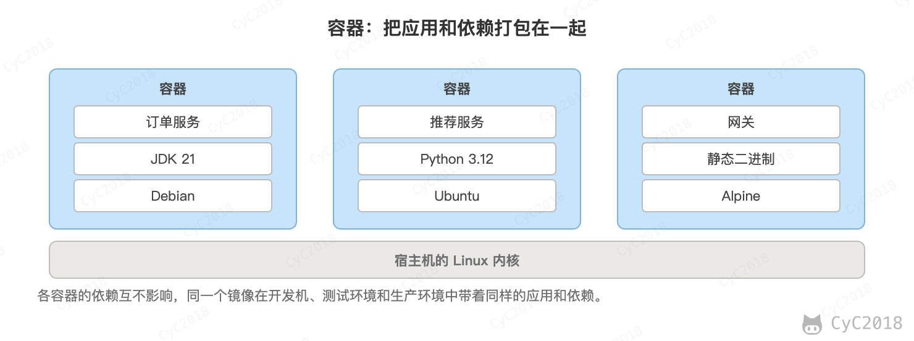
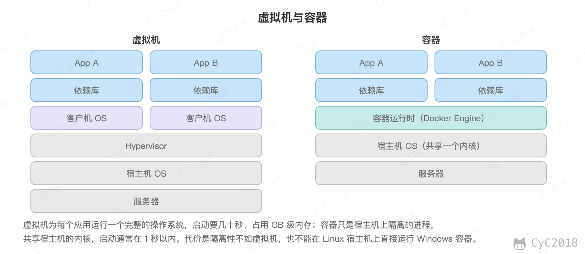
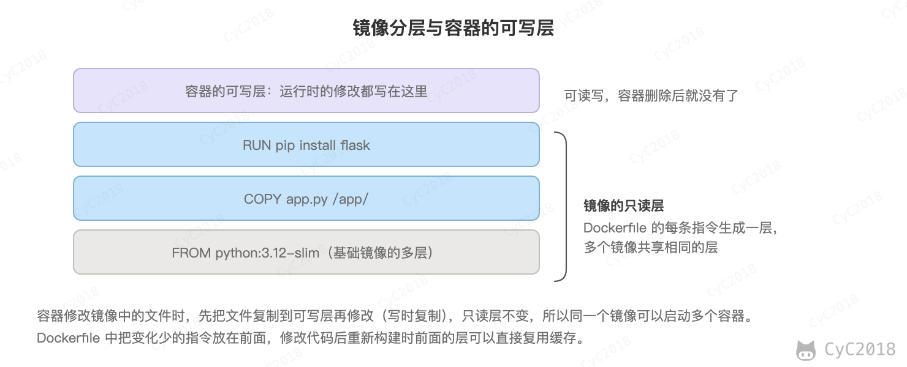

# Docker
<!-- GFM-TOC -->
* [Docker](#docker)
    * [一、解决的问题](#一解决的问题)
    * [二、与虚拟机的比较](#二与虚拟机的比较)
    * [三、优势](#三优势)
    * [四、使用场景](#四使用场景)
    * [五、镜像与容器](#五镜像与容器)
    * [六、实现原理](#六实现原理)
    * [七、Kubernetes](#七kubernetes)
    * [参考资料](#参考资料)
<!-- GFM-TOC -->


## 一、解决的问题

由于不同的机器有不同的操作系统，以及不同的库和组件，在将一个应用部署到多台机器上需要进行大量的环境配置操作。

Docker 主要解决环境配置问题，它是一种虚拟化技术，对进程进行隔离，被隔离的进程独立于宿主操作系统和其它隔离的进程。使用 Docker 可以不修改应用程序代码，不需要开发人员学习特定环境下的技术，就能够将现有的应用程序部署在其它机器上。

<div align="center">  </div><br>

## 二、与虚拟机的比较

虚拟机也是一种虚拟化技术，它与 Docker 最大的区别在于它是通过模拟硬件，并在硬件上安装操作系统来实现。

<div align="center">  </div><br>

### 启动速度

启动虚拟机需要先启动虚拟机的操作系统，再启动应用，这个过程非常慢；

而启动 Docker 相当于启动宿主操作系统上的一个进程。

### 占用资源

虚拟机是一个完整的操作系统，需要占用大量的磁盘、内存和 CPU 资源，一台机器只能开启几十个的虚拟机。

而 Docker 只是一个进程，只需要将应用以及相关的组件打包，在运行时占用很少的资源，一台机器可以开启成千上万个 Docker。

## 三、优势

除了启动速度快以及占用资源少之外，Docker 具有以下优势：

### 更容易迁移

提供一致性的运行环境。已经打包好的应用可以在不同的机器上进行迁移，而不用担心环境变化导致无法运行。

### 更容易维护

使用分层技术和镜像，使得应用可以更容易复用重复的部分。复用程度越高，维护工作也越容易。

### 更容易扩展

可以使用基础镜像进一步扩展得到新的镜像，并且官方和开源社区提供了大量的镜像，通过扩展这些镜像可以非常容易得到想要的镜像。

## 四、使用场景

### 持续集成

持续集成指的是频繁地将代码集成到主干上，这样能够更快地发现错误。

Docker 具有轻量级以及隔离性的特点，在将代码集成到一个 Docker 中不会对其它 Docker 产生影响。

### 提供可伸缩的云服务

根据应用的负载情况，可以很容易地增加或者减少 Docker。

### 搭建微服务架构

Docker 轻量级的特点使得它很适合用于部署、维护、组合微服务。

## 五、镜像与容器

镜像是一种静态的结构，可以看成面向对象里面的类，而容器是镜像的一个实例。

镜像包含着容器运行时所需要的代码以及其它组件，它是一种分层结构，每一层都是只读的（read-only layers）。构建镜像时，会一层一层构建，前一层是后一层的基础。镜像的这种分层存储结构很适合镜像的复用以及定制。

构建容器时，通过在镜像的基础上添加一个可写层（writable layer），用来保存着容器运行过程中的修改。

<div align="center">  </div><br>

## 六、实现原理

容器就是宿主机上的普通进程，Docker 用 Linux 内核的两个机制把它和其它进程隔开：

- 命名空间（Namespace）负责隔离“能看到什么”：PID 命名空间让容器中的第一个进程以为自己是 1 号进程；网络命名空间让容器有自己的网卡、IP 和端口；挂载命名空间让容器有自己的根文件系统；UTS 命名空间让容器有自己的主机名；
- 控制组（cgroup）负责限制“能用多少”：限制 CPU、内存、磁盘 I/O 等资源。

例如用 docker run --memory 64m --cpus 0.5 启动一个容器，在容器中查看：

```sh
$ cat /sys/fs/cgroup/memory.max /sys/fs/cgroup/cpu.max
67108864
50000 100000
$ echo $$
1
```

内存上限是 64 MB，CPU 每 100 ms 最多使用 50 ms，即半个 CPU；容器里的 shell 的进程号是 1。在容器中不断申请内存，超过 64 MB 时进程被内核杀掉，退出码为 137（128 + SIGKILL 的 9）。

因为所有容器共享宿主机的内核，所以容器比虚拟机轻量，但隔离性也更弱：内核漏洞可能让容器中的进程影响宿主机。

## 七、Kubernetes

Docker 解决的是单台机器上怎样运行容器。服务有几十个、部署在几十台机器上时，还需要决定每个容器放在哪台机器上、挂了谁来重启、怎样扩容、怎样不停机升级，这就是 Kubernetes（K8s）做的事情。

K8s 的核心思想是声明期望的状态，由控制器不断把实际状态调整为期望状态。例如下面的配置声明 order-service 要运行 3 个副本，并通过一个 Service 对外提供访问：

```yaml
apiVersion: apps/v1
kind: Deployment
metadata:
  name: order-service
spec:
  replicas: 3
  selector:
    matchLabels:
      app: order-service
  template:
    metadata:
      labels:
        app: order-service
    spec:
      containers:
        - name: app
          image: nginx:1.27-alpine
          ports:
            - containerPort: 80
          readinessProbe:
            httpGet: { path: /, port: 80 }
---
apiVersion: v1
kind: Service
metadata:
  name: order-service
spec:
  selector:
    app: order-service
  ports:
    - port: 80
      targetPort: 80
```

其中的几个概念：

- Pod：K8s 调度的最小单位，包含一个或几个共享网络和存储的容器，每个 Pod 有自己的 IP，重建后 IP 会变；
- Deployment：管理一组相同的 Pod，负责保持副本数、扩缩容和滚动升级；
- Service：为一组 Pod 提供固定的虚拟 IP 和域名，把请求负载均衡到其中就绪的 Pod 上；
- 控制平面：API Server 接收所有请求，etcd 保存集群状态，调度器决定 Pod 放在哪个节点，控制器管理器运行各种控制器；每个节点上的 kubelet 负责启动和检查本节点的容器。

在单节点 K8s（k3s v1.31）上实际操作的结果如下：

- kubectl apply 之后约 20 秒，3 个 Pod 全部就绪，Service 得到虚拟 IP 10.43.189.89，在集群内用 http://order-service 就能访问；
- 删除一个 Pod，Deployment 发现副本数少于 3，立即创建新的 Pod，约 1.2 秒后恢复为 3/3，新 Pod 的 IP 与原来不同，Service 自动更新了后端列表；
- kubectl scale 把副本数改为 5；kubectl set image 修改镜像版本后，Deployment 创建新的 ReplicaSet，逐个用新版本的 Pod 替换旧的，约 12 秒完成滚动升级，期间一直有就绪的 Pod 在提供服务，需要时可以用 kubectl rollout undo 回滚。

readinessProbe 是就绪探针：Pod 启动后要通过检查才会加入 Service 的后端列表，避免把请求转发给还没启动完成的实例。

## 参考资料

- [DOCKER 101: INTRODUCTION TO DOCKER WEBINAR RECAP](https://blog.docker.com/2017/08/docker-101-introduction-docker-webinar-recap/)
- [Docker 入门教程](http://www.ruanyifeng.com/blog/2018/02/docker-tutorial.html)
- [Docker container vs Virtual machine](http://www.bogotobogo.com/DevOps/Docker/Docker_Container_vs_Virtual_Machine.php)
- [How to Create Docker Container using Dockerfile](https://linoxide.com/linux-how-to/dockerfile-create-docker-container/)
- [理解 Docker（2）：Docker 镜像](http://www.cnblogs.com/sammyliu/p/5877964.html)
- [为什么要使用 Docker？](https://yeasy.gitbook.io/docker_practice/introduction/why)
- [What is Docker](https://www.docker.com/what-docker)
- [持续集成是什么？](http://www.ruanyifeng.com/blog/2015/09/continuous-integration.html)
- [Understanding the image layers | Docker Docs](https://docs.docker.com/get-started/docker-concepts/building-images/understanding-image-layers/)
- [Kubernetes 文档：Deployments](https://kubernetes.io/docs/concepts/workloads/controllers/deployment/)
- [Kubernetes 文档：Service](https://kubernetes.io/docs/concepts/services-networking/service/)
- [namespaces(7) — Linux manual page](https://man7.org/linux/man-pages/man7/namespaces.7.html)
- [cgroups(7) — Linux manual page](https://man7.org/linux/man-pages/man7/cgroups.7.html)
