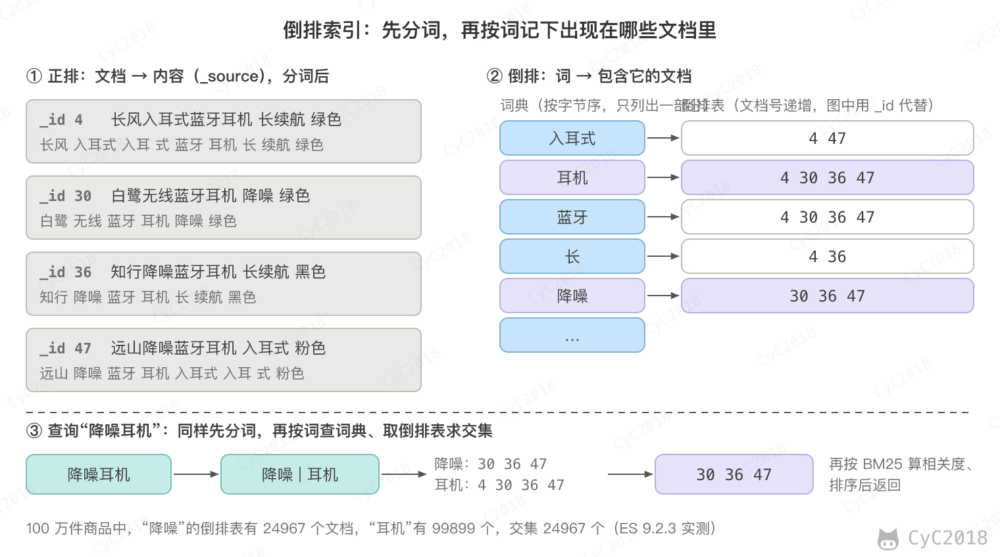
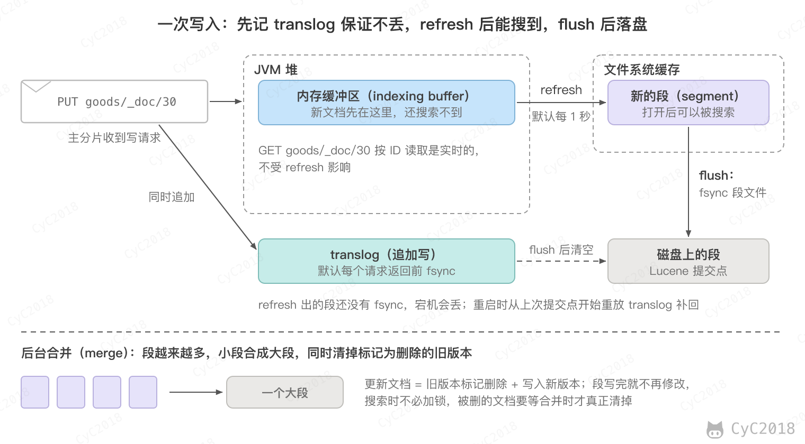
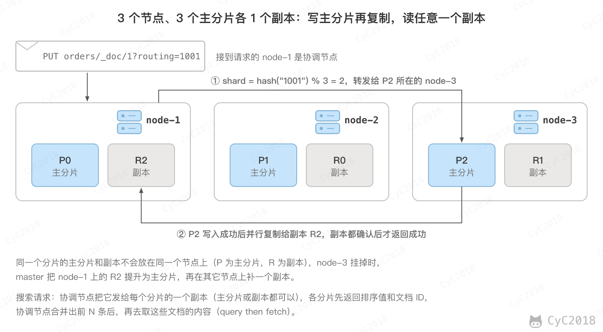

# Elasticsearch
<!-- GFM-TOC -->
* [Elasticsearch](#elasticsearch)
    * [一、为什么需要搜索引擎](#一为什么需要搜索引擎)
    * [二、倒排索引](#二倒排索引) 🔥
        * [正排与倒排](#正排与倒排)
        * [为什么快](#为什么快)
        * [分词](#分词)
    * [三、映射与查询](#三映射与查询)
        * [text 与 keyword](#text-与-keyword)
        * [常用查询](#常用查询)
        * [组合查询与过滤](#组合查询与过滤)
        * [相关度](#相关度)
    * [四、doc_values 与 _source](#四doc_values-与-_source)
    * [五、写入与近实时搜索](#五写入与近实时搜索)
        * [refresh](#refresh)
        * [translog 与 flush](#translog-与-flush)
        * [段合并](#段合并)
        * [批量写入](#批量写入)
    * [六、分片与集群](#六分片与集群)
        * [分片与路由](#分片与路由)
        * [自定义路由](#自定义路由)
        * [副本与集群](#副本与集群)
        * [脑裂](#脑裂)
    * [七、深分页](#七深分页)
    * [八、与 MySQL 的配合](#八与-mysql-的配合)
        * [与 MySQL 的数据同步](#与-mysql-的数据同步)
        * [适用场景](#适用场景)
        * [慢查询的排查](#慢查询的排查)
    * [附录：实测](#附录实测)
        * [A1 LIKE 与全文检索](#a1-like-与全文检索)
        * [A2 分词](#a2-分词)
        * [A3 词典热更新](#a3-词典热更新)
        * [A4 doc_values 与磁盘占用](#a4-doc_values-与磁盘占用)
        * [A5 近实时搜索与 translog](#a5-近实时搜索与-translog)
        * [A6 段与合并](#a6-段与合并)
        * [A7 批量写入时的 refresh](#a7-批量写入时的-refresh)
        * [A8 分片与路由](#a8-分片与路由)
        * [A9 term 与深分页](#a9-term-与深分页)
        * [A10 组合查询](#a10-组合查询)
        * [A11 混合检索](#a11-混合检索)
        * [A12 外部版本号](#a12-外部版本号)
        * [A13 修改映射与别名切换](#a13-修改映射与别名切换)
    * [参考资料](#参考资料)
<!-- GFM-TOC -->


Elasticsearch（简称 ES）是基于 Lucene 的分布式搜索引擎，常用于商品搜索、站内搜索和日志检索。本文用一个 100 万件商品的索引贯穿全文：每件商品有标题、类目、价格和销量，标题形如“白鹭无线蓝牙耳机 降噪 绿色”。文中的数字均为单节点实测（ES 9.2.3、Lucene 10.3.2、MySQL 8.0），环境见[附录](#附录实测)。

## 一、为什么需要搜索引擎

在 MySQL 中按关键词搜索商品，通常写成 LIKE：

```sql
SELECT id, title FROM goods WHERE title LIKE '%蓝牙耳机%' ORDER BY sales DESC LIMIT 10;
```

title 上即使有 B+Tree 索引也用不上，因为索引按标题从左到右的顺序排列，前面有 % 时无法定位到起点（见 [索引失效](MySQL.md#索引失效)），执行计划中 type 为 ALL，100 万行全部扫描一遍再排序，约 240 ms。

更大的问题是结果不对。用户搜“降噪耳机”，LIKE '%降噪耳机%' 一条也查不到，因为标题里写的是“降噪蓝牙耳机”，“降噪”和“耳机”中间隔了别的字。用户希望的是包含这两个词的商品，并且越相关的越靠前。

ES 把标题拆成词，记录每个词出现在哪些商品里。同样的 100 万件商品，搜“蓝牙耳机”找到 99899 件，搜“降噪耳机”找到 24967 件，按销量取前 10 件都不到 10 ms（见[附录 A1](#a1-like-与全文检索)）。

和 MySQL 相比，ES 的特点：

- 擅长全文检索：分词、倒排索引、按相关度排序，以及多条件过滤和聚合统计；
- 天然分布式：数据分成多个分片放在不同节点上，扩容靠加机器；
- 近实时：写入后默认约 1 秒才能被搜到；
- 不支持跨文档的事务，也不适合频繁更新和多表关联。

因此 ES 一般不作为主存储，而是 MySQL 的一份“搜索副本”：数据以 MySQL 为准，变更同步到 ES，搜索请求查 ES，下单、扣库存这类操作仍然走 MySQL，同步的做法见 [与 MySQL 的数据同步](#与-mysql-的数据同步)。

ES 中的几个基本概念：

- 索引（index）：一类文档的集合，相当于一张表，例如 goods；
- 文档（document）：一条 JSON 数据，相当于一行，用 _id 唯一标识；
- 映射（mapping）：字段的类型和分词方式，相当于表结构；
- 分片（shard）：一个索引拆成的若干份，每份是一个独立的 Lucene 索引。

早期版本一个索引中可以有多种类型（type），7.0 起废弃，8.0 起删除，文档的地址统一写成 goods/_doc/30 的形式。

## 二、倒排索引 🔥

### 正排与倒排

正排索引指的是从文档找内容，例如 MySQL 的主键索引，按 id 找到整行。倒排索引反过来，从词找文档：先把每个文档的内容拆成词，再为每个词记录包含它的文档列表。

以四件商品为例，标题分词后建成的倒排索引如下：

<div align="center">  </div><br>

倒排索引分为两部分：

- 词典（term dictionary）：所有出现过的词，按字节序排序；
- 倒排表（postings list）：每个词对应的文档编号，按编号递增排列，还可以记录词在文档中出现的次数（词频）和位置。

搜索“降噪耳机”时，先用同样的规则把它拆成“降噪”和“耳机”，在词典中找到这两个词，取出它们的倒排表求交集，得到同时包含两个词的文档，再按相关度排序。

查找时不需要扫描所有文档，代价取决于命中的倒排表有多长，而不是文档总数。倒排表按编号排好序，求交集时由最短的表领头，拿它的每个编号到其它表中向后跳着找，不必逐个比较。

### 为什么快

和 MySQL 的 B+Tree 相比，倒排索引快在以下几处：

- 查找单位是词：B+Tree 索引的是整个字段值，只能按前缀查找；倒排索引的是字段中的每个词，词在哪个位置都能直接找到；
- 词典查找快：Lucene 把排好序的词按前缀分成块，每块默认 25～48 个词，另有一个很小的词索引记录每个前缀所在的块，查一个词时先在词索引中找到块，再在块内查找，不存在的词常常在词索引中就能排除。词索引在 Lucene 10.3 之前用 FST（有限状态转换器）实现，10.3 起改为专门的 trie；
- 倒排表压缩：文档编号递增，只存与前一个编号的差值，再按 128 个一组用相同的位宽打包，组与组之间记录跳转信息，求交集时可以整组跳过；
- 数据不可变：倒排表写完就不再修改，可以放心地缓存在内存和文件系统缓存中，读取时不需要加锁，原因见 [写入与近实时搜索](#五写入与近实时搜索)。

倒排索引也有代价：写入时要分词、建索引，比 MySQL 插入一行慢；修改一个文档相当于删除后重新写入；不擅长按字段排序和聚合，这部分交给 doc_values，见下文。

### 分词

分词器（analyzer）决定了一段文本被拆成哪些词，查询能否命中全看这一步。它由三部分组成：字符过滤（例如去掉 HTML 标签）、分词（tokenizer）和词项过滤（例如转小写、去停用词）。

ES 自带的 standard 分词器适合英文，对中文是逐字拆分，“降噪蓝牙耳机”会拆成“降 噪 蓝 牙 耳 机”六个字，搜“牙耳”也能命中，结果很不准确。中文常用 IK 分词器插件，它按词典切分（见[附录 A2](#a2-分词)）：

```text
standard     声悦降噪蓝牙耳机 长续航 黑色: 声 | 悦 | 降 | 噪 | 蓝 | 牙 | 耳 | 机 | 长 | 续 | 航 | 黑 | 色
ik_smart     声悦降噪蓝牙耳机 长续航 黑色: 声 | 悦 | 降噪 | 蓝牙 | 耳机 | 长 | 续航 | 黑色
```

IK 有两种模式：

- ik_max_word：尽可能多地切出词，“不锈钢保温杯”切成“不锈钢、不锈、钢、保温杯、保温、杯”；
- ik_smart：切出最粗的一种，“不锈钢保温杯”切成“不锈钢、保温杯”。

常见的配置是写入用 ik_max_word、查询用 ik_smart。写入时多切，索引中的词更全，搜“保温”“保温杯”都能命中；查询时少切，避免把查询拆出“钢”“杯”这样的单字，召回一堆无关的商品。例如索引中有“316 不锈钢保温杯”“陶瓷马克杯”“钢化膜”，查询也用 ik_max_word 时，默认任意一个词命中即可，后两件因为“杯”“钢”也被搜了出来；查询用 ik_smart 时只返回保温杯（见[附录 A2](#a2-分词)）。

反过来，写入时只用 ik_smart，索引中只有“保温杯”而没有“保温”，搜“保温”就一件也找不到；同样的 100 万件商品，用 ik_max_word 建的索引能找到 99708 件。

新词不在词典中时会被拆开，例如品牌“声悦”被切成“声”和“悦”。IK 支持远程扩展词典：ES 每分钟请求一次配置的地址，响应首部中的 Last-Modified 或 ETag 变化时重新加载词典，不用重启。需要注意的是，新词典只影响之后写入和查询时的分词，已有文档的倒排索引里仍是“声”“悦”两个词，搜“声悦”一件也找不到，要用 _update_by_query 让这些文档按新词典重新建索引（见[附录 A3](#a3-词典热更新)）。

## 三、映射与查询

### text 与 keyword

字符串字段有两种类型：

- text：写入时分词，用于全文检索，例如商品标题；
- keyword：不分词，整个值作为一个词，用于精确匹配、排序和聚合，例如类目、状态、订单号。

不定义映射直接写入时，ES 会把字符串字段映射成 text，同时加一个 keyword 类型的子字段 xxx.keyword。这样每个字符串都建两份索引，也可能把本该是 keyword 的字段当成 text，生产环境通常预先定义映射。商品索引的映射：

```json
PUT goods
{
  "settings": { "number_of_shards": 3, "number_of_replicas": 0 },
  "mappings": {
    "properties": {
      "title":    { "type": "text", "analyzer": "ik_max_word", "search_analyzer": "ik_smart",
                    "fields": { "raw": { "type": "keyword" } } },
      "category": { "type": "keyword" },
      "price":    { "type": "scaled_float", "scaling_factor": 100 },
      "sales":    { "type": "integer" }
    }
  }
}
```

title 是 text，还有一个 keyword 子字段 title.raw，用来按完整标题精确查找。price 是 scaled_float，按分存成整数，避免浮点误差。数值字段不建倒排索引，而是用 BKD 树（一种把数值分块组织的多维树）支持范围查询。

已有字段的类型不能修改，例如把 sales 从 integer 改成 keyword 会报错；可以新增字段（见[附录 A13](#a13-修改映射与别名切换)）。这是因为已经写入的数据是按原来的类型建的索引，改类型相当于重建索引：新建一个索引，用 _reindex 把数据复制过去，再把别名从旧索引切到新索引。查询一直通过别名访问，切换对业务透明：

```json
POST _aliases
{
  "actions": [
    { "remove": { "index": "goods_v1", "alias": "goods_search" } },
    { "add":    { "index": "goods_v2", "alias": "goods_search" } }
  ]
}
```

两个动作在一个请求中原子地执行，不会出现别名同时指向两个索引或都不指向的情况。

### 常用查询

查询能否命中，取决于查询词和索引中的词是否一致：

- match：先把查询词分词，再查倒排索引，是全文检索最常用的查询；
- term：不分词，拿整个查询词去倒排索引中找完全相同的词，用于 keyword 和数值字段；
- match_phrase：分词后还要求这些词在文档中相邻且顺序一致。

最常见的错误是用 term 查 text 字段。title 中的“蓝牙耳机”在写入时已经被拆成“蓝牙”和“耳机”，索引中没有“蓝牙耳机”这个词，term 查询的结果是 0（见[附录 A9](#a9-term-与深分页)）：

```text
{"term": {"title": "蓝牙耳机"}}       -> 0
{"term": {"title": "耳机"}}           -> 99899
{"match": {"title": "蓝牙耳机"}}      -> 99899
{"term": {"category": "蓝牙耳机"}}    -> 99899
```

match 默认的 operator 是 or，命中任意一个词就返回，只是命中越多分数越高；要求所有词都出现时设为 and。

match_phrase 依赖倒排表中记录的位置。“降噪蓝牙耳机”中“降噪”和“耳机”之间隔了“蓝牙”，match_phrase 搜“降噪耳机”的结果为 0；slop 指的是允许词之间移动的位置数，设为 1 时找到 12460 件，即标题中带有“降噪蓝牙耳机”的商品；用 match 加 and 是 24967 件，也包括“蓝牙耳机 降噪”这种词序不同的标题（见[附录 A2](#a2-分词)）。

### 组合查询与过滤

实际的搜索通常是全文检索加上若干筛选条件，用 bool 查询组合：

- must：必须满足，参与相关度打分；
- filter：必须满足，不打分；
- should：满足时加分，没有 must 和 filter 时至少要满足一个；
- must_not：必须不满足，不打分。

例如搜“降噪耳机”，只要蓝牙耳机类目、价格在 200 到 500 元之间，按销量排序：

```json
POST goods/_search
{
  "query": {
    "bool": {
      "must":   [ { "match": { "title": { "query": "降噪耳机", "operator": "and" } } } ],
      "filter": [ { "term":  { "category": "蓝牙耳机" } },
                  { "range": { "price": { "gte": 200, "lte": 500 } } } ]
    }
  },
  "sort": [ { "sales": "desc" } ],
  "size": 10
}
```

共命中 3766 件，耗时几毫秒（见[附录 A10](#a10-组合查询)）。类目和价格这类是否满足的条件放在 filter 中，因为不需要算分数，而且 ES 会缓存经常使用的过滤结果，下次直接复用；关键词这种要看相关程度的条件才放在 must 中。

### 相关度

相关度分数默认用 BM25 计算，主要看三点：查询词在文档中出现得越多分数越高，但增长越来越慢；越少见的词权重越高；词频相同时，越短的文档分数越高。公式和算例见 [混合检索](大模型应用.md#混合检索)。

需要注意的是，每个分片只用自己的统计信息计算分数。查询会分发到所有分片，各分片用本地的文档数和词频算出 IDF，数据少、分布不均时，同一个文档在不同分片上得分不同。例如两件标题相同的商品分别在两个分片上，其中一个分片上另有 8 件也含“降噪”，“降噪”在这个分片上更常见，两件商品的分数分别为 0.045 和 0.596。查询时加 search_type=dfs_query_then_fetch，先收集所有分片的统计信息再打分，两件商品都是 0.117（见[附录 A8](#a8-分片与路由)）。数据量大、分布均匀时差异很小，一般不需要。

## 四、doc_values 与 _source

倒排索引擅长从词找文档，但排序和聚合需要的是反方向：已知一批文档，取出它们的销量或类目。如果只有倒排索引，就要遍历所有词，看每个词的倒排表里有没有这些文档。

doc_values 是写入时额外生成的一份列式存储，按文档编号顺序存放每个文档的字段值，排序、聚合和脚本读取字段值时都用它。keyword、数值、日期等类型默认开启；text 字段没有 doc_values，对 title 做聚合会报错，要用 keyword 类型的 title.raw 或 category（见[附录 A4](#a4-doc_values-与磁盘占用)）。

对 text 字段可以开启 fielddata，在第一次排序或聚合时把倒排索引反转后放到 JVM 堆中，它占用大量堆内存，容易引发频繁的垃圾收集，因此默认关闭，一般不使用。

不需要排序和聚合的字段可以关闭 doc_values 节省磁盘，只需要排序和聚合、不需要搜索的字段可以把 index 设为 false，不建倒排索引。

_source 指的是写入时的原始 JSON，搜索结果中返回的内容就来自它。它不能用于搜索，只用于返回和重建索引（_reindex 读的就是 _source）。

用 _disk_usage 统计商品索引中各部分的大小：100 万件商品共 78.2 MB，其中 _source 占 33.1 MB，title 的倒排索引 10.3 MB，title.raw 的倒排索引和 doc_values 各 5.5 MB、3.6 MB，price 和 sales 的 BKD 树和 doc_values 共 10.4 MB。

## 五、写入与近实时搜索

### refresh

ES 写入一个文档后，默认不能马上被搜到。这是因为 Lucene 的索引由若干个段（segment）组成，每个段是一个完整的小倒排索引，写完就不再修改，搜索只能搜已经生成的段；新写入的文档先放在内存缓冲区中，还不属于任何一个段。

refresh 指的是把内存缓冲区中的文档写成一个新的段并打开，使它可以被搜索。ES 默认每 1 秒执行一次 refresh，所以写入后约 1 秒才能搜到，称为近实时（near real-time）。

<div align="center">  </div><br>

实测写入一件商品后立即搜索，结果为 0，等待 0.93 秒后能搜到；同时，按 ID 读取（GET goods/_doc/30）立即就能读到，因为按 ID 读取是实时的，不依赖 refresh（见[附录 A5](#a5-近实时搜索与-translog)）。

refresh 生成的段先写到文件系统缓存，还没有 fsync 到磁盘，开销小，所以可以每秒执行一次。

写入后需要立即可见时，有两个选项：

- refresh=true：写入后立即对相关分片执行一次 refresh，频繁使用会产生大量小段；
- refresh=wait_for：不主动 refresh，等到下一次 refresh 完成再返回，实测写入后约 0.96 秒返回，返回时已能搜到。

常见的问题是写完 ES 立刻发消息通知下游，下游去搜却搜不到，原因就是还没有 refresh。下游按 ID 读取，或者写入时加 refresh=wait_for 再发消息。

没有显式设置 refresh_interval 时，一个分片 30 秒内没有收到搜索请求就会进入闲置状态（search idle），不再在后台定时 refresh，等到下一个搜索请求到来时才执行一次。这样写多读少的索引不必每秒都生成新段，代价是闲置后的第一次搜索要先等待 refresh。

### translog 与 flush

refresh 生成的段还在文件系统缓存中，宕机就会丢失。为了不丢数据，每次写入还会追加一条记录到 translog（事务日志），作用相当于 MySQL 的 redo log：

- 默认 index.translog.durability 为 request，每个写请求返回前，主分片和所有副本都要把 translog fsync 到磁盘；
- 设为 async 时在后台每 5 秒（sync_interval）fsync 一次，写入更快，但宕机时会丢失上次 fsync 之后已经返回成功的写入。

flush 指的是执行一次 Lucene 提交：把文件系统缓存中的段 fsync 到磁盘，写入提交点，然后开始新的 translog。宕机重启时，从最后一个提交点开始重放 translog，补回之后的写入。ES 根据 translog 的大小自动执行 flush，避免 translog 太大导致恢复时重放太久。

translog 和 MySQL 的 redo log 一样用顺序追加换取持久性，flush 类似于推进检查点，之后的恢复只需从提交点开始，见 [redo log](MySQL.md#redo-log)。

### 段合并

有新写入时每次 refresh 都会生成一个新段，段越来越多，每次搜索都要查所有的段，再合并结果。ES 在后台把小段合并成大段（merge），合并时还会真正删除那些标记为已删除的文档。

因为段写完就不再修改，更新一个文档的做法是在旧段中把旧版本标记为删除，在新段中写入新版本；删除文档也只是做标记，要等合并时才清除。实测在只有一个段的分片上更新约 1.7 万件商品，大段中多出约 1.7 万个已删除的文档，新版本写到了新生成的 3 个小段中（见[附录 A6](#a6-段与合并)）。

合并要读写大量数据，ES 会自动限制合并的速度，但写入量大时仍可能和搜索争抢磁盘和 CPU，导致查询延迟突然升高。

forcemerge 用于手动合并，例如合并成一个段：商品索引每个分片从 17～19 个段合并为 1 个段，已删除的文档清空，大小从 161.9 MB 降为 74.2 MB。需要注意的是，官方建议只对不再写入的索引（例如前一天的日志）执行 forcemerge：合并出的段大于 5 GB 时不再参与自动合并，之后的更新和删除留下的已删除文档会一直堆积在这个大段中。

### 批量写入

大量导入数据时，常用的做法：

- 用 _bulk 批量写入，100 万件商品按每批 5000 条写入约 15 秒；
- 初次导入时把副本数设为 0，导入完再改回来，副本直接复制主分片的段文件，不用把每个文档再索引一遍；
- 用 ES 自动生成的 ID，写入时不用检查同一个 ID 是否已经存在；
- 多个线程并发发送 bulk 请求。

常见的建议还有导入期间把 refresh_interval 设为 -1，关闭 refresh。需要注意的是，这条建议在本文的单节点测试中并没有更快：100 万条数据关闭 refresh 用了 16.5～18.3 秒，默认 1 秒 refresh 用了 14.2～14.4 秒，前者只生成了 6 个段（见[附录 A7](#a7-批量写入时的-refresh)）。效果取决于数据量、机器和段的大小，以实测为准。

## 六、分片与集群

### 分片与路由

一个索引的数据分成多个主分片，放在不同的节点上，单个索引的容量和写入能力就不受一台机器的限制。写入一个文档时，按下面的公式决定它属于哪个主分片：

```text
shard_num = hash(_routing) % number_of_shards
```

其中 hash 是 Murmur3 哈希，_routing 默认是文档的 _id。例如商品 1024 落在分片 1、1025 落在分片 0（见[附录 A8](#a8-分片与路由)）。需要注意的是，这个公式适用于 ES 9.4 起新建的索引；之前创建的索引（包括附录中的实验）先对一个更大的数 number_of_routing_shards（3 个分片时默认是 768）取模，再除以它与主分片数之比，同一个路由值算出的分片可能不同，但同样由主分片数决定。

因为路由依赖主分片数，主分片数在创建索引后不能修改，修改会让已有文档按公式算出的分片变化，按 ID 就找不到了。实测直接修改 number_of_shards 会被拒绝，需要扩分片时有两种做法：

- _split：把索引拆成主分片数为原来整数倍的新索引，前提是先把原索引设为只读；ES 9.4 之前创建的索引，目标分片数还要能整除 number_of_routing_shards，例如 3 个分片可以拆成 6 个，不能拆成 9 个；
- _reindex：新建一个分片数合适的索引，把数据复制过去，再切换别名。

_shrink 可以反过来减少主分片，目标分片数必须是原分片数的因数。

分片数要提前规划，官方建议每个分片 10 GB～50 GB、文档数不超过 2 亿。分片太多也不好：每个分片都要占用内存、文件句柄和集群状态，一次搜索要查询所有分片再合并，搜索 1000 个 50 MB 的分片比搜索一个 50 GB 的分片慢得多。

### 自定义路由

订单按用户查询时，可以把 user_id 作为路由值，同一个用户的订单就都在一个分片上：

```text
PUT orders/_doc/1?routing=1001
GET orders/_search?routing=1001
```

不指定路由时，“查询用户 1001 的订单”要发给全部 3 个分片；指定 routing=1001 后只查询 1 个分片。代价是：

- 按 ID 读取、更新、删除时也必须带上同样的路由值，否则会去错误的分片上找。在映射中设置 _routing 为 required 后，不带路由的读取直接报 routing_missing_exception（见[附录 A8](#a8-分片与路由)）；
- 不同用户的订单数差别很大时，分片大小不均匀，实测 30 个用户、3000 个订单时 3 个分片分别有 400、1300、1300 个订单；数据倾斜严重时可以设置 routing_partition_size，让一个路由值分散到多个分片上。

### 副本与集群

每个主分片可以有若干个副本（replica），副本是主分片的完整拷贝，用于故障转移和分担读请求。同一个分片的主分片和副本不会放在同一个节点上，单节点集群中副本无法分配，集群状态为 yellow。

<div align="center">  </div><br>

集群中的节点按角色分工：

- master 节点：维护集群状态（有哪些索引、映射，分片放在哪个节点上），较大的集群通常用不保存数据的专门节点担任；
- 数据节点：保存分片，执行写入和搜索；
- 协调节点：接收客户端请求，转发给相关的分片，合并结果后返回。每个节点都可以充当协调节点。

写入的过程：

1. 协调节点按路由公式算出主分片，把请求转发给主分片所在的节点；
2. 主分片校验并写入，再把该操作并行发给同步副本集合（in-sync copies，由 master 维护）中的所有副本；
3. 所有副本都写入成功后，主分片返回成功。

副本写入失败时，主分片请求 master 把它移出同步副本集合，之后不再等待它，这样一个故障的副本不会拖住写入。这种复制方式称为主备复制（primary-backup），基于微软的 PacificA 论文。主分片所在的节点故障时，master 把同步副本集合中的一个副本提升为主分片。

搜索分两个阶段，称为 query then fetch：

1. query：协调节点把请求发给每个分片的一个副本（主分片或副本都可以，默认按各节点的响应时间、队列长度自适应地选择），每个分片在本地查出前 from + size 个文档，只返回文档 ID 和排序值；
2. fetch：协调节点合并各分片的结果，确定最终的这一页，再去相应的分片取这些文档的 _source。

### 脑裂

脑裂（split brain）指的是网络分区后，集群分成两部分，各自选出一个 master，分别接受写入，数据出现冲突。

ES 通过法定人数（quorum）避免脑裂：选举 master、提交集群状态的变更，都要得到投票配置中超过半数的 master 候选节点同意。3 个候选节点分成 2 和 1 两部分时，只有 2 个节点的一边能选出 master，另一边因为不到半数而无法工作。

master 候选节点通常取 3 个这样的奇数：4 个和 3 个一样只能容忍 1 个故障，候选节点为偶数时，ES 会把其中一个排除在投票配置之外。

ES 7.0 之前需要手动配置 discovery.zen.minimum_master_nodes 为候选节点数 / 2 + 1，配置错误或扩容后忘记修改就可能脑裂；7.0 起由 ES 自动维护投票配置，这个参数不再生效。超过半数的思路和 Raft 相同，见 [Raft](分布式.md#六raft)。

## 七、深分页

from + size 分页时，每个分片都要返回前 from + size 个文档，由协调节点合并排序后再取出最后一页。查第 1000 页（from = 9990，size = 10）时，3 个分片各返回 10000 个，协调节点合并 30000 个，只用其中 10 个，页数越深，内存和 CPU 的开销越大。

实测 from 从 0 增加到 9990，耗时从 9.8 ms 增加到 28.3 ms。ES 默认限制 from + size 不能超过 10000（index.max_result_window），超过时直接报错（见[附录 A9](#a9-term-与深分页)）。调大这个参数能翻得更深，但开销仍随深度增长，通常不这样做。

更深的翻页用 search_after：每页按排序值加一个唯一的字段排序，下一页带上上一页最后一个文档的排序值，各分片只返回排在它之后的 size 个文档，原理与 MySQL 的游标分页相同（见 [深分页](MySQL.md#深分页)）。

```json
POST _search
{
  "query": { "match": { "title": "耳机" } },
  "sort": [ { "sales": "desc" }, { "_shard_doc": "asc" } ],
  "size": 10,
  "pit": { "id": "<上一页返回的 PIT ID>", "keep_alive": "1m" },
  "search_after": [ 67, 3169 ]
}
```

两页之间索引可能 refresh，新文档的插入会让后面的页出现重复或遗漏。时间点（Point In Time, PIT）用于固定一个时刻的索引快照，翻页期间都在这个快照上查询；使用 PIT 时可以用 _shard_doc 作为保证唯一的排序字段。实测用 search_after 加 PIT 连续翻到第 1000 页，第 2 页之后每页耗时的中位数约 3 ms，第 1000 页为 2.4 ms。

需要注意的是，search_after 只能一页一页往后翻，不能跳到第 N 页。产品上通常限制可跳转的页数（例如只给前 100 页），更深的结果用“加载更多”。

scroll 是早期用于遍历大量数据的接口，也会保存快照，官方已不再推荐用它做深分页，导出全量数据时也改用 search_after 加 PIT。

## 八、与 MySQL 的配合

### 与 MySQL 的数据同步

数据以 MySQL 为准，同步到 ES 的做法：

- 同步双写：业务代码写完 MySQL 再写 ES，简单，但两次写入不是一个事务，写 ES 失败或进程在中间崩溃都会导致不一致，还让业务代码依赖 ES 的可用性；
- 异步消息：写完 MySQL 发一条消息，消费者再写 ES，失败了可以重试；但发消息和提交事务也不是原子的，要用 [本地消息表](分布式.md#本地消息表) 保证消息一定发出；
- 订阅 binlog：用 Canal 这类工具伪装成 MySQL 的从库读取 binlog，转成消息发到 Kafka，消费者写 ES。业务代码不用改，手工执行的 SQL 也能同步，是常用的做法；
- 定时轮询：按 updated_at 定时拉取变更的行，实现简单，但会漏掉删除和晚提交的行，原因见 [binlog](MySQL.md#binlog)。

无论哪种方式，写 ES 都要处理两个问题：

- 重复和乱序：重试会造成重复，并行消费会造成乱序，旧的数据可能覆盖新的。写入时带上外部版本号（version_type=external），例如 MySQL 行上每次更新都加 1 的 version 列，版本号不大于已有文档的写入会被拒绝（见[附录 A12](#a12-外部版本号)），也可以按商品 ID 选择消息队列的分区，保证同一个商品的消息有序（见 [顺序性](消息队列.md#四顺序性)）；
- 写入失败：重试多次仍失败的消息放进 [死信队列](消息队列.md#死信队列) 告警，修复后重新投递。

ES 与 MySQL 之间只能做到最终一致：binlog 同步本身有延迟，写入 ES 后还要等 refresh。为了发现漏同步的数据，可以定期对账：按 ID 范围分批比较两边的记录数和版本号（或者数据的校验和），只对不一致的范围逐条比较并补写。

对一致性要求高的读取不走 ES：搜索结果列表来自 ES，用户点进商品详情或下单时，按 ID 回到 MySQL 查最新的数据。

### 适用场景

ES 适合的场景：

- 全文检索：商品搜索、站内搜索、文档检索；
- 多条件组合筛选：字段多、组合多，在 MySQL 中无法为每种组合都建索引；
- 日志和监控数据：写多改少，按时间范围查询和聚合，按天建索引，过期的整个索引直接删除；
- 向量检索：ES 也支持 dense_vector 字段和近似最近邻检索，可以和关键词检索组合，见 [向量数据库](大模型应用.md#向量数据库)；需要注意的是，ES 内置的 RRF 融合需要付费许可证（见[附录 A11](#a11-混合检索)）。

不适合的场景：

- 需要事务和强一致的数据，例如订单、账户余额；
- 频繁更新的数据，每次更新都是标记删除加写入新版本，旧版本要等合并时才清除；
- 复杂的多表关联查询，通常在写入前把关联的数据合并到一个文档中（例如订单中直接存商品名），以冗余换查询速度。

MySQL 也有全文索引（见 [全文索引](MySQL.md#3-全文索引)），中文要用 ngram 解析器按固定长度（默认 2 个字）切分，不能按词典分词，也不能像 ES 那样分片扩展，一般只在数据量小、不想引入新组件时使用。

### 慢查询的排查

ES 查询变慢时，常见的原因和做法：

- 分片太多或太大：每次搜索都要查所有分片，按每个分片 10 GB～50 GB 规划；
- 查询写法：通配符开头的 wildcard、正则、脚本排序都会遍历大量的词或文档，改为在写入时预先处理，例如把要前缀搜索的字段单独存一份；
- 深分页：改用 search_after；
- 内存：ES 依赖文件系统缓存读取索引文件，官方建议 JVM 堆不超过物理内存的一半，剩下的留给文件系统缓存，并且不超过压缩对象指针的阈值（大多数系统上 26 GB 是安全的）；
- 段太多或合并占用资源：写入期间查询延迟抖动，能接受更长的可见延迟时，可以增大 refresh_interval 减少小段。

定位时用 profile API 查看每个子查询在每个分片上的耗时，用慢查询日志（search slowlog）记录超过阈值的查询，阈值默认关闭，需要按索引设置。

## 附录：实测

环境：Apple M1 Pro、macOS 15.8.1；Elasticsearch 9.2.3（Lucene 10.3.2，自带 JDK 25.0.1），IK 分词器 9.2.3，单节点，堆 1 GB；MySQL 8.0.44。商品数据由脚本生成 100 万条（固定随机种子），标题为品牌加属性加类目加属性加颜色，例如“白鹭无线蓝牙耳机 降噪 绿色”，10 个类目各约 10 万件，MySQL 和 ES 中的数据相同。ES 的 goods 索引 3 个主分片、0 个副本，映射见 [text 与 keyword](#text-与-keyword)；MySQL 的 goods 表在 title 上有普通索引。耗时为客户端测量的 5～7 次的中位数，took 为 ES 返回的服务端耗时；单机上的绝对耗时只供比较。

### A1 LIKE 与全文检索

```text
-- MySQL
EXPLAIN SELECT id, title FROM goods WHERE title LIKE '%蓝牙耳机%' ORDER BY sales DESC LIMIT 10;
type = ALL, rows = 995656, Extra = Using where; Using filesort
COUNT LIKE '%蓝牙耳机%': 99899 rows, 162 ms
top10 LIKE '%蓝牙耳机%' ORDER BY sales: 243 ms
COUNT LIKE '%降噪耳机%': 0 rows, 161 ms

-- ES：{"match": {"title": {"query": ..., "operator": "and"}}, "size": 10, "track_total_hits": true}
'蓝牙耳机': total 99899, client 4.0 ms, took 2 ms
'蓝牙耳机' sort sales: client 6.9 ms, took 5 ms
'降噪耳机': total 24967, client 3.9 ms, took 2 ms
  top 3: ['声悦降噪蓝牙耳机 运动 黑色', '声悦降噪蓝牙耳机 无线 黑色', '声悦降噪蓝牙耳机 运动 白色']
'降噪耳机' sort sales: client 3.3 ms, took 2 ms
```

### A2 分词

```text
$ POST _analyze {"analyzer": ..., "text": ...}
standard     声悦降噪蓝牙耳机 长续航 黑色: 声 | 悦 | 降 | 噪 | 蓝 | 牙 | 耳 | 机 | 长 | 续 | 航 | 黑 | 色
ik_smart     声悦降噪蓝牙耳机 长续航 黑色: 声 | 悦 | 降噪 | 蓝牙 | 耳机 | 长 | 续航 | 黑色
ik_max_word  声悦降噪蓝牙耳机 长续航 黑色: 声 | 悦 | 降噪 | 蓝牙 | 耳机 | 长 | 续航 | 黑色
ik_max_word  不锈钢保温杯: 不锈钢 | 不锈 | 钢 | 保温杯 | 保温 | 杯
ik_smart     不锈钢保温杯: 不锈钢 | 保温杯
```

查询时的分词器：单分片的小索引中有三件商品，写入用 ik_max_word，match 查询“不锈钢保温杯”（默认 or）：

```text
ik_max_word 钢化膜 高清: 钢 | 化 | 膜 | 高清
ik_max_word 陶瓷马克杯 白色: 陶瓷 | 马克杯 | 马克 | 杯 | 白色
查询时用 ik_max_word: [('石榴316不锈钢保温杯 便携 灰色', 3.932), ('钢化膜 高清', 0.553), ('陶瓷马克杯 白色', 0.514)]
查询时用 ik_smart:    [('石榴316不锈钢保温杯 便携 灰色', 1.586)]
```

写入时的分词器：把 goods 的标题 _reindex 到一个写入也用 ik_smart 的索引，match 加 and 的命中数：

```text
                   保温     保温杯   不锈钢保温杯
写入 ik_max_word   99708    99708    25044
写入 ik_smart      0        99708    25044
```

match_phrase 与 slop：

```text
{"match_phrase": {"title": "蓝牙耳机"}}                         -> 99899
{"match_phrase": {"title": "降噪耳机"}}                         -> 0
{"match_phrase": {"title": {"query": "降噪耳机", "slop": 1}}}   -> 12460
{"match": {"title": {"query": "降噪耳机", "operator": "and"}}}  -> 24967
```

### A3 词典热更新

IKAnalyzer.cfg.xml 中配置 remote_ext_dict 为一个本地 HTTP 服务上的 brand.dic，修改配置后重启一次 ES。之后向 brand.dic 写入“声悦”，不重启：

```text
before: 声 | 悦 | 降噪 | 蓝牙 | 耳机
dict updated at 17:01:15
after 51s: 声悦 | 降噪 | 蓝牙 | 耳机

HTTP 服务的访问日志（每分钟一次 HEAD，变化后 GET）：
[17:01:04] "HEAD /brand.dic HTTP/1.1" 200
[17:01:05] "GET /brand.dic HTTP/1.1" 200
[17:02:04] "HEAD /brand.dic HTTP/1.1" 200
[17:02:05] "GET /brand.dic HTTP/1.1" 200
ES 日志：
[17:02:04,983][INFO ][o.w.a.d.Dictionary] start to reload ik dict.
[17:02:05,045][INFO ][o.w.a.d.Dictionary] reload ik dict finished.

match title "声悦"        -> 0
prefix title.raw "声悦"   -> 49998
POST goods/_update_by_query?conflicts=proceed&refresh=true {"query": {"prefix": {"title.raw": "声悦"}}}
 -> took 3522 ms, updated 49998
match title "声悦"        -> 49998
```

### A4 doc_values 与磁盘占用

```text
$ POST goods/_search {"size": 0, "aggs": {"t": {"terms": {"field": "title"}}}}
Fielddata is disabled on [title] in [goods]. Text fields are not optimised for operations that require
per-document field data like aggregations and sorting, so these operations are disabled by default.

$ POST goods/_disk_usage?run_expensive_tasks=true
total 78.2mb
title      total 11.3mb  inverted_index 10.3mb  doc_values 0b     stored 0b      points 0b
title.raw  total 9.2mb   inverted_index 5.5mb   doc_values 3.6mb  stored 0b      points 0b
category   total 1.2mb   inverted_index 768.7kb doc_values 514kb  stored 0b      points 0b
price      total 6.2mb   inverted_index 0b      doc_values 2.5mb  stored 0b      points 3.7mb
sales      total 4.2mb   inverted_index 0b      doc_values 2.1mb  stored 0b      points 2mb
_source    total 33.1mb  inverted_index 0b      doc_values 0b     stored 33.1mb  points 0b
_id        total 8.9mb   inverted_index 4.5mb   doc_values 0b     stored 4.4mb   points 0b
```

### A5 近实时搜索与 translog

单分片的索引，写入一件商品后立即搜索，再每 50 ms 搜索一次直到命中：

```text
search right after index: 0
GET by id right after index: found = True
visible to search after 0.93s
index with refresh=wait_for returned after 0.96s, search: 1

35 秒没有搜索后写入一件商品，3 秒后：
refresh stats: {'total': 5, 'external_total': 4}     -- 没有新的 refresh
searchable docs in segments: 2                         -- 新商品还不在可搜索的段中
first search after idle: hits=1, 0.015s
refresh stats after search: {'total': 6, 'external_total': 5}

translog before flush: {'operations': 3, 'uncommitted_operations': 3}
translog after flush:  {'operations': 0, 'uncommitted_operations': 0}
defaults: refresh_interval 1s, search.idle.after 30s, translog.durability REQUEST, translog.sync_interval 5s
```

### A6 段与合并

```text
$ GET _cat/indices/goods  （导入并做过一次 _update_by_query 后）
docs.count 1000000  docs.deleted 49323  store.size 161.9mb
shard 0 segments 17  shard 1 segments 17  shard 2 segments 19

$ POST goods/_forcemerge?max_num_segments=1    （2.9 s）
docs.count 1000000  docs.deleted 0  store.size 74.2mb
shard 0 segment _h 333316 docs  24.7mb   （另两个分片相同）

$ POST goods/_update_by_query {"query": {"prefix": {"title.raw": "青禾"}}}   （3 个分片共更新 50287 件）
docs.deleted 50287  store.size 74.6mb
shard segment docs.count docs.deleted    size committed
0     _h          316524        16792  24.7mb true
0     _i            1343            0 126.4kb false
0     _j           12319            0 912.8kb false
0     _k            3130            0 266.6kb false
...
```

### A7 批量写入时的 refresh

100 万条数据，每批 5000 条，单线程发送 _bulk，副本数为 0，两种设置交替各运行两次：

```text
refresh_interval=1s: 14.4s, refreshes=33, segments=27
refresh_interval=-1: 18.3s, refreshes=9,  segments=6
refresh_interval=1s: 14.2s, refreshes=32, segments=26
refresh_interval=-1: 16.5s, refreshes=9,  segments=6
```

统计中的 refresh 次数包括 ES 内部触发的。最初创建 goods 索引时用同样的批大小导入，约 15.0 s。

### A8 分片与路由

```text
$ GET goods/_search_shards?routing=1024      （_id 默认作为路由值）
_id 1024 -> shard 1      _id 1025 -> shard 0      _id 1026 -> shard 0

Murmur3（ES 9.2.3 的 Murmur3HashFunction）：
hash("1024") = 509060644,   floorMod(hash, 768) = 292, 292 / 256 = 1
hash("1001") = -1823115355, floorMod(hash, 768) = 677, 677 / 256 = 2
（goods 在 9.2.3 中创建，routing_num_shards = 768，用旧的路由公式）

orders 索引：3 个分片，_routing 为 required，30 个用户的 3000 个订单按 user_id 路由
search without routing:   shards total 3, hits 100
search with routing=1001: shards total 1, hits 100
GET orders/_doc/1 without routing: routing_missing_exception
docs per shard: 400, 1300, 1300

$ PUT orders/_settings {"index": {"number_of_shards": 6}}
illegal_argument_exception: Can't update non dynamic settings [[index.number_of_shards]] for open indices
$ PUT orders/_settings?reopen=true ...
illegal_argument_exception: final orders setting [index.number_of_shards], not updateable
$ PUT orders/_block/write
$ POST orders/_split/orders6 {"settings": {"index.number_of_shards": 6}}   -> acknowledged
$ POST orders/_split/orders9 {"settings": {"index.number_of_shards": 9}}
illegal_state_exception: the number of routing shards [768] must be a multiple of the target shards [9]
$ GET _cat/shards/orders6       （1 个副本，单节点上无法分配）
orders6 0 p STARTED 100    orders6 0 r UNASSIGNED   ...   health: yellow
```

分片间的相关度：2 个分片的索引，两件标题相同的商品“知行降噪蓝牙耳机 长续航 黑色”分别路由到分片 0 和分片 1，分片 0 上另有 8 件标题含“降噪”的商品，match 查询“降噪”：

```text
query_then_fetch:     分片 0 上的得分 0.045，分片 1 上的得分 0.5957
dfs_query_then_fetch: 分片 0 上的得分 0.1168，分片 1 上的得分 0.1168
```

### A9 term 与深分页

```text
{"term": {"title": "蓝牙耳机"}}                          -> 0
{"term": {"title": "耳机"}}                              -> 99899
{"match": {"title": "蓝牙耳机"}}                         -> 99899
{"term": {"title.raw": "蓝牙耳机"}}                      -> 0
{"term": {"title.raw": "木棉入耳式蓝牙耳机 降噪 粉色"}}   -> 13
{"term": {"category": "蓝牙耳机"}}                       -> 99899
```

match 查询“耳机”，按销量排序，每页 10 条：

```text
from=0    size=10: 9.8 ms,  took=2
from=1000 size=10: 19.1 ms, took=9
from=9990 size=10: 28.3 ms, took=11
from=10000: Result window is too large, from + size must be less than or equal to: [10000] but was [10010].

search_after + PIT，sort [sales desc, _shard_doc asc]，连续翻 1000 页：
page 1: 13.8 ms, page 1000: 2.4 ms, median of pages 2-1000: 3.0 ms, last sort values: [67, 3169]
```

### A10 组合查询

请求见 [组合查询与过滤](#组合查询与过滤)：

```text
total 3766, took 7 ms（第一次），连续运行后 took 1～2 ms
784329 {'title': '蓝鲸降噪蓝牙耳机 长续航 蓝色', 'price': 257.46, 'sales': 5113}
262074 {'title': '小满降噪蓝牙耳机 运动 白色', 'price': 207.53, 'sales': 4712}
962868 {'title': '拾光游戏低延迟蓝牙耳机 降噪 粉色', 'price': 380.29, 'sales': 4456}

只有 filter 的查询：_score 0.0
```

### A11 混合检索

一个小索引中有“降噪蓝牙耳机”“无线耳机 安静”“保温杯”三个文档，每个文档带一个 3 维的向量。在基础许可证下：

```text
retriever rrf:    403 current license is non-compliant for [Reciprocal Rank Fusion (RRF)]
retriever linear: 403 current license is non-compliant for [linear retriever]
knn only:         [('2', '无线耳机 安静', 0.9998), ('1', '降噪蓝牙耳机', 0.9972)]
query match + knn: [('1', '降噪蓝牙耳机', 2.5099), ('2', '无线耳机 安静', 1.4343)]
```

同时写 query 和 knn 时，两者的结果取并集，分数直接相加；RRF 和 linear 这两种融合方式需要付费许可证，用基础版时可以在应用中分别查询两路结果，再按 RRF 合并，RRF 的计算见 [混合检索](大模型应用.md#混合检索)。

### A12 外部版本号

```text
PUT vgoods/_doc/1024?version=5&version_type=external {"price": 299}   -> created
PUT vgoods/_doc/1024?version=4&version_type=external {"price": 199}
  -> 409 version_conflict_engine_exception: current version [5] is higher or equal to the one provided [4]
PUT vgoods/_doc/1024?version=6&version_type=external {"price": 259}   -> updated
GET vgoods/_doc/1024 -> {'price': 259}, _version 6, _seq_no 1, _primary_term 1
PUT vgoods/_doc/1024?if_seq_no=0&if_primary_term=1 ...   -> 409 version_conflict_engine_exception
```

### A13 修改映射与别名切换

```text
PUT goods/_mapping {"properties": {"sales": {"type": "keyword"}}}
  -> illegal_argument_exception: mapper [sales] cannot be changed from type [integer] to [keyword]
PUT goods/_mapping {"properties": {"brand": {"type": "keyword"}}}
  -> acknowledged

别名 goods_search 指向 goods_v1；新建 goods_v2（6 个分片，title 写入改用 ik_smart）：
POST _reindex {"source": {"index": "goods_v1"}, "dest": {"index": "goods_v2"}}  -> created 1, failures []
POST _aliases {remove goods_v1, add goods_v2}  -> acknowledged
GET _alias/goods_search -> ['goods_v2']
```

## 参考资料

- [Elasticsearch Reference: _routing field](https://www.elastic.co/docs/reference/elasticsearch/mapping-reference/mapping-routing-field)
- [Elasticsearch Reference: Index settings](https://www.elastic.co/docs/reference/elasticsearch/index-settings/index-modules)
- [Elasticsearch Reference: Translog](https://www.elastic.co/docs/reference/elasticsearch/index-settings/translog)
- [Elasticsearch Reference: Near real-time search](https://www.elastic.co/docs/manage-data/data-store/near-real-time-search)
- [Elasticsearch Reference: The refresh parameter](https://www.elastic.co/docs/reference/elasticsearch/rest-apis/refresh-parameter)
- [Elasticsearch Reference: Merge settings](https://www.elastic.co/docs/reference/elasticsearch/index-settings/merge)
- [Elasticsearch API: Force a merge](https://www.elastic.co/docs/api/doc/elasticsearch/operation/operation-indices-forcemerge)
- [Elasticsearch API: Split an index](https://www.elastic.co/docs/api/doc/elasticsearch/operation/operation-indices-split)
- [Elasticsearch API: Shrink an index](https://www.elastic.co/docs/api/doc/elasticsearch/operation/operation-indices-shrink)
- [Elasticsearch API: Get a document](https://www.elastic.co/docs/api/doc/elasticsearch/operation/operation-get)
- [Elasticsearch API: Run a search](https://www.elastic.co/docs/api/doc/elasticsearch/operation/operation-search)
- [Elasticsearch Reference: Reading and writing documents](https://www.elastic.co/docs/deploy-manage/distributed-architecture/reading-and-writing-documents)
- [Elasticsearch Reference: Search shard routing](https://www.elastic.co/docs/reference/elasticsearch/rest-apis/search-shard-routing)
- [Elasticsearch Reference: Quorum-based decision making](https://www.elastic.co/docs/deploy-manage/distributed-architecture/discovery-cluster-formation/modules-discovery-quorums)
- [Elasticsearch Reference 7.17: Voting configurations](https://www.elastic.co/guide/en/elasticsearch/reference/7.17/modules-discovery-voting.html)
- [Elasticsearch Reference 6.8: discovery.zen.minimum_master_nodes](https://www.elastic.co/guide/en/elasticsearch/reference/6.8/discovery-settings.html)
- [Elasticsearch Reference 7.17: Removal of mapping types](https://www.elastic.co/guide/en/elasticsearch/reference/7.17/removal-of-types.html)
- [Elasticsearch Reference: Optimistic concurrency control](https://www.elastic.co/docs/reference/elasticsearch/rest-apis/optimistic-concurrency-control)
- [Elasticsearch Reference: Paginate search results](https://www.elastic.co/docs/reference/elasticsearch/rest-apis/paginate-search-results)
- [Elasticsearch Reference: Query and filter context](https://www.elastic.co/docs/reference/query-languages/query-dsl/query-filter-context)
- [Elasticsearch Reference: Term query](https://www.elastic.co/docs/reference/query-languages/query-dsl/query-dsl-term-query)
- [Elasticsearch Reference: doc_values](https://www.elastic.co/docs/reference/elasticsearch/mapping-reference/doc-values)
- [Elasticsearch Reference: Size your shards](https://www.elastic.co/docs/deploy-manage/production-guidance/optimize-performance/size-shards)
- [Elasticsearch Reference: Tune for indexing speed](https://www.elastic.co/docs/deploy-manage/production-guidance/optimize-performance/indexing-speed)
- [Elasticsearch Reference: Tune for search speed](https://www.elastic.co/docs/deploy-manage/production-guidance/optimize-performance/search-speed)
- [Elasticsearch Reference: JVM settings](https://www.elastic.co/docs/reference/elasticsearch/jvm-settings)
- [Elasticsearch Reference: Slow query and index logging](https://www.elastic.co/docs/reference/elasticsearch/index-settings/slow-log)
- [Elasticsearch Reference: Approximate kNN query examples](https://www.elastic.co/docs/solutions/search/vector/knn/approximate-knn-query-examples)
- [Lucene 10.3.2: Lucene103PostingsFormat](https://lucene.apache.org/core/10_3_2/core/org/apache/lucene/codecs/lucene103/Lucene103PostingsFormat.html)
- [Lucene 10.3.2: Lucene103BlockTreeTermsWriter](https://lucene.apache.org/core/10_3_2/core/org/apache/lucene/codecs/lucene103/blocktree/Lucene103BlockTreeTermsWriter.html)
- [Lucene 10.3.2: Lucene90PointsFormat](https://lucene.apache.org/core/10_3_2/core/org/apache/lucene/codecs/lucene90/Lucene90PointsFormat.html)
- [Lucene 10.3.0 Changes](https://lucene.apache.org/core/10_3_0/changes/Changes.html)
- [IK Analysis for Elasticsearch](https://github.com/infinilabs/analysis-ik)
- [MySQL 8.0 Reference Manual: ngram Full-Text Parser](https://dev.mysql.com/doc/refman/8.0/en/fulltext-search-ngram.html)
- Lin W, Yang M, Zhang L, et al. [PacificA: Replication in Log-Based Distributed Storage Systems](https://www.microsoft.com/en-us/research/publication/pacifica-replication-in-log-based-distributed-storage-systems/). Microsoft Research, 2008.
