# Git
<!-- GFM-TOC -->
* [Git](#git)
    * [集中式与分布式](#集中式与分布式) 🔥
    * [中心服务器](#中心服务器)
    * [工作流](#工作流)
    * [分支实现](#分支实现)
    * [冲突](#冲突)
    * [Fast forward](#fast-forward)
    * [储藏（Stashing）](#储藏stashing)
    * [SSH 传输设置](#ssh-传输设置)
    * [.gitignore 文件](#gitignore-文件)
    * [Git 命令一览](#git-命令一览)
    * [参考资料](#参考资料)
<!-- GFM-TOC -->


## 集中式与分布式 🔥

Git 属于分布式版本控制系统，而 SVN 属于集中式。

<div align="center"> 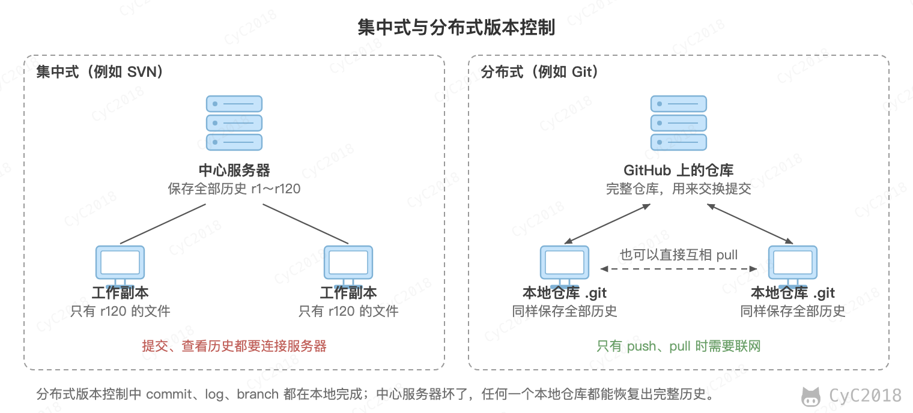 </div><br>

集中式版本控制的完整历史只保存在中心服务器上，每个人只取出某个版本的工作副本；分布式版本控制的每一份克隆都有完整的历史。

SVN 不联网也能修改文件、查看和撤销本地的改动，但提交、查看历史、切换版本都要连接服务器，服务器宕机时这些操作都无法进行。Git 的提交和查看历史都在本地完成，联网只是为了和别人交换提交。

SVN 的分支是服务器上的一次廉价复制，并不复制文件的数据；Git 新建、切换和合并分支都在本地完成，不需要访问服务器。

## 中心服务器

中心服务器用来交换每个用户的修改，没有中心服务器也能工作，但是中心服务器能够 24 小时保持开机状态，这样就能更方便地交换修改。

GitHub 就是一个中心服务器。

## 工作流

新建一个仓库之后，当前目录就成为了工作区，工作区下有一个隐藏目录 .git，它属于 Git 的版本库。

Git 的版本库有一个称为 Stage 的暂存区以及最后的 History 版本库，History 存储所有分支信息，使用一个 HEAD 指针指向当前分支。

<div align="center"> 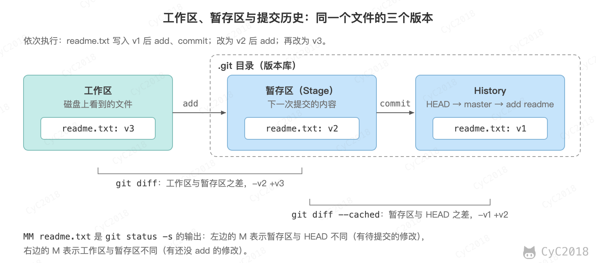 </div><br>

- git add files 把文件的修改添加到暂存区；
- git commit 把暂存区的修改提交到当前分支，提交之后暂存区的内容与这次提交一致；
- git reset -- files 用当前分支最新提交中的文件覆盖暂存区，取消这些文件已暂存的修改，工作区不变；
- git checkout -- files 使用暂存区的修改覆盖工作目录，用来撤销本地修改。

<div align="center"> 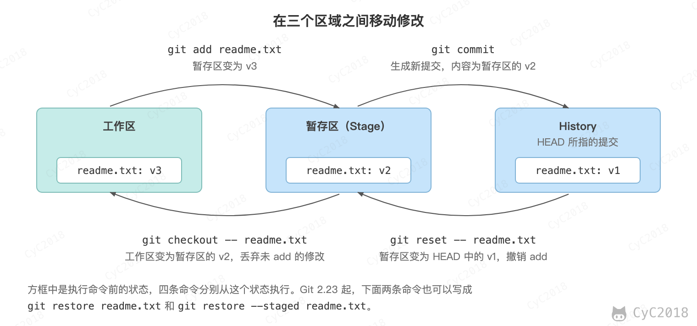 </div><br>

可以跳过暂存区域直接从分支中取出修改，或者直接提交修改到分支中。

- git commit -a 直接把所有已跟踪文件的修改添加到暂存区然后执行提交，未跟踪的新文件仍然需要先 git add；
- git checkout HEAD -- files 取出最后一次提交中的文件，同时覆盖暂存区和工作区，可以用来进行回滚操作。

<div align="center"> 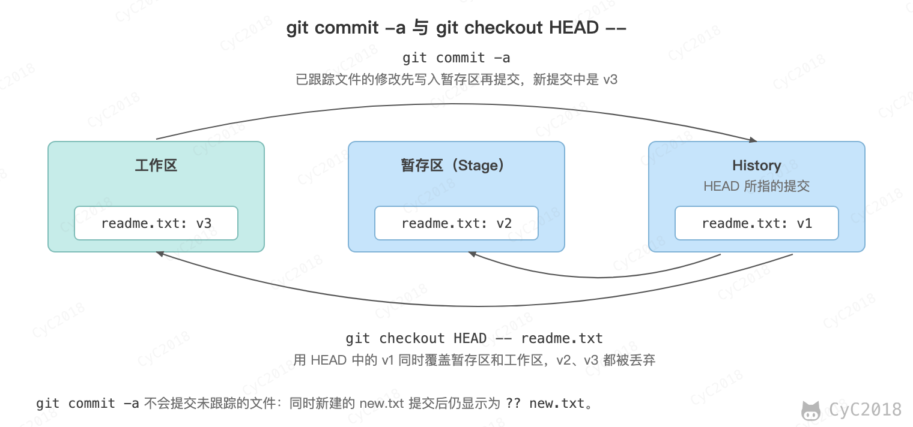 </div><br>

## 分支实现

使用指针将每个提交连接成一条时间线，HEAD 指针指向当前分支指针。

<div align="center"> 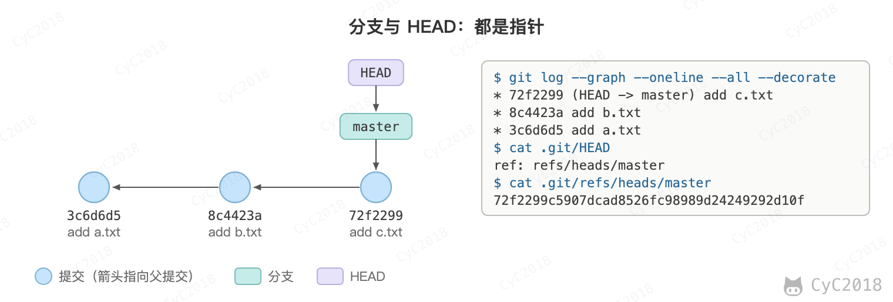 </div><br>

新建并切换分支时，新建一个指针指向时间线的最后一个节点，并让 HEAD 指针指向新分支，表示新分支成为当前分支。

<div align="center"> 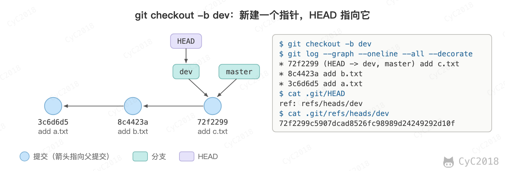 </div><br>

每次提交只会让当前分支指针向前移动，而其它分支指针不会移动。

<div align="center"> 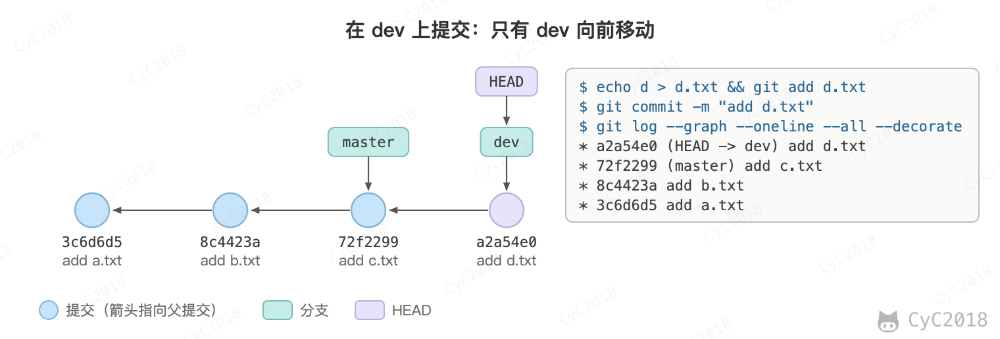 </div><br>

合并分支也只需要改变指针即可：切换回 master 后合并 dev，master 直接移动到 dev 所指的提交。这种情况称为快进合并（Fast-forward），两个分支都有新的提交时，合并会生成一个新的提交。

<div align="center"> 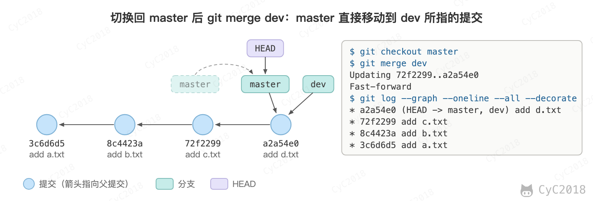 </div><br>

## 冲突

当两个分支都对同一个文件的同一行进行了修改，在分支合并时就会产生冲突。

<div align="center"> 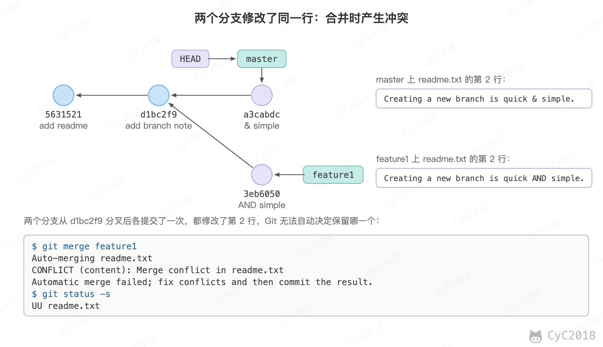 </div><br>

Git 会在冲突的文件中使用 \<\<\<\<\<\<\< ，======= ，\>\>\>\>\>\>\> 标记出两个分支的内容，在工作区中把这一段改成最终想要的内容，删掉这些标记，再执行 git add 和 git commit，就完成了合并。

```text
<<<<<<< HEAD
Creating a new branch is quick & simple.
=======
Creating a new branch is quick AND simple.
>>>>>>> feature1
```

例如决定保留 master 的写法，就把上面这五行改成 master 中的那一行。

## Fast forward

快进合并（fast-forward merge）只把 master 指针移动到 dev 所指的提交，不生成新提交。合并后的历史是一条直线，之后看不出哪些提交是在 dev 分支上开发的。

可以在合并时加上 --no-ff 参数来禁用 Fast forward 模式，这时总会生成一个新的合并提交，-m 参数指定这个提交的说明。

```bash
$ git merge --no-ff -m "merge with no-ff" dev
```

<div align="center"> 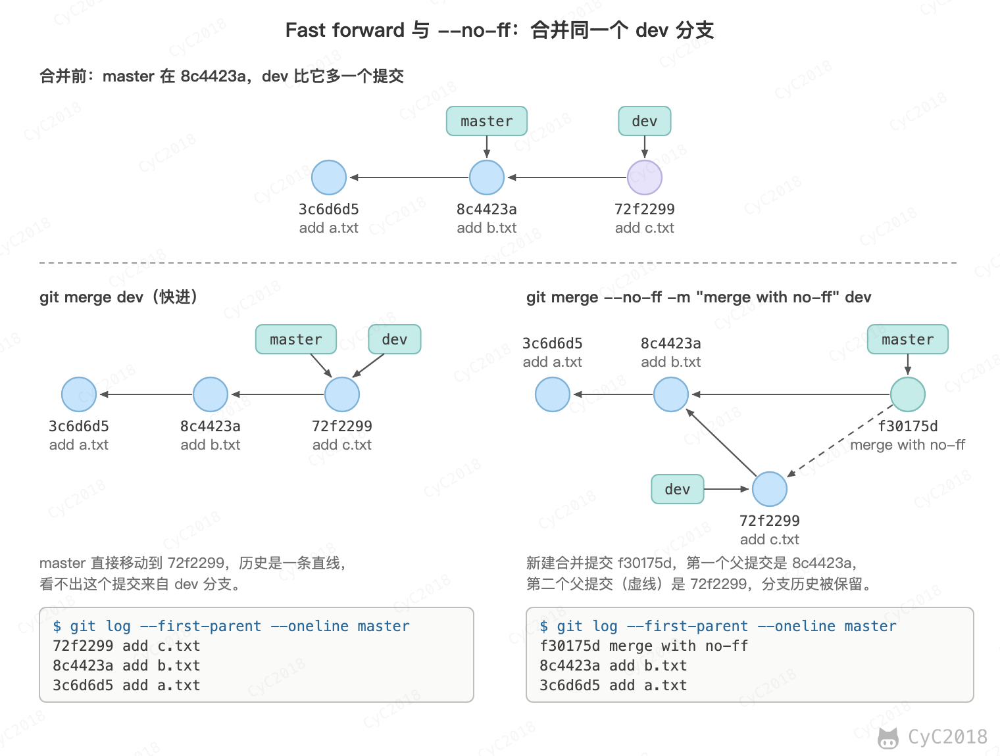 </div><br>

## 储藏（Stashing）

在一个分支上操作之后，如果还没有将修改提交到分支上，此时进行切换分支，那么另一个分支上也能看到新的修改。这是因为所有分支都共用一个工作区的缘故。如果切换会覆盖未提交的修改，Git 会拒绝切换。

可以使用 git stash 将当前分支的修改储藏起来，此时已跟踪文件的修改（包括已经 add 到暂存区的）都会被存到栈中，工作区回到干净的状态；未跟踪的新文件默认不会储藏，需要加上 -u 选项。此时就可以安全地切换到其它分支上了。

```bash
$ git stash
Saved working directory and index state WIP on master: 049d078 added the index file
```

例如 dev 上的开发做到一半，master 上有个 bug 需要马上修复，而 dev 的修改还不想提交：

```bash
$ git stash              # 储藏 dev 上未提交的修改
$ git switch master
$ git switch -c fix-bug  # 在 bug 分支上修复、提交，再合并回 master
$ git switch dev
$ git stash pop          # 取回储藏的修改，并从栈中删除这条记录
```

## SSH 传输设置

Git 仓库和 GitHub 中心仓库之间可以通过 HTTPS 或者 SSH 加密传输，使用 SSH 时需要配置 SSH Key。

如果用户主目录下没有 .ssh 目录，或者该目录下没有 id_ed25519 和 id_ed25519.pub 这两个文件，可以通过以下命令来创建 SSH Key：

```bash
$ ssh-keygen -t ed25519 -C "youremail@example.com"
```

然后把公钥 id_ed25519.pub 的内容添加到 GitHub “Settings” 中的 “SSH and GPG keys”。

## .gitignore 文件

忽略以下文件：

- 操作系统自动生成的文件，比如缩略图；
- 编译生成的中间文件，比如 Java 编译产生的 .class 文件；
- 自己的敏感信息，比如存放口令的配置文件。

例如 Java 项目的 .gitignore 可以这样写，每行一条规则：

```text
*.class
target/
*.local.yml
```

需要注意的是，.gitignore 只对未跟踪的文件生效。已经提交过的文件即使后来写进 .gitignore，修改仍会出现在 git status 中，要先用 git rm --cached \<file> 把它移出版本库（工作区的文件保留）。

不需要全部自己编写，可以到 [https://github.com/github/gitignore](https://github.com/github/gitignore) 中进行查询。

## Git 命令一览

| 用途 | 命令 |
| --- | --- |
| 克隆仓库 | git clone \<url> |
| 查看状态 | git status |
| 加入暂存区 | git add \<file> |
| 提交 | git commit -m "说明" |
| 查看历史 | git log --oneline --graph |
| 查看改动 | git diff（工作区与暂存区），git diff --staged（暂存区与最新提交） |
| 撤销工作区的修改 | git restore \<file> |
| 撤销 git add | git restore --staged \<file> |
| 新建并切换分支 | git switch -c dev |
| 切换分支 | git switch master |
| 合并分支 | git merge dev |
| 变基 | git rebase master |
| 临时保存修改 | git stash，之后用 git stash pop 恢复 |
| 撤销最近一次提交，保留修改 | git reset --soft HEAD~1 |
| 回到某个提交，丢弃之后的修改 | git reset --hard \<commit> |
| 用一个新提交抵消某次提交 | git revert \<commit> |
| 下载远程分支的新提交，不合并 | git fetch |
| 拉取并合并远程分支 | git pull |
| 推送 | git push origin dev |

git restore 和 git switch 是 Git 2.23 加入的命令，分别承担了原来 git checkout 恢复文件和切换分支两种用途。git pull 先执行 git fetch，再把远程分支合入当前分支：本地没有新提交时直接快进，两边都有新提交时按 pull.rebase 配置或 --rebase、--no-rebase 参数选择变基或合并。单独执行 git fetch 只更新 origin/master 这类远程跟踪分支，本地的 master 不动，可以先看别人改了什么再决定怎样合并。

master 和 dev 都有新提交时，merge 与 rebase 都能把 master 上的新提交合进 dev。merge 生成一个有两个父提交的合并提交，原有的提交不变；git rebase master 则把 dev 上的提交逐个放到 master 最新的提交之后重新提交一遍，历史成为一条直线，但这些提交的哈希都变了。因此只对还没有推送、或者只有自己在用的分支变基，别人已经拉取的提交不要变基。git rebase -i 还可以把本地的多个提交合并成一个再推送。

<div align="center"> 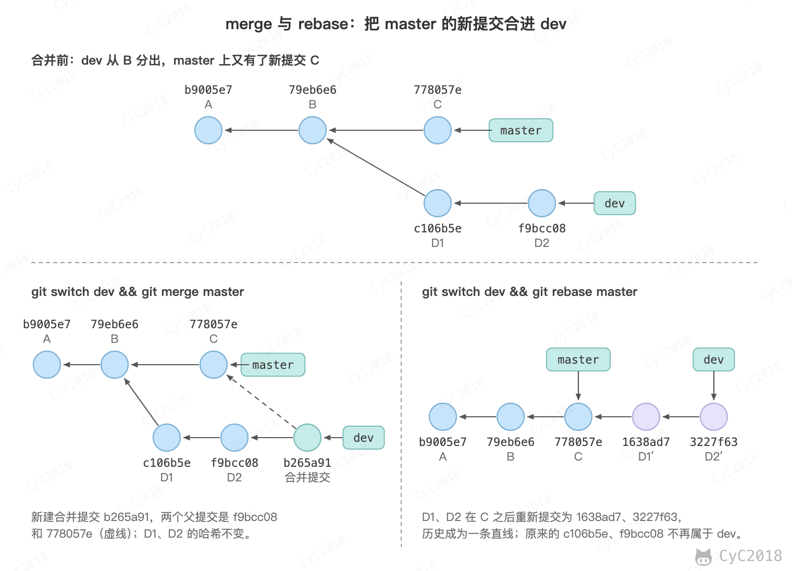 </div><br>

需要注意的是，reset --hard 会丢弃未提交的修改；已经推送到远程的提交，应该用 revert 撤销，而不是 reset 后强制推送。

比较详细的命令列表：http://www.cheat-sheets.org/saved-copy/git-cheat-sheet.pdf

## 参考资料

- [Git - 简明指南](http://rogerdudler.github.io/git-guide/index.zh.html)
- [图解 Git](http://marklodato.github.io/visual-git-guide/index-zh-cn.html)
- [Pro Git（第二版，中文）](https://git-scm.com/book/zh/v2)
- [Version Control with Subversion: Using Branches](https://svnbook.red-bean.com/en/1.7/svn.branchmerge.using.html)
- [Learn Git Branching](https://learngitbranching.js.org/)
