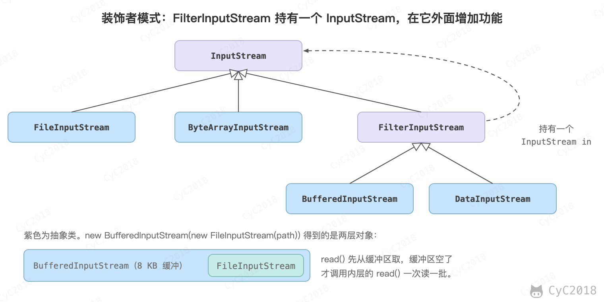
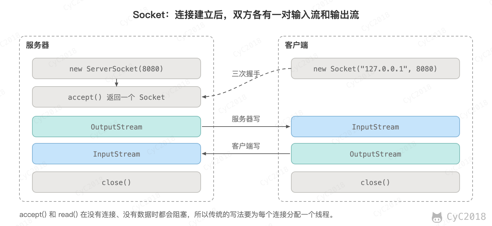
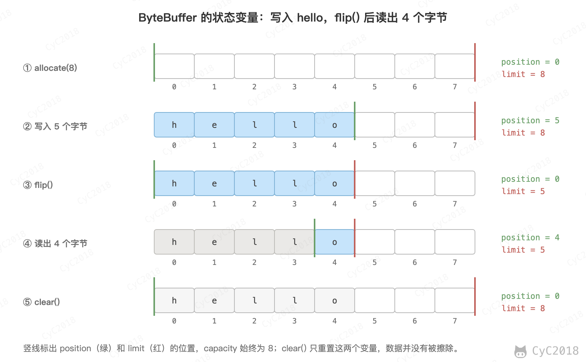
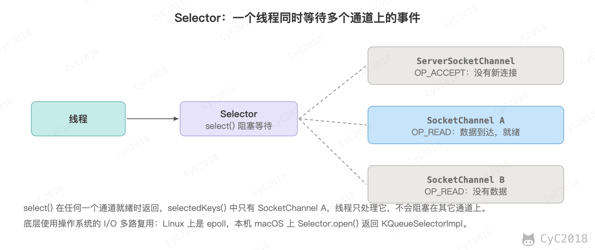

# Java IO
<!-- GFM-TOC -->
* [Java IO](#java-io)
    * [一、概览](#一概览)
    * [二、磁盘操作](#二磁盘操作)
    * [三、字节操作](#三字节操作)
        * [实现文件复制](#实现文件复制)
        * [装饰者模式](#装饰者模式)
    * [四、字符操作](#四字符操作)
        * [编码与解码](#编码与解码)
        * [String 的编码方式](#string-的编码方式)
        * [Reader 与 Writer](#reader-与-writer)
        * [实现逐行输出文本文件的内容](#实现逐行输出文本文件的内容)
    * [五、对象操作](#五对象操作)
        * [序列化](#序列化)
        * [Serializable](#serializable)
        * [transient](#transient)
    * [六、网络操作](#六网络操作)
        * [InetAddress](#inetaddress)
        * [URL](#url)
        * [Sockets](#sockets)
        * [Datagram](#datagram)
    * [七、NIO](#七nio)
        * [流与块](#流与块)
        * [通道与缓冲区](#通道与缓冲区)
        * [缓冲区状态变量](#缓冲区状态变量)
        * [文件 NIO 实例](#文件-nio-实例)
        * [选择器](#选择器)
        * [套接字 NIO 实例](#套接字-nio-实例)
        * [内存映射文件](#内存映射文件)
        * [对比](#对比)
    * [八、参考资料](#八参考资料)
<!-- GFM-TOC -->


## 一、概览

Java 的 I/O 大概可以分成以下几类：

- 磁盘操作：File
- 字节操作：InputStream 和 OutputStream
- 字符操作：Reader 和 Writer
- 对象操作：Serializable
- 网络操作：Socket
- 新的输入/输出：NIO

## 二、磁盘操作

File 类可以用于表示文件和目录的信息，但是它不表示文件的内容。

递归地列出一个目录下所有文件：

```java
public static void listAllFiles(File dir) {
    if (dir == null || !dir.exists()) {
        return;
    }
    if (dir.isFile()) {
        System.out.println(dir.getName());
        return;
    }
    // 没有读权限或发生 I/O 错误时 listFiles() 返回 null
    File[] files = dir.listFiles();
    if (files == null) {
        return;
    }
    for (File file : files) {
        listAllFiles(file);
    }
}
```

从 Java 7 开始，可以使用 Paths 和 Files 代替 File。

## 三、字节操作

### 实现文件复制

```java
public static void copyFile(String src, String dist) throws IOException {
    // try-with-resources：无论正常结束还是抛出异常，in 和 out 都会被关闭
    try (FileInputStream in = new FileInputStream(src);
         FileOutputStream out = new FileOutputStream(dist)) {

        byte[] buffer = new byte[20 * 1024];
        int cnt;

        // read() 最多读取 buffer.length 个字节
        // 返回的是实际读取的个数
        // 返回 -1 的时候表示读到 eof，即文件尾
        while ((cnt = in.read(buffer, 0, buffer.length)) != -1) {
            out.write(buffer, 0, cnt);
        }
    }
}
```

### 装饰者模式

Java I/O 使用了装饰者模式来实现。以 InputStream 为例，

- InputStream 是抽象组件；
- FileInputStream 是 InputStream 的子类，属于具体组件，提供了字节流的输入操作；
- FilterInputStream 属于抽象装饰者，装饰者用于装饰组件，为组件提供额外的功能。例如 BufferedInputStream 为 FileInputStream 提供缓存的功能。

<div align="center">  </div><br>

实例化一个具有缓存功能的字节流对象时，只需要在 FileInputStream 对象上再套一层 BufferedInputStream 对象即可。

```java
FileInputStream fileInputStream = new FileInputStream(filePath);
BufferedInputStream bufferedInputStream = new BufferedInputStream(fileInputStream);
```

DataInputStream 装饰者提供了对更多数据类型进行输入的操作，比如 int、double 等基本类型。

## 四、字符操作

### 编码与解码

编码就是把字符转换为字节，而解码是把字节重新组合成字符。

如果编码和解码过程使用不同的编码方式那么就出现了乱码。

- GBK 编码中，中文字符占 2 个字节，英文字符占 1 个字节；
- UTF-8 编码中，常用汉字占 3 个字节，英文字符占 1 个字节；
- UTF-16be 编码中，常用汉字和英文字符都占 2 个字节。

UTF-16be 中的 be 指的是 Big Endian，也就是大端。相应地也有 UTF-16le，le 指的是 Little Endian，也就是小端。

Java 的 char 类型占 16 位，存放的是字符的 UTF-16 编码，这不是指 Java 只支持这一种编码方式。常用的中文和英文字符都能用一个 char 存储，编号超过 U+FFFF 的字符（例如一部分生僻字和 emoji）要用两个 char 表示。

### String 的编码方式

String 可以看成一个字符序列，可以指定一个编码方式将它编码为字节序列，也可以指定一个编码方式将一个字节序列解码为 String。

```java
String str1 = "中文";
byte[] bytes = str1.getBytes("UTF-8");
String str2 = new String(bytes, "UTF-8");
System.out.println(str2);
```

在调用无参数 getBytes() 方法时，默认的编码方式不是 UTF-16。双字节编码的好处是可以使用一个 char 存储中文和英文，而将 String 转为 bytes[] 字节数组就不再需要这个好处，因此也就不再需要双字节编码。JDK 18 起 getBytes() 默认使用 UTF-8（JEP 400），之前的版本与平台有关。

```java
byte[] bytes = str1.getBytes();
```

### Reader 与 Writer

不管是磁盘还是网络传输，最小的存储单元都是字节，而不是字符。但是在程序中操作的通常是字符形式的数据，因此需要提供对字符进行操作的方法。

- InputStreamReader 实现从字节流解码成字符流；
- OutputStreamWriter 实现字符流编码成为字节流。

### 实现逐行输出文本文件的内容

```java
public static void readFileContent(String filePath) throws IOException {

    // 装饰者模式使得 BufferedReader 组合了一个 Reader 对象
    // 在调用 BufferedReader 的 close() 方法时会去调用 Reader 的 close() 方法
    // 因此 try 中只需要声明最外层的 BufferedReader
    try (BufferedReader bufferedReader = new BufferedReader(new FileReader(filePath))) {
        String line;
        while ((line = bufferedReader.readLine()) != null) {
            System.out.println(line);
        }
    }
}
```

## 五、对象操作

### 序列化

序列化就是将一个对象转换成字节序列，方便存储和传输。

- 序列化：ObjectOutputStream.writeObject()
- 反序列化：ObjectInputStream.readObject()

不会对静态变量进行序列化，因为序列化只是保存对象的状态，静态变量属于类的状态。

### Serializable

序列化的类需要实现 Serializable 接口，它是一个标记接口，没有任何方法需要实现，但是如果不去实现它的话而进行序列化，会抛出 NotSerializableException。

```java
public static void main(String[] args) throws IOException, ClassNotFoundException {

    A a1 = new A(123, "abc");
    String objectFile = "file/a1";

    try (ObjectOutputStream objectOutputStream = new ObjectOutputStream(new FileOutputStream(objectFile))) {
        objectOutputStream.writeObject(a1);
    }

    try (ObjectInputStream objectInputStream = new ObjectInputStream(new FileInputStream(objectFile))) {
        A a2 = (A) objectInputStream.readObject();
        System.out.println(a2);
    }
}

private static class A implements Serializable {

    private int x;
    private String y;

    A(int x, String y) {
        this.x = x;
        this.y = y;
    }

    @Override
    public String toString() {
        return "x = " + x + "  " + "y = " + y;
    }
}
```

### transient

transient 关键字可以使一些属性不会被序列化。

ArrayList 中存储数据的数组 elementData 是用 transient 修饰的，因为这个数组是动态扩展的，并不是所有的空间都被使用，因此就不需要所有的内容都被序列化。通过重写序列化和反序列化方法，使得可以只序列化数组中有内容的那部分数据。

```java
transient Object[] elementData; // JDK 8 起不是 private，便于内部类访问
```

## 六、网络操作

Java 中的网络支持：

- InetAddress：用于表示 IP 地址；
- URL：统一资源定位符；
- Sockets：使用 TCP 协议实现网络通信；
- Datagram：使用 UDP 协议实现网络通信。

### InetAddress

没有公有的构造函数，只能通过静态方法来创建实例。

```java
InetAddress.getByName(String host);
InetAddress.getByAddress(byte[] address);
```

### URL

可以直接从 URL 中读取字节流数据。

```java
public static void main(String[] args) throws IOException {

    URL url = URI.create("http://www.baidu.com").toURL();

    /* 字节流 */
    InputStream is = url.openStream();

    /* 字符流 */
    InputStreamReader isr = new InputStreamReader(is, "utf-8");

    /* 提供缓存功能，关闭 br 时会依次关闭 isr 和 is */
    try (BufferedReader br = new BufferedReader(isr)) {
        String line;
        while ((line = br.readLine()) != null) {
            System.out.println(line);
        }
    }
}
```

### Sockets

- ServerSocket：服务器端类；
- Socket：客户端类；
- 服务器和客户端通过 InputStream 和 OutputStream 进行输入输出。

这些读写都是[阻塞式 I/O](Socket.md#阻塞式-io)，服务器通常为每个连接分配一个线程；连接很多时改用 NIO 的[选择器](#选择器)。

<div align="center">  </div><br>

### Datagram

- DatagramSocket：通信类
- DatagramPacket：数据包类

## 七、NIO

新的输入/输出（NIO）库是在 JDK 1.4 中引入的，提供了面向块的 I/O 和可用于网络通信的非阻塞 I/O。

### 流与块

I/O 与 NIO 最重要的区别是数据打包和传输的方式，I/O 以流的方式处理数据，而 NIO 以块的方式处理数据。

面向流的 I/O 把数据看成连续的字节序列，按顺序读写，不能在流中前后移动；InputStream 的 read(byte[]) 也可以一次读入一批字节，前面的 copyFile 就是这样做的。为流式数据创建过滤器非常容易，链接几个过滤器，以便每个过滤器只负责复杂处理机制的一部分。

面向块的 I/O 先把数据读入缓冲区 Buffer，可以在缓冲区中前后移动、反复处理。两者的性能主要取决于缓冲区大小和系统调用次数，并不是按块处理就一定更快。

java.io 与 NIO 有部分实现是共用的，例如 JDK 13 起 Socket 改用 NIO 的实现（JEP 353），InputStreamReader 用 java.nio.charset 中的解码器把字节解码为字符。

### 通道与缓冲区

#### 1. 通道

通道 Channel 是对原 I/O 包中的流的模拟，可以通过它读取和写入数据。

通道与流的不同之处在于，流只能在一个方向上移动（一个流必须是 InputStream 或者 OutputStream 的子类），而通道是双向的，可以用于读、写或者同时用于读写。

通道包括以下类型：

- FileChannel：从文件中读写数据；
- DatagramChannel：通过 UDP 读写网络中数据；
- SocketChannel：通过 TCP 读写网络中数据；
- ServerSocketChannel：可以监听新进来的 TCP 连接，对每一个新进来的连接都会创建一个 SocketChannel。

#### 2. 缓冲区

发送给一个通道的所有数据都必须首先放到缓冲区中，同样地，从通道中读取的任何数据都要先读到缓冲区中。也就是说，不会直接对通道进行读写数据，而是要先经过缓冲区。

缓冲区实质上是一个数组，但它不仅仅是一个数组。缓冲区提供了对数据的结构化访问，而且还可以跟踪系统的读/写进程。

缓冲区包括以下类型：

- ByteBuffer
- CharBuffer
- ShortBuffer
- IntBuffer
- LongBuffer
- FloatBuffer
- DoubleBuffer

### 缓冲区状态变量

- capacity：最大容量；
- position：当前已经读写的字节数；
- limit：第一个不能读写的位置，limit - position 就是还可以读写的字节数。

状态变量的改变过程举例：

① 新建一个大小为 8 个字节的缓冲区，此时 position 为 0，而 limit = capacity = 8。capacity 变量不会改变，下面的讨论会忽略它。

② 从输入通道中读取 5 个字节数据写入缓冲区中，此时 position 为 5，limit 保持不变。

③ 在将缓冲区的数据写到输出通道之前，需要先调用 flip() 方法，这个方法将 limit 设置为当前 position，并将 position 设置为 0。

④ 从缓冲区中取 4 个字节写入输出通道，此时 position 设为 4。

⑤ 最后需要调用 clear() 方法来清空缓冲区，此时 position 和 limit 都被设置为最初位置。需要注意的是，clear() 只是重置这两个变量，缓冲区中的数据并没有被擦除，之后写入时会被覆盖。上例中还有一个 o 没有写出，clear() 之后它就会被覆盖；需要保留没处理完的数据时调用 compact()，它把 o 移到下标 0，position 设为 1，limit 设为 8，之后接着写入。

在 JDK 21 上按这五步执行，写入的 5 个字节为 hello，打印出的 position 和 limit 与下图一致：

<div align="center">  </div><br>

### 文件 NIO 实例

以下展示了使用 NIO 复制文件的实例：

```java
public static void fastCopy(String src, String dist) throws IOException {

    /* 获得源文件和目标文件的字节流，try 结束时自动关闭，流的通道也随之关闭 */
    try (FileInputStream fin = new FileInputStream(src);
         FileOutputStream fout = new FileOutputStream(dist)) {

        /* 获取输入字节流的文件通道 */
        FileChannel fcin = fin.getChannel();

        /* 获取输出字节流的文件通道 */
        FileChannel fcout = fout.getChannel();

        /* 为缓冲区分配 1024 个字节 */
        ByteBuffer buffer = ByteBuffer.allocateDirect(1024);

        while (true) {

            /* 从输入通道中读取数据到缓冲区中 */
            int r = fcin.read(buffer);

            /* read() 返回 -1 表示 EOF */
            if (r == -1) {
                break;
            }

            /* 切换读写 */
            buffer.flip();

            /* 把缓冲区的内容写入输出文件中 */
            fcout.write(buffer);

            /* 清空缓冲区 */
            buffer.clear();
        }
    }
}
```

### 选择器

NIO 常常被叫做非阻塞 I/O，主要是因为 NIO 在网络通信中的非阻塞特性被广泛使用。按 Unix 的五种 I/O 模型划分，通道的非阻塞读写对应[非阻塞式 I/O](Socket.md#非阻塞式-io)，选择器对应 [I/O 复用](Socket.md#二io-复用)。

NIO 的选择器 Selector 基于操作系统的 I/O 复用（Linux 上为 epoll，水平触发），一个线程 Thread 使用一个 Selector 同时监听多个通道 Channel 上的事件，从而让一个线程就可以处理多个事件，Reactor 模式就建立在它之上（见 [Socket](Socket.md#应用场景)）。

通过配置监听的通道 Channel 为非阻塞，线程不会阻塞在某一个 Channel 上，而是阻塞在 Selector 的 select() 方法上，任何一个 Channel 有 I/O 事件到达时 select() 就返回，线程再处理这些已经就绪的 Channel。

与每个连接一个线程相比，这样省去了大量线程的创建和切换开销。

需要注意的是，只有 SelectableChannel（套接字通道和管道 Pipe 的通道）才能配置为非阻塞并注册到选择器上，而 FileChannel 不能，为 FileChannel 配置非阻塞也没有意义。这些通道创建后默认也是阻塞的，需要调用 configureBlocking(false)。

<div align="center">  </div><br>

#### 1. 创建选择器

```java
Selector selector = Selector.open();
```

#### 2. 将通道注册到选择器上

```java
ServerSocketChannel ssChannel = ServerSocketChannel.open();
ssChannel.configureBlocking(false);
ssChannel.register(selector, SelectionKey.OP_ACCEPT);
```

通道必须先配置为非阻塞模式，否则 register() 会抛出 IllegalBlockingModeException。这是因为通道如果在某个读写上阻塞，线程就不能回到 select() 响应其它通道的事件，这和选择器的作用相违背。

在将通道注册到选择器上时，还需要指定要注册的具体事件，主要有以下几类：

- SelectionKey.OP_CONNECT
- SelectionKey.OP_ACCEPT
- SelectionKey.OP_READ
- SelectionKey.OP_WRITE

它们在 SelectionKey 的定义如下：

```java
public static final int OP_READ = 1 << 0;
public static final int OP_WRITE = 1 << 2;
public static final int OP_CONNECT = 1 << 3;
public static final int OP_ACCEPT = 1 << 4;
```

可以看出每个事件可以被当成一个位域，从而组成事件集整数。例如：

```java
int interestSet = SelectionKey.OP_READ | SelectionKey.OP_WRITE;
```

#### 3. 监听事件

```java
int num = selector.select();
```

使用 select() 来监听到达的事件，它会一直阻塞直到有至少一个事件到达。

#### 4. 获取到达的事件

```java
Set<SelectionKey> keys = selector.selectedKeys();
Iterator<SelectionKey> keyIterator = keys.iterator();
while (keyIterator.hasNext()) {
    SelectionKey key = keyIterator.next();
    if (key.isAcceptable()) {
        // ...
    } else if (key.isReadable()) {
        // ...
    }
    keyIterator.remove();
}
```

#### 5. 事件循环

因为一次 select() 调用不能处理完所有的事件，并且服务器端有可能需要一直监听事件，因此服务器端处理事件的代码一般会放在一个死循环内。

```java
while (true) {
    int num = selector.select();
    Set<SelectionKey> keys = selector.selectedKeys();
    Iterator<SelectionKey> keyIterator = keys.iterator();
    while (keyIterator.hasNext()) {
        SelectionKey key = keyIterator.next();
        if (key.isAcceptable()) {
            // ...
        } else if (key.isReadable()) {
            // ...
        }
        keyIterator.remove();
    }
}
```

### 套接字 NIO 实例

服务端只用一个线程处理所有连接。非阻塞的 read() 有多少数据读多少，暂时没有数据时返回 0（对应底层 read 系统调用的 [EAGAIN](Socket.md#非阻塞式-io) 错误），这时应回到 select() 去处理其它连接，因此每个连接已经收到的数据要保存在它的 SelectionKey 的附件（attachment）中。示例约定客户端关闭连接（read 返回 -1）时一条消息才算收完。

```java
public class NIOServer {

    public static void main(String[] args) throws IOException {

        Selector selector = Selector.open();

        ServerSocketChannel ssChannel = ServerSocketChannel.open();
        ssChannel.configureBlocking(false);
        ssChannel.register(selector, SelectionKey.OP_ACCEPT);

        ServerSocket serverSocket = ssChannel.socket();
        InetSocketAddress address = new InetSocketAddress("127.0.0.1", 8888);
        serverSocket.bind(address);

        while (true) {

            selector.select();
            Set<SelectionKey> keys = selector.selectedKeys();
            Iterator<SelectionKey> keyIterator = keys.iterator();

            while (keyIterator.hasNext()) {

                SelectionKey key = keyIterator.next();

                if (key.isAcceptable()) {

                    ServerSocketChannel ssChannel1 = (ServerSocketChannel) key.channel();

                    // 服务器会为每个新连接创建一个 SocketChannel
                    SocketChannel sChannel = ssChannel1.accept();
                    sChannel.configureBlocking(false);

                    // 注册读事件，附件用来保存这个连接已经收到的字节
                    sChannel.register(selector, SelectionKey.OP_READ, new ByteArrayOutputStream());

                } else if (key.isReadable()) {

                    SocketChannel sChannel = (SocketChannel) key.channel();
                    ByteArrayOutputStream data = (ByteArrayOutputStream) key.attachment();
                    ByteBuffer buffer = ByteBuffer.allocate(1024);
                    int n;
                    // 读到返回 0（暂时没有数据）或 -1（对端关闭）为止
                    while ((n = sChannel.read(buffer)) > 0) {
                        data.write(buffer.array(), 0, n);
                        buffer.clear();
                    }
                    if (n == -1) {
                        // 全部字节收齐后再解码，避免一个汉字的字节被拆在两次读取中
                        System.out.println(data.toString(StandardCharsets.UTF_8));
                        sChannel.close();
                    }
                }

                keyIterator.remove();
            }
        }
    }
}
```

```java
public class NIOClient {

    public static void main(String[] args) throws IOException {
        Socket socket = new Socket("127.0.0.1", 8888);
        OutputStream out = socket.getOutputStream();
        String s = "hello world";
        out.write(s.getBytes(StandardCharsets.UTF_8));
        out.close();
    }
}
```

### 内存映射文件

内存映射文件 I/O 是一种读和写文件数据的方法，它把文件的一段映射到进程的内存中，适合随机访问大文件，省去了在内核缓冲区和用户数组之间的复制。

写入映射缓冲区的数据先修改的是映射到内存中的文件页，操作系统之后再把它写回文件；需要确保写到磁盘时调用 MappedByteBuffer.force()。

下面代码行将文件的前 1024 个字节映射到内存中（READ_WRITE 模式下文件不足 1024 字节时会被扩展到 1024 字节），map() 方法返回一个 MappedByteBuffer，它是 ByteBuffer 的子类。因此，可以像使用其他任何 ByteBuffer 一样使用新映射的缓冲区，操作系统会在需要时负责执行映射。

```java
MappedByteBuffer mbb = fc.map(FileChannel.MapMode.READ_WRITE, 0, 1024);
```

### 对比

NIO 与普通 I/O 的区别主要有以下两点：

- 套接字通道和管道通道可以配置为非阻塞，配合 Selector 用一个线程处理多个连接；普通 I/O 的流都是阻塞的，FileChannel 也是阻塞的；
- NIO 面向块，通过 Channel 和 Buffer 读写数据；I/O 面向流。

## 八、参考资料

- Eckel B, 埃克尔, 昊鹏, 等. Java 编程思想 [M]. 机械工业出版社, 2002.
- [Java SE 21 API: java.io](https://docs.oracle.com/en/java/javase/21/docs/api/java.base/java/io/package-summary.html)
- [Java SE 21 API: java.nio](https://docs.oracle.com/en/java/javase/21/docs/api/java.base/java/nio/package-summary.html)
- [The Java Tutorials: Basic I/O](https://docs.oracle.com/javase/tutorial/essential/io/)
- [JEP 353: Reimplement the Legacy Socket API](https://openjdk.org/jeps/353)
- [Java SE 21 API: MappedByteBuffer](https://docs.oracle.com/en/java/javase/21/docs/api/java.base/java/nio/MappedByteBuffer.html)
- [IBM: NIO 入门](https://www.ibm.com/developerworks/cn/education/java/j-nio/j-nio.html)
- [Java NIO Tutorial](https://jenkov.com/tutorials/java-nio/index.html)
- [Java NIO 浅析](https://tech.meituan.com/2016/11/04/nio.html)
- [IBM: 深入分析 Java I/O 的工作机制](https://www.ibm.com/developerworks/cn/java/j-lo-javaio/index.html)
- [IBM: 深入分析 Java 中的中文编码问题](https://www.ibm.com/developerworks/cn/java/j-lo-chinesecoding/index.html)
- [IBM: Java 序列化的高级认识](https://www.ibm.com/developerworks/cn/java/j-lo-serial/index.html)
- [NIO 与传统 IO 的区别](https://web.archive.org/web/20250917122905/https://blog.csdn.net/shimiso/article/details/24990499)
- [Decorator Design Pattern](http://stg-tud.github.io/sedc/Lecture/ws13-14/5.3-Decorator.html#mode=document)
- [Socket Multicast](http://labojava.blogspot.com/2012/12/socket-multicast.html)
