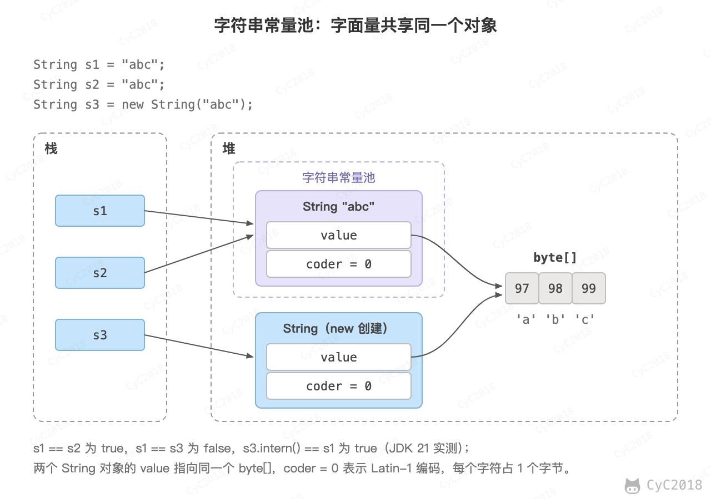
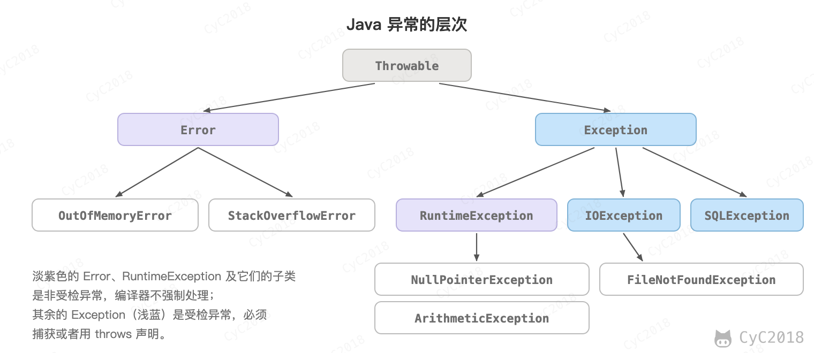

# Java 基础
<!-- GFM-TOC -->
* [Java 基础](#java-基础)
    * [一、数据类型](#一数据类型)
        * [基本类型](#基本类型)
        * [包装类型](#包装类型)
        * [缓存池](#缓存池)
    * [二、String](#二string)
        * [概览](#概览)
        * [不可变的好处](#不可变的好处)
        * [String, StringBuffer and StringBuilder](#string-stringbuffer-and-stringbuilder)
        * [String Pool](#string-pool)
        * [new String("abc")](#new-stringabc)
    * [三、运算](#三运算)
        * [参数传递](#参数传递)
        * [float 与 double](#float-与-double)
        * [隐式类型转换](#隐式类型转换)
        * [switch](#switch)
    * [四、关键字](#四关键字)
        * [final](#final)
        * [static](#static)
    * [五、Object 通用方法](#五object-通用方法)
        * [概览](#概览-1)
        * [equals()](#equals)
        * [hashCode()](#hashcode)
        * [toString()](#tostring)
        * [clone()](#clone)
    * [六、继承](#六继承)
        * [访问权限](#访问权限)
        * [抽象类与接口](#抽象类与接口)
        * [super](#super)
        * [重写与重载](#重写与重载)
    * [七、反射](#七反射)
    * [八、异常](#八异常)
    * [九、泛型](#九泛型)
    * [十、注解](#十注解)
    * [十一、特性](#十一特性)
        * [Java 各版本的新特性](#java-各版本的新特性)
        * [Java 与 C++ 的区别](#java-与-c-的区别)
        * [JRE or JDK](#jre-or-jdk)
    * [附录：实测](#附录实测)
        * [A1 包装类型的缓存池](#a1-包装类型的缓存池)
        * [A2 字符串的存储](#a2-字符串的存储)
        * [A3 泛型的类型擦除](#a3-泛型的类型擦除)
        * [A4 反射与注解](#a4-反射与注解)
        * [A5 Lambda 与 Stream](#a5-lambda-与-stream)
    * [参考资料](#参考资料)
<!-- GFM-TOC -->


## 一、数据类型

### 基本类型

- byte/8
- char/16
- short/16
- int/32
- float/32
- long/64
- double/64
- boolean/\~

boolean 只有两个值：true、false，可以使用 1 bit 来存储，但是具体大小没有明确规定。编译器会把 boolean 类型的数据编译为 int，使用 1 来表示 true，0 表示 false。JVM 支持 boolean 数组，但是是通过读写 byte 数组来实现的。

### 包装类型

基本类型都有对应的包装类型，基本类型与其对应的包装类型之间的赋值使用自动装箱与拆箱完成。

```java
Integer x = 2;     // 装箱 调用了 Integer.valueOf(2)
int y = x;         // 拆箱 调用了 x.intValue()
```

### 缓存池

new Integer(123) 与 Integer.valueOf(123) 的区别在于：

- new Integer(123) 每次都会新建一个对象；
- Integer.valueOf(123) 会使用缓存池中的对象，多次调用会取得同一个对象的引用。

```java
Integer x = new Integer(123);
Integer y = new Integer(123);
System.out.println(x == y);    // false
Integer z = Integer.valueOf(123);
Integer k = Integer.valueOf(123);
System.out.println(z == k);   // true
```

需要注意的是，new Integer(123) 从 JDK 9 起已经废弃，JDK 16 起标记为将要删除，编译时会给出警告，应该使用 Integer.valueOf(123)。

valueOf() 方法的实现比较简单，就是先判断值是否在缓存池中，如果在的话就直接返回缓存池的内容。

```java
public static Integer valueOf(int i) {
    if (i >= IntegerCache.low && i <= IntegerCache.high)
        return IntegerCache.cache[i + (-IntegerCache.low)];
    return new Integer(i);
}
```

编译器会在自动装箱过程调用 valueOf() 方法，因此多个值相同且值在缓存池范围内的 Integer 实例使用自动装箱来创建，那么就会引用相同的对象。

```java
Integer m = 123;
Integer n = 123;
System.out.println(m == n); // true
```

各包装类型的缓存池如下（JDK 21 实测，见[附录 A1](#a1-包装类型的缓存池)）：

- Boolean：true 和 false；
- Byte：全部 256 个值；
- Short、Integer、Long：-128\~127；
- Character：0\~127，即 \u0000\~\u007F；
- Float、Double 没有缓存池。

Integer 缓存池的上界可以调整：启动时加上 -XX:AutoBoxCacheMax=1000，IntegerCache 初始化时会读取这个值，之后 Integer.valueOf(128) 也会返回同一个对象。其它包装类型的缓存范围是固定的。

## 二、String

### 概览

String 被声明为 final，因此它不可被继承（Integer 等包装类也不能被继承）。

在 Java 8 中，String 内部使用 char 数组存储数据。

```java
public final class String
    implements java.io.Serializable, Comparable<String>, CharSequence {
    /** The value is used for character storage. */
    private final char value[];
}
```

从 Java 9 开始，String 类的实现改用 byte 数组存储字符串，同时使用 coder 来标识使用了哪种编码（紧凑字符串，JEP 254）：只包含 Latin-1 字符的字符串每个字符占 1 个字节，coder 为 0；含有中文等其它字符时按 UTF-16 存储，每个字符占 2 个字节，coder 为 1。英文为主的程序中，字符串占用的内存因此减少近一半。

```java
public final class String
    implements java.io.Serializable, Comparable<String>, CharSequence {
    /** The value is used for character storage. */
    private final byte[] value;

    /** The identifier of the encoding used to encode the bytes in {@code value}. */
    private final byte coder;
}
```

value 数组被声明为 final，这意味着 value 数组初始化之后就不能再引用其它数组。并且 String 内部没有改变 value 数组的方法，因此可以保证 String 不可变。

### 不可变的好处

#### 1. 可以缓存哈希值

因为 String 的哈希值经常被使用，例如 String 用做 HashMap 的 key。不可变的特性可以使得哈希值也不可变，因此只需要进行一次计算。

#### 2. String Pool 的需要

如果一个 String 对象已经被创建过了，那么就会从 String Pool 中取得引用。只有 String 是不可变的，才可能使用 String Pool：下图中 s1 和 s2 引用的是同一个对象，如果可以通过 s1 修改它，s2 的值也会跟着改变。

<div align="center">  </div><br>

#### 3. 安全性

String 经常作为参数，String 不可变性可以保证参数不可变。例如在作为网络连接参数的情况下如果 String 是可变的，那么在网络连接过程中，String 被改变，改变 String 的那一方以为现在连接的是其它主机，而实际情况却不一定是。

#### 4. 线程安全

String 不可变性天生具备线程安全，可以在多个线程中安全地使用。

### String, StringBuffer and StringBuilder

- 可变性：String 不可变，StringBuffer 和 StringBuilder 可变；
- 线程安全：String 不可变，因此是线程安全的；StringBuffer 的方法使用 synchronized 进行同步，是线程安全的；StringBuilder 不是线程安全的，但没有加锁的开销，单线程中拼接字符串时使用它。

需要注意的是，在循环中用 + 拼接字符串，每次循环都会创建一个新的 String 对象并复制之前的内容，应该在循环外创建一个 StringBuilder，在循环中调用 append()。

### String Pool

字符串常量池（String Pool）保存着所有字符串字面量（literal strings），这些字面量在编译时期就确定。不仅如此，还可以使用 String 的 intern() 方法在运行过程将字符串添加到 String Pool 中。

当一个字符串调用 intern() 方法时，如果 String Pool 中已经存在一个字符串和该字符串值相等（使用 equals() 方法进行确定），那么就会返回 String Pool 中字符串的引用；否则，就会在 String Pool 中添加一个新的字符串，并返回这个新字符串的引用。

下面示例中，s1 和 s2 采用 new String() 的方式新建了两个不同字符串，而 s3 和 s4 是通过 s1.intern() 和 s2.intern() 方法取得同一个字符串引用。intern() 首先把 "aaa" 放到 String Pool 中，然后返回这个字符串引用，因此 s3 和 s4 引用的是同一个字符串。

```java
String s1 = new String("aaa");
String s2 = new String("aaa");
System.out.println(s1 == s2);           // false
String s3 = s1.intern();
String s4 = s2.intern();
System.out.println(s3 == s4);           // true
```

如果是采用 "bbb" 这种字面量的形式创建字符串，会自动地将字符串放入 String Pool 中。

```java
String s5 = "bbb";
String s6 = "bbb";
System.out.println(s5 == s6);  // true
```

在 Java 7 之前，String Pool 被放在运行时常量池中，它属于永久代。而在 Java 7，String Pool 被移到堆中。这是因为永久代的空间有限，在大量使用字符串的场景下会导致 OutOfMemoryError 错误。

### new String("abc")

使用这种方式一共会创建两个字符串对象（前提是 String Pool 中还没有 "abc" 字符串对象）。

- "abc" 属于字符串字面量，编译时记录在 class 文件的常量池中，HotSpot 在运行时第一次执行到对应的 ldc 指令时，才在 String Pool 中创建这个字符串对象，之后再执行就直接复用；
- 而使用 new 的方式会在堆中创建一个字符串对象。

创建一个测试类，其 main 方法中使用这种方式来创建字符串对象。

```java
public class NewStringTest {
    public static void main(String[] args) {
        String s = new String("abc");
    }
}
```

使用 javap -verbose 进行反编译，得到以下内容：

```java
// ...
Constant pool:
// ...
   #2 = Class              #18            // java/lang/String
   #3 = String             #19            // abc
// ...
  #18 = Utf8               java/lang/String
  #19 = Utf8               abc
// ...

  public static void main(java.lang.String[]);
    descriptor: ([Ljava/lang/String;)V
    flags: ACC_PUBLIC, ACC_STATIC
    Code:
      stack=3, locals=2, args_size=1
         0: new           #2                  // class java/lang/String
         3: dup
         4: ldc           #3                  // String abc
         6: invokespecial #4                  // Method java/lang/String."<init>":(Ljava/lang/String;)V
         9: astore_1
// ...
```

在 class 文件的常量池中，#19 存储字符串字面量 "abc"，#3 是 String 类型的常量，它指向 #19；运行时解析 #3 得到的就是 String Pool 中的字符串对象。在 main 方法中，0: 行使用 new #2 在堆中创建一个字符串对象，并且使用 ldc #3 将 String Pool 中的字符串对象作为 String 构造函数的参数。

以下是 JDK 21 中 String 构造函数的源码，可以看到，在将一个字符串对象作为另一个字符串对象的构造函数参数时，并不会完全复制 value 数组内容，而是都会指向同一个 value 数组，即上图中的 s3。

```java
public String(String original) {
    this.value = original.value;
    this.coder = original.coder;
    this.hash = original.hash;
    this.hashIsZero = original.hashIsZero;
}
```

## 三、运算

### 参数传递

Java 的参数是以值传递的形式传入方法中，而不是引用传递。

以下代码中 Dog dog 的 dog 是一个指针，存储的是对象的地址。在将一个参数传入一个方法时，本质上是将对象的地址以值的方式传递到形参中。

```java
public class Dog {

    String name;

    Dog(String name) {
        this.name = name;
    }

    String getName() {
        return this.name;
    }

    void setName(String name) {
        this.name = name;
    }

    String getObjectAddress() {
        return super.toString();
    }
}
```

在方法中改变对象的字段值会改变原对象该字段值，因为引用的是同一个对象。

```java
class PassByValueExample {
    public static void main(String[] args) {
        Dog dog = new Dog("A");
        func(dog);
        System.out.println(dog.getName());          // B
    }

    private static void func(Dog dog) {
        dog.setName("B");
    }
}
```

但是在方法中将指针引用了其它对象，那么此时方法里和方法外的两个指针指向了不同的对象，在一个指针改变其所指向对象的内容对另一个指针所指向的对象没有影响。

```java
public class PassByValueExample {
    public static void main(String[] args) {
        Dog dog = new Dog("A");
        System.out.println(dog.getObjectAddress()); // Dog@4554617c
        func(dog);
        System.out.println(dog.getObjectAddress()); // Dog@4554617c
        System.out.println(dog.getName());          // A
    }

    private static void func(Dog dog) {
        System.out.println(dog.getObjectAddress()); // Dog@4554617c
        dog = new Dog("B");
        System.out.println(dog.getObjectAddress()); // Dog@74a14482
        System.out.println(dog.getName());          // B
    }
}
```

### float 与 double

Java 不能隐式执行向下转型，因为这会使得精度降低。

1.1 字面量属于 double 类型，不能直接将 1.1 直接赋值给 float 变量，因为这是向下转型。

```java
// float f = 1.1;
```

1.1f 字面量才是 float 类型。

```java
float f = 1.1f;
```

### 隐式类型转换

因为字面量 1 是 int 类型，它比 short 类型精度要高，因此不能隐式地将 int 类型向下转型为 short 类型。

```java
short s1 = 1;
// s1 = s1 + 1;
```

但是使用 += 或者 ++ 运算符会执行隐式类型转换。

```java
s1 += 1;
s1++;
```

上面的语句相当于将 s1 + 1 的计算结果进行了向下转型：

```java
s1 = (short) (s1 + 1);
```

### switch

从 Java 7 开始，可以在 switch 条件判断语句中使用 String 对象。

```java
String s = "a";
switch (s) {
    case "a":
        System.out.println("aaa");
        break;
    case "b":
        System.out.println("bbb");
        break;
}
```

switch 不支持 long、float、double，这是因为 switch 编译后的 tableswitch 和 lookupswitch 指令只能按 int 值跳转。对 String 使用 switch 时，编译器先按 hashCode() 跳转，再用 equals() 比较（JDK 21 javap 实测，见[附录 A2](#a2-字符串的存储)）。

```java
// long x = 111;
// switch (x) { // error: selector type long is not allowed
//     case 111:
//         System.out.println(111);
//         break;
//     case 222:
//         System.out.println(222);
//         break;
// }
```

从 Java 14 开始，switch 还可以作为表达式使用。case 后面用 -> 时不会贯穿到下一个分支，不需要 break：

```java
int days = switch (month) {
    case 2 -> 28;
    case 4, 6, 9, 11 -> 30;
    default -> 31;
};
```

Java 21 起 switch 还可以按类型匹配，见 [Java 各版本的新特性](#java-各版本的新特性)。


## 四、关键字

### final

#### 1. 数据

声明数据为常量，可以是编译时常量，也可以是在运行时被初始化后不能被改变的常量。

- 对于基本类型，final 使数值不变；
- 对于引用类型，final 使引用不变，也就不能引用其它对象，但是被引用的对象本身是可以修改的。

```java
final int x = 1;
// x = 2;  // cannot assign value to final variable 'x'
final A y = new A();
y.a = 1;
```

#### 2. 方法

声明方法不能被子类重写。

private 方法隐式地被指定为 final，如果在子类中定义的方法和基类中的一个 private 方法签名相同，此时子类的方法不是重写基类方法，而是在子类中定义了一个新的方法。

#### 3. 类

声明类不允许被继承。

### static

#### 1. 静态变量

- 静态变量：又称为类变量，也就是说这个变量属于类的，类所有的实例都共享静态变量，可以直接通过类名来访问它，静态变量在内存中只存在一份；
- 实例变量：每创建一个实例就会产生一个实例变量，它与该实例同生共死。

```java
public class A {

    private int x;         // 实例变量
    private static int y;  // 静态变量

    public static void main(String[] args) {
        // int x = A.x;  // Non-static field 'x' cannot be referenced from a static context
        A a = new A();
        int x = a.x;
        int y = A.y;
    }
}
```

#### 2. 静态方法

静态方法在类加载的时候就存在了，它不依赖于任何实例。所以静态方法必须有实现，也就是说它不能是抽象方法。

```java
public abstract class A {
    public static void func1(){
    }
    // public abstract static void func2();  // Illegal combination of modifiers: 'abstract' and 'static'
}
```

只能访问所属类的静态字段和静态方法，方法中不能有 this 和 super 关键字，因为这两个关键字与具体对象关联。

```java
public class A {

    private static int x;
    private int y;

    public static void func1(){
        int a = x;
        // int b = y;  // Non-static field 'y' cannot be referenced from a static context
        // int b = this.y;     // 'A.this' cannot be referenced from a static context
    }
}
```

#### 3. 静态语句块

静态语句块在类初始化时运行一次。

```java
public class A {
    static {
        System.out.println("123");
    }

    public static void main(String[] args) {
        A a1 = new A();
        A a2 = new A();
    }
}
```

```text
123
```

#### 4. 静态内部类

非静态内部类依赖于外部类的实例，也就是说需要先创建外部类实例，才能用这个实例去创建非静态内部类。而静态内部类不需要。

```java
public class OuterClass {

    class InnerClass {
    }

    static class StaticInnerClass {
    }

    public static void main(String[] args) {
        // InnerClass innerClass = new InnerClass(); // 'OuterClass.this' cannot be referenced from a static context
        OuterClass outerClass = new OuterClass();
        InnerClass innerClass = outerClass.new InnerClass();
        StaticInnerClass staticInnerClass = new StaticInnerClass();
    }
}
```

静态内部类不能访问外部类的非静态的变量和方法。

#### 5. 静态导包

在使用静态变量和方法时不用再指明 ClassName，从而简化代码，但可读性大大降低。

```java
import static com.xxx.ClassName.*;
```

#### 6. 初始化顺序

静态变量和静态语句块优先于实例变量和普通语句块，静态变量和静态语句块的初始化顺序取决于它们在代码中的顺序。

```java
public static String staticField = "静态变量";
```

```java
static {
    System.out.println("静态语句块");
}
```

```java
public String field = "实例变量";
```

```java
{
    System.out.println("普通语句块");
}
```

最后才是构造函数的初始化。

```java
public InitialOrderTest() {
    System.out.println("构造函数");
}
```

存在继承的情况下，初始化顺序为：

- 父类（静态变量、静态语句块）
- 子类（静态变量、静态语句块）
- 父类（实例变量、普通语句块）
- 父类（构造函数）
- 子类（实例变量、普通语句块）
- 子类（构造函数）

## 五、Object 通用方法

### 概览

```java
public native int hashCode()

public boolean equals(Object obj)

protected native Object clone() throws CloneNotSupportedException

public String toString()

public final native Class<?> getClass()

protected void finalize() throws Throwable {}   // JDK 9 起废弃，JDK 18 起标记为将要删除

public final native void notify()

public final native void notifyAll()

public final native void wait(long timeout) throws InterruptedException

public final void wait(long timeout, int nanos) throws InterruptedException

public final void wait() throws InterruptedException
```

### equals()

#### 1. 等价关系

两个对象具有等价关系，需要满足以下五个条件：

- 自反性：x.equals(x) 为 true；
- 对称性：x.equals(y) 与 y.equals(x) 的结果相同；
- 传递性：x.equals(y) 和 y.equals(z) 都为 true 时，x.equals(z) 也为 true；
- 一致性：对象没有被修改时，多次调用 x.equals(y) 的结果不变；
- 与 null 的比较：对任何不是 null 的对象 x，x.equals(null) 为 false。

#### 2. 等价与相等

- 对于基本类型，== 判断两个值是否相等，基本类型没有 equals() 方法；
- 对于引用类型，== 判断两个变量是否引用同一个对象，而 equals() 判断引用的对象是否等价。

```java
Integer x = new Integer(1);
Integer y = new Integer(1);
System.out.println(x.equals(y)); // true
System.out.println(x == y);      // false
```

#### 3. 实现

- 检查是否为同一个对象的引用，如果是直接返回 true；
- 检查是否是同一个类型，如果不是，直接返回 false；
- 将 Object 对象进行转型；
- 判断每个关键域是否相等。

```java
public class EqualExample {

    private int x;
    private int y;
    private int z;

    public EqualExample(int x, int y, int z) {
        this.x = x;
        this.y = y;
        this.z = z;
    }

    @Override
    public boolean equals(Object o) {
        if (this == o) return true;
        if (o == null || getClass() != o.getClass()) return false;

        EqualExample that = (EqualExample) o;

        if (x != that.x) return false;
        if (y != that.y) return false;
        return z == that.z;
    }
}
```

### hashCode()

hashCode() 返回哈希值，而 equals() 是用来判断两个对象是否等价。Object 规定等价的两个对象哈希值必须相同，但是哈希值相同的两个对象不一定等价，这是因为哈希值只有 32 位，不同的对象可能计算出相同的哈希值，例如 "Aa" 和 "BB" 的哈希值都是 2112（见[附录 A2](#a2-字符串的存储)）。

在覆盖 equals() 方法时应当总是覆盖 hashCode() 方法，保证等价的两个对象哈希值也相等。

HashSet 和 HashMap 等集合类使用了 hashCode() 方法来计算对象应该存储的位置，因此要将对象添加到这些集合类中，需要让对应的类实现 hashCode() 方法。

下面的代码中，新建了两个等价的对象，并将它们添加到 HashSet 中。期望的结果是把这两个对象当成一样的，只在集合中添加一个对象。但是 EqualExample 没有实现 hashCode() 方法，因此这两个对象的哈希值是不同的，最终导致集合添加了两个等价的对象。

```java
EqualExample e1 = new EqualExample(1, 1, 1);
EqualExample e2 = new EqualExample(1, 1, 1);
System.out.println(e1.equals(e2)); // true
HashSet<EqualExample> set = new HashSet<>();
set.add(e1);
set.add(e2);
System.out.println(set.size());   // 2
```

理想的哈希函数应当具有均匀性，即不相等的对象应当均匀分布到所有可能的哈希值上。这就要求了哈希函数要把所有域的值都考虑进来。可以将每个域都当成 R 进制的某一位，然后组成一个 R 进制的整数。

R 一般取 31，因为它是一个奇素数，如果是偶数的话，当出现乘法溢出，信息就会丢失，因为与 2 相乘相当于向左移一位，最左边的位丢失。并且一个数与 31 相乘可以转换成移位和减法：`31*x == (x<<5)-x`，虚拟机可以自动进行这个优化。

```java
@Override
public int hashCode() {
    int result = 17;
    result = 31 * result + x;
    result = 31 * result + y;
    result = 31 * result + z;
    return result;
}
```

实际编写时可以直接调用 Objects.hash(x, y, z)，它按同样的方式计算，只是初始值为 1。

### toString()

默认返回 ToStringExample@4554617c 这种形式，其中 @ 后面的数值为哈希码的无符号十六进制表示。

```java
public class ToStringExample {

    private int number;

    public ToStringExample(int number) {
        this.number = number;
    }
}
```

```java
ToStringExample example = new ToStringExample(123);
System.out.println(example.toString());
```

```text
ToStringExample@4554617c
```

### clone()

#### 1. Cloneable

clone() 是 Object 的 protected 方法，它不是 public，一个类不显式去重写 clone()，其它类就不能直接去调用该类实例的 clone() 方法。

```java
public class CloneExample {
    private int a;
    private int b;
}
```

```java
CloneExample e1 = new CloneExample();
// CloneExample e2 = e1.clone(); // 'clone()' has protected access in 'java.lang.Object'
```

重写 clone() 得到以下实现：

```java
public class CloneExample {
    private int a;
    private int b;

    @Override
    public CloneExample clone() throws CloneNotSupportedException {
        return (CloneExample)super.clone();
    }
}
```

```java
CloneExample e1 = new CloneExample();
try {
    CloneExample e2 = e1.clone();
} catch (CloneNotSupportedException e) {
    e.printStackTrace();
}
```

```text
java.lang.CloneNotSupportedException: CloneExample
```

以上抛出了 CloneNotSupportedException，这是因为 CloneExample 没有实现 Cloneable 接口。

应该注意的是，clone() 方法并不是 Cloneable 接口的方法，而是 Object 的一个 protected 方法。Cloneable 接口只是规定，如果一个类没有实现 Cloneable 接口又调用了 clone() 方法，就会抛出 CloneNotSupportedException。

```java
public class CloneExample implements Cloneable {
    private int a;
    private int b;

    @Override
    public Object clone() throws CloneNotSupportedException {
        return super.clone();
    }
}
```

#### 2. 浅拷贝

拷贝对象和原始对象的引用类型引用同一个对象。

```java
public class ShallowCloneExample implements Cloneable {

    private int[] arr;

    public ShallowCloneExample() {
        arr = new int[10];
        for (int i = 0; i < arr.length; i++) {
            arr[i] = i;
        }
    }

    public void set(int index, int value) {
        arr[index] = value;
    }

    public int get(int index) {
        return arr[index];
    }

    @Override
    protected ShallowCloneExample clone() throws CloneNotSupportedException {
        return (ShallowCloneExample) super.clone();
    }
}
```

```java
ShallowCloneExample e1 = new ShallowCloneExample();
ShallowCloneExample e2 = null;
try {
    e2 = e1.clone();
} catch (CloneNotSupportedException e) {
    e.printStackTrace();
}
e1.set(2, 222);
System.out.println(e2.get(2)); // 222
```

#### 3. 深拷贝

拷贝对象和原始对象的引用类型引用不同对象。

```java
public class DeepCloneExample implements Cloneable {

    private int[] arr;

    public DeepCloneExample() {
        arr = new int[10];
        for (int i = 0; i < arr.length; i++) {
            arr[i] = i;
        }
    }

    public void set(int index, int value) {
        arr[index] = value;
    }

    public int get(int index) {
        return arr[index];
    }

    @Override
    protected DeepCloneExample clone() throws CloneNotSupportedException {
        DeepCloneExample result = (DeepCloneExample) super.clone();
        result.arr = new int[arr.length];
        for (int i = 0; i < arr.length; i++) {
            result.arr[i] = arr[i];
        }
        return result;
    }
}
```

```java
DeepCloneExample e1 = new DeepCloneExample();
DeepCloneExample e2 = null;
try {
    e2 = e1.clone();
} catch (CloneNotSupportedException e) {
    e.printStackTrace();
}
e1.set(2, 222);
System.out.println(e2.get(2)); // 2
```

#### 4. clone() 的替代方案

使用 clone() 方法来拷贝一个对象既复杂又有风险，它会抛出异常，并且还需要类型转换。Effective Java 书上讲到，最好不要去使用 clone()，可以使用拷贝构造函数或者拷贝工厂来拷贝一个对象。

```java
public class CloneConstructorExample {

    private int[] arr;

    public CloneConstructorExample() {
        arr = new int[10];
        for (int i = 0; i < arr.length; i++) {
            arr[i] = i;
        }
    }

    public CloneConstructorExample(CloneConstructorExample original) {
        arr = new int[original.arr.length];
        for (int i = 0; i < original.arr.length; i++) {
            arr[i] = original.arr[i];
        }
    }

    public void set(int index, int value) {
        arr[index] = value;
    }

    public int get(int index) {
        return arr[index];
    }
}
```

```java
CloneConstructorExample e1 = new CloneConstructorExample();
CloneConstructorExample e2 = new CloneConstructorExample(e1);
e1.set(2, 222);
System.out.println(e2.get(2)); // 2
```

## 六、继承

### 访问权限

Java 中有三个访问权限修饰符：private、protected 以及 public，如果不加访问修饰符，表示包级可见。

可以对类或类中的成员（字段和方法）加上访问修饰符。

- 类可见表示其它类可以用这个类创建实例对象；
- 成员可见表示其它类可以用这个类的实例对象访问到该成员。

protected 用于修饰成员，表示在继承体系中成员对于子类可见，但是这个访问修饰符对于类没有意义。

设计良好的模块会隐藏所有的实现细节，把它的 API 与它的实现清晰地隔离开来。模块之间只通过它们的 API 进行通信，一个模块不需要知道其他模块的内部工作情况，这个概念被称为信息隐藏或封装。因此访问权限应当尽可能地使每个类或者成员不被外界访问。

如果子类的方法重写了父类的方法，那么子类中该方法的访问级别不允许低于父类的访问级别。这是为了确保可以使用父类实例的地方都可以使用子类实例去代替，也就是确保满足里氏替换原则。

字段决不能是公有的，因为这么做的话就失去了对这个字段修改行为的控制，客户端可以对其随意修改。例如下面的例子中，AccessExample 拥有 id 公有字段，如果在某个时刻想要改为使用 int 存储 id 字段，那么就需要修改所有的客户端代码。

```java
public class AccessExample {
    public String id;
}
```

可以使用公有的 getter 和 setter 方法来替换公有字段，这样的话就可以控制对字段的修改行为。

```java
public class AccessExample {

    private int id;

    public String getId() {
        return id + "";
    }

    public void setId(String id) {
        this.id = Integer.valueOf(id);
    }
}
```

但是也有例外，如果是包级私有的类或者私有的嵌套类，那么直接暴露成员不会有特别大的影响。

```java
public class AccessWithInnerClassExample {

    private class InnerClass {
        int x;
    }

    private InnerClass innerClass;

    public AccessWithInnerClassExample() {
        innerClass = new InnerClass();
    }

    public int getValue() {
        return innerClass.x;  // 直接访问
    }
}
```

### 抽象类与接口

#### 1. 抽象类

抽象类和抽象方法都使用 abstract 关键字进行声明。如果一个类中包含抽象方法，那么这个类必须声明为抽象类。

抽象类和普通类最大的区别是，抽象类不能被实例化，只能被继承。

```java
public abstract class AbstractClassExample {

    protected int x;
    private int y;

    public abstract void func1();

    public void func2() {
        System.out.println("func2");
    }
}
```

```java
public class AbstractExtendClassExample extends AbstractClassExample {
    @Override
    public void func1() {
        System.out.println("func1");
    }
}
```

```java
// AbstractClassExample ac1 = new AbstractClassExample(); // 'AbstractClassExample' is abstract; cannot be instantiated
AbstractClassExample ac2 = new AbstractExtendClassExample();
ac2.func1();
```

#### 2. 接口

接口是抽象类的延伸，在 Java 8 之前，它可以看成是一个完全抽象的类，也就是说它不能有任何的方法实现。

从 Java 8 开始，接口也可以拥有默认的方法实现，这是因为不支持默认方法的接口的维护成本太高了。在 Java 8 之前，如果一个接口想要添加新的方法，那么要修改所有实现了该接口的类，让它们都实现新增的方法。

接口的成员（字段 + 方法）默认都是 public 的，并且不允许定义为 protected。在 Java 8 及之前也不允许定义为 private，从 Java 9 开始，允许将方法定义为 private，这样就能定义某些复用的代码又不会把方法暴露出去。

接口的字段默认都是 static 和 final 的。

```java
public interface InterfaceExample {

    void func1();

    default void func2(){
        System.out.println("func2");
    }

    int x = 123;
    // int y;               // Variable 'y' might not have been initialized
    public int z = 0;       // Modifier 'public' is redundant for interface fields
    // private int k = 0;   // Modifier 'private' not allowed here
    // protected int l = 0; // Modifier 'protected' not allowed here
    // private void fun3(); // missing method body：Java 9 起可以定义私有方法，但必须有方法体
}
```

```java
public class InterfaceImplementExample implements InterfaceExample {
    @Override
    public void func1() {
        System.out.println("func1");
    }
}
```

```java
// InterfaceExample ie1 = new InterfaceExample(); // 'InterfaceExample' is abstract; cannot be instantiated
InterfaceExample ie2 = new InterfaceImplementExample();
ie2.func1();
System.out.println(InterfaceExample.x);
```

#### 3. 比较

- 从设计层面上看，抽象类提供了一种 IS-A 关系，需要满足里氏替换原则，即子类对象必须能够替换掉所有父类对象。而接口更像是一种 LIKE-A 关系，它只是提供一种方法实现契约，并不要求接口和实现接口的类具有 IS-A 关系；
- 从使用上来看，一个类可以实现多个接口，但是不能继承多个抽象类；
- 接口的字段只能是 static 和 final 类型的，而抽象类的字段没有这种限制；
- 接口的成员默认是 public 的，Java 9 起方法可以是 private 的，但不能是 protected 的；抽象类的成员可以有多种访问权限。

#### 4. 使用选择

使用接口：

- 需要让不相关的类都实现一个方法，例如不相关的类都可以实现 Comparable 接口中的 compareTo() 方法；
- 需要使用多重继承。

使用抽象类：

- 需要在几个相关的类中共享代码；
- 需要能控制继承来的成员的访问权限，而不是都为 public；
- 需要继承非静态和非常量字段。

在很多情况下，接口优先于抽象类。因为接口没有抽象类严格的类层次结构要求，可以灵活地为一个类添加行为。并且从 Java 8 开始，接口也可以有默认的方法实现，使得修改接口的成本也变得很低。


### super

- 访问父类的构造函数：可以使用 super() 函数访问父类的构造函数，从而委托父类完成一些初始化的工作。应该注意到，子类一定会调用父类的构造函数来完成初始化工作，一般是调用父类的默认构造函数，如果子类需要调用父类其它构造函数，那么就可以使用 super() 函数；
- 访问父类的成员：如果子类重写了父类的某个方法，可以通过使用 super 关键字来引用父类的方法实现。

```java
public class SuperExample {

    protected int x;
    protected int y;

    public SuperExample(int x, int y) {
        this.x = x;
        this.y = y;
    }

    public void func() {
        System.out.println("SuperExample.func()");
    }
}
```

```java
public class SuperExtendExample extends SuperExample {

    private int z;

    public SuperExtendExample(int x, int y, int z) {
        super(x, y);
        this.z = z;
    }

    @Override
    public void func() {
        super.func();
        System.out.println("SuperExtendExample.func()");
    }
}
```

```java
SuperExample e = new SuperExtendExample(1, 2, 3);
e.func();
```

```text
SuperExample.func()
SuperExtendExample.func()
```

### 重写与重载

#### 1. 重写（Override）

存在于继承体系中，指子类实现了一个与父类在方法声明上完全相同的一个方法。

为了满足里氏替换原则，重写有以下三个限制：

- 子类方法的访问权限必须大于等于父类方法；
- 子类方法的返回类型必须是父类方法返回类型或为其子类型；
- 子类方法抛出的受检异常必须是父类方法抛出的异常类型或为其子类型。

上面三个限制无论是否加注解，编译器都会检查。@Override 注解让编译器检查这个方法确实重写了父类的方法，例如方法名或参数类型写错时，没有注解就会悄悄地变成一个新方法。

下面的示例中，SubClass 为 SuperClass 的子类，SubClass 重写了 SuperClass 的 func() 方法。其中：

- 子类方法访问权限为 public，大于父类的 protected；
- 子类的返回类型为 ArrayList\<Integer\>，是父类返回类型 List\<Integer\> 的子类；
- 子类抛出的异常类型为 Exception，是父类抛出异常 Throwable 的子类；
- 子类重写方法使用 @Override 注解，从而让编译器检查它确实重写了父类的方法。

```java
class SuperClass {
    protected List<Integer> func() throws Throwable {
        return new ArrayList<>();
    }
}

class SubClass extends SuperClass {
    @Override
    public ArrayList<Integer> func() throws Exception {
        return new ArrayList<>();
    }
}
```

调用一个方法分为两步：

- 编译时，按变量声明的类型（静态类型）找到可以调用的方法，包括从父类继承来的方法，在其中选择参数类型最匹配的一个，参数没有完全匹配的方法时，把参数转型为父类再找；
- 运行时，按对象的实际类型，如果子类重写了编译时选定的方法，就调用子类的版本。

下面的代码中，ba 的静态类型是 A，ba.show(d) 在编译时选定 show(C obj)，运行时的对象是 B，而 B 没有重写 show(C obj)，所以调用的是 A.show(C)。


```java
/*
    A
    |
    B
    |
    C
    |
    D
 */


class A {

    public void show(A obj) {
        System.out.println("A.show(A)");
    }

    public void show(C obj) {
        System.out.println("A.show(C)");
    }
}

class B extends A {

    @Override
    public void show(A obj) {
        System.out.println("B.show(A)");
    }
}

class C extends B {
}

class D extends C {
}
```

```java
public static void main(String[] args) {

    A a = new A();
    B b = new B();
    C c = new C();
    D d = new D();

    // 在 A 中存在 show(A obj)，直接调用
    a.show(a); // A.show(A)
    // 在 A 中不存在 show(B obj)，将 B 转型成其父类 A
    a.show(b); // A.show(A)
    // 在 B 中存在从 A 继承来的 show(C obj)，直接调用
    b.show(c); // A.show(C)
    // 在 B 中不存在 show(D obj)，但是存在从 A 继承来的 show(C obj)，将 D 转型成其父类 C
    b.show(d); // A.show(C)

    // 引用的还是 B 对象，所以 ba 和 b 的调用结果一样
    A ba = new B();
    ba.show(c); // A.show(C)
    ba.show(d); // A.show(C)
}
```

#### 2. 重载（Overload）

存在于同一个类中，指一个方法与已经存在的方法名称上相同，但是参数类型、个数、顺序至少有一个不同。

应该注意的是，返回值不同，其它都相同不算是重载。

```java
class OverloadingExample {
    public void show(int x) {
        System.out.println(x);
    }

    public void show(int x, String y) {
        System.out.println(x + " " + y);
    }
}
```

```java
public static void main(String[] args) {
    OverloadingExample example = new OverloadingExample();
    example.show(1);
    example.show(1, "2");
}
```

## 七、反射

每个类都有一个 Class 对象，包含了与类有关的信息。当编译一个新类时，会产生一个同名的 .class 文件，该文件保存着类的字节码，类加载时 JVM 根据它创建对应的 Class 对象。

类加载相当于 Class 对象的加载，类在第一次使用时才动态加载到 JVM 中。也可以使用 Class.forName("com.example.Order") 这种方式来控制类的加载，该方法会返回一个 Class 对象。

反射可以提供运行时的类信息，并且这个类可以在运行时才加载进来，甚至在编译时期该类的 .class 不存在也可以加载进来。

Class 和 java.lang.reflect 一起对反射提供了支持，java.lang.reflect 类库主要包含了以下三个类：

- Field：可以使用 get() 和 set() 方法读取和修改 Field 对象关联的字段；
- Method：可以使用 invoke() 方法调用与 Method 对象关联的方法；
- Constructor：可以用 Constructor 的 newInstance() 创建新的对象。

例如只知道类名 Order 时，创建对象、调用方法并读取私有字段：

```java
Class<?> clazz = Class.forName("Order");
Object order = clazz.getConstructor(long.class).newInstance(1024L);
Method pay = clazz.getMethod("pay", int.class);
System.out.println(pay.invoke(order, 99));     // order 1024 paid 99

Field status = clazz.getDeclaredField("status");
status.setAccessible(true);                    // 私有字段要先关闭访问检查
System.out.println(status.get(order));         // PAID
```

反射的用途：

- 框架：Spring 按配置或注解中的类名创建 Bean 并注入字段，MyBatis 把查询结果写入对象的字段，JUnit 找出带 @Test 注解的方法逐个调用，这些类在编写框架时都还不存在；
- 动态代理：JDK 动态代理在运行时生成实现了指定接口的类，调用通过 Method 对象转发，见 [动态代理](Spring.md#动态代理)；
- 开发工具：IDE 列出类的成员，调试器查看对象的私有字段。

反射的缺点：

- 性能开销：反射调用要检查访问权限、把参数装进 Object 数组，查找 Method 对象的开销更大。JDK 21 上把 Method 对象缓存起来时，每次调用只比直接调用多 2 纳秒左右；每次都用 getMethod() 查找再调用则约 28 纳秒（见[附录 A4](#a4-反射与注解)），所以框架都会缓存 Method 对象；
- 访问限制：JDK 9 引入模块系统后，JDK 内部类的私有成员默认不能通过反射访问，例如对 String 的 value 字段调用 setAccessible(true) 会抛出 InaccessibleObjectException，需要启动时加上 --add-opens；
- 破坏封装：反射可以访问私有的字段和方法，依赖这些内部细节的代码在类的实现改变后可能失效。

## 八、异常

Throwable 可以用来表示任何可以作为异常抛出的类，分为两种：Error 和 Exception。其中 Error 用来表示 JVM 无法处理的错误，例如 OutOfMemoryError、StackOverflowError，程序一般不捕获。Exception 分为两种：

- 受检异常：例如 IOException、SQLException，需要用 try...catch... 语句捕获并进行处理，或者用 throws 声明抛出，否则编译不通过，这类异常通常可以恢复；
- 非受检异常：RuntimeException 及其子类，是程序运行时错误，例如除 0 会引发 ArithmeticException，访问 null 的成员会引发 NullPointerException。编译器不强制处理这类异常，通常应该修改代码来避免，而不是捕获之后恢复。

<div align="center">  </div><br>

## 九、泛型

泛型把类型作为参数，让编译器在编译时检查类型。例如 List\<String\> 中只能放入字符串，取出时也不需要强制类型转换：

```java
public class Box<T> {
    // T stands for "Type"
    private T t;
    public void set(T t) { this.t = t; }
    public T get() { return t; }
}
```

Java 的泛型通过类型擦除实现：类型参数只在编译时检查，编译后都替换为它的上界（没有声明上界时为 Object），在取出元素的地方由编译器插入强制类型转换。所以 List\<String\> 和 List\<Integer\> 在运行时是同一个类：

```java
List<String> a = new ArrayList<>();
List<Integer> b = new ArrayList<>();
System.out.println(a.getClass() == b.getClass());   // true

a.add("redis");
String s = a.get(0);    // 编译为 List.get，返回 Object，再执行 checkcast String
```

类型擦除带来以下限制：

- 类型参数不能是基本类型，只能写 List\<Integer\>，不能写 List\<int\>；
- 不能 new T()，也不能用 instanceof List\<String\> 判断，因为运行时已经没有 T 和 String 这些信息；
- 类型检查只发生在编译时：把 List\<String\> 赋值给原始类型 List 后，可以放入一个 Integer，编译器只给出警告，等到取出赋给 String 时才抛出 ClassCastException；通过反射调用 add() 也能绕过检查（见[附录 A3](#a3-泛型的类型擦除)）。

通配符用于方法参数，让方法接受一族泛型类型：List\<? extends Number\> 可以接收 List\<Integer\>、List\<Double\>，只能从中读出 Number，不能放入元素；List\<? super Integer\> 可以接收 List\<Number\>、List\<Object\>，可以放入 Integer。例如 Collections.copy() 的声明为：

```java
public static <T> void copy(List<? super T> dest, List<? extends T> src)
```

src 只读取，用 extends；dest 只写入，用 super。

## 十、注解

Java 注解是附加在代码中的一些元信息，本身不会改变代码的逻辑，要由编译器、注解处理器或者框架读取之后才起作用。@Retention 决定注解保留到什么阶段：

- SOURCE：只在源码中，编译后丢弃，例如 @Override 只给编译器检查用，Lombok 的注解在编译时由注解处理器读取并生成代码；
- CLASS：保留在 class 文件中，但运行时读取不到，这是默认值；
- RUNTIME：运行时可以通过反射读取，Spring 的 @Autowired、@Transactional 都是这一类。

例如定义一个限流注解，再通过反射读出它的值：

```java
@Retention(RetentionPolicy.RUNTIME)
@Target(ElementType.METHOD)
@interface RateLimit {
    int value();                 // 每秒最多请求数
}

class OrderController {
    @RateLimit(100)
    public String create() { return "ok"; }
}

Method m = OrderController.class.getMethod("create");
RateLimit limit = m.getAnnotation(RateLimit.class);
System.out.println(limit.value());   // 100
```

注解是一种特殊的接口，getAnnotation() 返回的是 JDK 在运行时生成的动态代理对象（类名为 $Proxy1 这样的形式），调用 value() 时从注解的属性表中取值。框架就是这样在调用方法前读出注解，再执行限流、开启事务等逻辑。

## 十一、特性

### Java 各版本的新特性

目前常用的是长期支持（LTS）版本 8、11、17、21，面试中最常问 Java 8 和 Java 21：

| 版本 | 与上一个长期支持版本相比的主要新特性 |
| --- | --- |
| Java 8（2014） | Lambda 表达式、Stream、Optional、新的日期时间 API（java.time）、接口默认方法；永久代被元空间取代 |
| Java 11（2018） | var 用于 Lambda 参数（var 本身在 Java 10 引入）、标准化的 HttpClient、String 新增 isBlank、strip、repeat 等方法 |
| Java 17（2021） | 记录类（record）、密封类（sealed）、文本块、instanceof 模式匹配、新的 switch 表达式 |
| Java 21（2023） | 虚拟线程、switch 模式匹配、记录模式、有序集合接口 SequencedCollection |

以下代码在 JDK 21 上编译运行，用到了其中的大部分特性：

```java
sealed interface Shape permits Circle, Square {}
record Circle(double r) implements Shape {}
record Square(double side) implements Shape {}

static double area(Shape s) {
    return switch (s) {                          // switch 模式匹配，编译器检查是否覆盖了所有子类
        case Circle c -> Math.PI * c.r() * c.r();
        case Square(double side) -> side * side; // 记录模式，直接取出字段
    };
}

var upper = List.of("redis", "mysql", "kafka", "java").stream()
        .filter(w -> w.length() == 5)
        .map(String::toUpperCase)
        .collect(Collectors.toList());           // [REDIS, MYSQL, KAFKA]

Thread.ofVirtual().start(() -> System.out.println(Thread.currentThread().isVirtual()));  // true
```

Lambda 表达式不会生成匿名内部类的 class 文件。Lambda 的方法体被编译成当前类的私有静态方法 lambda$main$0，调用处是一条 invokedynamic 指令，第一次执行时由 LambdaMetafactory 在运行时生成实现函数式接口的类（javap 实测，见[附录 A5](#a5-lambda-与-stream)）。

Stream 是惰性求值的：filter、map 等中间操作只是记录下来，遇到 collect、findFirst 等终止操作才开始执行，并且每个元素依次走完整条流水线。上例改为 findFirst() 时，只处理了第一个元素 redis 就返回了，后面的 mysql、kafka 都没有被处理。

### Java 与 C++ 的区别

- Java 的代码都写在类中，除了基本类型之外，所有的对象都继承自 java.lang.Object；C++ 为了兼容 C，既支持面向对象也支持面向过程；
- Java 通过虚拟机从而实现跨平台特性，但是 C++ 依赖于特定的平台；
- Java 没有指针，它的引用可以理解为安全指针，而 C++ 具有和 C 一样的指针；
- Java 支持自动垃圾收集，而 C++ 需要手动释放内存；
- Java 不支持多重继承，只能通过实现多个接口来达到相同目的，而 C++ 支持多重继承；
- Java 不支持操作符重载，虽然可以对两个 String 对象执行加法运算，但是这是语言内置支持的操作，不属于操作符重载，而 C++ 可以；
- Java 的 goto 是保留字，但是不可用，C++ 可以使用 goto。

与 Go、Python 相比：

| | Java | Go | Python（CPython） |
| --- | --- | --- | --- |
| 执行方式 | 编译为字节码，由 JVM 解释执行，热点代码由 JIT 编译为机器码 | 直接编译为机器码，生成一个可执行文件，启动快 | 编译为字节码，由解释器执行，3.13 起有实验性的 JIT |
| 类型检查 | 静态类型，编译时检查 | 静态类型，编译时检查 | 动态类型，运行时才发现类型错误 |
| 并发 | 线程对应操作系统线程，JDK 21 起有虚拟线程 | goroutine 由运行时调度到少量线程上，用 channel 通信 | 有全局解释器锁（GIL），同一时刻只有一个线程执行 Python 代码，CPU 密集型任务要用多进程；3.13 起提供去掉 GIL 的版本，3.14 起正式支持，但不是默认版本 |
| 内存回收 | 分代的垃圾收集器，可以选择 G1、ZGC 等 | 与程序并发执行的标记清除，不移动对象 | 以引用计数为主，计数为 0 时立即释放，再用垃圾收集器处理循环引用 |
| 错误处理 | 异常 | 函数返回 error 值，由调用方检查 | 异常 |

### JRE or JDK

- JRE：Java Runtime Environment，Java 运行环境的简称，为 Java 的运行提供了所需的环境。它是一个 JVM 程序，主要包括了 JVM 的标准实现和一些 Java 基本类库；
- JDK：Java Development Kit，Java 开发工具包，提供了 Java 的开发及运行环境。JDK 是 Java 开发的核心，集成了 JRE 以及一些其它的工具，比如编译 Java 源码的编译器 javac 等。

JDK 11 起 Oracle 不再单独发布 JRE，需要精简的运行环境时，可以用 jlink 生成只包含程序所需模块的运行时。

## 附录：实测

以下实验的环境为 Apple M1 Pro、macOS，JDK 为 Adoptium OpenJDK 21.0.13。

### A1 包装类型的缓存池

```java
Integer a = 127, b = 127, c = 128, d = 128;
System.out.println("Integer 127: " + (a == b) + "，128: " + (c == d));
Long e = 127L, f = 127L, g = 128L, h = 128L;
System.out.println("Long 127: " + (e == f) + "，128: " + (g == h));
Character i = 127, j = 127, k = 128, l = 128;
System.out.println("Character 127: " + (i == j) + "，128: " + (k == l));
Short s1 = 127, s2 = 127, s3 = 128, s4 = 128;
System.out.println("Short 127: " + (s1 == s2) + "，128: " + (s3 == s4));
Byte b1 = -128, b2 = -128;
Boolean t1 = true, t2 = true;
System.out.println("Byte -128: " + (b1 == b2) + "，Boolean true: " + (t1 == t2));
Float f1 = 1.0f, f2 = 1.0f;
System.out.println("Float 1.0: " + (f1 == f2));
Double m = 1.0, n = 1.0;
System.out.println("Double 1.0: " + (m == n));
Integer x = new Integer(123), y = new Integer(123);
System.out.println("new Integer(123) == new Integer(123): " + (x == y));
```

```text
$ javac Cache.java
Cache.java:18: 警告: [removal] Integer 中的 Integer(int) 已过时, 且标记为待删除
$ java Cache
Integer 127: true，128: false
Long 127: true，128: false
Character 127: true，128: false
Short 127: true，128: false
Byte -128: true，Boolean true: true
Float 1.0: false
Double 1.0: false
new Integer(123) == new Integer(123): false
$ java -XX:AutoBoxCacheMax=1000 Cache
Integer 127: true，128: true
```

### A2 字符串的存储

value 和 coder 是 String 的私有字段，用反射读取，运行时需要加上 --add-opens java.base/java.lang=ALL-UNNAMED：

```java
String s1 = "abc";
String s2 = "abc";
String s3 = new String("abc");
Field value = String.class.getDeclaredField("value");
value.setAccessible(true);
byte[] v1 = (byte[]) value.get(s1), v3 = (byte[]) value.get(s3);
System.out.println("s1.value == s3.value: " + (v1 == v3));
```

```text
s1 == s2: true
s1 == s3: false
s3.intern() == s1: true
s1.value == s3.value: true，内容 [97, 98, 99]，coder 0
"中" 的 coder: 1，value 长度 2
"Aa".hashCode() = 2112，"BB".hashCode() = 2112
```

对 String 使用 switch（正文中 case "a"、case "b" 的例子）编译后的字节码：

```text
$ javap -c SwExpr（节选）
       5: invokevirtual #7                  // Method java/lang/String.hashCode:()I
       8: lookupswitch  { // 2
      39: invokevirtual #15                 // Method java/lang/String.equals:(Ljava/lang/Object;)Z
      53: invokevirtual #15                 // Method java/lang/String.equals:(Ljava/lang/Object;)Z
```

### A3 泛型的类型擦除

```java
List<String> a = new ArrayList<>();
List<Integer> b = new ArrayList<>();
System.out.println("a.getClass() == b.getClass(): " + (a.getClass() == b.getClass()));
a.add("redis");
String s = a.get(0);
List raw = a;                // 原始类型，编译时只有警告
raw.add(1024);
System.out.println("a = " + a);
String t = a.get(1);         // 抛出 ClassCastException
List.class.getMethod("add", Object.class).invoke(b, "kafka");
System.out.println("b = " + b);
```

```text
Note: Erase.java uses unchecked or unsafe operations.
a.getClass() == b.getClass(): true
a = [redis, 1024]
ClassCastException: class java.lang.Integer cannot be cast to class java.lang.String
b = [kafka]
$ javap -c Erase（节选）
      58: invokeinterface #39,  2           // InterfaceMethod java/util/List.get:(I)Ljava/lang/Object;
      63: checkcast     #43                 // class java/lang/String
```

### A4 反射与注解

正文中反射和注解的两段代码运行结果：

```text
order 1024 paid 99
PAID
InaccessibleObjectException: Unable to make field private final byte[] java.lang.String.value accessible: module java.base does not "opens java.lang" to unnamed module @76ed5528
100
$Proxy1 implements RateLimit
```

反射调用的耗时：inc() 对一个 volatile 字段加 1（volatile 防止 JIT 把整个循环优化掉），每轮直接调用和 Method.invoke 各 5000 万次，每次 getMethod 再调用 100 万次：

```java
for (int i = 0; i < N; i++) o.inc(1);
for (int i = 0; i < N; i++) m.invoke(o, 1);
for (int i = 0; i < N / 50; i++) ReflBench.class.getMethod("inc", int.class).invoke(o, 1);
```

```text
round 0: 直接调用 5.91 ns，Method.invoke 8.32 ns，每次 getMethod 再 invoke 43.0 ns
round 1: 直接调用 5.60 ns，Method.invoke 8.13 ns，每次 getMethod 再 invoke 27.5 ns
round 2: 直接调用 5.90 ns，Method.invoke 8.19 ns，每次 getMethod 再 invoke 30.7 ns
round 3: 直接调用 5.90 ns，Method.invoke 8.18 ns，每次 getMethod 再 invoke 27.5 ns
round 4: 直接调用 5.91 ns，Method.invoke 8.15 ns，每次 getMethod 再 invoke 27.6 ns
```

### A5 Lambda 与 Stream

```java
Optional<String> first = List.of("redis", "mysql", "kafka", "java").stream()
        .peek(w -> System.out.println("处理 " + w))
        .filter(w -> w.length() == 5)
        .map(String::toUpperCase)
        .findFirst();
System.out.println(first.get());
```

```text
处理 redis
REDIS
$ ls Lam*.class
Lam.class
$ javap -c -p Lam（节选）
      16: invokedynamic #25,  0             // InvokeDynamic #0:accept:()Ljava/util/function/Consumer;
      26: invokedynamic #35,  0             // InvokeDynamic #1:test:()Ljava/util/function/Predicate;
  private static boolean lambda$main$1(java.lang.String);
  private static void lambda$main$0(java.lang.String);
```

## 参考资料

- Eckel B. Java 编程思想 [M]. 机械工业出版社, 2002.
- Bloch J. Effective Java [M]. Addison-Wesley Professional, 2017.
- [JEP 441: Pattern Matching for switch](https://openjdk.org/jeps/441)
- [JEP 444: Virtual Threads](https://openjdk.org/jeps/444)
- [PEP 703: Making the Global Interpreter Lock Optional in CPython](https://peps.python.org/pep-0703/)
- [What’s New in Python 3.14](https://docs.python.org/3/whatsnew/3.14.html)
- [A Guide to the Go Garbage Collector](https://go.dev/doc/gc-guide)
- [JLS 5.1.7: Boxing Conversion](https://docs.oracle.com/javase/specs/jls/se21/html/jls-5.html#jls-5.1.7)
- [JLS 4.6: Type Erasure](https://docs.oracle.com/javase/specs/jls/se21/html/jls-4.html#jls-4.6)
- [JEP 254: Compact Strings](https://openjdk.org/jeps/254)
- [JEP 361: Switch Expressions](https://openjdk.org/jeps/361)
- [JEP 403: Strongly Encapsulate JDK Internals](https://openjdk.org/jeps/403)
- [JEP 416: Reimplement Core Reflection with Method Handles](https://openjdk.org/jeps/416)
- [JEP 421: Deprecate Finalization for Removal](https://openjdk.org/jeps/421)
- [Primitive Data Types](https://docs.oracle.com/javase/tutorial/java/nutsandbolts/datatypes.html)
- [The Java® Virtual Machine Specification](https://docs.oracle.com/javase/specs/jvms/se8/jvms8.pdf)
- [Autoboxing and Unboxing](https://docs.oracle.com/javase/tutorial/java/data/autoboxing.html)
- [StackOverflow : Differences between new Integer(123), Integer.valueOf(123) and just 123](https://stackoverflow.com/questions/9030817/differences-between-new-integer123-integer-valueof123-and-just-123)
- [StackOverflow : String, StringBuffer, and StringBuilder](https://stackoverflow.com/questions/2971315/string-stringbuffer-and-stringbuilder)
- [StackOverflow : What is String interning?](https://stackoverflow.com/questions/10578984/what-is-string-interning)
- [深入解析 String#intern](https://tech.meituan.com/in_depth_understanding_string_intern.html)
- [StackOverflow: Is Java “pass-by-reference” or “pass-by-value”?](https://stackoverflow.com/questions/40480/is-java-pass-by-reference-or-pass-by-value)
- [StackOverflow : Why don't Java's +=, -=, *=, /= compound assignment operators require casting?](https://stackoverflow.com/questions/8710619/why-dont-javas-compound-assignment-operators-require-casting)
- [StackOverflow : Why can't your switch statement data type be long, Java?](https://stackoverflow.com/questions/2676210/why-cant-your-switch-statement-data-type-be-long-java)
- [Abstract Methods and Classes](https://docs.oracle.com/javase/tutorial/java/IandI/abstract.html)
- [深入理解 abstract class 和 interface](https://www.ibm.com/developerworks/cn/java/l-javainterface-abstract/)
- [When to Use Abstract Class and Interface](https://dzone.com/articles/when-to-use-abstract-class-and-intreface)
- [Java 9 Private Methods in Interfaces](https://www.journaldev.com/12850/java-9-private-methods-interfaces)
- [Using the Keyword super](https://docs.oracle.com/javase/tutorial/java/IandI/super.html)
- [Trail: The Reflection API](https://docs.oracle.com/javase/tutorial/reflect/index.html)
- [深入解析 Java 反射（1）- 基础](http://www.sczyh30.com/posts/Java/java-reflection-1/)
- [Java Exception Interview Questions and Answers](https://www.journaldev.com/2167/java-exception-interview-questions-and-answers)
- [Java提高篇——Java 异常处理](https://www.cnblogs.com/Qian123/p/5715402.html)
- [Java 泛型详解](https://www.cnblogs.com/Blue-Keroro/p/8875898.html)
- [10 道 Java 泛型面试题](https://cloud.tencent.com/developer/article/1033693)
- [注解 Annotation 实现原理与自定义注解例子](https://www.cnblogs.com/acm-bingzi/p/javaAnnotation.html)
