# Java 容器
<!-- GFM-TOC -->
* [Java 容器](#java-容器)
    * [一、概览](#一概览) 🔥
        * [Collection](#collection)
        * [Map](#map)
    * [二、容器中的设计模式](#二容器中的设计模式)
        * [迭代器模式](#迭代器模式)
        * [适配器模式](#适配器模式)
    * [三、源码分析](#三源码分析)
        * [ArrayList](#arraylist) 🔥
        * [LinkedList](#linkedlist)
        * [Vector](#vector)
        * [CopyOnWriteArrayList](#copyonwritearraylist)
        * [HashMap](#hashmap) 🔥🔥
        * [ConcurrentHashMap](#concurrenthashmap) 🔥🔥
        * [LinkedHashMap](#linkedhashmap)
        * [WeakHashMap](#weakhashmap)
    * [附录：实测](#附录实测)
        * [A1 ArrayList 的扩容与常见陷阱](#a1-arraylist-的扩容与常见陷阱)
        * [A2 HashMap 的并发写入](#a2-hashmap-的并发写入)
        * [A3 ArrayList 的并发写入](#a3-arraylist-的并发写入)
        * [A4 HashMap 链表转红黑树](#a4-hashmap-链表转红黑树)
        * [A5 HashMap 的扩容时机与 Hashtable](#a5-hashmap-的扩容时机与-hashtable)
        * [A6 JDK 1.7 HashMap 扩容成环的模拟](#a6-jdk-17-hashmap-扩容成环的模拟)
        * [A7 访问顺序 LinkedHashMap 的并发 get](#a7-访问顺序-linkedhashmap-的并发-get)
        * [A8 CopyOnWriteArrayList 的迭代器](#a8-copyonwritearraylist-的迭代器)
        * [A9 HashMap 的可变键与遍历删除](#a9-hashmap-的可变键与遍历删除)
        * [A10 ConcurrentHashMap 的组合操作](#a10-concurrenthashmap-的组合操作)
        * [A11 HashMap 每个条目的内存](#a11-hashmap-每个条目的内存)
    * [参考资料](#参考资料)
<!-- GFM-TOC -->


## 一、概览 🔥

容器主要包括 Collection 和 Map 两种，Collection 存储着对象的集合，而 Map 存储着键值对（两个对象）的映射表。

### Collection

<div align="center"> 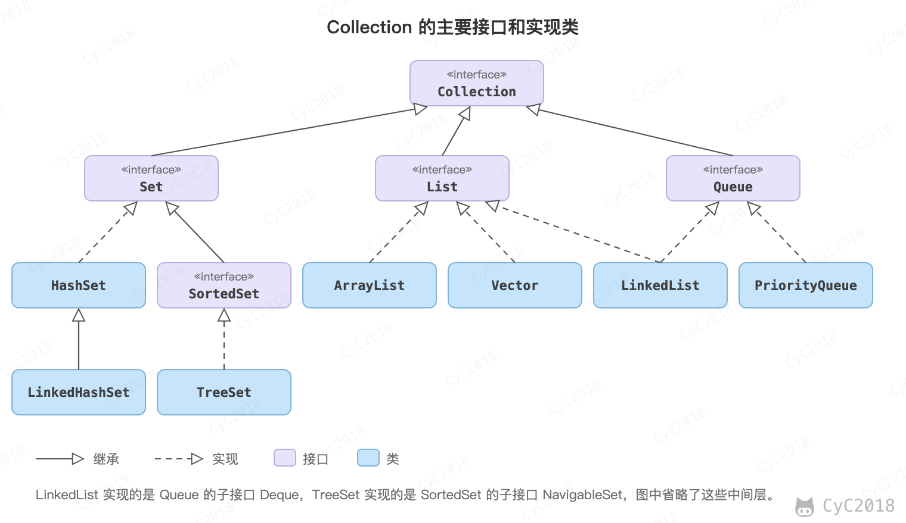 </div><br>

#### 1. Set

- TreeSet：基于红黑树实现，支持有序性操作，例如根据一个范围查找元素的操作。但是查找效率不如 HashSet，HashSet 查找的时间复杂度为 O(1)，TreeSet 则为 O(logN)；
- HashSet：基于哈希表实现，内部就是一个 HashMap，元素作为键、值是同一个占位对象，所以去重靠键的 hashCode() 和 equals()。支持快速查找，但不支持有序性操作，也不保证遍历的顺序；
- LinkedHashSet：具有 HashSet 的查找效率，并且内部使用双向链表维护元素的插入顺序。

#### 2. List

- ArrayList：基于动态数组实现，支持随机访问；
- Vector：和 ArrayList 类似，但它是线程安全的；
- LinkedList：基于双向链表实现，只能顺序访问，但是可以快速地在链表中间插入和删除元素。不仅如此，LinkedList 还可以用作栈、队列和双向队列。

#### 3. Queue

- LinkedList：可以用它来实现双向队列；
- PriorityQueue：基于堆结构实现，可以用它来实现优先队列。

### Map

<div align="center"> 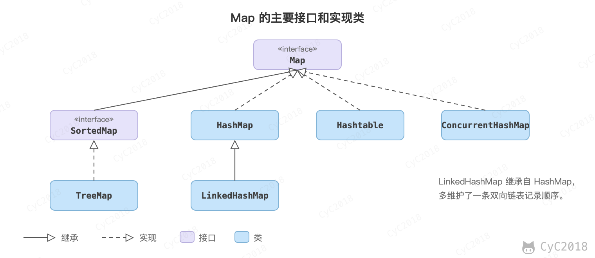 </div><br>

- TreeMap：基于红黑树实现；
- HashMap：基于哈希表实现；
- Hashtable：和 HashMap 类似，但它是线程安全的，这意味着同一时刻多个线程同时写入 Hashtable 不会导致数据不一致。它是遗留类，需要线程安全时应该使用 ConcurrentHashMap。ConcurrentHashMap 的效率更高，因为它不会锁住整个表：JDK 1.7 使用分段锁，JDK 1.8 只锁住一个桶；
- LinkedHashMap：使用双向链表来维护元素的顺序，顺序为插入顺序或者最近最少使用（LRU）顺序。

上面的 ArrayList、LinkedList、HashMap 等常用容器都不是线程安全的。需要在多个线程之间共享时，线程安全的容器主要有以下三类：

- 同步容器：Vector、Hashtable，以及用 Collections.synchronizedList()、synchronizedMap() 包装出来的容器，所有方法共用一把锁，同一时刻只有一个线程能访问，遍历这类组合操作仍要在外面加锁（见 [ArrayList 的替代方案](#4-替代方案)）；
- 写时复制容器：CopyOnWriteArrayList、CopyOnWriteArraySet，写操作复制整个数组，读操作不加锁，适合读多写少的场景；
- 并发容器：ConcurrentHashMap、ConcurrentSkipListMap（按键排序）、ConcurrentLinkedQueue，以及 ArrayBlockingQueue 等阻塞队列（见 [BlockingQueue](Java%20并发.md#blockingqueue)），用 CAS 和更细粒度的锁让多个线程同时访问。

只在一个线程中使用的容器，例如方法中的局部变量，不需要线程安全，直接使用 ArrayList、HashMap，没有加锁的开销。


## 二、容器中的设计模式

### 迭代器模式

<div align="center"> 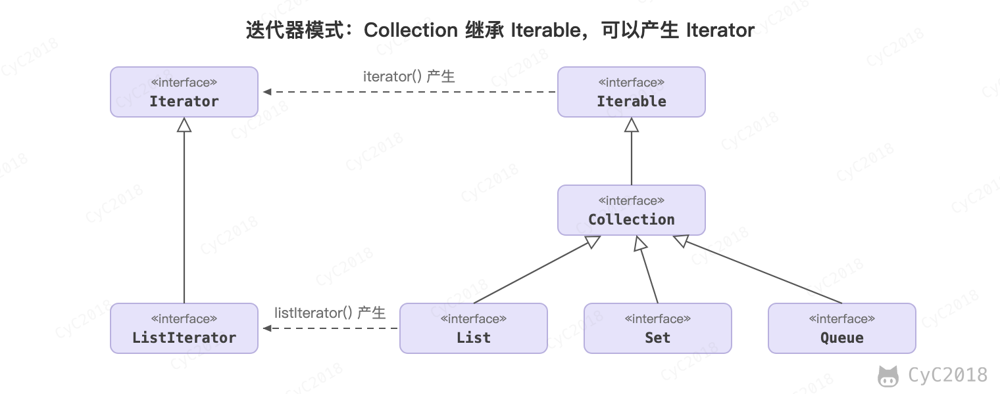 </div><br>

Collection 继承了 Iterable 接口，其中的 iterator() 方法能够产生一个 Iterator 对象，通过这个对象就可以迭代遍历 Collection 中的元素。

从 JDK 1.5 之后可以使用 foreach 方法来遍历实现了 Iterable 接口的聚合对象。

```java
List<String> list = new ArrayList<>();
list.add("a");
list.add("b");
for (String item : list) {
    System.out.println(item);
}
```

### 适配器模式

java.util.Arrays#asList() 可以把数组类型转换为 List 类型。

```java
@SafeVarargs
public static <T> List<T> asList(T... a)
```

应该注意的是 asList() 的参数为泛型的变长参数，T 只能是引用类型，所以要传入包装类型的数组；传入基本类型数组的情况见下文。

```java
Integer[] arr = {1, 2, 3};
List<Integer> list = Arrays.asList(arr);
```

也可以使用以下方式调用 asList()：

```java
List<Integer> list = Arrays.asList(1, 2, 3);
```

asList() 返回的是数组的一个视图，而不是一个新的 ArrayList，使用时需要注意（JDK 21 实测，见[附录 A1](#a1-arraylist-的扩容与常见陷阱)）：

- 长度固定：可以 set()，但调用 add()、remove() 会抛出 UnsupportedOperationException；
- 与数组共用存储：修改原数组后，List 中的元素也跟着改变；
- 传入 int[] 这样的基本类型数组时，整个数组被当成一个元素，得到的 List 长度为 1。

需要一个可以修改的列表时，用 new ArrayList<>(Arrays.asList(arr)) 复制一份。

## 三、源码分析

如果没有特别说明，以下源码分析基于 JDK 1.8。JDK 21 中这些类的主要逻辑没有变化，有差异的地方单独说明。

### ArrayList 🔥


#### 1. 概览

因为 ArrayList 是基于数组实现的，所以支持快速随机访问。RandomAccess 接口标识着该类支持快速随机访问。

```java
public class ArrayList<E> extends AbstractList<E>
        implements List<E>, RandomAccess, Cloneable, java.io.Serializable
```

数组的默认大小为 10。用无参构造函数创建时，elementData 先指向一个长度为 0 的共享空数组，第一次添加元素时才分配长度为 10 的数组。

```java
private static final int DEFAULT_CAPACITY = 10;
```

<div align="center"> 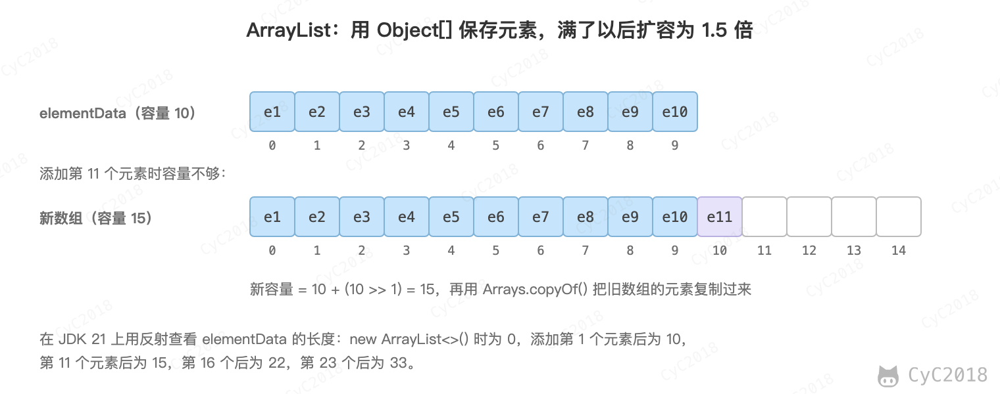 </div><br>

#### 2. 扩容

以 JDK 8 的源码为例，添加元素时使用 ensureCapacityInternal() 方法来保证容量足够，如果不够时，需要使用 grow() 方法进行扩容，新容量的大小为 `oldCapacity + (oldCapacity >> 1)`，即 oldCapacity+oldCapacity/2。其中 oldCapacity >> 1 需要取整，所以新容量大约是旧容量的 1.5 倍（oldCapacity 为偶数就是 1.5 倍，为奇数就是 1.5 倍减 0.5）。例如依次添加元素时，容量的变化为 0、10、15、22、33（JDK 21 实测，见[附录 A1](#a1-arraylist-的扩容与常见陷阱)）。JDK 21 的 grow() 改为调用 ArraysSupport.newLength() 计算新容量，增长的规则相同。

扩容操作需要调用 `Arrays.copyOf()` 把原数组整个复制到新数组中，这个操作代价很高，因此最好在创建 ArrayList 对象时就指定大概的容量大小，减少扩容操作的次数。

以下是 JDK 8 的源码：

```java
public boolean add(E e) {
    ensureCapacityInternal(size + 1);  // Increments modCount!!
    elementData[size++] = e;
    return true;
}

private void ensureCapacityInternal(int minCapacity) {
    if (elementData == DEFAULTCAPACITY_EMPTY_ELEMENTDATA) {
        minCapacity = Math.max(DEFAULT_CAPACITY, minCapacity);
    }
    ensureExplicitCapacity(minCapacity);
}

private void ensureExplicitCapacity(int minCapacity) {
    modCount++;
    // overflow-conscious code
    if (minCapacity - elementData.length > 0)
        grow(minCapacity);
}

private void grow(int minCapacity) {
    // overflow-conscious code
    int oldCapacity = elementData.length;
    int newCapacity = oldCapacity + (oldCapacity >> 1);
    if (newCapacity - minCapacity < 0)
        newCapacity = minCapacity;
    if (newCapacity - MAX_ARRAY_SIZE > 0)
        newCapacity = hugeCapacity(minCapacity);
    // minCapacity is usually close to size, so this is a win:
    elementData = Arrays.copyOf(elementData, newCapacity);
}
```

#### 3. 删除元素

需要调用 System.arraycopy() 将 index+1 后面的元素都复制到 index 位置上，该操作的时间复杂度为 O(N)，删除的位置越靠前，需要移动的元素越多。

```java
public E remove(int index) {
    rangeCheck(index);
    modCount++;
    E oldValue = elementData(index);
    int numMoved = size - index - 1;
    if (numMoved > 0)
        System.arraycopy(elementData, index+1, elementData, index, numMoved);
    elementData[--size] = null; // clear to let GC do its work
    return oldValue;
}
```

#### 4. 序列化

保存元素的数组 elementData 用 transient 修饰，不参与默认的序列化。ArrayList 实现了 writeObject() 和 readObject()，只序列化前 size 个实际存放的元素，数组中空闲的位置不写出；反序列化时按 size 而不是原来的容量分配数组。源码见[进阶：序列化](Java%20容器%20-%20进阶.md#序列化)。

#### 5. Fail-Fast

modCount 用来记录 ArrayList 结构发生变化的次数。结构发生变化是指添加或者删除至少一个元素的所有操作，或者是调整内部数组的大小，仅仅只是设置元素的值不算结构发生变化。

在进行序列化或者迭代等操作时，需要比较操作前后 modCount 是否改变，如果改变了需要抛出 ConcurrentModificationException。代码参考[进阶：序列化](Java%20容器%20-%20进阶.md#序列化)中的 writeObject() 方法。

最常见的情况是在 foreach 循环中删除元素。foreach 编译后使用迭代器，list.remove() 改变了 modCount，迭代器下一次调用 next() 时就会抛出异常。需要注意的是，fail-fast 只是尽力检测：hasNext() 只比较游标和 size，modCount 要到 next() 中才检查，例如遍历 [a, b, c] 时删除 b，游标和 size 都是 2，循环直接结束，不抛异常，c 也没有被遍历到（见[附录 A1](#a1-arraylist-的扩容与常见陷阱)）。应该使用迭代器自己的 remove()，或者 removeIf()。HashMap 等其它容器的迭代器同样是 fail-fast 的，遍历时删除键用 map.entrySet().removeIf() 或迭代器的 remove()：

```java
for (String s : list) {
    if (s.equals("a")) list.remove(s);    // ConcurrentModificationException
}

Iterator<String> it = list.iterator();
while (it.hasNext()) {
    if (it.next().equals("a")) it.remove();
}

list.removeIf(s -> s.equals("a"));
```

java.util.concurrent 包中容器的迭代器不是 fail-fast 的，遍历期间修改容器不会抛出 ConcurrentModificationException：CopyOnWriteArrayList 遍历的是快照（见 [CopyOnWriteArrayList](#copyonwritearraylist)），ConcurrentHashMap 的迭代器是弱一致的，可能看不到遍历期间的修改。

### LinkedList

#### 1. 概览

基于双向链表实现，使用 Node 存储链表节点信息。

```java
private static class Node<E> {
    E item;
    Node<E> next;
    Node<E> prev;
}
```

每个链表存储了 first 和 last 指针：

```java
transient Node<E> first;
transient Node<E> last;
```

<div align="center"> 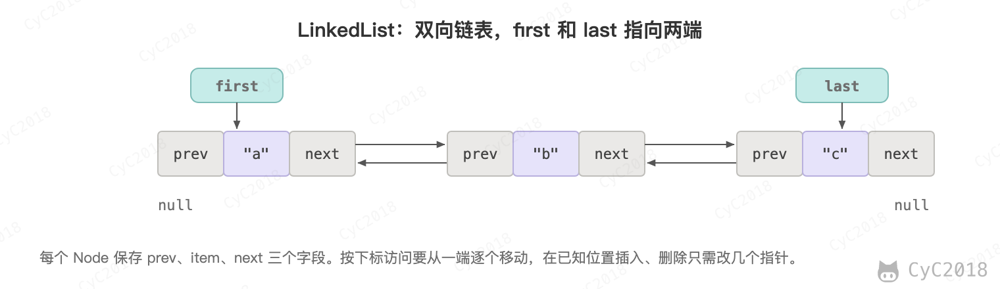 </div><br>

#### 2. 与 ArrayList 的比较

ArrayList 基于动态数组实现，LinkedList 基于双向链表实现。ArrayList 和 LinkedList 的区别可以归结为数组和链表的区别：

- 数组支持随机访问，get(i) 是 O(1)，但插入删除的代价很高，需要移动大量元素；
- 链表不支持随机访问，get(i) 要从离 i 较近的一端逐个遍历，是 O(N)，但插入删除只需要改变指针。

需要注意的是，链表在中间插入或删除前要先遍历到这个位置，这一步也是 O(N) 的，而且要逐个访问分散在内存中的节点，只有已经拿到节点时（例如用 ListIterator 遍历到这个位置，再通过迭代器插入或删除），改指针才是 O(1)；数组移动元素用的是 System.arraycopy()，一次复制一整块连续内存。例如在 10 万个元素的中间插入 1 万次，ArrayList 约 50 ms，LinkedList 约 0.8～1 秒；在头部插入时 LinkedList 明显更快（JDK 21 实测，见[附录 A1](#a1-arraylist-的扩容与常见陷阱)）。

内存上，ArrayList 每个元素只占数组中的一个引用（压缩指针下 4 字节，扩容留下的空位另算），LinkedList 每个元素还要一个 24 字节的 Node 对象（JDK 21 实测，见[附录 A1](#a1-arraylist-的扩容与常见陷阱)）。所以大多数场景下应该使用 ArrayList，需要在头尾频繁插入删除时使用 ArrayDeque 或 LinkedList。

### Vector

#### 1. 同步

它的实现与 ArrayList 类似，但是使用了 synchronized 进行同步。

```java
public synchronized boolean add(E e) {
    modCount++;
    ensureCapacityHelper(elementCount + 1);
    elementData[elementCount++] = e;
    return true;
}

public synchronized E get(int index) {
    if (index >= elementCount)
        throw new ArrayIndexOutOfBoundsException(index);

    return elementData(index);
}
```

#### 2. 扩容

Vector 的构造函数可以传入 capacityIncrement 参数，扩容时容量增加 capacityIncrement；这个参数小于等于 0 时，每次扩容容量翻倍。无参构造函数的初始容量为 10，它和只传入初始容量的构造函数都把 capacityIncrement 设为 0，所以默认情况下 Vector 每次扩容容量翻倍。

```java
private void grow(int minCapacity) {
    // overflow-conscious code
    int oldCapacity = elementData.length;
    int newCapacity = oldCapacity + ((capacityIncrement > 0) ?
                                     capacityIncrement : oldCapacity);
    if (newCapacity - minCapacity < 0)
        newCapacity = minCapacity;
    if (newCapacity - MAX_ARRAY_SIZE > 0)
        newCapacity = hugeCapacity(minCapacity);
    elementData = Arrays.copyOf(elementData, newCapacity);
}
```

#### 3. 与 ArrayList 的比较

- Vector 是同步的，因此开销就比 ArrayList 要大，访问速度更慢。最好使用 ArrayList 而不是 Vector，因为同步操作完全可以由程序员自己来控制；
- Vector 每次扩容请求其大小的 2 倍（也可以通过构造函数设置增长的容量），而 ArrayList 是 1.5 倍。

#### 4. 替代方案

ArrayList 不是线程安全的。JDK 21 的 add() 先读出 size 记为 s，容量不够时扩容，然后写入 elementData[s]，最后把 size 设为 s + 1，这几步之间没有同步：

- 两个线程读到同一个 s，写入同一个位置，一个元素被覆盖，size 也只增加了 1；
- 一个线程扩容后换成了新数组，另一个线程仍然写入旧数组，这次写入丢失，新数组中的这个位置留下 null；
- 一个线程读到的 size 已被其它线程增加到超过它手中旧数组的长度，写入时抛出 ArrayIndexOutOfBoundsException。

例如 8 个线程各添加 10 万个元素，30 轮中 size 在 15 万～58 万之间，大多数轮次中出现了上百到数万个 null，有 3 轮抛出了 ArrayIndexOutOfBoundsException；同样的操作用 Collections.synchronizedList() 每次都是 80 万（JDK 21 实测，见[附录 A3](#a3-arraylist-的并发写入)）。

可以使用 `Collections.synchronizedList();` 得到一个线程安全的 ArrayList。

```java
List<String> list = new ArrayList<>();
List<String> synList = Collections.synchronizedList(list);
```

包装后的每个方法各自加锁，遍历和“先检查再修改”这类组合操作仍要在外面锁住 synList，并且不能再绕过它直接操作 list：

```java
synchronized (synList) {
    for (String s : synList) {
        System.out.println(s);
    }
}
```

也可以使用 concurrent 并发包下的 CopyOnWriteArrayList 类。

```java
List<String> list = new CopyOnWriteArrayList<>();
```

### CopyOnWriteArrayList

#### 1. 读写分离

写操作先加锁，把当前数组复制一份，在副本上修改，最后把 volatile 字段 array 指向副本；加锁是为了防止两个写操作各自复制同一个旧数组，后完成的覆盖先完成的。已经发布的数组不再被修改，所以读操作直接读当前的数组，不需要加锁。JDK 9 起写操作改为用 synchronized 加锁，过程相同。

迭代器遍历的是创建时的数组快照：遍历期间可以修改列表，不会抛出 ConcurrentModificationException，但看不到这些修改，也不支持通过迭代器 remove（JDK 21 实测，见[附录 A8](#a8-copyonwritearraylist-的迭代器)）。

```java
public boolean add(E e) {
    final ReentrantLock lock = this.lock;
    lock.lock();
    try {
        Object[] elements = getArray();
        int len = elements.length;
        Object[] newElements = Arrays.copyOf(elements, len + 1);
        newElements[len] = e;
        setArray(newElements);
        return true;
    } finally {
        lock.unlock();
    }
}

final void setArray(Object[] a) {
    array = a;
}
```

```java
@SuppressWarnings("unchecked")
private E get(Object[] a, int index) {
    return (E) a[index];
}
```

#### 2. 适用场景

CopyOnWriteArrayList 的读操作不加锁，也不会被写操作阻塞，适合读多写少的场景，例如监听器列表、很少变化的配置。

但是 CopyOnWriteArrayList 有其缺陷：

- 写的代价：每次写都复制整个数组，写操作是 O(N) 的，写的过程中新旧两个数组同时存在，内存占用约为两倍；
- 数据不一致：读操作读到的可能是写操作完成前的旧数组。

所以 CopyOnWriteArrayList 不适合内存敏感以及对实时性要求很高的场景。

### HashMap 🔥🔥

以下以 JDK 1.8 为主，JDK 21 与 JDK 1.8 相同。与 JDK 1.7 相比主要有以下变化，JDK 1.7 的源码见[进阶：JDK 1.7 的 HashMap](Java%20容器%20-%20进阶.md#jdk-17-的-hashmap)：

- 节点类由 Entry 改为 Node，链表过长时转为红黑树，见[链表转红黑树](#8-链表转红黑树)，JDK 1.7 始终使用链表；
- 新的键值对插入链表尾部，JDK 1.7 插入链表头部；
- 计算哈希值时只做一次扰动，JDK 1.7 做了四次移位和异或；
- 扩容时按哈希值新增的那一位把链表拆成两条，保持节点原来的顺序，见[扩容-重新计算桶下标](#6-扩容-重新计算桶下标)，JDK 1.7 逐个重新计算桶下标并插入新链表的头部，顺序会反转；
- 扩容的时机：JDK 1.8 在插入后 size 大于 threshold 时扩容，JDK 1.7 在插入前 size 大于等于 threshold 并且目标桶不为空时扩容。

#### 1. 存储结构

内部包含了一个 Node 类型的数组 table，数组中的每个位置被当成一个桶。Node 存储着键值对，从 next 字段可以看出 Node 是一个链表节点，一个桶存放一个链表。HashMap 使用拉链法来解决冲突，同一个链表中存放桶下标相同的 Node。

<div align="center"> 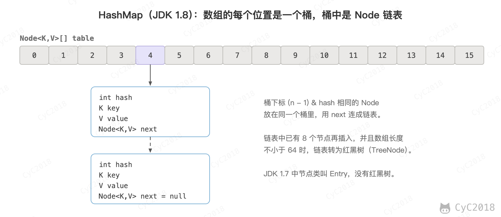 </div><br>

```java
transient Node<K,V>[] table;

static class Node<K,V> implements Map.Entry<K,V> {
    final int hash;
    final K key;
    V value;
    Node<K,V> next;
}
```

链表转为红黑树后，桶中存放的是红黑树的节点 TreeNode，见[链表转红黑树](#8-链表转红黑树)。

#### 2. 拉链法的工作原理

```java
HashMap<String, String> map = new HashMap<>();
map.put("K1", "V1");
map.put("K2", "V2");
map.put("K3", "V3");
```

- 新建一个 HashMap，默认大小为 16；
- 插入 &lt;K1,V1\> 键值对，先计算 K1 的 hashCode，为了便于说明，假设为 115（实际上 "K1".hashCode() 是 2374），使用除留余数法得到所在的桶下标 115%16=3；
- 插入 &lt;K2,V2\> 键值对，假设 K2 的 hashCode 为 118，使用除留余数法得到所在的桶下标 118%16=6；
- 插入 &lt;K3,V3\> 键值对，假设 K3 的 hashCode 也为 118，使用除留余数法得到所在的桶下标 118%16=6，接在 &lt;K2,V2\> 后面。

查找需要分成两步进行：

- 计算键值对所在的桶；
- 在链表上顺序查找，时间复杂度显然和链表的长度成正比。

<div align="center"> 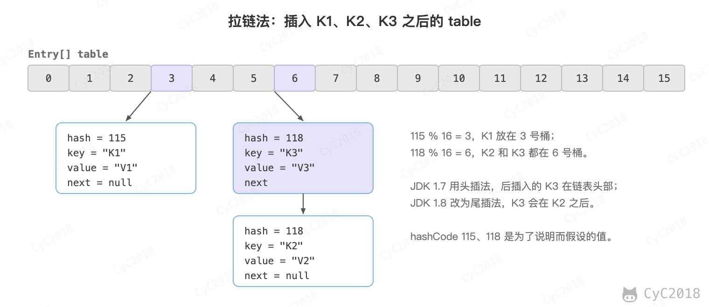 </div><br>

拉链法之外，解决哈希冲突的常见方法还有：

- 开放定址法：冲突时按固定的规则在数组中寻找下一个空位，例如线性探测依次检查下一个位置。JDK 中的 ThreadLocalMap 和 IdentityHashMap 使用线性探测；
- 再哈希法：冲突时换一个哈希函数重新计算位置。

开放定址法的元素都存放在数组中，没有链表节点的开销，但装载因子必须较低，否则探测序列会很长；删除时也不能直接把位置置空，否则会截断其它元素的探测序列，ThreadLocalMap 删除元素后要把后面同一段中的元素重新放置。HashMap 采用拉链法，装载因子可以达到 0.75，删除只需修改链表，冲突严重时还可以把链表转为红黑树。

#### 3. put 操作

put() 调用 putVal()，过程如下，右侧用前面的 K1、K2、K3 各走一个分支：

<div align="center"> 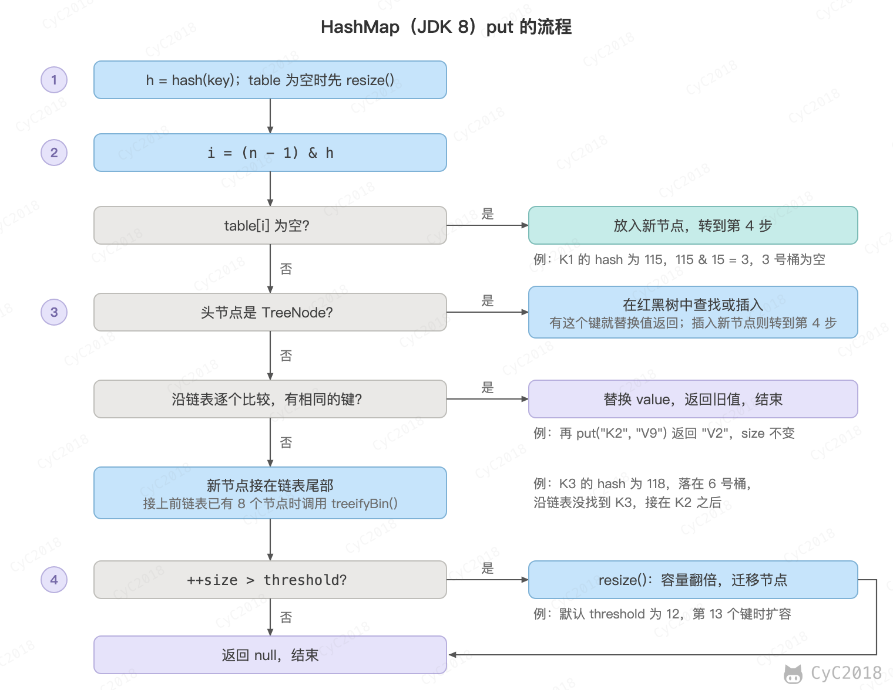 </div><br>

1. 用 hash() 计算哈希值，键为 null 时哈希值为 0，所以 null 键总是放在 0 号桶；table 为空时先调用 resize() 创建数组，数组到第一次 put 时才分配；
2. 用 (n - 1) & hash 计算桶下标，桶为空时直接放入新节点；
3. 桶不为空时，头节点是 TreeNode 就在红黑树中查找或插入，否则遍历链表，找到相同的键就用新值替换旧值并返回旧值，找不到就把新节点接在链表尾部，接上之前链表已有 8 个节点时调用 treeifyBin()，见[链表转红黑树](#8-链表转红黑树)；
4. 新增了节点时 size 加 1，大于 threshold 就调用 resize() 扩容，见[扩容-基本原理](#5-扩容-基本原理)。

判断键相同的条件是哈希值相等，并且两个键是同一个对象或者 equals() 返回 true，所以作为键的类要同时重写 hashCode() 和 equals()。键放入之后也不能再修改参与 hashCode() 的字段，否则按新的哈希值找不到原来的桶：例如用 ArrayList [1, 2] 作为键，放入后再 add(3)，get 和 containsKey 都找不到它（JDK 21 实测，见[附录 A9](#a9-hashmap-的可变键与遍历删除)）。String、Integer 这类不可变类适合作为键。

get() 用同样的方法算出桶下标，先比较桶中的头节点，头节点是 TreeNode 就在红黑树中查找，否则沿链表逐个比较。

#### 4. 确定桶下标

很多操作都需要先确定一个键值对所在的桶下标。

```java
int hash = hash(key);
int i = (n - 1) & hash;    // n 为 table 的长度
```

##### 4.1 计算哈希值

```java
static final int hash(Object key) {
    int h;
    return (key == null) ? 0 : (h = key.hashCode()) ^ (h >>> 16);
}
```

hash() 把 hashCode 的高 16 位异或到低 16 位。桶下标只取哈希值的低几位，不扰动时，高位不同、低位相同的键都会落在同一个桶中。例如 hashCode 为 0x10000 和 0x20000 的两个键，低 16 位都是 0，在容量 16 的数组中都落在 0 号桶；扰动后低 4 位分别为 1 和 2，落在不同的桶。

##### 4.2 取模

确定桶下标相当于把哈希值对桶的个数取模。capacity 为 2 的 n 次方时，capacity - 1 的低 n 位全是 1，与运算正好保留 hash 的低 n 位，hash 非负时结果和 hash % capacity 相同（hash 为负时 % 可能得到负数，与运算仍是合法的下标），而且位运算比取模快得多。例如 capacity 为 16、hash 为 178：

```text
hash         : 10110010    178
capacity - 1 : 00001111     15
与运算的结果 : 00000010      2    与 178 % 16 = 2 相同
```

需要注意的是，长度不是 2 的幂时，length - 1 的二进制中有为 0 的位，与运算后这些位总是 0，一部分桶永远用不到，例如长度为 15 时 length - 1 为 1110，下标只可能是偶数。容量为 2 的幂的另一个好处是扩容时可以按一位拆分链表，见[扩容-重新计算桶下标](#6-扩容-重新计算桶下标)。

#### 5. 扩容-基本原理

设 HashMap 的 table 长度为 M，需要存储的键值对数量为 N，如果哈希函数满足均匀性的要求，那么每条链表的长度大约为 N/M，因此查找的复杂度为 O(N/M)。

为了降低查找的成本，N/M 要保持在较小的值。HashMap 在 N 增大时扩容，增大 M，使空间效率和时间效率都能得到保证。

和扩容相关的参数主要有：capacity、size、threshold 和 load_factor。

| 参数 | 含义 |
| :--: | :-- |
| capacity | table 的容量大小，默认为 16。需要注意的是 capacity 必须保证为 2 的 n 次方。|
| size | 键值对数量。 |
| threshold | size 的临界值，插入后 size 大于 threshold 时扩容。 |
| loadFactor | 装载因子，threshold = (int)(capacity * loadFactor)。比较的是键值对个数 size，不是非空桶的个数。 |

```java
static final int DEFAULT_INITIAL_CAPACITY = 16;

static final int MAXIMUM_CAPACITY = 1 << 30;

static final float DEFAULT_LOAD_FACTOR = 0.75f;

transient Node<K,V>[] table;

transient int size;

int threshold;

final float loadFactor;

transient int modCount;
```

例如默认容量 16、装载因子 0.75 时 threshold 为 12，放入第 13 个键后容量变为 32，放入第 25 个键后变为 64（JDK 21 实测，见[附录 A5](#a5-hashmap-的扩容时机与-hashtable)）。

装载因子取 0.75 是时间和空间的折中：调大可以少占内存，但链表变长，查找变慢；调小则扩容更频繁，空着的桶更多。装载因子为 0.75 时，桶中的节点数近似服从参数为 0.5 的泊松分布，约 98.6% 的桶只有 0～2 个节点，见[链表转红黑树](#8-链表转红黑树)。

HashMap 的空间开销也要考虑。例如一个 HashMap\<String, Long\> 放入 100 万个键值对，键是 12 个 ASCII 字符的字符串，每个条目连同键和值约占 120 字节：键 56 字节、Long 24 字节、Node 32 字节、桶数组约 8 字节，约为有效数据（12 字节字符加 8 字节的 long）的 6 倍（JDK 21 实测，见[附录 A11](#a11-hashmap-每个条目的内存)）。用 HashMap 做本地缓存时，要按键和值的实际大小这样估算，并给扩容留出余量。

能预估键的数量时，应该在创建时指定容量，避免多次扩容。需要注意的是，构造函数的参数是容量而不是键数：new HashMap<>(1000) 的容量为 1024、threshold 为 768，放入 1000 个键时仍会扩容一次；JDK 19 起的 HashMap.newHashMap(1000) 按装载因子换算出容量 2048，不再扩容（JDK 21 实测，见[附录 A5](#a5-hashmap-的扩容时机与-hashtable)）。

扩容由 resize() 完成：容量变为原来的两倍，threshold 随之变为新容量乘以装载因子，创建新数组，再把旧数组中的节点逐个桶迁移到新数组中，因此这一步是很费时的。

#### 6. 扩容-重新计算桶下标

扩容时要重新计算每个键值对的桶下标。capacity 为 2 的 n 次方时不需要重新取模，只看哈希值中的一位就能确定新位置。

容量从 16 扩为 32 时，桶下标从取 hash 的低 4 位变为取低 5 位，新下标比原来多取一位，即 hash 中值为 16 的那一位（hash & oldCap）：

- 这一位为 0，新下标与原来相同；
- 这一位为 1，新下标为原下标 + 16。

resize() 就利用了这个性质：遍历旧桶中的链表，按 (hash & oldCap) 是否为 0 把节点分到 lo、hi 两条链表，分别放到新数组的 j 和 j + oldCap 位置，链表中节点的相对顺序保持不变。例如 Integer 键 5、21、37、53 的哈希值就是它们自身，容量 16 时都在 5 号桶，扩容后 5、37 留在 5 号桶，21、53 移到 21 号桶（JDK 21 实测，见[附录 A5](#a5-hashmap-的扩容时机与-hashtable)）：

<div align="center"> 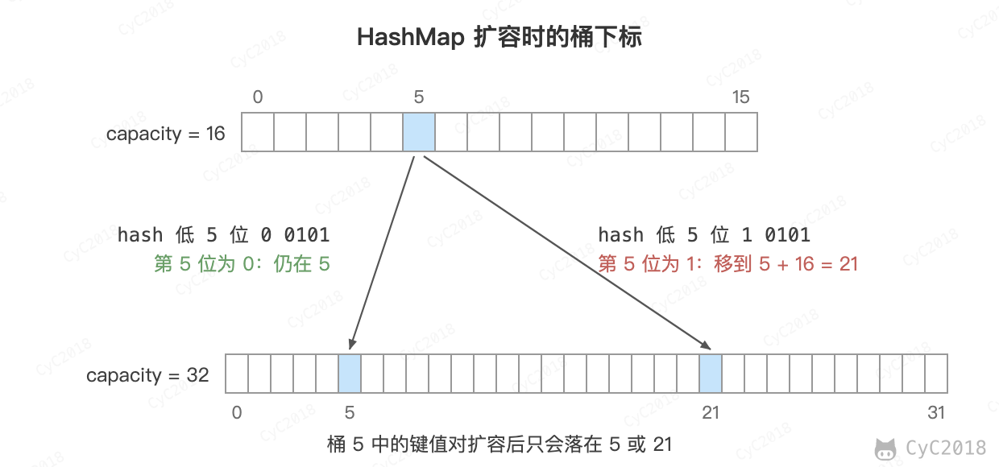 </div><br>

#### 7. 计算数组容量

HashMap 构造函数允许传入的容量不是 2 的 n 次方，tableSizeFor() 会把它向上取为大于等于它的最小的 2 的 n 次方，例如传入 17 时容量为 32，传入 16 时仍为 16。这个计算只用移位和或运算，过程见[进阶：计算数组容量](Java%20容器%20-%20进阶.md#计算数组容量)。

#### 8. 链表转红黑树

从 JDK 1.8 开始，向一个桶中添加元素时，如果链表中已经有 8 个节点（TREEIFY_THRESHOLD），会先检查数组长度：小于 64（MIN_TREEIFY_CAPACITY）时只进行扩容，否则把链表转换为红黑树。例如所有键的 hashCode() 都相同时，放入第 9 个键时容量从 16 扩为 32，第 10 个键时扩为 64，第 11 个键时才转为红黑树（JDK 21 实测，见[附录 A4](#a4-hashmap-链表转红黑树)）。数组较小时，冲突多半是桶太少造成的，扩容就能把链表拆开，所以先扩容。

引入红黑树是为了限制最坏情况：hashCode() 分布很差，或者被人故意构造成相同的值时，大量键落在同一个桶中，在链表中查找退化为 O(N)，红黑树则为 O(logN)。需要注意的是，红黑树按哈希值和 compareTo() 决定查找方向，哈希值相同又没有实现 Comparable 的键无法比较，查找仍会退化为 O(N)（JDK 21 实测，见[附录 A4](#a4-hashmap-链表转红黑树)）。

阈值取 8，是因为 hashCode() 足够随机时，一个桶中很难积累 8 个节点：装载因子为 0.75 时，桶中的节点数近似服从参数为 0.5 的泊松分布，一个桶中恰好有 8 个节点的概率约为 0.00000006（计算见[附录 A4](#a4-hashmap-链表转红黑树)）。TreeNode 的大小约为普通节点的两倍，正常情况下用不到它，也就不必付出这部分内存。

红黑树转回链表的阈值是 6 而不是 8，两个阈值之间留出余量，避免节点数在 8 附近增减时反复转换。需要注意的是，6 只用于扩容时拆分树：拆分后的节点数不超过 6 就转回链表。删除节点时按树的形状判断，根节点缺少左子节点或右子节点，或者根的左子节点没有左子节点时，转回链表，例如上面的例子再放入第 12 个键，然后逐个删除，剩 3 个键时才转回链表。

源码注释没有说明为什么选红黑树而不选 AVL 树，树化桶的平衡代码与 TreeMap 一样改编自《算法导论》中的红黑树。两者相比，插入时最多都只旋转 2 次；删除时红黑树最多旋转 3 次，AVL 树可能要沿着路径旋转多次。红黑树只要求大致平衡，高度上界比 AVL 树高，但节点少时差别不大，例如 10 个节点时两者的高度上界分别约为 6 层和 4 层。B+ 树为磁盘设计，用很大的节点减少读取磁盘的次数，不适合内存中只有几个节点的桶。

#### 9. 与 Hashtable 的比较

- 线程安全：Hashtable 的方法都用 synchronized 修饰，所有操作共用一把锁；HashMap 不加锁，不是线程安全的；
- null：HashMap 允许一个键为 null、任意多个值为 null，Hashtable 的键和值都不能为 null，否则抛出 NullPointerException；
- 容量与下标：HashMap 默认容量 16，每次扩为 2 倍，用位运算计算下标；Hashtable 默认容量 11，每次扩为 2n + 1，用 (hash & 0x7FFFFFFF) % length 取模，也不对 hashCode 做扰动（JDK 21 实测 Hashtable 依次扩为 23、47、95，见[附录 A5](#a5-hashmap-的扩容时机与-hashtable)）；
- 哈希冲突：HashMap 的链表过长时转为红黑树，Hashtable 始终使用链表；
- 迭代：两者 keySet()、values() 等视图的迭代器都是 fail-fast 的，只有 Hashtable 的 keys()、elements() 返回的 Enumeration 不是；
- 顺序：两者都不保证遍历的顺序，并且扩容后顺序可能改变。

Hashtable 是 JDK 1.0 的遗留类，需要线程安全时使用 ConcurrentHashMap。需要按顺序遍历时，按插入顺序用 LinkedHashMap，按键的大小用 TreeMap：TreeMap 基于红黑树，查找和插入为 O(logN)，支持 firstKey()、subMap() 这类按范围的操作；HashMap 平均为 O(1)，不支持这些操作。

#### 10. 线程安全

HashMap 不是线程安全的。数据放好并安全发布（例如赋给 final 字段）之后只读，多个线程并发访问没有问题；只要有一个线程在写就会出问题，例如两个线程同时向同一个空桶插入，都判断桶为空，后写入的会覆盖先写入的；size++ 也不是原子操作。用 8 个线程各插入 10 万个不同的键，HashMap 的 size 每次都不同，例如 111068、323870，远少于 80 万；同样的操作 ConcurrentHashMap 每次都是 800000（JDK 21 实测，见[附录 A2](#a2-hashmap-的并发写入)）。

只有一个线程写、其它线程只读也不安全。resize() 先把 table 指向新数组，再逐个桶把节点迁过去，读线程在这期间查已经存在的键，可能落到还没迁入的新桶上，返回 null。例如键 0 事先放入，一个线程再放入 1～199999，另一个线程反复 get(0)，10 轮中每轮都有几次到一百多次返回 null，写完后再读都正常（JDK 21 实测，见[附录 A2](#a2-hashmap-的并发写入)）。

JDK 1.7 的问题更严重：扩容时把节点逐个插入新链表的头部，顺序会反转，两个线程同时扩容时链表可能形成环，之后在这个桶上的 get 会陷入死循环。例如桶中为 B → A，线程 1 读到 e = B、next = A 后暂停；线程 2 完成扩容，新链表反转为 A → B，A.next 指向了 B；线程 1 继续时依次放入 B、A，又沿 A.next 取回 B 再放入一次，把 B.next 设为 A，B 和 A 互相指向（按 JDK 7 的 transfer() 模拟，见[附录 A6](#a6-jdk-17-hashmap-扩容成环的模拟)）。

<div align="center"> 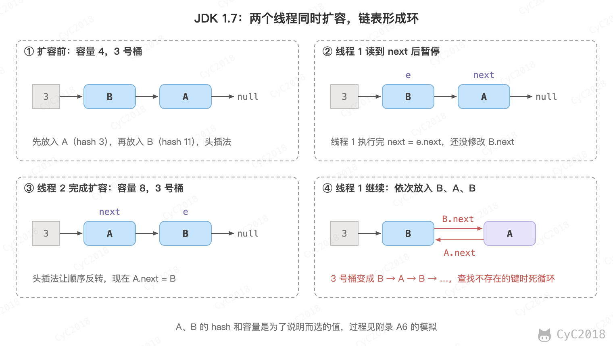 </div><br>

JDK 1.8 改为尾插法，扩容时保持链表原来的顺序，不会再因为头插法成环，但并发写入仍然会丢失数据；链表转为红黑树时还可能破坏树的结构，实测中出现过线程抛出 ClassCastException，以及线程在 TreeNode.treeify() 中一直循环不返回的情况（见[附录 A2](#a2-hashmap-的并发写入)）。多线程环境应该使用 ConcurrentHashMap。

### ConcurrentHashMap 🔥🔥

以下以 JDK 1.8 为主，JDK 21 与 JDK 1.8 相同；JDK 1.7 的分段锁以及两者的区别见[JDK 1.8 的改动](#3-jdk-18-的改动)。

#### 1. 存储结构

ConcurrentHashMap 和 HashMap 一样使用 Node 数组加链表（或红黑树），区别在于并发控制：往空桶中放入节点时用 CAS，修改非空的桶时锁住它的头节点，锁的粒度是单个桶。

```java
transient volatile Node<K,V>[] table;

static class Node<K,V> implements Map.Entry<K,V> {
    final int hash;
    final K key;
    volatile V val;
    volatile Node<K,V> next;
}
```

#### 2. size 操作

元素个数保存在 baseCount 和一组 CounterCell 中：没有竞争时用 CAS 更新 baseCount，竞争激烈时不同线程更新不同的 CounterCell，size() 把它们加起来，与 LongAdder 的思路相同。求和时不加锁，其它线程可能正在增减，所以并发修改时返回的是一个估计值。元素个数可能超过 int 的范围，JDK 8 起建议用返回 long 的 mappingCount()，它同样是估计值。

#### 3. JDK 1.8 的改动

JDK 1.7 使用分段锁（Segment）来实现并发更新：每个 Segment 继承自 ReentrantLock，维护着自己的 HashEntry 数组，多个线程可以同时访问不同 Segment 中的桶，并发度与 Segment 数量相等，默认为 16。源码见[进阶：JDK 1.7 的存储结构](Java%20容器%20-%20进阶.md#jdk-17-的存储结构)。

<div align="center"> 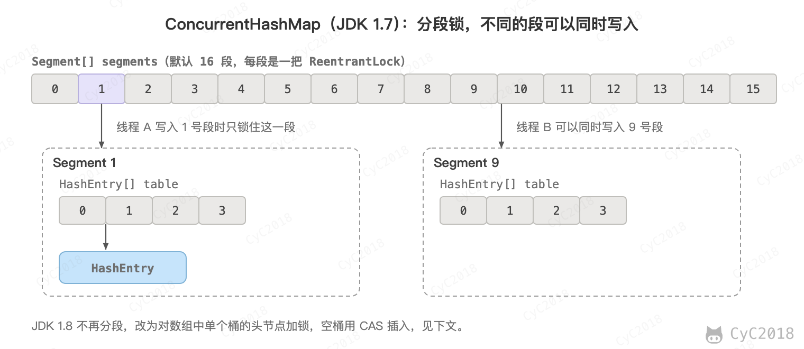 </div><br>

JDK 1.8 去掉了 Segment，锁的粒度缩小到每个桶。put 的过程如下：

1. 用 spread() 计算哈希值，把 hashCode 的高 16 位异或到低 16 位，让高位也参与决定桶下标；
2. 如果桶是空的，用 CAS 把新节点放进去，不加锁。CAS 失败说明有其它线程刚刚放入了节点，重新循环；
3. 如果桶的头节点是 ForwardingNode（哈希值为 MOVED），说明这个桶已经迁移到新数组，当前线程先尝试帮忙迁移（还有没被领取的桶时），再到新数组中插入；
4. 否则用 synchronized 锁住桶的头节点，在链表或红黑树中插入或更新，链表中已有 8 个节点时再插入会转为红黑树，数组长度小于 64 时则只扩容；
5. 最后更新元素个数。

例如扩容已经迁移完 10～15 号桶时，三个线程同时 put，键分别落在空桶、已迁移的桶和还没迁移的非空桶，分别走第 2、3、4 步，不需要争同一把锁：

<div align="center"> 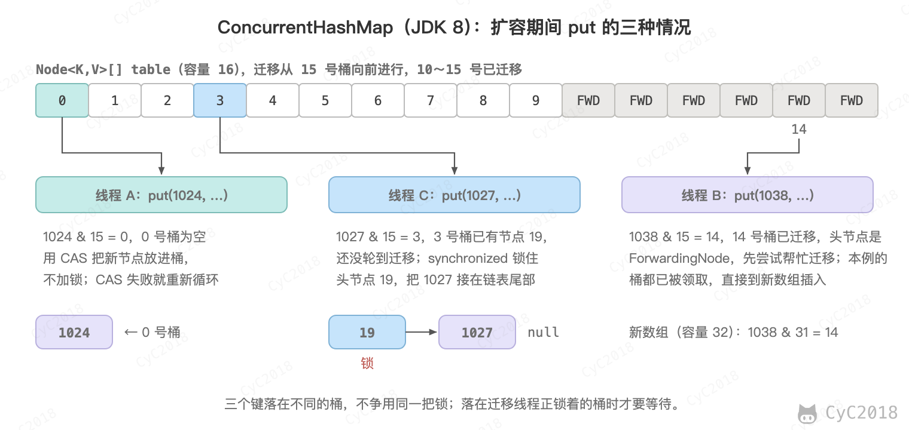 </div><br>

需要注意的是，迁移线程也要锁住旧桶的头节点，扩容期间 put 可能要等这个桶迁移完，或者先帮忙迁移一段，耗时会变长。

get 不加锁：数组元素通过 Unsafe 的 volatile 方式读取，节点的 val 和 next 都是 volatile，能读到其它线程写入的最新值。

去掉 Segment 是因为 JDK 1.7 的并发度在创建时由 concurrencyLevel 确定，之后不能改变，默认的 16 个 Segment 最多允许 16 个线程同时写。JDK 1.8 锁住的是单个桶，并发度随扩容增大，键的哈希值随机时，两个线程更新不同的键争用同一把锁的概率约为 1 / (8 × 元素个数)；而且最常见的往空桶中插入只用一次 CAS，不需要加锁。

用 synchronized 锁住头节点，而不是给每个桶配一个 ReentrantLock，是为了不给每个桶多分配一个锁对象，用已有的头节点作为锁最省空间。加锁之后还要检查头节点是否仍是原来的节点，因为它可能已经被删除，或者这个桶已经被迁移。

扩容的过程：

1. 元素个数达到 sizeCtl（容量的 0.75 倍）时，一个线程创建 2 倍大小的新数组，开始迁移；
2. 迁移从数组末尾向前进行，每个线程用 CAS 修改 transferIndex，领取一段还没有迁移的桶，每段至少 16 个，不同线程领到的范围不会重叠。例如容量 64 时，第一个线程把 transferIndex 从 64 改为 48，领到 48～63 号桶，第二个线程再改为 32，领到 32～47 号桶；
3. 迁移一个桶时锁住它的头节点，按 hash & n 把节点分到新数组的 i 和 i + n 两个位置，分组的规则与 HashMap 相同，然后在旧桶中放入 ForwardingNode；
4. 所有桶迁移完后，table 指向新数组，sizeCtl 更新为新容量的 0.75 倍。

迁移期间，get 遇到 ForwardingNode 时到新数组中查找，还没有迁移的桶照常在旧数组中读取；put 遇到 ForwardingNode 时先尝试帮忙迁移，再到新数组中插入。迁移时不修改旧节点的 next（链表末尾同组的一段直接复用，其余节点复制），所以正在旧链表上遍历的 get 不受影响。

与 JDK 1.7 相比的其它变化：

- 计数：JDK 1.7 的 size() 先不加锁累加各 Segment 的 count，相邻两轮各 Segment 的 modCount 之和相同就返回，3 次仍不稳定再锁住所有 Segment（见[进阶：size 操作](Java%20容器%20-%20进阶.md#size-操作)）；JDK 1.8 见[size 操作](#2-size-操作)；
- 扩容：JDK 1.7 中每个 Segment 在自己的锁内各自扩容；JDK 1.8 中多个线程可以一起迁移整个数组，过程见上文。

需要注意的是，ConcurrentHashMap 的键和值都不能为 null。HashMap 中 get 返回 null 时，可以再用 containsKey 判断是键不存在还是值为 null；在并发环境下，这两次调用之间其它线程可能修改了数据，结果无法确定，所以干脆不允许 null。另外，get、put 这类针对单个键的操作各自是原子的，组合起来就不是了。例如 8 个线程各执行 10 万次 put(k, getOrDefault(k, 0) + 1)，get 和 put 之间其它线程可能已经写入，最后只有 696658；改用 merge(k, 1, Integer::sum) 每次都是 800000（JDK 21 实测，见[附录 A10](#a10-concurrenthashmap-的组合操作)）。

putIfAbsent、computeIfAbsent、compute、merge 把对一个键的判断和修改合成一次原子操作，例如 computeIfAbsent 在键不存在时只调用一次映射函数，同时调用的其它线程拿到同一个值，常用于懒初始化；函数返回 null、抛出异常或映射被移除后，下次调用会重新计算。映射函数在桶的锁内执行，所以要短，也不能修改这个 map，否则可能抛出 IllegalStateException（Recursive update）。同时修改多个键（例如在两个账户之间转账）时，仍要自己加锁。

### LinkedHashMap

#### 存储结构

继承自 HashMap，因此具有和 HashMap 一样的快速查找特性。

```java
public class LinkedHashMap<K,V> extends HashMap<K,V> implements Map<K,V>
```

内部维护了一个双向链表，用来维护插入顺序或者 LRU 顺序。

```java
/**
 * The head (eldest) of the doubly linked list.
 */
transient LinkedHashMap.Entry<K,V> head;

/**
 * The tail (youngest) of the doubly linked list.
 */
transient LinkedHashMap.Entry<K,V> tail;
```

accessOrder 决定了顺序，默认为 false，此时维护的是插入顺序。

```java
final boolean accessOrder;
```

LinkedHashMap 最重要的是以下用于维护顺序的函数，它们会在 put、get 等方法中调用。

```java
void afterNodeAccess(Node<K,V> p) { }
void afterNodeInsertion(boolean evict) { }
```

#### afterNodeAccess()

当一个节点被访问时，如果 accessOrder 为 true，则会将该节点移到链表尾部。这样链表尾部总是最近访问的节点，链表首部就是最近最久未使用的节点。

```java
void afterNodeAccess(Node<K,V> e) { // move node to last
    LinkedHashMap.Entry<K,V> last;
    if (accessOrder && (last = tail) != e) {
        LinkedHashMap.Entry<K,V> p =
            (LinkedHashMap.Entry<K,V>)e, b = p.before, a = p.after;
        p.after = null;
        if (b == null)
            head = a;
        else
            b.after = a;
        if (a != null)
            a.before = b;
        else
            last = b;
        if (last == null)
            head = p;
        else {
            p.before = last;
            last.after = p;
        }
        tail = p;
        ++modCount;
    }
}
```

#### afterNodeInsertion()

在 put 等操作之后执行，当 removeEldestEntry() 方法返回 true 时会移除最老的节点，也就是链表首部节点 first。

evict 只在用另一个 Map 构造、clone() 和反序列化时为 false，普通的 put 中为 true。

```java
void afterNodeInsertion(boolean evict) { // possibly remove eldest
    LinkedHashMap.Entry<K,V> first;
    if (evict && (first = head) != null && removeEldestEntry(first)) {
        K key = first.key;
        removeNode(hash(key), key, null, false, true);
    }
}
```

removeEldestEntry() 默认返回 false，不删除任何节点。实现 LRU 缓存时继承 LinkedHashMap 并覆盖它，超过容量时返回 true，每次插入后就会删除链表头部最近最久未使用的节点。

```java
protected boolean removeEldestEntry(Map.Entry<K,V> eldest) {
    return false;
}
```

#### LRU 缓存

以下是使用 LinkedHashMap 实现的一个 LRU 缓存：

- 设定最大缓存空间 MAX_ENTRIES 为 3；
- 使用 LinkedHashMap 的构造函数将 accessOrder 设置为 true，开启 LRU 顺序；
- 覆盖 removeEldestEntry() 方法实现，在节点多于 MAX_ENTRIES 就会将最近最久未使用的数据移除。

```java
class LRUCache<K, V> extends LinkedHashMap<K, V> {
    private static final int MAX_ENTRIES = 3;

    @Override
    protected boolean removeEldestEntry(Map.Entry<K, V> eldest) {
        return size() > MAX_ENTRIES;
    }

    LRUCache() {
        super(MAX_ENTRIES, 0.75f, true);
    }
}
```

```java
public static void main(String[] args) {
    LRUCache<Integer, String> cache = new LRUCache<>();
    cache.put(1, "a");
    cache.put(2, "b");
    cache.put(3, "c");
    cache.get(1);
    cache.put(4, "d");
    System.out.println(cache.keySet());
}
```

```text
[3, 1, 4]
```

每一步之后链表的状态如下，get(1) 把 1 移到尾部，所以放入 4 时被删除的是 2 而不是 1：

<div align="center"> 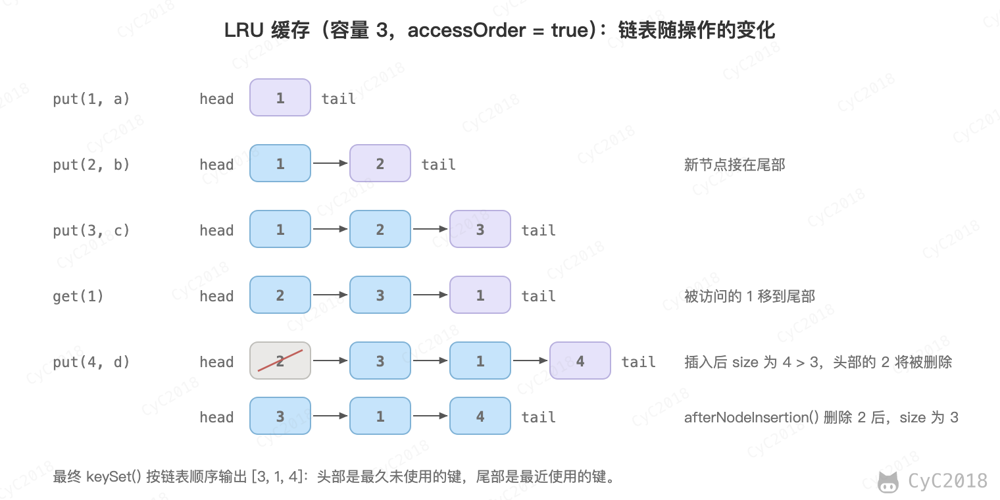 </div><br>

面试中常要求不用 LinkedHashMap，自己用 HashMap 加双向链表实现，见[缓存 · LRU](缓存.md#七lru)。

需要注意的是，accessOrder 为 true 时 get 也会移动节点，属于结构性修改，多个线程只调用 get 也会弄坏链表，而且不抛出异常：size 不变，沿链表却走不到一部分键，这些键再也不会被淘汰（JDK 21 实测，见[附录 A7](#a7-访问顺序-linkedhashmap-的并发-get)）。多线程使用时要用 Collections.synchronizedMap() 包装或者自己加锁。

### WeakHashMap

#### 存储结构

WeakHashMap 的 Entry 继承自 WeakReference，键被 WeakReference 关联，没有其它强引用时，键在之后的垃圾收集中被回收，对应的 Entry 随后从 Map 中清除。需要注意的是，值不能强引用键，否则键永远不会被回收，条目也不会被清除。

WeakHashMap 主要用来实现缓存，通过使用 WeakHashMap 来引用缓存对象，由 JVM 对这部分缓存进行回收。

```java
private static class Entry<K,V> extends WeakReference<Object> implements Map.Entry<K,V>
```

Tomcat 的 ConcurrentCache 就是这样用的：新放入和最近命中的对象放在 ConcurrentHashMap 中，它满了以后整批移入 WeakHashMap，其中没有其它强引用的键由垃圾收集器回收，实现见[进阶：ConcurrentCache](Java%20容器%20-%20进阶.md#concurrentcache)。


## 附录：实测

以下实验的环境为 Apple M1 Pro（10 核）、macOS，JDK 为 Adoptium OpenJDK 21.0.13。

### A1 ArrayList 的扩容与常见陷阱

用反射读取 elementData 的长度，运行时需要加上 --add-opens java.base/java.util=ALL-UNNAMED：

```java
Field f = ArrayList.class.getDeclaredField("elementData");
f.setAccessible(true);
ArrayList<String> list = new ArrayList<>();
for (int i = 1; i <= 23; i++) {
    list.add("e" + i);
    int cap = ((Object[]) f.get(list)).length;    // 容量变化时打印
}
```

```text
new ArrayList<>()：容量 0
添加第 1 个元素后：容量 10，size 1
添加第 11 个元素后：容量 15，size 11
添加第 16 个元素后：容量 22，size 16
添加第 23 个元素后：容量 33，size 23
```

正文中 foreach 删除元素和 Arrays.asList() 的几种用法：

```text
foreach 中 remove：ConcurrentModificationException
foreach 中删除 [a, b, c] 的 b（倒数第二个）：无异常，结果 [a, c]
Iterator.remove：[b, c]
removeIf：[b, c]
asList set：[10, 2, 3]
asList add：UnsupportedOperationException
修改数组后 list：[100, 2, 3]
Arrays.asList(int[]).size()：1
```

ArrayList 与 LinkedList 的插入：先放入 10 万个元素，再执行 list.add(list.size() / 2, i) 1 万次；另外从空列表开始执行 list.add(0, i) 10 万次：

```text
round 0: 10 万个元素中间插入 1 万次 ArrayList 51 ms，LinkedList 844 ms；头部插入 10 万次 ArrayList 445 ms，LinkedList 2 ms
round 1: 10 万个元素中间插入 1 万次 ArrayList 47 ms，LinkedList 1029 ms；头部插入 10 万次 ArrayList 441 ms，LinkedList 3 ms
round 2: 10 万个元素中间插入 1 万次 ArrayList 47 ms，LinkedList 831 ms；头部插入 10 万次 ArrayList 441 ms，LinkedList 0 ms
```

每个元素占用的内存：100 万个元素都是同一个对象，只统计容器本身，用 -XX:+UseSerialGC 运行，多次 System.gc() 后比较已用堆的大小：

```java
long b = used();                                     // used()：多次 System.gc() 后的已用堆
for (int i = 0; i < N; i++) arrayList.add(x);        // LinkedList 同样测量
long a1 = used();                                    // (a1 - b) / N 即每个元素的字节数
arrayList.trimToSize();
```

```text
ArrayList 逐个 add 4.86 字节/元素，trimToSize 后 4.00；LinkedList 24.00 字节/元素
加 -XX:-UseCompressedOops：ArrayList 9.72 / 8.00，LinkedList 40.00
```

### A2 HashMap 的并发写入

8 个线程各插入 10 万个不同的键（线程 t 插入 t × 100000 到 t × 100000 + 99999），结束后查看 size：

```java
for (int t = 0; t < 8; t++) {
    int base = t * 100_000;
    pool.submit(() -> { for (int i = 0; i < 100_000; i++) map.put(base + i, i); });
}
```

```text
HashMap size=111068  ConcurrentHashMap size=800000
HashMap size=323870  ConcurrentHashMap size=800000
HashMap size=732440  ConcurrentHashMap size=800000
```

改用守护线程，每轮最多等待 10 秒，记录没有结束的线程停在哪里。两次运行的输出（节选）：

```text
Exception in thread "putter-6" java.lang.ClassCastException: class java.util.HashMap$Node cannot be cast to class java.util.HashMap$TreeNode
	at java.base/java.util.HashMap$TreeNode.moveRootToFront(HashMap.java:1994)
	at java.base/java.util.HashMap$TreeNode.treeify(HashMap.java:2110)
	at java.base/java.util.HashMap.treeifyBin(HashMap.java:778)
run 0: size=278394 stuckThreads=0

run 0: size=263620 stuckThreads=4
  putter-4 at java.base/java.util.HashMap$TreeNode.treeify(HashMap.java:2107) / java.base/java.util.HashMap$TreeNode.split(HashMap.java:2339)
```

一个线程写、一个线程读（Apple M1 Pro，JDK 21.0.13）：键 0 事先放入，写线程放入 1～199999，读线程在写线程结束前反复 get(0)，统计返回 null 的次数：

```java
Map<Integer, Integer> map = new HashMap<>();
map.put(0, 0);
long[] nulls = new long[1], reads = new long[1];
Thread writer = new Thread(() -> {
    for (int i = 1; i < 200_000; i++) map.put(i, i);
});
Thread reader = new Thread(() -> {
    while (writer.isAlive()) {
        if (map.get(0) == null) nulls[0]++;
        reads[0]++;
    }
});
writer.start(); reader.start();   // 先启动写线程，读线程才会进入循环
writer.join(); reader.join();
```

```text
第 1 轮：get(0) 2764724 次，返回 null 19 次，写完后 get(0) = 0
第 2 轮：get(0) 322215 次，返回 null 48 次，写完后 get(0) = 0
第 3 轮：get(0) 3665665 次，返回 null 137 次，写完后 get(0) = 0
……
第 10 轮：get(0) 2844579 次，返回 null 3 次，写完后 get(0) = 0
```

10 轮返回 null 的次数为 3～153 次。

### A3 ArrayList 的并发写入

8 个线程各向同一个 ArrayList 添加 10 万个元素，捕获 add() 抛出的异常，结束后统计 size 和 null 元素的个数，共 30 轮：

```java
for (int t = 0; t < 8; t++) {
    ts[t] = new Thread(() -> {
        for (int i = 0; i < 100_000; i++) {
            try { list.add(i); } catch (Exception e) { errors.incrementAndGet(); }
        }
    });
    ts[t].start();
}
```

```text
round 0: size=155642，null 元素 5540，异常 1 次 [ArrayIndexOutOfBoundsException]
round 1: size=160142，null 元素 768，异常 0 次 []
round 2: size=295557，null 元素 40378，异常 0 次 []
……
round 19: size=584393，null 元素 0，异常 0 次 []
round 21: size=379448，null 元素 17821，异常 1 次 [ArrayIndexOutOfBoundsException]
round 24: size=373831，null 元素 5434，异常 1 次 [ArrayIndexOutOfBoundsException]
round 29: size=541149，null 元素 91379，异常 0 次 []
synchronizedList: size=800000
```

### A4 HashMap 链表转红黑树

Key 的 hashCode() 都返回 42，并实现了 Comparable。每次放入或删除后，用反射查看数组的长度和 42 号桶中头节点的类型，运行时需要加上 --add-opens java.base/java.util=ALL-UNNAMED：

```java
record Key(int id) implements Comparable<Key> {
    @Override public int hashCode() { return 42; }
    @Override public int compareTo(Key o) { return Integer.compare(id, o.id); }
}

HashMap<Key, Integer> map = new HashMap<>();
for (int i = 1; i <= 12; i++) map.put(new Key(i), i);      // 每次放入后打印
for (int i = 12; i >= 1; i--) map.remove(new Key(i));      // 每次删除后打印
```

只打印了发生变化的行：

```text
放入第 1 个键后：容量 16，桶中节点类型 Node
放入第 9 个键后：容量 32，桶中节点类型 Node
放入第 10 个键后：容量 64，桶中节点类型 Node
放入第 11 个键后：容量 64，桶中节点类型 TreeNode
删除后剩 3 个键：容量 64，桶中节点类型 Node
```

扩容拆分树：容量 64 时放入 10 个哈希值为 42 或 106 的键（各 5 个），它们都在 42 号桶中，组成红黑树；再放入其它键触发扩容，容量变为 128 后它们分到 42 和 106 两个桶，每个桶 5 个节点，都转回了链表：

```text
容量 64：42 号桶 TreeNode
扩容到 128 后：42 号桶 Node，106 号桶 Node
```

键的 hashCode() 都相同、但没有实现 Comparable 时，放入 1000 个键后查找一个不存在的键，统计 equals() 的调用次数：

```java
static long eq = 0;
static final class K {                       // 不实现 Comparable
    final int id; K(int id) { this.id = id; }
    @Override public int hashCode() { return 42; }
    @Override public boolean equals(Object o) { eq++; return o instanceof K k && k.id == id; }
}

HashMap<K, Integer> m = new HashMap<>();
for (int i = 0; i < 1000; i++) m.put(new K(i), i);
eq = 0;
m.get(new K(-1));
```

```text
不可比较的键 1000 个，查找不存在的键：equals 调用 1001 次
```

源码注释中的泊松分布概率 e<sup>-0.5</sup> × 0.5<sup>k</sup> / k!，按 k = 0～8 计算：

```text
0 0.60653066
1 0.30326533
2 0.07581633
3 0.01263606
4 0.00157951
5 0.00015795
6 0.00001316
7 0.00000094
8 0.00000006
```

### A5 HashMap 的扩容时机与 Hashtable

用反射读取 table 的长度和 threshold，运行时需要加上 --add-opens java.base/java.util=ALL-UNNAMED。依次放入 Integer 键，只打印容量变化的行；再分别用 new HashMap<>(n) 和 HashMap.newHashMap(n) 放入 n 个键，统计扩容次数：

```java
HashMap<Integer, Integer> m = new HashMap<>();
for (int i = 1; i <= 25; i++) m.put(i, i);              // 容量变化时打印

HashMap<Integer, Integer> a = new HashMap<>(1000);       // 放入 1000 个键，记录容量变化的次数
HashMap<Integer, Integer> b = HashMap.newHashMap(1000);

Hashtable<Integer, Integer> h = new Hashtable<>();
for (int i = 1; i <= 40; i++) h.put(i, i);              // 容量变化时打印
h.put(null, 1);
h.put(1, null);
```

```text
new HashMap<>()：容量 0，threshold 0
放入第 1 个键后：容量 16，threshold 12
放入第 13 个键后：容量 32，threshold 24
放入第 25 个键后：容量 64，threshold 48
放入 12 个键：new HashMap<>(12) 最终容量 16，期间扩容 0 次；HashMap.newHashMap(12) 最终容量 16，期间扩容 0 次
放入 1000 个键：new HashMap<>(1000) 最终容量 2048，期间扩容 1 次；HashMap.newHashMap(1000) 最终容量 2048，期间扩容 0 次
new Hashtable<>()：容量 11
Hashtable 放入第 9 个键后：容量 23
Hashtable 放入第 18 个键后：容量 47
Hashtable 放入第 36 个键后：容量 95
Hashtable put(null, 1)：NullPointerException
Hashtable put(1, null)：NullPointerException
HashMap 放入 null 键和 null 值：{null=v, k=null}
```

扩容时链表的拆分：放入 5、21、37、53，再放入其它桶的键直到 size 为 13，沿 table 中的 next 读出 5 号和 21 号桶：

```text
capacity 16:  [5] 5 21 37 53
capacity 32:  [5] 5 37  [21] 21 53
```

### A6 JDK 1.7 HashMap 扩容成环的模拟

下面在 JDK 21 上按 JDK 7 HashMap.transfer() 的逻辑模拟两个线程的执行顺序：A、B 的哈希值为 3 和 11，容量从 4 扩到 8 时都在 3 号桶。线程 1 执行完 next = e.next 后暂停，线程 2 完成整个扩容，线程 1 再继续：

```java
Entry e = old[3], next = e.next;            // 线程 1 读到 e、next 后暂停
transfer(old[3], t2);                       // 线程 2 完整扩容
while (e != null) {                         // 线程 1 继续，与 transfer() 的循环体相同
    int i = e.hash & 7;
    e.next = t1[i]; t1[i] = e;
    e = next; if (e != null) next = e.next;
}
```

```text
扩容前 3 号桶：B -> A -> null
线程 1 暂停：e=B，next=A
线程 2 完成：新数组 3 号桶 A -> B -> null
线程 1 第 1 步：放入 B，A.next=B，B.next=null
线程 1 第 2 步：放入 A，A.next=B，B.next=null
线程 1 第 3 步：放入 B，A.next=B，B.next=A
线程 1 的新数组 3 号桶：B -> A -> B -> A -> B -> A -> B -> A -> ...
在 3 号桶中查找不存在的键：走了 1000000 步仍未到达 null
```

### A7 访问顺序 LinkedHashMap 的并发 get

accessOrder 为 true 的 LinkedHashMap 中放入 100 个键，8 个线程各随机 get 20 万次，不做任何写入；结束后查看 size，并沿链表（keySet() 的迭代顺序）统计能走到多少个不同的键，共 10 轮：

```java
Map<Integer, Integer> m = new LinkedHashMap<>(16, 0.75f, true);
for (int i = 0; i < 100; i++) m.put(i, i);
for (int t = 0; t < 8; t++) {
    new Thread(() -> { for (int i = 0; i < 200_000; i++) m.get(r.nextInt(100)); }).start();
}
```

```text
round 0: size=100，按链表遍历到 66 个不同的键，get 抛异常 0 次
round 1: size=100，按链表遍历到 15 个不同的键，get 抛异常 0 次
round 4: size=100，按链表遍历到 1 个不同的键，get 抛异常 0 次
……
round 9: size=100，按链表遍历到 18 个不同的键，get 抛异常 0 次
synchronizedMap: size=100，链表中的键 100
```

### A8 CopyOnWriteArrayList 的迭代器

```java
List<String> cow = new CopyOnWriteArrayList<>(List.of("a", "b", "c"));
Iterator<String> it = cow.iterator();
cow.add("d");
cow.remove("a");
// 用 it 遍历；再调用 cow.iterator().remove()；在 foreach 中 add，与 ArrayList 对比
```

```text
迭代器创建后 add(d)、remove(a)，迭代器看到：[a, b, c]，列表现在：[b, c, d]
COW 迭代器 remove：UnsupportedOperationException
foreach 中 add：无异常，列表 [b, c, d, e]
ArrayList foreach 中 add：ConcurrentModificationException
```

### A9 HashMap 的可变键与遍历删除

```java
List<Integer> key = new ArrayList<>(List.of(1, 2));
Map<List<Integer>, String> m = new HashMap<>();
m.put(key, "v");
key.add(3);                                    // 修改参与 hashCode 的内容
m.get(key); m.containsKey(key); m.get(List.of(1, 2));

Map<String, Integer> h = new HashMap<>(Map.of("a", 1, "b", 2, "c", 3));
for (String k : h.keySet()) if (k.equals("a")) h.remove(k);
h.entrySet().removeIf(e -> e.getValue() >= 2);   // 在新建的 h 上执行
```

```text
修改键后 get：null，containsKey：false，size：1
用原来的内容 [1, 2] get：null
HashMap foreach 中 remove：ConcurrentModificationException
entrySet().removeIf(value >= 2)：{a=1}
```

### A10 ConcurrentHashMap 的组合操作

8 个线程同时对同一个键计数，每个线程 10 万次：

```java
c1.put("k", c1.getOrDefault("k", 0) + 1);   // 先读再写
c2.merge("k", 1, Integer::sum);             // 一次完成
m.computeIfAbsent("a", k -> m.computeIfAbsent("a", x -> 1));  // 映射函数中修改同一个 map
```

```text
get+put count=696658 merge count=800000
recursive: java.lang.IllegalStateException: Recursive update
```

### A11 HashMap 每个条目的内存

JDK 21.0.13（默认开启压缩指针和压缩类指针，对象头 12 字节），Apple M1 Pro，-Xmx2g。每一步之后多次 System.gc()，用 totalMemory - freeMemory 的差值除以条目数：

```java
import java.util.*;

public class HmMem {
    static long used() {
        for (int i = 0; i < 5; i++) System.gc();
        Runtime r = Runtime.getRuntime();
        return r.totalMemory() - r.freeMemory();
    }
    public static void main(String[] args) {
        int n = 1_000_000;
        String[] keys = new String[n];
        Long[] vals = new Long[n];
        long base = used();
        for (int i = 0; i < n; i++) keys[i] = String.format("user:%07d", i);       // 12 个字符
        long afterKeys = used();
        for (int i = 0; i < n; i++) vals[i] = 1_000_000_000L + i;                    // 不在 Long 缓存范围内
        long afterVals = used();
        Map<String, Long> map = new HashMap<>();
        for (int i = 0; i < n; i++) map.put(keys[i], vals[i]);
        long afterMap = used();
        System.out.printf("键 %.1f 字节/个，Long %.1f 字节/个，HashMap 结构 %.1f 字节/条，合计 %.1f 字节/条%n",
                (afterKeys - base) / (double) n, (afterVals - afterKeys) / (double) n,
                (afterMap - afterVals) / (double) n, (afterMap - base) / (double) n);
        System.out.println(map.size() + " " + keys.length + " " + vals.length);
    }
}
```

```text
键 56.1 字节/个，Long 24.0 字节/个，HashMap 结构 41.5 字节/条，合计 121.6 字节/条
```

运行 3 次结果相同。按对象布局计算（8 字节对齐）：String 对象 24 字节，键只有 ASCII 字符时每个字符占 1 字节（Compact Strings），内部的 byte[] 为 16 + 12 = 28、对齐到 32 字节；Long 为 12 + 8 = 20、对齐到 24 字节；Node 为 12 + 4（hash）+ 3 × 4（三个引用）= 28、对齐到 32 字节；100 万个条目时数组扩到 2²¹ 个桶，每个引用 4 字节，平均每条约 8.4 字节。理论合计约 120.4 字节，实测的 121.6 是堆用量的差值，包含少量其它对象。

## 参考资料

- Eckel B. Java 编程思想 [M]. 机械工业出版社, 2002.
- [Java Collection Framework](https://www.w3resource.com/java-tutorial/java-collections.php)
- [Iterator 模式](https://openhome.cc/Gossip/DesignPattern/IteratorPattern.htm)
- [Java 8 系列之重新认识 HashMap](https://tech.meituan.com/2016/06/24/java-hashmap.html)
- [HashMap 相关面试题及其解答](https://www.jianshu.com/p/75adf47958a7)
- [HashMap (Java SE 21)](https://docs.oracle.com/en/java/javase/21/docs/api/java.base/java/util/HashMap.html)
- [Hashtable (Java SE 21)](https://docs.oracle.com/en/java/javase/21/docs/api/java.base/java/util/Hashtable.html)
- [ConcurrentHashMap (Java SE 21)](https://docs.oracle.com/en/java/javase/21/docs/api/java.base/java/util/concurrent/ConcurrentHashMap.html)
- [JDK 21 源码：ConcurrentHashMap.java](https://github.com/openjdk/jdk21u/blob/master/src/java.base/share/classes/java/util/concurrent/ConcurrentHashMap.java)
- [Java Collection Framework – The LinkedList Class](https://javaconceptoftheday.com/java-collection-framework-linkedlist-class/)
- [JDK 21 源码：HashMap.java](https://github.com/openjdk/jdk21u/blob/master/src/java.base/share/classes/java/util/HashMap.java)
- [JDK 21 源码：ArrayList.java](https://github.com/openjdk/jdk21u/blob/master/src/java.base/share/classes/java/util/ArrayList.java)
- [JDK 21 源码：ThreadLocal.java](https://github.com/openjdk/jdk21u/blob/master/src/java.base/share/classes/java/lang/ThreadLocal.java)
- [JDK 8 源码 java.util](https://github.com/openjdk/jdk8u/tree/master/jdk/src/share/classes/java/util)
- [JDK 7u 源码：HashMap.java](https://github.com/openjdk/jdk7u/blob/master/jdk/src/share/classes/java/util/HashMap.java)
- [LinkedHashMap (Java SE 21)](https://docs.oracle.com/en/java/javase/21/docs/api/java.base/java/util/LinkedHashMap.html)
- [WeakHashMap (Java SE 21)](https://docs.oracle.com/en/java/javase/21/docs/api/java.base/java/util/WeakHashMap.html)
- [CopyOnWriteArrayList (Java SE 21)](https://docs.oracle.com/en/java/javase/21/docs/api/java.base/java/util/concurrent/CopyOnWriteArrayList.html)
- [Java SE 21 API: Arrays.asList](https://docs.oracle.com/en/java/javase/21/docs/api/java.base/java/util/Arrays.html#asList(T...))
- [Java SE 21 API: ArrayDeque](https://docs.oracle.com/en/java/javase/21/docs/api/java.base/java/util/ArrayDeque.html)
